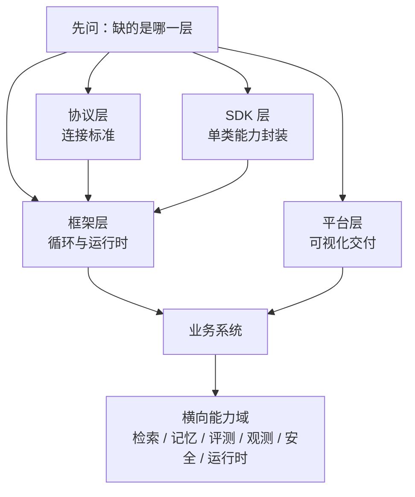
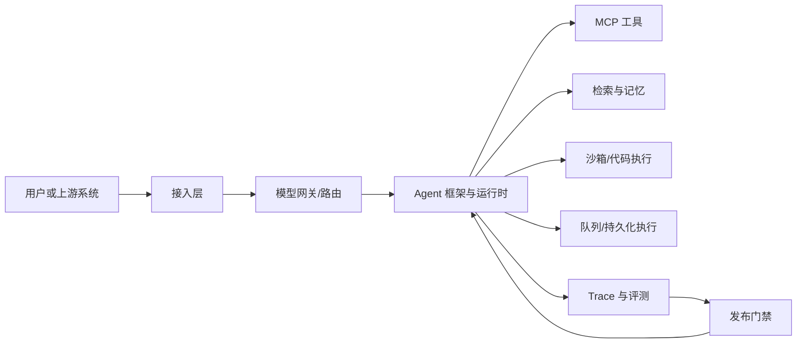

# 附录 B 主流框架与工具速查表


本附录是查阅型材料，不是排行榜。它按“协议—SDK—框架—平台”四层定位工具，再按能力域给出候选。所有能力、接口与部署方式都在快速变化，具体细节请以官方文档为准；表中不提供价格、版本号和基准分数，也不构成对任何产品的官方评价。


## 本章导读

选型会上，一张功能对比表常常让所有人更困惑：LangGraph、Dify、MCP、LiteLLM 被放进同一列比较，仿佛它们解决同一个问题。本附录先帮你判断“缺的是哪一层”，再按能力域查候选，最后用一次小规模 spike 做决定。

⭐ 查阅型 ｜ 适合：工程师、技术负责人、产品经理

## 学习目标

读完本附录你将能够：

- 判断一个工具属于协议、SDK、框架还是平台，避免跨层比较
- 用统一维度比较主流代码框架与低代码平台的定位、代价与退出成本
- 按行动、知识、质量、运行四类能力域，快速找到候选工具
- 把硬约束映射为候选清单，并设计一次带故障注入的 spike
- 用 Atlas 现有接口记录选型依据，而不是只留下会议纪要

## B.1 先定位：你在选哪一层

选型的第一步不是打开功能清单，而是回答三个问题：

1. **你缺的是连接标准、调用封装、编排运行时，还是可视化交付？**
2. **哪些条件是硬约束，缺了就淘汰？**
3. **如果明天要换掉它，你需要改多少代码、迁多少状态？**

这三个问题对应四个层次。四层可以同时出现在一个系统里，但不能互相替代。

| 层 | 它回答的问题 | 代表 | 适合先看它的信号 | 选错的典型症状 |
|---|---|---|---|---|
| 协议 | 两个东西怎么连接、怎么交换数据 | MCP、A2A、OpenAPI、JSON Schema、OpenTelemetry GenAI | 工具或 Agent 要跨团队、跨厂商复用 | 把协议当编排器，仍然要自己写循环 |
| SDK | 一类能力怎么调用 | 模型 SDK、工具 SDK、浏览器 SDK | 只想封装调用，不想接管生命周期 | 每个调用点重复写胶水代码 |
| 框架 | 循环、状态、编排与恢复怎么跑 | LangGraph、OpenAI Agents SDK、Claude Agent SDK、Google ADK、CrewAI | 任务多步、长时运行、需要中断恢复 | 简单问题被复杂抽象包住，升级要改全身 |
| 平台 | 怎么最快交付并持续运营 | Dify、Coze | 业务边界清晰，业务人员要参与维护 | 深度定制撞上平台能力上限 |



一个常见的误判，是把“工具数量”当成“框架能力”。模型能调用十个工具，不等于系统能可靠完成十步任务；后者取决于循环、状态、错误恢复、预算与验证，属于框架和运行时层。反过来，框架再强，也不能替你决定工具描述是否清楚、权限是否最小。

另一个误判，是把“开源”当成“可控”。开源意味着你可以修改和自托管，但也意味着升级、漏洞、运维和合规责任由你承担。可控性来自数据可导出、接口可替换、状态可迁移，而不只来自许可证。

## B.2 协议与接口标准

先区分四种容易混淆的“接口”：

- **原生函数调用（Function Calling）**是模型输出工具名与参数的一种格式，不是连接协议。
- **MCP（Model Context Protocol）**连接 Agent 运行时与工具、资源、提示模板。
- **A2A（Agent2Agent）**连接 Agent 与远程 Agent，表达任务委派与产物交换。
- **OpenAPI**描述 HTTP 接口，适合把已有服务暴露成工具，但不负责 Agent 编排。

| 标准 | 连接对象 | 核心对象 | 适合 | 注意 |
|---|---|---|---|---|
| MCP | Agent 运行时 ↔ 工具/资源/提示 | 主机、客户端、服务器；tools、resources、prompts；JSON-RPC 2.0 | 多工具复用、跨宿主接入、统一权限边界 | MCP 服务器是不可信边界；工具结果可能含间接注入 |
| A2A | Agent ↔ 远程 Agent | Agent Card、Task、Message/Part、Artifact；任务状态机 | 跨框架、跨厂商、跨组织的任务委派 | “不透明”只表示不暴露内部实现，不表示可信 |
| OpenAPI | Agent/服务 ↔ HTTP API | 路径、操作、请求与响应 schema | 已有 REST 服务快速变成工具 | 过大的 schema 会挤占上下文；鉴权仍需运行时处理 |
| JSON Schema | 结构化数据的契约 | 类型、属性、必填、枚举、额外字段约束 | 工具参数、结构化输出、配置校验 | 约束越宽，模型越容易填错；校验不能替代语义检查 |
| OpenTelemetry GenAI | Agent ↔ 观测后端 | Trace、Span、attributes | 跨语言、跨后端的模型与工具追踪 | 语义约定仍在演进，部分字段属于实验性内容 |
| AG-UI（新兴，Agent-User Interaction Protocol） | Agent ↔ 前端 | 事件流与状态同步 | 需要把 Agent 进度、工具调用与中断呈现给用户 | 生态与实现仍在变化；接入前先确认后端支持程度 |

再强调一次分工：**MCP 是纵向的“Agent—工具”连接，A2A 是横向的“Agent—Agent”连接。** 一个远程 Agent 可以在内部使用多个 MCP 服务器，对外只暴露 A2A 的任务接口；客户端看到的是能力声明与任务状态，看不到内部工具。


MCP 与 A2A 的规范、传输方式、状态集合与字段名都可能变化。截至写作时，部分实现只支持规范的子集。接入前请确认：支持哪些传输、是否支持流式、工具结果如何限长、认证与授权如何表达、错误如何分类。


## B.3 模型接入与网关

模型接入通常有三条路线：直连供应商 API、使用兼容 OpenAI 协议的自托管端点、在中间加一层网关。三条路线可以组合，但每加一层都会增加延迟、配置复杂度和观测需求。

| 入口 | 典型能力 | 适合 | 注意 |
|---|---|---|---|
| OpenAI API | 原生工具调用、结构化输出、内置工具、会话状态接口 | 生态成熟、需要快速接入 | 接口形态演进快；锁定在具体 API 而非模型名 |
| Anthropic Messages API | 工具使用、提示缓存、Computer Use、长上下文 | Claude 生态、编码与文件操作 | 模型与工具能力绑定较深；换供应商需改适配层 |
| Google Gemini API / Vertex AI | 函数调用、长上下文、检索 grounding | Google Cloud 体系、多模态任务 | 区域、配额与部署形态需提前确认 |
| OpenAI 兼容端点 | 用统一协议暴露开源模型 | 自托管、合规、成本控制 | 工具调用、结构化输出与流式行为因实现而异 |
| 模型网关 | 统一接口、路由、回退、密钥与配额管理 | 多供应商、容灾、成本优化 | 多一跳；必须记录“这次请求实际走了哪个模型” |

模型接入至少要在选型表里回答四个问题：是否支持原生工具调用；结构化输出是提示层还是约束解码；上下文窗口与有效上下文差多少；提示缓存（Prompt Caching）如何计价、命中条件是什么。第 3 章与第 18 章给出了判断方法，这里不再展开。

## B.4 代码框架

下表只描述稳定定位与核心抽象，不比较“谁更强”。同一个框架在不同团队、不同运维体系里的实际成本可能完全不同。

| 框架 | 核心抽象 | 控制粒度 | 状态与恢复 | 多 Agent | 模型绑定 | 适合 | 主要代价 |
|---|---|---|---|---|---|---|---|
| 不用框架 | 自己的循环与类型 | 最高 | 自己实现 | 自己实现 | 完全自主 | 学习、极小项目、强控制需求 | 开发与维护成本 |
| LangGraph | 状态图、检查点、中断 | 高 | 强，支持持久化与恢复 | 图与子图 | 开放 | 长任务、显式状态、人工介入 | 状态与图需自行设计 |
| OpenAI Agents SDK | Agent、Handoff、Guardrail、Session、Tracing | 中 | 基础会话 | 交接式 | 较开放 | 轻量多 Agent、交接流程 | 复杂状态与长任务需自补 |
| Claude Agent SDK | Agent 循环、子 Agent、钩子、会话、工具权限 | 中高 | 会话 | 子 Agent | 偏 Claude | 编码、文件操作、工具治理 | 生态绑定较深 |
| Google ADK | LLM Agent、工作流 Agent、工具、会话与记忆、评测 | 中高 | 会话与记忆 | 顺序/并行/循环 | 较开放 | GCP 体系、多语言团队 | 云外部署需额外工作 |
| CrewAI | Agent、Task、Crew、Flow | 中 | 基础 | 角色团队 | 开放 | 角色分工明确的快速搭建 | 复杂控制流要退回 Flow |
| Microsoft Agent Framework | Agent、工作流、内置编排模式 | 中高 | 工作流 | 多种内置模式 | 较开放 | .NET/Azure、企业集成 | 生态较新，版本需关注 |
| Pydantic AI | 类型安全 Agent、依赖注入、结构化输出 | 中高 | 需自补 | 可组合，需自建 | 开放 | Python 强类型项目 | 长任务与多 Agent 需自行设计 |
| LlamaIndex | 数据连接器、索引、检索、Workflow | 中 | 依赖集成 | 可组合 | 开放 | 数据与 RAG 为主 | 抽象层多，升级需评估 |
| smolagents | CodeAgent、工具调用 Agent、可替换执行器 | 中 | 基础 | 支持，较简 | 开放 | 代码动作研究、教学实验 | 执行器安全与生产化需自建 |

### B.4.1 一句话判断

| 你的首要需求 | 先看 | 原因 |
|---|---|---|
| 显式状态图、长任务恢复、人工介入 | LangGraph | 检查点与中断是一等能力，图和状态由你掌握 |
| 轻量交接式多 Agent | OpenAI Agents SDK | Handoff 原语贴近问题，追踪开箱即用 |
| Claude 生态、编码与文件工具治理 | Claude Agent SDK | Agent 循环、子 Agent、钩子与权限控制集成度高 |
| GCP 体系、多语言、工作流 Agent | Google ADK | LLM Agent 与确定性工作流可以组合 |
| 角色团队快速搭原型 | CrewAI | 角色、任务、团队的隐喻直观 |
| .NET/Azure、企业编排 | Microsoft Agent Framework | 工作流与企业集成是重点 |
| 强类型、结构化输出、依赖注入 | Pydantic AI | 类型约束贯穿开发体验 |
| 数据接入与 RAG 为主 | LlamaIndex | 连接器、索引与检索积累深 |
| 代码动作、研究实验 | smolagents | 动作格式与执行器可替换，便于对比 |
| 最小依赖、教学、完全可控 | 不用框架 | 看清循环、工具、上下文与停止条件的最小实现 |

这张表只用于缩小范围。最终选择仍要靠 spike：同一组任务、同一组工具、同一份预算，比较完成质量、失败可诊断性和退出时你要改多少代码。框架不是架构；状态放在哪、边界怎么划、失败如何隔离，不会因为换了框架就自动解决。

## B.5 低代码平台

低代码平台的核心价值是把模型、工具、知识库、发布渠道和运营界面打包，用控制力换交付速度。它适合业务边界清晰、需要快速上线和持续运营的场景。

| 平台 | 形态 | 核心抽象 | 适合 | 边界 |
|---|---|---|---|---|
| Dify | 开源、可自托管，也提供托管服务 | 可视化工作流、RAG 管线、Agent、插件、模型管理、可观测性、Service API | 知识库问答、内容处理、流程辅助 | 深度运行时定制、复杂状态恢复受平台能力限制 |
| Coze | 托管为主，另有开源 Studio | Bot、插件、工作流、知识库、多渠道发布 | 快速验证、轻量运营、渠道分发 | 私有化、可移植性与深度控制需单独评估 |

评估低代码平台时，固定检查五件事：

1. **数据能否导出**：知识库、会话、运行记录是否能完整导出。
2. **API 能否被外部系统稳定调用**：鉴权、限流、幂等、错误语义是否清楚。
3. **权限与审计能否细化到操作级**：谁在什么时候改了什么、发布了什么。
4. **失败能否拿到可诊断的日志**：是否能看到每步输入、工具结果与错误分类。
5. **最坏情况下能否迁移**：工作流、提示词、知识库与插件能否重建。

前四项决定它能不能用，最后一项决定你敢不敢用。低代码不是“不能上生产”，而是“生产边界由平台决定”；当需求落在平台能力范围内，它的交付效率很高，超出边界时，平台边界就会变成产品边界。

## B.6 按能力域选工具

框架解决“怎么编排”，工具解决“能做什么”。下面按四类能力域组织：行动、知识、质量、运行。每张表只给候选与边界，不替代试用。

### B.6.1 行动：搜索、浏览与执行

| 类别 | 代表项目 | 解决什么 | 主要边界 |
|---|---|---|---|
| 搜索 API | Tavily、Exa、Brave Search API、Serper | 把查询变成结果列表与摘要 | 按查询计费、限流、结果质量与来源条款 |
| 抓取与解析 | Firecrawl、Jina Reader、Playwright | 把网页变成 Markdown、DOM 或截图 | JS 渲染、反爬、内容不可信 |
| 浏览器自动化 | Playwright、Puppeteer、browser-use、Stagehand | 点击、填表、导航与页面断言 | 选择器漂移、登录态、速度与稳定性 |
| Computer Use | Anthropic Computer Use、OpenAI computer-use 类接口 | 用截图与鼠标键盘操作桌面或浏览器 | 通常较慢、易受界面变化影响，权限大，必须在隔离环境运行 |
| 代码执行 | Docker、gVisor、Firecracker、E2B、Daytona、Modal、Pyodide | 隔离运行模型生成的代码 | 冷启动、网络出口、持久化与资源上限 |
| 编码 Agent | Claude Code、Codex、Cursor、Aider | 仓库级读取、搜索、修改、运行与验证 | 不是普通库；供应商与工作流绑定较深 |
| 浏览器 MCP | Playwright MCP | 把浏览器能力标准化成 MCP 工具 | 与浏览器自动化相同的安全与稳定性问题 |

选行动工具时，先问“失败能不能被观察到”。搜索失败是空结果还是超时？浏览器失败是选择器失效还是页面未加载？代码执行失败是语法错误还是超时？工具返回的错误分类，决定了 Agent 能不能改道，也决定了你能不能定位问题。

### B.6.2 知识：检索、记忆与重排

| 类别 | 代表项目 | 解决什么 | 主要边界 |
|---|---|---|---|
| 词法检索 | Elasticsearch、OpenSearch（BM25） | 精确词、代码、编号、专有名词召回 | 运维成本、中文分词、相关性调参 |
| 向量库 | pgvector、Qdrant、Weaviate、Milvus、Chroma、Pinecone、LanceDB、FAISS | 语义召回与相似度检索 | 过滤、混合检索、持久化与运维差异大 |
| 嵌入模型 | OpenAI Embeddings、Voyage AI、Cohere Embed、BGE、Jina Embeddings | 把文本映射为向量 | 语言与领域适配、成本、版本锁定 |
| 重排模型 | Cohere Rerank、BGE Reranker、Jina Reranker | 对候选片段做精排 | 延迟与成本；只能重排已召回的候选 |
| 文档解析 | Unstructured、Apache Tika、LlamaParse、Firecrawl | 把 PDF、HTML、Office 转成可用文本 | 版式、表格与脚注容易丢失 |
| 记忆层 | Redis、PostgreSQL、向量库 + 结构化库、Mem0、Zep | 跨会话保存事实、偏好与经验 | 写入治理、作用域隔离、记忆投毒 |
| RAG 编排 | LlamaIndex、LangChain、Haystack | 连接器、索引、检索与生成管线 | 抽象税、版本升级、调试链路变长 |

两个提醒。第一，**向量只是索引方式，不是记忆类型**；情景、语义、程序与偏好记忆的治理方式不同，不能都塞进一个向量集合。第二，**混合检索通常比单一检索稳**：BM25 保住精确词，向量补语义改写，再用 RRF 一类方法融合名次，最后按预算决定是否重排。

### B.6.3 质量：评测与可观测

先看基准。基准衡量的是基准作者定义的能力，不是你的产品需求。

| 基准 | 衡量什么 | 适合回答 | 盲区 |
|---|---|---|---|
| SWE-bench | 真实仓库 issue → 补丁 → 测试 | 编码 Agent 的定位、修改与验证能力 | 脚手架差异大；通过测试不等于可维护 |
| GAIA | 需要浏览、工具与多步推理的现实问题 | 通用助手能否组合工具解决开放问题 | 静态题目、答案匹配严格、可能被污染 |
| τ-bench | 带模拟用户与领域工具的多轮任务 | 业务规则遵守与 pass^k 可靠性 | 领域有限，模拟用户与真实用户有差距 |
| WebArena | 自托管网站上的网页任务 | 浏览器 Agent 的端到端完成能力 | 环境漂移、网站改版会让结果不可比 |
| OSWorld | 桌面操作系统任务 | Computer Use 的观察、定位与操作能力 | 慢、贵、环境复现成本高 |
| BFCL | 函数选择与参数生成 | 工具调用这一项能力 | 不是端到端任务评测 |

再看工具链：

| 类别 | 代表项目 | 解决什么 | 主要边界 |
|---|---|---|---|
| 评测框架 | Inspect AI、promptfoo、DeepEval、RAGAS、OpenAI Evals | 组织任务、运行模型、定义评分器 | 评分器设计与校准仍需自己负责 |
| 实验与数据集平台 | LangSmith、Braintrust、Arize Phoenix | 数据集、实验对比、回归与人工复核 | 平台锁定；导出与权限要提前确认 |
| 追踪与可观测 | Langfuse、Arize Phoenix、W&B Weave、Helicone、MLflow Tracing | Trace 采集、检索、成本与延迟分析 | 采样会改变指标分母；隐私与保留期要定义 |
| 开放标准 | OpenTelemetry GenAI、OpenInference | 统一 Span 与属性，便于换后端 | 语义约定仍在演进，不要硬编码未确认字段 |

评测工具不能替代评测设计。先定义“什么算成功”，再选工具；否则只是把错误的指标做得更漂亮。第 15 章的分层门禁与第 16 章的 Trace 模型，是选工具前的设计基线。

### B.6.4 运行：网关、队列、沙箱与安全

| 类别 | 代表项目 | 解决什么 | 主要边界 |
|---|---|---|---|
| AI 网关 | LiteLLM、OpenRouter、Portkey | 统一模型接口、路由、回退、密钥与配额 | 多一跳；必须记录实际模型与用量 |
| 推理服务 | vLLM、SGLang、Ollama、TGI | 自托管模型推理与并发调度 | GPU 运维、冷启动、版本与量化差异 |
| 持久化执行 | Temporal、Inngest、Restate | 长任务检查点、恢复与定时等待 | 步骤边界仍需幂等；外部副作用要协调 |
| 任务队列与消息流 | Celery、Redis、SQS、RabbitMQ、Kafka | 异步任务、削峰、worker 扩缩容 | 至少一次投递会重复；可见性超时要设计 |
| 沙箱 | Docker、gVisor、Firecracker、E2B、Daytona、Modal | 隔离不可信代码与浏览器操作 | 逃逸面、网络出口、冷启动与成本 |
| 护栏 | NeMo Guardrails、Guardrails AI、Llama Guard、Azure AI Content Safety、Lakera Guard | 输入输出过滤、敏感内容与注入检测 | 误拒与漏放并存；不能单独充当安全边界 |
| 密钥与身份 | Vault、云 KMS、OAuth/OIDC | 凭据签发、轮换与最小权限 | 长任务要短期凭据；不要把密钥放进提示词 |

运行时工具的选择，取决于任务的时间跨度与副作用。分钟级、失败可重跑的任务，普通队列就够；小时级、需要人工审批的任务，才需要持久化执行。不要为了“看起来生产级”引入一整套分布式基础设施，也不要让长任务跑在一个 HTTP 请求里。

## B.7 三套参考组合

下面的组合是起点，不是标准答案。每套都标出“为什么选”和“必须验证什么”。




| 层 | 选择 | 理由 |
|---|---|---|
| 模型 | 托管 API | 不承担推理运维，先验证任务价值 |
| 编排 | 不用框架，或轻量 Agents SDK | 代码少，问题暴露得快 |
| 行动 | 搜索 API + 抓取 + 只读文件工具 | 先覆盖信息获取，避免副作用 |
| 知识 | 本地目录 + BM25 或小规模向量库 | 数据量小，混合检索的收益有限 |
| 观测 | JSONL 或轻量追踪 | 能复盘每一步即可 |
| 评测 | 20–30 条手工任务 + 脚本评分 | 先建立基线，再谈优化 |
| 安全 | 只读工具、无外网写操作 | 把风险挡在演示之外 |




| 层 | 选择 | 理由 |
|---|---|---|
| 模型 | 多供应商 + 网关路由 | 容灾、成本与合规需要备选 |
| 编排 | LangGraph、ADK 或 Microsoft Agent Framework | 长任务、中断恢复与人工介入 |
| 行动 | MCP 工具 + 搜索/抓取 + 沙箱代码执行 | 工具复用与最小权限 |
| 知识 | 混合检索 + 重排 + 证据台账 | 引用可追溯，降低召回噪声 |
| 上下文 | 预算、压缩与渐进式披露 | 控制成本与上下文腐化 |
| 运行时 | 持久化执行 + 队列 + 限流 | 跨进程恢复与尾延迟控制 |
| 观测 | OTel 导出 + 追踪平台 | 跨后端、可回放、可告警 |
| 评测 | 固定任务集 + 回归门禁 + 安全切片 | 发布前拦截退化 |
| 安全 | 护栏 + 审批 + 审计 + 出网控制 | 纵深防御，而不是单点过滤 |




| 层 | 选择 | 理由 |
|---|---|---|
| 模型 | 强编码模型，固定版本 | 行为可复现，避免静默升级 |
| 编排 | Claude Agent SDK、Codex 或自建循环 | 需要细粒度工具与权限控制 |
| 行动 | 读、搜、改、跑、git | 行动空间围绕仓库 |
| 执行 | 容器或 microVM 沙箱 | 命令与依赖不可信 |
| 验证 | 编译、测试、类型检查、lint | 可执行反馈是主要传感器 |
| 审批 | 危险命令与出网操作前置确认 | 不可逆动作需要人把关 |
| 观测 | 每次运行一条 Trace | 支持回放与失败分诊 |
| 评测 | SWE-bench 子集 + 自有仓库任务 | 公开基准与真实需求都要覆盖 |






## B.8 选型速查：从硬约束到候选

把需求写成硬约束与偏好，再查下表。候选顺序不等于推荐顺序；每一行都必须用 spike 验证。

| 硬约束或场景 | 优先候选 | 必须验证 |
|---|---|---|
| 必须自托管、支持开放模型 | LangGraph、Google ADK、Microsoft Agent Framework、自建、Dify | 模型兼容、部署形态、许可证 |
| 长任务、中断恢复、人工审批 | LangGraph、Microsoft Agent Framework、Temporal + 任一框架 | 恢复后是否重复执行副作用 |
| 轻量交接式多 Agent | OpenAI Agents SDK、Microsoft Agent Framework | 交接循环、终止条件、追踪完整性 |
| 角色团队快速搭建 | CrewAI | 复杂控制流是否要退回 Flow 或自定义代码 |
| 编码、文件操作、工具权限 | Claude Agent SDK、自建 + 沙箱 | 测试质量、命令审批、沙箱逃逸面 |
| 业务人员快速原型 | Dify、Coze | 数据导出、API、审计、迁移路径 |
| 数据与 RAG 为主 | LlamaIndex、Haystack、Dify | 召回率、引用支持率、增量索引 |
| 强类型结构化输出 | Pydantic AI、模型原生结构化输出 | schema 约束程度、失败可恢复性 |
| MCP 工具生态 | 支持 MCP 客户端的框架 | 传输、超时、权限、结果限长 |
| 低延迟、高并发 | 自建循环 + vLLM/SGLang + 网关 | p95 延迟、并发上限、成本曲线 |

<details>
<summary>做一次 2 小时 spike 的步骤</summary>

1. **定任务**：选 5–10 条真实任务，覆盖简单、正常、困难三类，明确成功标准。
2. **定工具与预算**：两个候选使用同一组工具、同一模型、同一预算，避免比较失真。
3. **跑顺利路径**：记录成功率、平均与 p95 延迟、令牌与费用、失败类型。
4. **注入一次故障**：让工具超时、返回错误，或让进程在中途重启；观察恢复与诊断。
5. **量退出成本**：统计业务代码里有多少处 import 了框架类型，状态与追踪能否导出。
6. **写结论**：给出“继续、换候选、自建”的决策，并记录未验证的假设。

没有经过故障注入的 spike，只证明了顺利路径可用。一次合格的验证，还要能回答“失败时我从哪里开始查”。

</details>

## B.9 动手实践：把速查表变成可复现的选型记录

Atlas v0.11.0 已经提供了框架画像与选型函数。下面的脚本复用第 11 章的画像，把“硬约束 → 候选”的过程变成可复现的输出，而不是会议上的口头判断。

```bash
PYTHONPATH=src:. python3 - <<'PY'
from atlas import Requirements, select_frameworks
from examples.ch11_frameworks import profiles

req = Requirements(
    required=frozenset({"mcp", "evaluation"}),
    preferred=frozenset({"tracing"}),
    must_self_host=True,
    min_maturity="stable",
)

for choice in select_frameworks(profiles(), req):
    print(f"{choice.profile.name:28} {choice.score:>5} {choice.reasons}")
PY
```

输出会列出通过硬约束的候选、分数与命中理由。请注意它的边界：分数只用于粗排，画像靠人工维护，且不包含价格与真实性能。正确的用法是把它当作“候选生成器”，再用 B.8 的 spike 补齐质量、延迟、可诊断性与迁移成本。

如果你要评估的不只是框架，还可以把工具写成“工具卡”，至少包含八个字段：名称与版本、输入输出 schema、权限与副作用、失败模式、超时与重试、费用与延迟、替代方案、退出方式。工具卡比功能清单更能暴露真实成本。

## B.10 业界案例：Dify 把工具链打包成平台

Dify 是一个有代表性的低代码平台：它把模型管理、可视化工作流、RAG 管线、Agent、插件、可观测性与 Service API 放进同一个界面，并支持自托管。对业务团队来说，这意味着不必分别采购和拼接模型客户端、向量库、编排框架与运营后台。

它的设计有三个值得借鉴的点。

**第一，用统一抽象降低组合成本。** 工作流节点、知识库、插件与 Agent 被放在同一套可视化模型里，业务人员可以组合出问答、内容处理与流程辅助应用。代价是运行时语义被平台隐藏：你看到的是节点与连线，看不到检查点、并发、重试和上下文预算的实现细节。

**第二，把自托管与 Service API 当作退出通道。** 平台能否被外部系统稳定调用、数据能否导出、权限与审计能否细化，决定了它是“工具”还是“牢笼”。选型时不要只看拖拽体验，要看最坏情况下能否迁移。

**第三，生产边界由运行时决定。** 低代码能覆盖的业务，交付效率很高；一旦需要复杂状态恢复、自定义沙箱、细粒度并发控制或深度调试，平台边界就会变成产品边界。此时合理的做法不是硬拗平台，而是把关键流程拆出来，用代码实现，再通过 API 与平台协作。


截至写作时，Dify 与 Coze 的功能、许可、部署方式与开源范围都在变化。上述分析只描述其产品定位与设计取舍，具体能力请以官方文档为准。


## B.11 常见误区

**误区一：把速查表当排行榜。** 表里的顺序只表示“在你的约束下通过筛选”，不表示客观质量。同一张表换一组硬约束，候选就会变。

**误区二：先选框架，再定运行时需求。** 正确顺序是先回答“任务多长、能否中断、是否需要人工审批、失败能否重跑”，再看框架能不能提供对应语义。运行时需求决定候选范围，而不是反过来。

**误区三：工具越多，Agent 越强。** 工具数量增加会放大选择错误、参数错误与权限风险。先把少量工具的描述、schema、错误分类做好，再考虑扩展。

**误区四：开源或自托管就等于可控。** 可控性来自数据可导出、接口可替换、状态可迁移，以及团队能维护。开源只是把运维与安全责任交回给你。

**误区五：评测与可观测可以最后再接。** 等到上线后再补 Trace，往往发现关键决策点没有记录；等到出问题再补评测，往往发现没有可复现的任务集。两者都应该在第一个可用版本就介入。

## B.12 本章小结

- 先定位层次：协议解决连接，SDK 解决调用，框架解决循环与运行时，平台解决交付与运营；不要跨层比较。
- MCP 连接 Agent 与工具，A2A 连接 Agent 与 Agent，OpenAPI 描述 HTTP 接口，OpenTelemetry 负责观测；它们互补，不互相替代。
- 代码框架的差异主要在控制粒度、状态与恢复、多 Agent 形态与模型绑定；选型本质上是选运行时语义。
- 低代码平台用控制力换交付速度；数据导出、API、审计与迁移路径决定它的生产边界。
- 工具按行动、知识、质量、运行四类组织；每类都要看失败模式、权限、成本与可观测性，而不只看功能。
- 硬约束先过滤，偏好再排序，最后用带故障注入的 spike 验证质量、诊断性与退出成本。
- 速查表的终点不是“选哪个”，而是一份可复现的选型记录：任务集、候选、验证结果与未验证假设。

## B.13 思考与练习

1. **需求矩阵**：为“企业内部合同审查助手”写一份选型需求，区分硬约束与偏好，用 B.8 的表缩小到两个候选，并设计一次包含故障注入的 spike。说明你还缺哪些信息才能做最终决定。

2. **工具卡对比**：从 B.6 中选一类工具（搜索、浏览器、向量库或沙箱），为两个候选各写一张工具卡。用 10 条真实任务做小规模对比，记录成功率、p95 延迟、单次成本与主要失败类型。

3. **扩展画像**：为 `FrameworkProfile` 增加一个你关心的能力维度（例如“是否支持流式事件”或“是否支持本地部署”），更新画像与排序逻辑，并写一个测试验证它能改变候选顺序。再解释：为什么这个维度应该是硬约束还是偏好。
