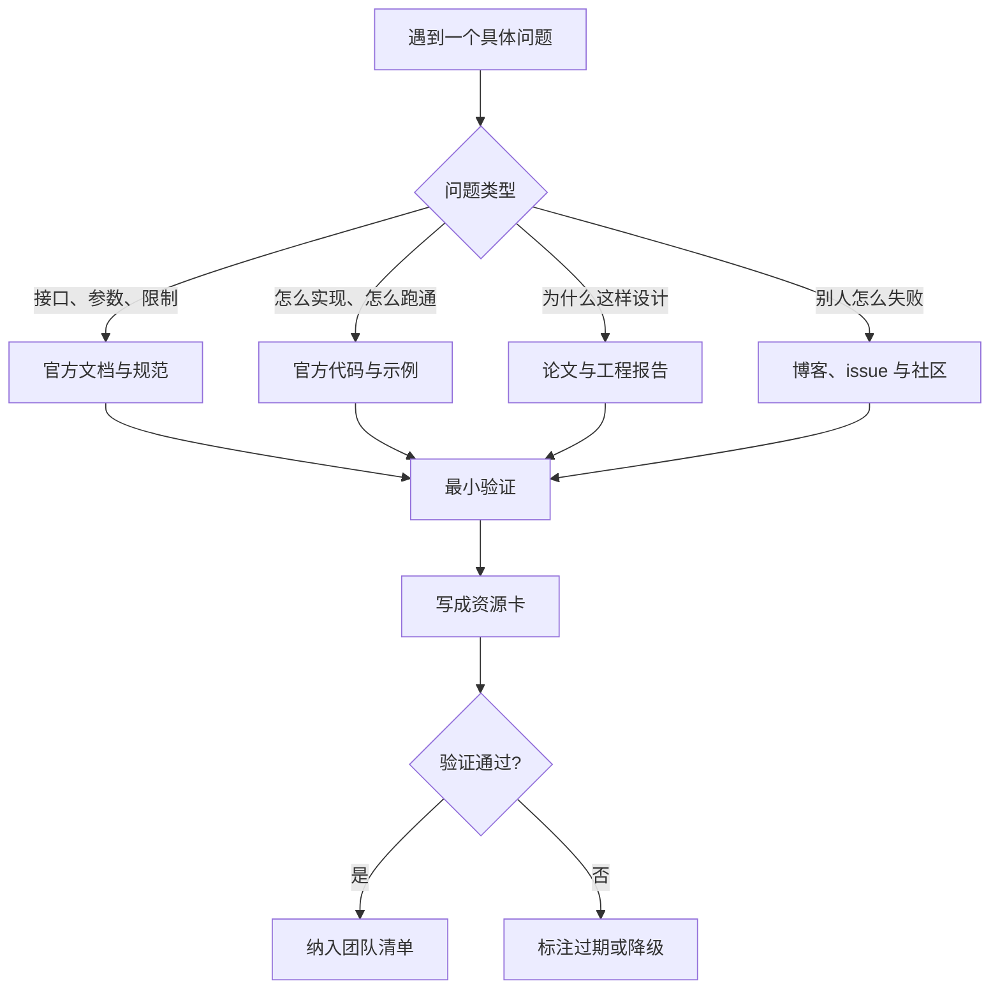

# 附录 D 参考资源与延伸阅读


本附录不是链接大全，而是一份按用途组织的资源索引。选入标准是：能回答一个具体工程问题、有明确的一手来源、可被验证。具体链接、版本号、价格与产品能力变化很快，本附录只给资源名称、官方入口的检索方式与判断标准；使用前请以官方文档为准。


## 本章导读

学 Agent 最费时间的，往往不是读不懂概念，而是找到可信、当前、够用的资料。搜索引擎会给出一堆二手总结，官方文档又散落在多个站点。本附录按“先一手、再代码、后社区”的顺序组织资源，并给出一张资源卡，帮你判断一份资料什么时候该被替换。

⭐ 入门到进阶 ｜ 适合：工程师、产品经理、研究者

## 学习目标

读完本附录你将能够：

- 按用途找到 Agent 开发所需的一手文档、代码、论文与评测资源
- 区分官方文档、工程博客、二手教程与社区讨论的可信边界
- 用资源卡记录来源、版本、验证日期与替代方案
- 为入门、做项目、跟进前沿三种场景组合不同的资源路径
- 识别过期、营销化与不可复现的资源，避免把资料当结论

## D.1 怎么用这份清单

资源大致分四类，价值和风险都不同：

| 类型 | 回答的问题 | 更新速度 | 典型用法 | 主要风险 | 对应 Atlas 层 |
|---|---|---|---|---|---|
| 官方文档与规范 | 接口是什么、参数怎么填、边界在哪 | 快 | 查语法、确认能力、对照版本 | 版本漂移、实验性字段变化 | 模型、工具 |
| 官方代码与示例 | 最小可运行路径是什么 | 中 | 跑通 quickstart、读核心循环 | 示例简化、依赖较重 | 工具、循环 |
| 论文与基准 | 为什么这样设计、如何衡量 | 慢 | 建立判断、设计评测 | 实验条件与生产不同 | 上下文、循环 |
| 博客与社区 | 别人怎么用、踩过什么坑 | 很快 | 补盲区、找失败模式 | 营销、过时、个体经验 | 全部 |

评估一份资源，可以看四个维度：一手性（是否来自作者或官方）、时效性（版本与日期是否明确）、可验证性（能否用代码或实验核对）、迁移成本（换成别的模型或框架时是否要重写）。四个维度都弱的资源，只适合当线索。

一张资源地图可以避免“遇到问题就搜”的随机性：



同一份清单，不同目标的使用方式不同：



先读一本系统教程或官方 quickstart，跑通一个最小 Agent；再用附录 C 的 3–5 篇核心论文建立概念。此阶段不要同时追十个框架，先把“模型—工具—循环—观察”跑通。



以官方文档和代码为主：先确认模型与工具接口，再读框架的运行时、状态与追踪文档，最后用基准或自建评测集验证。博客只用来找失败模式，不作为接口依据。



以论文、官方工程报告和规范变更为主，配合会议与实验室博客。每读一篇，写清它改变了哪个假设、影响了哪一层，不要只收集标题。



<details>
<summary>资源卡的八个字段</summary>

| 字段 | 要回答的问题 |
|---|---|
| 名称 | 这份资源叫什么，是否有一手来源？ |
| 类型 | 文档、规范、代码、论文、博客还是社区？ |
| 官方入口 | 从哪里获取，是否有稳定域名或仓库？ |
| 版本与日期 | 对应哪个版本、哪一天核对？ |
| 为什么读 | 它解决你的哪个具体问题？ |
| 验证方式 | 你如何确认它仍然有效？ |
| 替代方案 | 失效时换什么？ |
| 复核时间 | 下次什么时候重新检查？ |

资源卡不是收藏夹。没有“验证方式”和“复核时间”的条目，迟早会变成团队里的过时知识。

</details>

## D.2 官方文档与规范

一手资料优先级最高。模型厂商文档回答“模型能做什么”，协议规范回答“系统之间怎么连接”，两者不能互相替代。

读官方文档建议分三层：先用 quickstart 跑通最小调用，再读 reference 确认参数与返回，最后读 limits 与 errors 了解失败边界。只读 quickstart 容易把示例当契约；只读 reference 又不知道真实调用长什么样。

看到 experimental、beta、preview 这类标记，先假设它会在下一个版本变化；生产代码只使用稳定标记的接口，实验性能力放在适配层后面。文档中的示例输出只能说明格式，不能说明模型在你的任务上的成功率。

| 资源 | 一手内容 | 对应章节 | 注意 |
|---|---|---|---|
| OpenAI API 文档 | 工具调用、结构化输出、流式、缓存、配额与错误码 | 第 3、5、18 章 | 模型名称与参数会更新，按项目锁定版本 |
| Anthropic API 文档 | 工具使用、长上下文、提示缓存、批处理与错误处理 | 第 3、5、9 章 | 不同模型的上下文与工具行为可能不同 |
| Google Gemini API 文档 | 函数调用、结构化输出、多模态输入与长上下文 | 第 3、5、14 章 | 多模态能力与配额按模型区分 |
| Model Context Protocol 规范 | 工具、资源、提示三种原语，主机/客户端/服务器模型与传输 | 第 5 章 | 传输方式、授权与能力子集需逐项确认 |
| Agent2Agent（A2A）规范 | Agent Card、Task、Message/Part、Artifact 与任务状态机 | 第 10 章 | 跨组织协作还要考虑身份、信任与结算 |
| OpenAPI 规范 | HTTP 接口的描述格式与契约 | 第 5 章 | 它是接口描述，不是 Agent 编排协议 |
| JSON Schema | 工具参数与结构化输出的约束语言 | 第 3、5 章 | 不同模型的 schema 支持子集不同 |
| OpenTelemetry GenAI 语义约定 | 模型调用、令牌用量与工具执行的 Span 与属性 | 第 16 章 | 部分字段仍是实验性，需固定版本 |
| OWASP Top 10 for LLM Applications | 提示注入、敏感信息泄露、过度代理等风险清单 | 第 17 章 | 它是检查表，不是完整防御方案 |

框架文档的重点不是“功能列表”，而是运行时语义。选型对比见附录 B，这里只给阅读顺序：

| 框架 | 官方文档先读什么 | 对应章节 |
|---|---|---|
| LangGraph | 图与状态、检查点、人工中断、持久化 | 第 11、18 章 |
| OpenAI Agents SDK | Agent、工具、handoff、guardrail、tracing | 第 11、16 章 |
| Claude Agent SDK | 会话、工具、权限、子 Agent 与钩子 | 第 11、17 章 |
| Google ADK | Agent 类型、工具、会话状态、部署 | 第 11、18 章 |
| CrewAI | 角色、任务、流程、协作与记忆 | 第 10、11 章 |
| Microsoft Agent Framework | Agent、工作流、连接器与可观测 | 第 10、11 章 |
| Pydantic AI | 类型化输出、依赖注入、工具与评测 | 第 11 章 |
| LlamaIndex | 数据连接、索引、检索与 Agent 工作流 | 第 8、11 章 |
| smolagents | 代码 Agent、工具抽象与执行器 | 第 11、12 章 |
| Dify | 工作流、知识库、插件、发布与运营 | 第 11、18 章 |
| Coze | Bot、插件、工作流与渠道发布 | 第 11 章 |

读框架文档时，优先回答四个问题：状态存在哪里、失败后从哪里恢复、工具权限在哪里校验、追踪事件能否导出。四个问题决定它能否进入生产，而不是功能列表决定。


截至写作时，上述框架与模型的接口、能力与部署方式仍在快速变化。本附录只给出阅读顺序，不承诺具体 API、价格或功能；接入前请核对官方文档的版本与日期，并为关键依赖锁定版本。


## D.3 代码、示例与开源项目

代码资源分四类：官方 SDK、官方 cookbook/notebook、参考应用、基准与评测脚本。它们的可信度不同，读法也不同。

| 类型 | 典型来源 | 适合解决 | 注意事项 |
|---|---|---|---|
| 官方 SDK | 模型厂商与框架官方组织仓库 | 确认接口、类型与最小调用 | 先读测试与示例，再看实现 |
| Cookbook / Notebook | 官方示例集合 | 跑通一条完整路径 | 示例常省略错误处理与权限 |
| 参考应用 | 官方或社区完整项目 | 看目录结构、状态与部署 | 未必经过生产验证 |
| 基准脚本 | 论文作者或官方仓库 | 复现评测、构造子集 | 环境重、依赖多，先读运行说明 |
| 模板与脚手架 | 框架官方模板 | 快速起项目 | 模板会过时，注意生成器版本 |

判断一个仓库是否值得投入，可以按顺序看：

1. **README 是否给出可复现的最小路径**：安装、运行、预期输出是否完整。
2. **是否有测试与 CI**：测试覆盖核心循环、工具错误与停止条件。
3. **发布节奏与 issue 响应**：最近一次发布、未关闭的关键 issue、维护者是否活跃。
4. **许可证与依赖**：许可证是否允许商用，依赖是否过重或含遥测。
5. **退出成本**：状态、轨迹与配置能否导出，是否深度绑定框架类型。

许可证要看三件事：是否允许商用、是否要求开源衍生代码、是否对网络服务有额外限制。依赖要看两件事：安装体积与传递依赖数量，以及是否默认开启遥测。一个功能很强但依赖数百个包的示例，往往不适合作为生产起点。

<details>
<summary>读一个 Agent 仓库的顺序</summary>

1. 读 README 的 quickstart，先跑通最小示例。
2. 读 examples，找与你场景最接近的一条。
3. 读 tests，确认作者如何验证工具错误、预算终止与恢复。
4. 读核心循环，标出模型调用、工具执行、停止条件与状态写入的位置。
5. 读 issues 与 release notes，找已知限制与近期破坏性变更。
6. 最后才读扩展点与插件机制，避免一开始陷进抽象层。

</details>

判断一个示例能不能改，先看它有没有把“模型提议”和“运行时执行”分开。如果示例把工具执行直接写在模型回调里，迁移到有权限与审计要求的系统时会被迫重写。


示例代码不是生产代码。把 demo 搬进项目前，至少补上输入校验、权限控制、超时与重试、日志脱敏与成本上限；同时确认示例中的密钥、遥测与外部服务调用符合你的合规要求。


## D.4 论文与研究资源

附录 C 已经给出按问题链组织的论文清单。本节只回答“去哪里找、怎么更新、怎么判断一篇新论文值不值得读”。

| 来源 | 强项 | 弱项 | 典型用法 |
|---|---|---|---|
| arXiv（cs.AI / cs.CL / cs.SE） | 更新快、覆盖广、可检索全文 | 未经同行评审，质量参差 | 跟进最新方法，先看摘要与实验设置 |
| 会议论文集（NeurIPS、ICML、ICLR、ACL、EMNLP、NAACL 等） | 经过评审，方法较完整 | 出版周期长，工程细节少 | 建立主线，读高引用与 oral 论文 |
| Semantic Scholar / Google Scholar | 引用网络、作者与相关工作 | 元数据偶有错误 | 从一篇核心论文向前后扩展 |
| Papers with Code 等索引 | 论文与代码、榜单关联 | 覆盖不全，榜单可能滞后 | 找复现入口，核对官方仓库 |
| 实验室与公司研究博客 | 工程动机、系统取舍、失败模式 | 带产品叙事，缺少对照实验 | 补充论文没有的工程细节 |

读新论文时，先问三个问题：它改变了哪个假设？它的基线是否公平？它的评测是否覆盖你的失败模式？三个问题有一个答不上来，就先读摘要，不必精读。

一个可执行的月度流程：固定一天扫 arXiv 的新列表，只收藏与当前问题链相关的标题；每篇先读摘要与实验设置，能回答三个问题才进入精读；精读后写论文卡，并把它与已有论文的关系标成“替代、补充、反驳或无关”。这样积累的是判断，不是书签。


预印本与榜单都不是结论。引用论文前核对正式出版版本、实验设置与代码版本；榜单分数会受脚手架、提示、预算与污染影响，不能直接当产品能力。


## D.5 课程与系统学习

课程的价值在于顺序，而不是知识点数量。下面三条路径分别面向工程师、产品与研究者，可按时间裁剪。

| 路径 | 目标 | 资源组合 | 产出 |
|---|---|---|---|
| 工程师四周 | 能独立实现并部署一个 Agent | 官方 quickstart + 框架文档 + 附录 C 核心论文 + 自建评测集 | 一个带工具、记忆、追踪与评测的最小系统 |
| 产品一周 | 能判断场景是否适合 Agent | 第 1、19 章 + 官方产品案例 + 安全清单 | 一页场景评估与风险清单 |
| 研究者八周 | 能读懂并复现关键方法 | 附录 C 精读清单 + 会议论文 + 基准脚本 | 一篇复现报告或论文卡集合 |

选择课程时看三件事：是否有可运行代码、是否标注版本、是否有评测或作业。只有视频、没有代码与版本的课程，适合建立直觉，不适合作为实现依据。

判断一门课程是否值得投入，可以再问五个问题：代码能否在本地跑通？依赖版本是否标注？是否包含失败案例与评测？讲师是否说明适用边界？学完后能产出什么可验证的东西？五个问题里少于三个肯定回答，就把它当科普，而不是训练。

课程结束后，用一个小项目验收：能否在无教程的情况下独立跑通、排错并解释取舍。不能，说明还停在跟读阶段。

## D.6 博客、newsletter 与社区

二手资源擅长补盲区，不擅长定接口。把它们放在“发现问题”和“寻找失败模式”的位置，而不是“确认参数”的位置。

| 来源类型 | 价值 | 偏差 | 用法 |
|---|---|---|---|
| 厂商工程博客 | 真实系统架构、成本与失败模式 | 产品叙事、选择性披露 | 读架构与教训，不把内部数据当普遍规律 |
| 独立实践者博客 | 一线踩坑、迁移经验 | 个体经验、样本有限 | 找候选方案，回到官方文档验证 |
| Newsletter | 信息聚合、趋势跟踪 | 标题化、深度有限 | 做索引，不替代原文 |
| GitHub Discussions / issue | 真实错误、维护者回复 | 噪音多、版本混杂 | 搜具体报错与已知限制 |
| 会议演讲与播客 | 设计动机、团队决策 | 缺少细节与数据 | 补充背景，不作为唯一依据 |

一条简单的“三源规则”：一个结论至少要有官方文档、可运行代码、独立实践报告三个来源之一以上互相印证；只有单一来源时，把它标成假设，不要写进设计文档的“事实”部分。

读一篇工程博客时，先看日期与版本，再看它描述的是“顺利路径”还是“失败现场”。只有顺利路径的文章适合建立直觉；包含失败、成本与回滚细节的文章，才值得进入团队知识库。遇到没有数据的结论，把它标成经验，不要写成规范。

在社区提问时，给出最小复现、版本、报错与期望结果，比贴一大段代码更快得到有效回复；同时先搜索已关闭的 issue，很多问题已经有答案。

## D.7 基准、数据集与评测资源

基准资源回答“怎么衡量”，不是“买哪家”。使用前先确认任务、环境、判定与版本。

| 基准 | 衡量什么 | 资源形态 | 使用注意 |
|---|---|---|---|
| SWE-bench | 真实仓库 issue 的修复能力 | 任务集、容器环境、测试判定 | 脚手架影响大，注意污染与版本 |
| GAIA | 需要浏览与工具的多步通用任务 | 问题集与参考答案 | 难度分级明显，别只看总分 |
| τ-bench | 带模拟用户与领域工具的多轮任务 | 环境、工具与 pass^k 指标 | 关注可靠性与用户交互，不只看单次成功率 |
| WebArena | 自托管网站上的端到端任务 | 网站环境与任务集 | 环境重，先跑小子集 |
| OSWorld | 真实桌面环境的开放任务 | 虚拟机环境与任务 | 成本高，注意权限与隔离 |
| AgentBench | 多环境下的 Agent 综合能力 | 多任务环境 | 适合看短板，不适合当产品验收 |
| BFCL | 函数调用与工具选择能力 | 调用任务与判定 | 关注参数正确性与多轮调用 |
| HumanEval / pass@k | 代码生成能力 | 题目与测试 | pass@k 与 pass^k 含义不同 |


数据集与基准的许可证、依赖、运行成本与版本差异很大。公开榜单可能存在污染与选择偏差；本附录只建议把它们当能力探针与回归基线，产品验收应使用自建任务集。


使用一个基准可以按五步走：先读任务构造与判定，再确认环境与版本，然后跑一个小子集估算成本，接着记录失败类型与脚手架差异，最后决定它适合做能力探针还是回归基线。跳过前三步直接看总分，得到的往往只是排行榜的排序，不是你的系统能力。

## D.8 可观测、安全与生产工具

这一类资源按“解决什么问题”选，不按品牌选。下面只列类别与验证点，不代表推荐或排名。

| 类别 | 代表资源 | 解决什么问题 | 验证点 |
|---|---|---|---|
| 追踪与可观测 | OpenTelemetry、LangSmith、Langfuse、Arize Phoenix 等 | 记录模型调用、工具执行、令牌与延迟 | 能否导出、采样成本、敏感字段脱敏 |
| 评测与回归 | 框架自带评测、基准脚本、自建评测集 | 比较改动前后的成功率、成本与轨迹 | 任务版本、判定方式、失败归因 |
| 护栏与内容安全 | 厂商审核接口、Llama Guard、NeMo Guardrails 等 | 输入输出分类、策略拦截 | 误拒率、漏放率、延迟与多语言覆盖 |
| 沙箱与隔离 | 容器、microVM、gVisor、托管沙箱等 | 隔离不可信代码与浏览器操作 | 逃逸面、冷启动、网络出口与文件系统 |
| 网关与路由 | LiteLLM、Portkey、云厂商 AI 网关等 | 统一模型接入、回退、配额与密钥 | 故障转移、成本核算、日志与权限 |
| 密钥与审计 | 密钥管理、审计日志、审批流 | 控制高权限动作与敏感数据 | 最小权限、不可抵赖、保留周期 |

生产落地前，至少验证五件事：失败能否定位到步骤、成本能否按任务核算、权限能否最小化、敏感数据能否脱敏、版本升级能否回滚。工具只是手段，这五件事才是验收标准。

可观测的最小闭环是：一次运行有唯一 ID，每个步骤有开始/结束与状态，模型调用记录令牌与延迟，工具调用记录参数摘要与错误类型，最后能按运行 ID 还原完整轨迹。先做到这五点，再考虑采样、聚合与告警；否则工具再多，也无法回答“这次为什么失败”。

选工具前先问三个问题：它记录的是结果还是过程？数据存在哪里、能否导出？上线后谁维护？答不上来，再强的功能也不适合进入关键路径。

## D.9 如何维护这份清单

资源清单最大的敌人不是“找不到”，而是“找到了过期的”。下面这些信号出现时，应该重新核对：

- 文档出现“deprecated”“legacy”“experimental”或迁移指南。
- 示例代码的依赖版本与当前主版本相差一个大版本以上。
- 官方仓库长期没有发布，关键 issue 无人回应。
- 价格、配额、模型名称或区域可用性发生变化。
- 基准榜单规则、任务集或运行脚本更新。
- 博客结论与官方文档冲突，且没有标注日期。

建议每季度做一次资源复核，按资源卡逐条检查。对关键依赖，锁定版本并保存当时的文档快照；对实验性能力，标注“仅用于验证”，不要写进长期架构。

复核时不要只看链接是否可打开，还要看结论是否仍成立。页面还在但接口已弃用、价格已变化、示例依赖已升级，这条资源就已经过期。把“可访问”与“仍正确”分开检查。

资源卡可以用一个很小的结构固定下来：

```python
from dataclasses import dataclass, fields


@dataclass(frozen=True)
class ResourceCard:
    name: str
    kind: str
    official: str
    version: str
    why: str
    verify: str
    alternative: str
    last_checked: str

    def missing(self) -> list[str]:
        return [f.name for f in fields(self) if not getattr(self, f.name).strip()]


MCP = ResourceCard(
    name="Model Context Protocol Specification",
    kind="规范",
    official="官方规范站点",
    version="核对时的最新稳定版",
    why="确认工具、资源、提示三种原语与传输方式",
    verify="按规范跑通 initialize 与 tools/call",
    alternative="自定义工具协议或框架内置工具层",
    last_checked="写入你实际核对的日期",
)

if __name__ == "__main__":
    print("缺字段:", MCP.missing() or "无")
```

字段写不全，说明这份资源还没有达到“可依赖”的程度。尤其是 `verify` 与 `last_checked`，它们决定了这条记录是知识还是猜测。

团队清单不必追求全，而要保证每条都能被复核。最小结构包括：资源名称、负责人、适用场景、版本、上次验证日期、下次复核日期、替代方案。没有负责人的条目，通常最先过期。

## D.10 常见误区

**误区一：收藏等于学会。** 收藏夹只解决“以后可能看”，不解决“现在怎么判断”。每条资源至少写一句“它解决我的哪个问题”，否则不要收。

**误区二：只看二手解读。** 二手文章能帮你建立直觉，但接口、参数与限制必须以官方文档为准；两者冲突时，先信一手来源，再看出处日期。

**误区三：追最新，不锁版本。** 最新教程可能对应预发布版本，直接用于生产会引入不稳定依赖。学习和生产使用不同版本，并明确记录。

**误区四：把课程或榜单当能力证明。** 学完课程不等于能上线，榜单高分不等于适合你的任务。能力要用自己的任务集、成本与失败模式验证。

**误区五：不记录验证日期。** 没有日期的资源无法判断是否过期。资源卡的价值不在于“记过”，而在于“知道什么时候该重查”。

## D.11 本章小结

- 资源要按用途组织：官方文档定接口，代码验路径，论文建判断，社区补盲区。
- 一手来源优先；二手资源只用于发现问题和寻找失败模式。
- 代码仓库看五点：可复现、有测试、维护活跃、许可证清晰、退出成本可控。
- 论文与基准都有适用条件；预印本、榜单与课程都不能替代自己的评测。
- 资源卡要记录来源、版本、验证方式、替代方案与复核时间。
- 过期信号包括弃用标记、依赖大版本落后、仓库停更、价格与配额变化、榜单规则更新。
- 关键依赖锁定版本并保存文档快照；实验性能力只用于验证，不进入长期架构。

## D.12 思考与练习

1. **建立资源卡**：为你的项目列出 10 条最常用资源，各写一张资源卡。标出其中哪些只有二手来源，哪些缺少验证方式。

2. **追踪一次规范变更**：选择 MCP、A2A 或 OpenTelemetry GenAI 中的一个规范，阅读最近一次变更说明，写一页影响分析：哪些接口、权限、观测字段或测试会受影响。

3. **设计团队复核流程**：为团队制定一份季度资源复核清单，说明谁负责、检查哪些字段、如何处理过期资源，以及如何避免“清单越长越没人看”。
