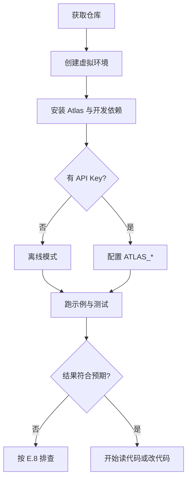

# 附录 E 实验环境与代码运行指南


本附录的命令以仓库根目录为工作目录，环境为 Python 3.11 及以上。示例优先使用离线模式，不需要 API Key；接入真实模型时再配置 `ATLAS_*` 环境变量。依赖版本、模型名称与接口会变化，遇到差异时以仓库当前的 `pyproject.toml` 与官方文档为准。


## 本章导读

同一份代码，在你的机器上能跑、在别人的机器上跑不起来，通常不是代码错了，而是 Python 版本、依赖、工作目录或环境变量不一致。本附录给出三条可复现路径：离线演示、真实模型、测试套件，并说明每一步该看到什么结果。

⭐ 入门 ｜ 适合：工程师、学生、技术负责人

## 学习目标

读完本附录你将能够：

- 从零创建隔离的 Python 环境并安装 Atlas
- 不配置 API Key 跑通离线演示与各章示例
- 用环境变量控制模型、预算与知识库
- 运行测试套件，并根据失败信息定位环境问题
- 接入 OpenAI 兼容服务，并避免密钥泄露与成本失控

## E.1 三种运行方式

Atlas 支持三种运行方式。先明确你要验证哪一层，不要同时排错：

| 方式 | 是否需要 API Key | 依赖 | 适合做什么 | 成功信号 |
|---|---|---|---|---|
| 离线演示 | 否 | 仅标准库 | 第一次跑通、读输出、改代码 | 打印答案、`stop_reason` 与引用 |
| 测试套件 | 否 | `pytest` 开发依赖 | 确认改动没有破坏既有行为 | `178 passed` |
| 真实模型 | 是 | `openai` 可选依赖 | 端到端验证、观察真实延迟与成本 | 返回答案与令牌用量 |

三种方式是递进的诊断阶梯，不是三个并列选项：离线演示验证“本地链路是否通”，测试套件验证“行为契约是否还在”，真实模型验证“端到端效果是否达标”。前一步没通过就跳到下一步，只会把环境问题和模型问题混在一起。建议第一次接触仓库时严格按这个顺序走一遍，再决定从哪里深入。



不同目标的使用顺序不同：



先跑 `python -m atlas --offline` 和 `python -m pytest -q`，确认环境正常；再按 E.5 的表格挑一章示例运行。离线输出能让你在没有模型成本的情况下理解循环、工具与停止条件。



先跑测试建立基线，再改一个最小位置（例如工具描述或停止预算），然后同时跑相关测试与离线示例。每次只改一处，避免把环境问题与代码问题混在一起。



先确认离线与测试都通过，再安装 `openai` 可选依赖、配置 `ATLAS_API_KEY`、`ATLAS_MODEL` 与可选的 `ATLAS_BASE_URL`。第一次调用把步数与费用预算调小，观察一次完整轨迹后再放开。



## E.2 环境准备

先确认 Python 版本。项目要求 3.11 及以上：

```bash
python3 --version
```

如果低于 3.11，先安装新版本，或使用系统的版本管理工具。不要用系统自带的 Python 直接安装项目依赖，避免污染全局环境。

创建并激活虚拟环境：



```bash
python3 -m venv .venv
source .venv/bin/activate
python -m pip install -U pip
```



```powershell
py -3.11 -m venv .venv
.venv\Scripts\Activate.ps1
python -m pip install -U pip
```



```bat
py -3.11 -m venv .venv
.venv\Scripts\activate.bat
python -m pip install -U pip
```



激活后，`python` 与 `pip` 应指向 `.venv`。可以用下面的命令确认：

```bash
python -c "import sys; print(sys.executable)"
```

输出的路径里应包含 `.venv`。如果仍然指向系统 Python，说明虚拟环境没有激活成功。

虚拟环境解决的是“依赖隔离”，不是“代码隔离”：它让当前项目拥有独立的 `site-packages`，安装或升级包不会影响其他项目，也不会被系统包管理器覆盖。激活只在当前终端生效，新开窗口要重新激活；这也是很多人“刚才还能跑、换个窗口就导入失败”的原因。判断是否激活，永远看 `sys.executable`，不要凭提示符猜测。

## E.3 安装 Atlas

在仓库根目录执行可编辑安装：

```bash
python -m pip install -e ".[dev]"
```

`-e` 让代码修改立即生效，不需要反复安装；`[dev]` 会安装 `pytest`。Atlas 的运行时依赖为空，离线模式只使用标准库。需要真实模型时再安装可选依赖：

```bash
python -m pip install -e ".[openai]"
```

也可以一次装齐：

```bash
python -m pip install -e ".[dev,openai]"
```

安装完成后验证：

```bash
python -c "import atlas; print(atlas.__version__, atlas.__file__)"
```

预期输出包含版本号 `1.4.0` 与仓库中的 `src/atlas` 路径。注意发行包名是 `atlas-agent`，导入名是 `atlas`，两者不一致是正常的：前者用于 `pip`，后者用于 `import`。排查时用 `pip show atlas-agent` 查安装，用 `import atlas` 查能否加载，不要混用。

四种安装方式各有适用场景，不要为了“省事”长期使用临时方式：

| 方式 | 命令 | 特点 | 适合 |
|---|---|---|---|
| 可编辑安装 | `pip install -e ".[dev]"` | 改源码立即生效 | 阅读与开发（推荐） |
| 普通安装 | `pip install ".[dev]"` | 拷贝一份快照，改源码不生效 | 验证打包结果 |
| 路径注入 | `export PYTHONPATH=src` | 不写入环境，每次终端都要设 | 临时试跑、不污染环境 |
| 全量安装 | `pip install -e ".[dev,openai]"` | 一次装齐测试与模型依赖 | 准备接真实模型 |

如果不想安装，也可以直接设置 `PYTHONPATH`：

```bash
export PYTHONPATH=src      # macOS / Linux
python -m atlas --offline
```

Windows 的 cmd 使用 `set PYTHONPATH=src`，PowerShell 使用 `$env:PYTHONPATH="src"`。这种方式适合临时阅读，不适合长期开发，因为每次新开终端都要重新设置。

**用代码调用 Atlas。** 命令行只是薄封装，真正装配逻辑在 `build_app` 里。想在脚本、Notebook 或自己的服务里调用，用下面这段：

```python
from atlas import AtlasConfig, build_app

config = AtlasConfig.from_env()
config.offline = True  # 不访问网络，使用脚本模型
app = build_app(config)
trajectory = app.run("用一句话解释 Agent 循环。")
print(trajectory.final_answer)
print(trajectory.stop_reason, len(trajectory.steps))
```

`build_app` 按固定顺序装配：工具 → 模型 → 记忆与检索 → 上下文 → 循环 → 包装。离线时它把模型替换为脚本化实现；真实模式则根据 `config` 创建 OpenAI 兼容客户端。返回的 `Trajectory` 包含最终答案、停止原因、每一步的模型响应与工具调用，以及令牌用量。调试时优先看 `stop_reason`：它比答案文本更能说明循环为什么结束。

需要自定义工具或知识库时，把对应对象传给 `build_app(tools=..., knowledge=...)`，不要绕过装配函数手工拼装，否则很容易漏掉引用审计或记忆记录。密钥仍然只从环境变量读取，不要写进脚本。

## E.4 环境变量与预算

Atlas 从 `ATLAS_` 前缀的环境变量读取配置。常用变量如下：

| 变量 | 默认值 | 作用 |
|---|---|---|
| `ATLAS_MODEL` | `gpt-4o-mini` | 模型名称，按服务商实际名称填写 |
| `ATLAS_API_KEY` | 空 | API Key；为空时应改用离线模式，不会自动回退 |
| `ATLAS_BASE_URL` | 空 | OpenAI 兼容服务的地址；使用官方服务时可留空 |
| `ATLAS_TEMPERATURE` | `0.0` | 采样温度；Agent 任务通常从 0 开始 |
| `ATLAS_OFFLINE` | `false` | 是否强制离线，支持 `1/true/yes/on` 与 `0/false/no/off` |
| `ATLAS_MAX_CONTEXT_TOKENS` | `32000` | 上下文预算，超过后触发压缩或截断 |
| `ATLAS_MAX_STEPS` | `20` | 单次任务最大循环步数 |
| `ATLAS_MAX_TOKENS` | `100000` | 单次任务累计令牌预算 |
| `ATLAS_MAX_COST_USD` | `1.0` | 单次任务费用上限 |
| `ATLAS_MAX_SECONDS` | `300.0` | 单次任务时间上限 |
| `ATLAS_MAX_TOOL_CALLS` | `40` | 单次任务工具调用次数上限 |

配置的优先级从高到低是：命令行参数 > `ATLAS_*` 环境变量 > 代码默认值。空字符串通常视为“未设置”，回落到默认值；布尔值则相反，必须落在允许集合里，写错会直接报 `invalid boolean`，不会静默取默认值。这种“数值宽松、布尔严格”的设计是有意的：预算写错可以回退，行为开关写错不应该被忽略。

这些上限是“护栏”，不是建议值。调试时先把步数、工具调用与费用调小，确认轨迹符合预期后再放开。不同阶段可以用不同的组合：



保持默认即可，只在离线模式运行。此时关心的是轨迹结构与停止原因，不产生费用，也不需要收紧预算。



把 `ATLAS_MAX_STEPS` 设为 5–8、`ATLAS_MAX_TOOL_CALLS` 设为 10 左右。让异常循环尽快撞到上限，方便观察 `stop_reason` 与最后一步的状态，而不是等几十步之后才发现问题。



把 `ATLAS_MAX_STEPS` 设为 6、`ATLAS_MAX_COST_USD` 设为 0.05、`ATLAS_MAX_SECONDS` 设为 60。先确认一次完整轨迹的延迟、令牌与费用，再按任务需要逐项放开，不要一次性全调到默认上限。



```bash
ATLAS_MAX_STEPS=8 ATLAS_MAX_TOOL_CALLS=10 python -m atlas --offline
```

Windows 的 cmd 使用：

```bat
set ATLAS_MAX_STEPS=8
set ATLAS_MAX_TOOL_CALLS=10
python -m atlas --offline
```

命令行参数优先于环境变量。例如 `--max-steps 5` 会覆盖 `ATLAS_MAX_STEPS`；`--offline` 会强制离线，不受 `ATLAS_OFFLINE` 影响。

<details>
<summary>离线模式到底做了什么</summary>

离线模式会把模型替换为脚本化的 `MockLLM`，并装载内置知识库与一条预置记忆。它不发起网络请求，也不评估真实模型能力；它验证的是循环、工具调用、上下文装配、引用校验与停止条件是否能串起来。

因此，离线输出“看起来对”不等于真实模型也会做对。真实模型的行为要在 E.7 的配置下单独验证。

</details>

## E.5 逐章运行示例

确认虚拟环境已激活，或已设置 `PYTHONPATH=src`。每个示例都是独立脚本，可以从仓库根目录运行：

| 章节 | 文件 | 运行命令 | 观察点 |
|---|---|---|---|
| 第 4 章 | `ch04_single_tool.py` | `python examples/ch04_single_tool.py` | 工具调用、观察回填、`final_answer` |
| 第 5 章 | `ch05_mcp.py` | `python examples/ch05_mcp.py` | MCP 工具加载、危险工具拒绝 |
| 第 5 章 | `ch05_mcp_server.py` | 由上一行自动启动 | stdio 服务器，不单独运行 |
| 第 6 章 | `ch06_plan.py` | `python examples/ch06_plan.py` | 计划步骤、反思与重规划 |
| 第 7 章 | `ch07_memory.py` | `python examples/ch07_memory.py` | 记忆写入、替换与注入 |
| 第 8 章 | `ch08_rag.py` | `python examples/ch08_rag.py` | 混合检索、RRF 合并、引用 |
| 第 9 章 | `ch09_context.py` | `python examples/ch09_context.py` | 上下文预算、压缩与截断 |
| 第 10 章 | `ch10_multi_agent.py` | `python examples/ch10_multi_agent.py` | 角色顺序、工具隔离、轨迹合并 |
| 第 11 章 | `ch11_frameworks.py` | `python examples/ch11_frameworks.py` | 框架画像、硬约束过滤、候选排序 |
| 第 12 章 | `ch12_minimal_agent.py` | `python examples/ch12_minimal_agent.py` | 完整最小 Agent、用量统计 |
| 第 12 章 | `ch12_langgraph.py` | `python examples/ch12_langgraph.py` | 可选依赖；未安装时打印提示 |
| 第 15 章 | `ch15_eval.py` | `python examples/ch15_eval.py` | 通过率、成本与回归比较 |
| 第 16 章 | `ch16_trace.py` | `python examples/ch16_trace.py` | 结构化事件、错误信号 |
| 第 17 章 | `ch17_safety.py` | `python examples/ch17_safety.py` | 注入标记、越界读取拒绝 |
| 第 18 章 | `ch18_runtime.py` | `python examples/ch18_runtime.py` | 路由、缓存、重试与幂等 |
| 第 20 章 | `ch20_agentic_rl.py` | `python examples/ch20_agentic_rl.py` | rollout、奖励、组相对优势 |

**运行示例的通用姿势。** 先读脚本开头的说明与 `main()`，确认它使用离线模型还是真实模型、是否需要额外依赖；运行时加 `python -u` 关闭输出缓冲，或把输出重定向到文件，便于与书中结果逐行对照。示例之间不共享状态：每个脚本自行构建应用与知识库，单独运行才能得到可比的结果。如果输出与书中不一致，先核对仓库版本、Python 版本与运行目录，再怀疑代码本身。

说明两点：

- `ch05_mcp_server.py` 是一个 stdio 服务器，`ch05_mcp.py` 会用当前 Python 解释器把它作为子进程启动。单独运行服务器时，它会等待标准输入，看起来“没有输出”，这不是报错。
- `ch12_langgraph.py` 需要额外安装 `langgraph`。未安装时脚本会打印“需要可选依赖”并正常退出，不影响其他示例。

**读一次离线输出。** 先跑最基础的演示，逐行对照：

```text
Atlas · 离线演示
任务：Atlas 如何把记忆、检索与上下文预算组合起来？
答案：Atlas 把三者放在不同层：记忆由 MemoryBuilder 检索后注入系统消息[atlas-memory#0]；知识检索被封装成工具，结果进入证据台账[atlas-rag#0]；上下文预算在两者之后统一压缩[atlas-context#0]。
停止原因：final_answer ｜ 步骤：2 ｜ 工具调用：1 ｜ 令牌：968
引用：atlas-memory#0、atlas-rag#0、atlas-context#0 ｜ 检索：1 次
长期记忆：2 条
```

这六行分别回答六个问题：任务是什么、答案是什么、循环为什么停、走了几步、引用了哪些证据、记忆有没有写回。`final_answer` 表示模型主动给出答案；如果看到 `max_steps`、`max_tokens` 或 `max_tool_calls`，说明是预算先耗尽，答案可能不完整。引用标记 `[doc_id#序号]` 出现在最终答案里，由 `EvidenceLedger` 校验是否来自本轮检索；出现“未找到出处的引用”就说明模型编造或错用了来源，应回到对应章节检查检索与提示词。预置记忆只有一条，运行结束后 `MemoryRecorder` 又写入一条本次任务记忆，所以这里显示 2 条。

需要机器可读结果时加 `--json`，字段包括 `answer`、`stop_reason`、`steps`、`tool_calls`、`total_tokens`、`citations`、`unknown_citations`、`retrieval_count` 与 `memory_items`。写脚本做回归时优先消费这些字段，而不是解析中文文本。

注意离线模式的脚本模型只覆盖内置演示轨迹：换一个任务文本，答案仍然是上面这条，这不是 bug。它验证的是链路，不验证理解能力；要观察不同任务的行为，必须接真实模型。

**源码目录与章节对应。** 改代码前先知道该去哪：

| 目录 | 内容 | 对应章节 |
|---|---|---|
| `src/atlas/agent/` | Agent 循环、停止策略、运行器 | 第 4 章 |
| `src/atlas/tools/` | 工具注册、Schema、MCP | 第 5 章 |
| `src/atlas/planning/` | 计划、执行、反思 | 第 6 章 |
| `src/atlas/memory/` | 短期/长期记忆、写入与记录 | 第 7 章 |
| `src/atlas/rag/` | 切分、检索、混合、引用审计 | 第 8 章 |
| `src/atlas/context/` | 预算、压缩、渐进披露 | 第 9 章 |
| `src/atlas/multi_agent/` | 角色、编排、共享看板 | 第 10 章 |
| `src/atlas/integrations/` | 框架画像与一致性检查 | 第 11 章 |
| `src/atlas/eval/` | 评测器、指标、回归比较 | 第 15 章 |
| `src/atlas/trace/` | 事件、诊断、回放 | 第 16 章 |
| `src/atlas/safety/` | 护栏、审批、沙箱、审计 | 第 17 章 |
| `src/atlas/runtime/` | 路由、缓存、重试、幂等 | 第 18 章 |

每个示例都应打印可读的轨迹或统计信息。第一次运行时不要急着改代码，先对照对应章节的讲解，确认每一步的输入、输出与停止原因。

## E.6 运行测试

在仓库根目录执行：

```bash
python -m pytest -q
```

当前基线应为 `178 passed`。测试与示例都使用离线模型和本地语料，不需要网络。

`pyproject.toml` 已经配置了 `pythonpath = ["src", "."]` 与 `testpaths = ["tests"]`，因此只要在仓库根目录运行，就不必先安装包。换到其他目录运行会找不到 `src`，表现成导入失败——这是工作目录问题，不是代码坏了。

测试文件按模块划分，可以按改动范围选择：

| 测试文件 | 覆盖内容 |
|---|---|
| `test_contracts.py` | 公共接口与数据契约，改动接口时最先跑 |
| `test_agent_loop.py` | 循环、停止条件、工具结果回填 |
| `test_tools.py`、`test_mcp.py` | 工具注册、Schema 校验、MCP 装载 |
| `test_planning.py` | 计划生成、执行与反思 |
| `test_memory.py` | 记忆读写、替换与脱敏 |
| `test_rag.py` | 切分、检索、混合排序与引用 |
| `test_context_engineering.py` | 预算、压缩与截断 |
| `test_multi_agent.py` | 角色、编排与工具隔离 |
| `test_integrations.py` | 框架画像与一致性检查 |
| `test_eval.py` | 评测器、指标与回归比较 |
| `test_trace.py` | 事件、诊断与回放 |
| `test_safety.py` | 注入检测、审批、沙箱与审计 |
| `test_runtime.py` | 路由、缓存、重试与幂等 |
| `test_app.py` | 端到端装配与引用审计 |

改动跨模块时先跑 `test_contracts.py`：它约束的是各章共享的数据结构，一旦破坏，后面的失败往往只是连锁反应。定位时先修第一个失败，不要同时追十个报错。

常用变体：

```bash
python -m pytest tests/test_agent_loop.py -q      # 只跑循环相关测试
python -m pytest -q -k memory                     # 按名称筛选
python -m pytest -q -x                            # 遇到第一个失败就停
python -m pytest -q -vv                           # 显示更详细的用例名
```

测试失败时，先区分三类原因：环境问题（导入失败、版本不符）、代码问题（断言失败、异常）、测试本身的问题（数据或路径依赖）。不要一上来就改代码。

<details>
<summary>测试失败的五步定位法</summary>

1. 看第一行错误：是 `ModuleNotFoundError`、`ImportError`，还是断言失败？
2. 看完整用例名：`tests/test_xxx.py::test_yyy`，先单独跑这一条。
3. 看是“预期值变了”还是“异常路径变了”：前者可能是代码改动，后者可能是环境或数据。
4. 用 `-x -vv` 重跑，确认失败发生在准备、执行还是清理阶段。
5. 如果只有你的机器失败，记录 Python 版本、安装方式、工作目录与环境变量，再与基线对比。

</details>

最后提醒：`178 passed` 是当前版本的基线，不是永恒数字。新增测试会让数字上升，删改测试会让它下降；把基线写进 README 或 CI，才能在变化时立刻发现异常。测试通过也不等于功能正确——它证明的是既有契约没有被破坏，功能是否符合预期仍要用示例与真实模型验证。

## E.7 接入真实模型

Atlas 通过 OpenAI 兼容接口调用模型。安装可选依赖：

```bash
python -m pip install -e ".[openai]"
```

配置环境变量后运行：

```bash
export ATLAS_API_KEY="你的密钥"
export ATLAS_MODEL="你的模型名称"
# 使用兼容服务时再设置：
# export ATLAS_BASE_URL="兼容服务的地址"
python -m atlas "用一句话解释 ReAct，并给出来源。"
```

Windows 的 cmd 使用 `set ATLAS_API_KEY=...`，PowerShell 使用 `$env:ATLAS_API_KEY="..."`。不要把密钥写进代码、Notebook 或提交到 Git；使用环境变量或密钥管理服务。

如果使用自建或第三方兼容服务，确认三件事：接口兼容 Chat Completions、模型支持工具调用、返回的用量字段可用。缺少工具调用能力时，Agent 循环可能只能得到普通文本，工具路径不会触发。

**先用离线排除工程问题。** 真实模型报错时，先切回离线跑一遍：离线通过而真实失败，问题多半在密钥、网络、模型名或接口兼容性；离线也失败，问题在本地环境或最近的代码改动。这个二分法能省掉大量猜测，也能避免把服务商的临时故障误判成自己的 bug。

接入真实模型后，建议先跑一个小任务并加上 `--json`：

```bash
python -m atlas "计算 (128 + 64) * 3，并给出结果。" --json
```

`--json` 输出包含答案、停止原因、步骤数、工具调用数、令牌与引用，便于脚本化检查。第一次调用把 `ATLAS_MAX_STEPS` 与 `ATLAS_MAX_COST_USD` 调小，确认没有异常循环后再放开。

**估算成本。** 单次调用费用近似等于输入令牌乘输入单价，加上输出令牌乘输出单价。但 Agent 的成本不是“一次调用”，而是“步数乘每步上下文”：轨迹会随步骤增长，工具结果与检索片段又会进入后续请求，所以长任务的实际用量通常明显高于第一次调用的估计。用 `--json` 里的 `total_tokens` 建立一个基线，再按预期步数放大，比凭感觉设预算可靠。重试、缓存未命中和多智能体并行都会进一步放大消耗，设预算时要留出余量。

还可以把本地文档装入知识库：

```bash
python -m atlas "总结知识库中关于记忆与检索的要点。" --knowledge-dir ./docs
```

目录下的 `.md` 与 `.txt` 会被加载，`doc_id` 由相对路径生成。目录不存在或没有可用文本时，命令会报错并退出。


模型名称、接口字段、价格与配额会变化。接入前核对服务商当前文档，并为项目锁定模型与依赖版本；不要用生产密钥跑未限制预算的实验。


## E.8 常见报错排查

| 现象 | 常见原因 | 处理 |
|---|---|---|
| `ModuleNotFoundError: No module named 'atlas'` | 未安装，或不在仓库根目录 | 执行 `pip install -e ".[dev]"`，或设置 `PYTHONPATH=src` |
| `ModuleNotFoundError: No module named 'openai'` | 未安装可选依赖 | `pip install -e ".[openai]"` |
| `401`、`403` 或认证失败 | Key 无效、过期或与 Base URL 不匹配 | 重新生成 Key，确认服务地址与模型归属 |
| 连接超时或 DNS 失败 | 网络、代理或 Base URL 错误 | 先用离线模式确认本地正常，再检查网络与地址 |
| `invalid boolean: ...` | `ATLAS_OFFLINE` 值不在允许集合 | 使用 `1/true/yes/on` 或 `0/false/no/off` |
| `knowledge directory not found` | `--knowledge-dir` 路径错误 | 使用绝对路径或从仓库根目录写相对路径 |
| `知识库为空` | 目录中没有 `.md` 或 `.txt` | 放入文本文件，或换一个目录 |
| `需要可选依赖：pip install langgraph` | 未安装 LangGraph | 按提示安装，或跳过该示例 |
| `ch05_mcp_server.py` 没有输出 | 它是 stdio 服务器，等待输入 | 运行 `ch05_mcp.py`，不要单独运行服务器 |
| Windows 激活脚本被禁止 | PowerShell 执行策略限制 | 使用 cmd 的 `activate.bat`，或按系统策略调整 |
| `pytest` 收集不到用例 | 不在仓库根目录，或 `testpaths` 被覆盖 | 回到根目录运行，确认没有额外的 `pytest.ini` |
| 安装依赖长时间卡住或超时 | 网络、代理或镜像源配置 | 换镜像源或配置代理，先确认能访问包索引 |

排查顺序建议从外到内，不要一上来读源码：

1. **解释器**：`python --version` 与 `sys.executable` 是否指向 `.venv`。
2. **包**：`import atlas` 能否成功，`pip show atlas-agent` 的版本与路径是否正确。
3. **工作目录**：是否在仓库根目录，`examples/` 与 `tests/` 的相对路径是否成立。
4. **配置**：`ATLAS_*` 是否拼写正确，布尔值是否在允许集合内。
5. **外部服务**：网络、代理、Base URL、密钥与模型名。
6. **业务代码**：最后才怀疑循环、工具或提示词。

越靠前的层越容易验证，也越常见。先确认前四层，再看外部服务，能避免在错误的层面上浪费时间。

遇到问题时，先收集这四个信息：

```bash
python --version
python -c "import sys; print(sys.executable)"
python -c "import atlas; print(atlas.__version__, atlas.__file__)"
python -m pip show atlas-agent
```

四条信息能区分“版本不对”“装错环境”“路径不对”和“包未安装”四类问题。把输出贴到 issue 里，也比只写“跑不起来”更容易得到帮助。

## E.9 清理、复现与版本锁定

实验结束后，可以退出虚拟环境：

```bash
deactivate
```

需要重建环境时，删除 `.venv` 后按 E.2 重新创建。删除前确认没有未保存的本地改动；`.venv` 不应提交到 Git。

出现以下情况时，重建往往比继续修依赖更快：升级了 Python 次版本、多个项目共用同一个环境导致版本冲突、导入报错但文件明明存在、或者 `pip check` 报告依赖不一致。重建前先 `pip freeze > requirements.lock.txt` 留一份快照，再删环境；这样即使新环境有问题，也能对照旧快照定位差异。

为了让别人复现你的结果，至少记录五项：操作系统、Python 版本、Atlas 版本、依赖安装方式、运行命令。需要更严格时，导出依赖快照：

```bash
python -m pip freeze > requirements.lock.txt
```

注意 `pip freeze` 记录的是当前环境的全部包，不同操作系统可能得到不同结果；它适合作为“当时能跑”的证据，不适合直接当作跨平台依赖声明。项目的真实依赖仍以 `pyproject.toml` 为准。

一个最小复现包可以这样组织：

```text
atlas-repro/
├── README.md          # 运行命令与预期输出
├── requirements.lock.txt
└── run.sh             # 可选：一条命令跑完离线演示与测试
```

`run.sh` 建议只做两件事：跑离线演示、跑测试，任一失败立即退出。这样别人拿到复现包后，不必先读文档就能判断环境是否一致：

```bash
#!/usr/bin/env bash
set -euo pipefail

python -m atlas --offline
python -m pytest -q
```

`README.md` 至少写清三条命令、预期输出与基线数字（例如 `178 passed`），以及最后一次验证的操作系统、Python 版本与 Atlas 版本。复现包的目标不是“证明我没错”，而是让别人能用最少的步骤得到同一个结果，或者明确指出在第几步出现分歧。

如果问题只在真实模型下出现，记录模型名称、服务地址类型、请求时间、任务文本、预算设置与完整轨迹；不要记录 API Key。

## E.10 常见误区

**误区一：用系统 Python 直接安装。** 系统环境被多个项目共享，升级依赖容易互相破坏。每个项目一个虚拟环境，成本很低。

**误区二：在错误目录运行。** `python -m atlas` 依赖安装或 `PYTHONPATH`，`examples/` 依赖仓库根目录。路径不对时，先看当前目录与 `sys.executable`。

**误区三：把密钥写进代码或提交到 Git。** 一旦推送，密钥应视为泄露并立即轮换。用环境变量、密钥管理或本地未跟踪文件。

**误区四：把离线输出当成真实模型能力。** 离线模式使用脚本化模型，验证的是工程链路，不是模型效果。真实能力要在真实模型与自己的任务集上验证。

**误区五：不设预算就接真实模型。** 没有步数、令牌与费用上限，异常循环会持续消耗配额。先设小预算，确认轨迹后再放开。

## E.11 本章小结

- 先创建虚拟环境，再安装 Atlas；不要污染系统 Python。
- 离线模式不需要 API Key，适合第一次跑通与理解链路。
- `pip install -e ".[dev]"` 安装开发依赖，`[openai]` 安装真实模型依赖。
- 环境变量控制模型、服务地址、上下文与预算；命令行参数优先。
- 各章示例独立可运行；MCP 服务器由客户端脚本启动，不要单独运行。
- 测试基线是 `178 passed`；失败时先区分环境、代码与测试数据。
- 真实模型要确认工具调用能力，并用小预算与 `--json` 观察一次完整轨迹。
- 复现要记录操作系统、Python、Atlas 版本、安装方式与运行命令。

## E.12 思考与练习

1. **最小验收**：从零创建虚拟环境，依次跑通离线演示、`ch04_single_tool.py` 与测试套件，记录三条命令的输出与耗时。验收标准：三条命令退出码均为 0，且测试输出包含 `178 passed`；能解释每一行输出分别由哪一层产生。

2. **预算实验**：把 `ATLAS_MAX_STEPS` 设为 2，运行一个需要多步工具调用的任务，观察停止原因与轨迹差异；再恢复到默认值，比较结果。验收标准：能指出 `stop_reason` 从 `final_answer` 变成 `max_steps` 的位置，并说明缺少了哪一次观察或哪一个工具结果。

3. **复现文档**：为你的项目写一页运行指南，包含环境要求、安装命令、环境变量、离线与真实模型两种运行方式，以及三个常见报错的排查步骤。验收标准：一位没看过仓库的同事只按文档操作，能在 15 分钟内跑通离线演示与测试。
