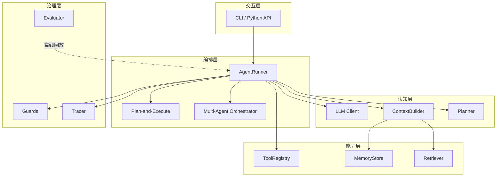
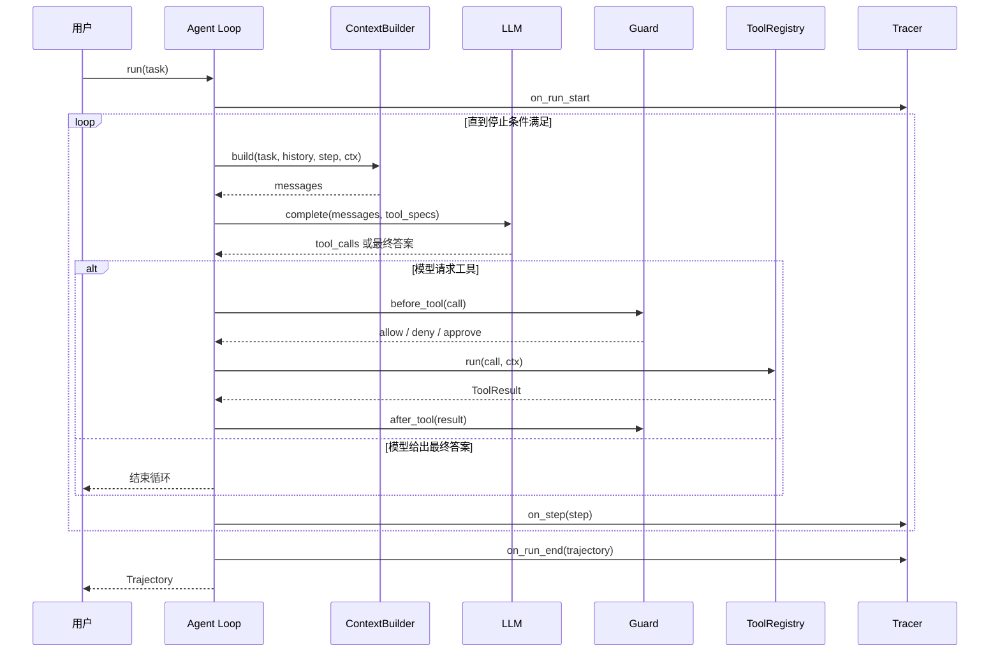

# Atlas 项目总览与演进路线


Atlas 不是一个"演示完就丢"的示例，而是一条贯穿全书的工程主线。它的接口在首次定义后保持稳定，能力按章节增量叠加，读者可以从第 4 章开始逐章运行，也可以在任意一章跳进来。


## 为什么需要一个贯穿项目

多数技术书的代码是互不相干的片段：这一章查天气，下一章订机票，读者很难看清"一个真实系统是如何长出来的"。Agent 尤其需要连贯的示例，因为它的难点不在单个 API，而在**多个组件之间的约束**：

- 工具返回的内容会挤占上下文，上下文又决定模型能否选对下一步工具
- 记忆和 RAG 都会往上下文里塞东西，但两者的失败方式不同
- 多 Agent 能提高并行度，也会放大成本和调试难度
- 评测、追踪和护栏如果后补，往往要推翻前面的设计

Atlas 用同一个研究任务把这些约束串起来。每加一个能力，你都能看到它对上下文、成本、可靠性的影响。

## 项目定位

**Atlas 研究助手**接收一个开放问题，通过检索、阅读、分析，产出带来源引用的研究报告。

一个典型的任务：

> "对比 ReAct 与 Plan-and-Execute 在长任务上的适用场景，给出 2024 年以来的代表性系统，并说明各自的失败模式。"

Atlas 需要完成：

1. 理解问题，判断需要哪些子问题
2. 在本地语料与互联网上检索
3. 读取网页或文档，抽取证据
4. 必要时写代码做统计或验证
5. 记录"结论—证据—来源"的对应关系
6. 在预算内写出带引用的报告
7. 留下完整轨迹，供评测与复盘

### 做什么

| 能力 | 说明 |
|---|---|
| 多源检索 | 本地语料、搜索引擎、指定网页 |
| 证据管理 | 每条关键结论都能追溯到来源片段 |
| 规划与重规划 | 先拆解，执行受阻时调整 |
| 记忆 | 记住用户偏好与既往研究，不重复劳动 |
| 预算控制 | 步数、token、费用、时间四类上限 |
| 可观测 | 每一步都有结构化轨迹 |
| 可评测 | 固定任务集 + 过程指标 + 回归测试 |
| 可控 | 高风险工具需要审批，代码执行在沙箱中 |

### 不做什么

- **不做通用聊天机器人**：没有开放式闲聊目标，所有能力围绕研究任务
- **不追求完全无人监督**：默认允许人在关键动作前介入
- **不做模型训练**：第 20 章讨论训练原理，但 Atlas 只做应用层
- **不是完整 SaaS**：第 18 章给出部署模式，不包含计费、多租户等完整产品能力

## 设计原则

1. **接口先于实现**：先定数据类型与协议，再写具体模块。这样第 10 章换多 Agent、第 11 章换框架时，上层代码不用重写。
2. **增量演进，不推倒重来**：每章只加模块或加可选参数，不删除、不改名、不改变已有语义。
3. **模型可替换**：所有模型调用走统一的 `LLM` 协议，默认可接任意 OpenAI 兼容服务。
4. **默认可观测**：`Step` 与 `Trajectory` 是一等公民，不是事后补的日志。
5. **预算是一等公民**：任何循环都必须有停止条件，默认就有步数、token、费用和时间上限。
6. **离线可测试**：核心流程用 Mock LLM 与本地语料就能跑通，不把 API Key 当成运行前提。

## 架构总览



分层的原则是**依赖只向下**：

- 交互层不关心 Agent 内部如何循环
- 编排层决定"谁来做、按什么顺序做"
- 认知层负责"这一轮给模型看什么、让它怎么想"
- 能力层提供工具、记忆与检索这些"可被替换的零件"
- 治理层横切所有层，负责拦截、记录与评分

## 一次任务的执行流程



几个容易忽略的细节：

- **ContextBuilder 每轮都会被调用**，不是只在开始时拼一次。工具结果、计划状态、记忆召回都可能在循环中变化。
- **Guard 同时检查调用前和结果后**。前者防止危险动作，后者防止恶意内容或敏感数据继续进入上下文。
- **Tracer 记录的是 `Step`，不是自然语言日志**。结构化记录才能回放、统计和做根因分析。
- **停止条件在多处检查**：步数、token、费用、时间、连续失败次数，任何一个越界都能终止。

## 目录结构

```text
atlas/
├── pyproject.toml
├── .env.example
├── README.md
├── corpus/
│   ├── docs/                 # 本地知识库原始文档
│   └── index/                # 离线索引（BM25 或向量）
├── evals/
│   ├── tasks.jsonl           # 评测任务
│   └── rubric.md             # 评分标准
├── examples/
│   ├── ch04_single_tool.py
│   ├── ch05_mcp.py
│   ├── ch06_plan.py
│   ├── ch07_memory.py
│   ├── ch08_rag.py
│   ├── ch09_budget.py
│   ├── ch10_multi_agent.py
│   └── ch11_langgraph.py
├── src/atlas/
│   ├── __init__.py
│   ├── config.py
│   ├── types.py
│   ├── llm/
│   │   ├── base.py
│   │   ├── openai_compat.py
│   │   └── mock.py
│   ├── tools/
│   │   ├── base.py
│   │   ├── registry.py
│   │   ├── web_search.py
│   │   ├── fetch_url.py
│   │   ├── python_exec.py
│   │   ├── corpus_search.py
│   │   └── mcp.py
│   ├── agent/
│   │   ├── loop.py
│   │   ├── policy.py
│   │   └── runner.py
│   ├── planning/
│   │   ├── base.py
│   │   ├── planner.py
│   │   └── plan_execute.py
│   ├── context/
│   │   ├── base.py
│   │   ├── builder.py
│   │   └── compressor.py
│   ├── memory/
│   │   ├── base.py
│   │   ├── short_term.py
│   │   └── long_term.py
│   ├── rag/
│   │   ├── base.py
│   │   ├── local.py
│   │   └── agentic.py
│   ├── multi_agent/
│   │   ├── base.py
│   │   ├── orchestrator.py
│   │   └── roles.py
│   ├── eval/
│   │   ├── base.py
│   │   └── runner.py
│   ├── trace/
│   │   ├── base.py
│   │   ├── jsonl.py
│   │   └── replay.py
│   ├── safety/
│   │   ├── base.py
│   │   ├── guards.py
│   │   └── approval.py
│   ├── runtime/
│   │   ├── worker.py
│   │   └── cache.py
│   └── cli.py
└── tests/
    ├── test_contracts.py
    ├── test_agent_loop.py
    └── ...
```

目录不是一次建完的。第 4 章只有 `types.py`、`llm/`、`tools/`、`agent/` 四块；其余模块按章节出现。上面是 v1.x 的最终形态。

## 演进路线

| 章节 | 版本 | 新增能力 | 主要模块 | 示例 |
|---|---|---|---|---|
| 第 4 章 | v0.4.0 | 最小循环、单工具、停止条件 | `types.py`、`llm/`、`tools/base.py`、`agent/loop.py` | `examples/ch04_single_tool.py` |
| 第 5 章 | v0.5.0 | 搜索/网页/代码执行、MCP 接入、并行调用 | `tools/*`、`tools/mcp.py` | `examples/ch05_mcp.py` |
| 第 6 章 | v0.6.0 | ReAct、Plan-and-Execute、反思重试 | `planning/*` | `examples/ch06_plan.py` |
| 第 7 章 | v0.7.0 | 短期/长期记忆、ContextBuilder | `memory/*`、`context/base.py` | `examples/ch07_memory.py` |
| 第 8 章 | v0.8.0 | 本地语料检索、Agentic RAG | `rag/*`、`corpus/` | `examples/ch08_rag.py` |
| 第 9 章 | v0.9.0 | 上下文预算、压缩、渐进式披露 | `context/builder.py`、`context/compressor.py` | `examples/ch09_budget.py` |
| 第 10 章 | v0.10.0 | 检索员/分析员/撰稿人协作 | `multi_agent/*` | `examples/ch10_multi_agent.py` |
| 第 11 章 | v0.11.0 | 框架适配，内核不变 | `integrations/*` | `examples/ch11_langgraph.py` |
| 第 12 章 | v1.0.0 | CLI 整合、配置、打包 | `cli.py`、`config.py` | `atlas research "..."` |
| 第 15 章 | v1.1.0 | 评测集与评测运行器 | `eval/*`、`evals/` | `atlas eval` |
| 第 16 章 | v1.2.0 | JSONL 追踪与轨迹回放 | `trace/*` | `atlas replay` |
| 第 17 章 | v1.3.0 | 护栏、审批、沙箱强化 | `safety/*` | `atlas research --approve` |
| 第 18 章 | v1.4.0 | 异步任务、重试、缓存、部署 | `runtime/*`、`deploy/` | worker + 容器 |

第 13、14 章分析外部产品，不改 Atlas 内核；第 19–21 章为产品、训练与趋势讨论，也不改代码。这样安排是为了让"代码主线"和"认知主线"互不拖累。

## 运行方式

离线模式（不需要 API Key）：

```bash
ATLAS_OFFLINE=1 python examples/ch04_single_tool.py
ATLAS_OFFLINE=1 python -m atlas.cli research "ReAct 与 Plan-and-Execute 的区别"
```

接入真实模型：

```bash
export ATLAS_MODEL="your-model-name"
export ATLAS_API_KEY="..."
export ATLAS_BASE_URL="https://your-openai-compatible-endpoint/v1"
python -m atlas.cli research "..." --trace traces/run.jsonl
```

评测与回放：

```bash
python -m atlas.cli eval --dataset evals/tasks.jsonl
python -m atlas.cli replay traces/run.jsonl
```


命令行参数以对应章节的代码为准。本书会尽量保持命令稳定，但 `--trace`、`--approve` 等选项是逐步加入的，早期章节中不存在。


## 环境与外部依赖

| 依赖 | 用途 | 是否必需 |
|---|---|---|
| Python 3.11+ | 运行环境 | 必需 |
| `openai` | OpenAI 兼容模型客户端 | 真实模式必需 |
| `httpx` | 网页抓取与工具 HTTP 调用 | 必需 |
| `tavily-python` 或搜索服务 API | 联网搜索 | 联网模式必需 |
| `mcp` | MCP 客户端 | 第 5 章起可选 |
| `pytest` | 测试 | 开发必需 |
| `numpy` | 向量运算 | 第 8 章向量检索可选 |

本地检索的基线实现只用标准库（BM25 + 倒排索引），不强制安装向量数据库。这样第 8 章可以先讲清检索原理，再引入外部组件。

## 测试策略

1. **契约测试**（`tests/test_contracts.py`）：检查公开接口的签名、字段与返回类型没有被破坏。
2. **单元测试**：工具、记忆、检索、压缩等模块各自用固定输入验证。
3. **离线集成测试**：`MockLLM` 按预设脚本返回工具调用，跑完整 Agent Loop。
4. **在线冒烟测试**：标记为 `live`，需要 API Key，默认不跑。
5. **评测回归**：第 15 章起，每次改动跑固定任务集，记录成功率、步数与成本。

```bash
pytest -m "not live"      # 默认
pytest -m live            # 显式开启在线测试
```

## 每章验收标准

一章写完，Atlas 至少要满足：

- [ ] 该章新增模块有对应单元测试
- [ ] 该章 `examples/chXX_*.py` 在离线模式下可运行
- [ ] `pytest -m "not live"` 全部通过
- [ ] 没有破坏 `atlas/interfaces.md` 中的冻结接口
- [ ] 新增的 `Step`/`Trajectory` 字段能被追踪器序列化
- [ ] 预算与停止条件在新增路径上仍然生效
- [ ] `progress.md` 与 `atlas-state.md` 已更新

## 几个关键设计取舍

**为什么内核是同步的？**
教学代码里，`async` 会把注意力从 Agent 循环本身引开。Atlas 的 `LLM.complete`、`Agent.run` 都是同步接口；第 18 章在 `runtime/` 层用工作进程或线程池包装成长任务，不改变内核。这是一个有意的取舍：先让循环清楚，再让工程完整。

**为什么用组合而不是继承？**
`ContextBuilder`、`Planner`、`Guard` 都是协议。换一种上下文策略，不需要继承一个新的 Agent 子类，只需要传入另一个实现。多 Agent 编排器也因此可以把任意 `AgentRunner` 当子节点。

**为什么 `Trajectory` 要包含完整工具结果？**
只记录最终答案无法回答"它为什么失败"。完整的 `Step` 序列体积更大，但它是评测、回放和根因分析的基础。第 16 章会讨论如何在体积与可诊断性之间取舍。

**为什么默认限制这么严？**
`max_steps=20`、`max_cost_usd=1.0` 对研究任务并不宽裕，但默认值的作用是防止失控，而不是追求一次成功。真实使用时按任务调整，并让预算成为显式配置。

接口的完整定义与兼容规则见 [Atlas 接口清单](interfaces.md)。
