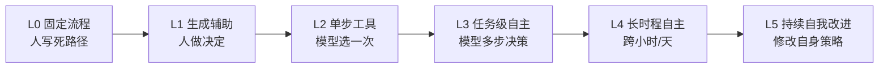
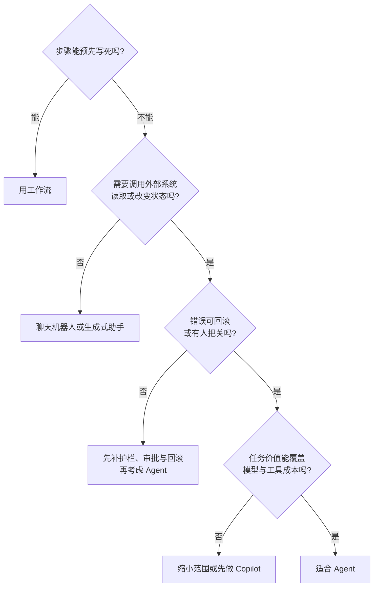

# 第 1 章 什么是 Agent：定义、边界与自主性分级

## 本章导读

一家公司把原本固定五步的报销审批改成"让 Agent 自己判断"。上线两周，人工复核率从 10% 升到 45%，成本翻了三倍，审批时间反而更长。复盘发现：五步里只有一步真正需要判断，其余四步都有明确规则。问题不在于 Agent 不够强，而在于一开始就没分清：哪些决定该交给模型，哪些应该写死。

⭐⭐ 入门 ｜ 适合：工程师、产品经理、技术管理者

## 学习目标

读完本章你将能够：

- 用自己的话定义什么是 Agent，并说清它与工作流、聊天机器人的本质区别
- 用"目标、运行时决策、行动与观察、停止条件"四项条件判断一个系统是不是 Agent
- 用 L0–L5 自主性分级描述一个系统当前处在哪一级，以及它应该处在哪一级
- 判断一类业务问题是否适合交给 Agent，以及应该从哪一级自主性起步
- 识别"伪 Agent（Pseudo-agent）""过度自主化"和"用 Agent 解决工作流问题"这三类常见错误

## 1.1 三个系统，三种决策方式

先看三个都"用了大模型"的系统。它们的差别不在模型，而在**谁决定下一步做什么**。

**系统 A：订单查询客服。** 用户问"我的快递到哪了"，系统识别出订单号，调用一次物流查询接口，把结果组织成一句人话回复。如果接口失败，就提示用户稍后再试。整个过程最多一次工具调用（Tool Calling），没有"根据结果继续查别的"这一步。

**系统 B：报销审批。** 员工提交发票，系统做 OCR 识别，按金额和费用类型路由到不同审批人，审批通过后调用付款接口。路径由流程图写死：金额超过五千走总监，差旅费走部门负责人，缺发票直接退回。大模型可能参与识别票据或生成提示文案，但它不决定流程走向。

**系统 C：研究助手。** 用户给一个开放问题："对比 ReAct 与 Plan-and-Execute 在长任务上的适用场景。"系统先拆子问题，决定先搜什么、读哪几篇、要不要写代码做统计，读到一半发现证据不足又回头补搜，最后产出带引用的报告。下一步做什么，取决于上一步看到了什么。

| 维度 | 订单查询客服 | 报销审批 | 研究助手 |
|---|---|---|---|
| 目标 | 回答一个具体问题 | 完成一条固定流程 | 完成一个开放任务 |
| 下一步由谁决定 | 模型（最多一次工具选择） | 代码与规则 | 模型（多步，依赖观察） |
| 是否根据结果改变路径 | 基本不会 | 不会 | 会 |
| 输出 | 一段文本 | 状态变更与审批结果 | 报告与来源引用 |
| 典型失败 | 答错、查错订单 | 卡在某个节点 | 跑偏、超预算、证据不足 |

三个系统都调用了模型，但只有第三个把"下一步做什么"交给了模型。这个差别，就是本章要讨论的核心。

## 1.2 定义：什么叫"智能体"

### 1.2.1 先给一个生活化的类比

自动售货机、客服热线和实习生，是三种不同的"任务承接方式"。

- **自动售货机**：你按哪个按钮，它走哪条固定路径。按钮之外的情况它不处理。这是工作流（Workflow）。
- **客服热线**：你问什么，它答什么；它可以把问题转给人工，但不会主动替你把事情办完。这是聊天机器人（Chatbot）。
- **实习生**：你给一个目标，他自己决定先做什么、用什么工具、遇到问题找谁确认，做完向你汇报。这是智能体（Agent）。

实习生这个类比还有一个重要提示：**给实习生目标的同时，必须给边界**。预算多少、能接触哪些系统、什么动作要先请示、什么时候必须停下来。Agent 的工程问题，很大程度上就是把这四件事设计清楚。

### 1.2.2 正式定义


**智能体（Agent）**是一个以目标为输入、在运行时由模型决定下一步行动、通过工具作用于环境、根据观察结果继续决策，并在约束与停止条件下终止的系统。


这个定义里有四个关键词，每一个都对应一条可检验的条件。

| 条件 | 含义 | 不满足时会怎样 |
|---|---|---|
| **目标性**（Goal-directedness） | 系统承接的是一个要完成的目标，而不只是一轮问答 | 只是一问一答的聊天机器人 |
| **运行时决策**（Runtime Decision-making） | 下一步行动由模型在运行时决定，并在多步之间根据观察结果调整，而不是由人预先写死 | 只是一条工作流 |
| **行动与观察**（Action and Observation） | 能通过工具读取或改变外部环境，并把结果作为下一轮输入 | 只能生成文本，无法真正"办事" |
| **停止条件**（Stop Condition） | 有明确的成功、失败、超预算或人工中断规则 | 可能陷入无限循环，或永远不交付 |

这四条不是"Agent 的高级特性"，而是最低门槛。缺少任何一条，系统就退化成另一种东西。

### 1.2.3 一个更顺手的心智模型

本书反复使用一个公式：


**Agent = 模型 + 工具（Tool） + 上下文（Context） + 循环（Loop）**


这四个部分分别回答四个问题：

- **模型**：谁来做判断？
- **工具**：它能做什么？
- **上下文**：它做判断时能看到什么？
- **循环**：它如何根据结果调整下一步，以及何时停止？

缺一部分，你会得到另一种系统：

| 缺少的部分 | 得到的东西 |
|---|---|
| 模型 | 规则驱动的工作流 |
| 工具 | 聊天机器人 |
| 上下文 | 每一步都从零开始、反复犯同样错误的"失忆循环" |
| 循环 | 一次性的工具调用 |

这个公式还有一层工程含义：模型提供智能，但**工具、上下文和循环是工程问题**。同一个模型，工具设计得清楚、上下文组织得当、循环有停止条件，做出来的 Agent 就可靠；反过来，再强的模型也会被糟糕的工具描述和失控的循环拖垮。本书后续章节会反复回到这一点。

### 1.2.4 三种视角下的 Agent

不同角色关心的事情不同，但指向的是同一个对象。



一个由模型输出驱动的有限状态机：状态是消息与工具结果，转移由模型决策，终止由策略控制。工程上要解决的是工具协议、上下文预算、错误处理、可观测性与安全边界。



一个可以被委派任务、在执行过程中汇报进度并在关键点请示的"数字同事"。产品上要解决的是任务边界、用户信任、中断与恢复、以及用户愿意为哪些任务付费。



一个在部分可观察环境中、以语言模型为策略、通过试错完成任务的决策系统。研究上关心的是规划、探索、信用分配、长时程一致性与自我改进。



### 1.2.5 智能体化（Agentic）不等于智能体（Agent）

这个词常被混用。**Agentic** 描述的是一种性质：目标导向、会使用工具、会根据反馈迭代。一个系统可以具备某些 agentic 特征，但不构成完整 Agent。

- 一个工作流里放一个"让模型判断该走哪个分支"的节点，它是 **agentic workflow**，整体仍是工作流。
- 一个聊天助手会根据问题决定调用哪个搜索接口，但只调用一次就回复，它是**工具型助手（Tool-using Assistant）**，不是多步 Agent。
- 一个多 Agent 系统如果每个子 Agent 都只做固定的一步，那它更像"分布式工作流"，而不是"多个自主智能体"。

判断时不要看它"像不像 AI"，要看**决策权（Decision Rights）在谁手里、决策发生几次、是否依赖观察结果**。

<details>
<summary>深入了解：为什么"自动"不等于"自主"</summary>

自动化解决的是"已知路径的稳定执行"。流水线上的机械臂可以极其自动，但它不自主：它不判断今天该不该焊接、焊歪了要不要换个方案。

自主性（Autonomy）解决的是"未知情况下的选择"。Agent 面对的是开放环境：网页结构会变，搜索结果会互相矛盾，用户的需求可能前后不一致。它必须在信息不完整时做决定，并为决定承担后果。

这也是为什么"自主性"不是一个越高越好的指标。自动化程度高通常意味着更稳定；自主性程度高则意味着更灵活，同时方差、成本和安全面都会扩大。工程上追求的从来不是"最大自主"，而是"任务所需的最小自主"。

</details>

## 1.3 自主性分级：从辅助到自主

"是不是 Agent"只是第一层问题。更有用的问题是：**它在多大程度上自己做决定？**

下面这套**自主性分级（Autonomy Level）**不是学术标准，而是一个工程沟通工具。它把"自主性（Autonomy）"拆成可讨论的责任分配。

| 等级 | 谁决定下一步 | 人的角色 | 典型形态 | 主要风险 |
|---|---|---|---|---|
| **L0 固定流程** | 代码与规则 | 设计流程 | 审批流、ETL、规则引擎 | 覆盖不了长尾 |
| **L1 生成辅助** | 人 | 审核与采纳 | 写作助手、代码补全 | 过度信任、错误采纳 |
| **L2 单步工具调用** | 模型选一次工具 | 发起请求 | 查订单、查天气、单次检索 | 选错工具、参数错误 |
| **L3 任务级自主** | 模型多步决策 | 设定目标、关键点审批 | 编码 Agent、研究助手、复杂客服 | 跑偏、成本、注入 |
| **L4 长时程自主** | 模型跨小时/天决策 | 监督、异常介入 | 大型重构、持续研究、自动运维 | 错误累积、难复盘 |
| **L5 持续自我改进** | 模型修改自身策略/工具 | 治理与边界设定 | 研究原型 | 目标漂移、失控 |



这张表最重要的不是等级本身，而是最后一列：**每提高一级，你把更多的决定权交给了模型，也就把更多的方差、成本和攻击面接进了系统。**

### 1.3.1 自主性的收益与代价

| 提高自主性带来的收益 | 同时引入的代价 |
|---|---|
| 覆盖无法预先枚举的长尾情况 | 行为不可预测，回归测试更难 |
| 减少人工逐步操作 | token、工具调用与时间成本上升 |
| 可以并行处理多个子任务 | 安全边界变多，权限管理更复杂 |
| 在开放环境中持续迭代 | 失败可能累积，根因更难定位 |

所以，"能不能做到 L4"不是正确的问题。正确的问题是：

1. 这个任务的**开放程度**是否真的需要多步决策？
2. 环境是否提供**便宜、可靠的反馈**，让 Agent 能自己判断做得对不对？
3. 错误的**代价与可逆性**是否允许它多试几次？
4. 我们是否有能力**观测和评测**它多走的那几步？


截至写作时，多数生产系统停留在 L2–L3；L4 只在反馈便宜、环境相对可控的领域（如编码、部分研究任务）出现；L5 仍主要是研究原型。不要因为演示视频里"全自动"很震撼，就跳过 L3 所需的护栏与评测。


### 1.3.2 同一任务，不同等级

以"修复一个失败的单元测试"为例：

- **L1**：IDE 补全给出修改建议，工程师手动应用
- **L2**：助手读取报错，建议一条命令或一处修改，工程师执行
- **L3**：Agent 自己读代码、改文件、跑测试，失败后继续改，工程师审查 diff
- **L4**：Agent 在无人值守的 CI 中修复一批失败用例，失败时开 issue 并回滚
- **L5**：Agent 自己发现测试覆盖不足、补充测试、调整修复策略

同一个任务可以落在不同等级。选择哪一级，取决于你的反馈速度、错误代价和团队对自动化的信任程度，而不是取决于模型上限。

## 1.4 Agent、Workflow、Chatbot 的边界

三者最容易混淆的地方，是它们都可以"调用大模型"，也都可以"调用工具"。真正的分界线只有一条：**下一步做什么，由谁决定。**

| 维度 | 聊天机器人 Chatbot | 工作流 Workflow | 智能体 Agent |
|---|---|---|---|
| 下一步由谁决定 | 模型生成回复，通常单轮 | 人预先定义的步骤与分支 | 模型在运行时多步决定 |
| 路径 | 不固定，但不作用于环境 | 固定或有限分支 | 依赖观察结果动态变化 |
| 工具使用 | 可以有一次调用 | 每步调用什么由代码决定 | 调用什么、何时调用由模型决定 |
| 输出 | 文本 | 状态变更、业务结果 | 任务结果 + 过程记录 |
| 可预测性 | 中 | 高 | 低到中 |
| 成本 | 低 | 低且可估算 | 方差大 |
| 调试方式 | 看输入输出 | 看流程节点 | 看完整执行过程 |
| 适用场景 | 问答、咨询、陪伴 | 合规流程、稳定业务 | 开放任务、长尾场景 |

### 1.4.1 它们不是互斥的

真实系统经常把三者组合起来：

- **工作流里放一个 Agent 节点**：普通工单走规则，疑难工单交给 Agent 处理，处理结果回到流程里继续审批。整体仍是工作流，但局部具备自主性。
- **Agent 把工作流当工具**：Agent 决定"要退款"，但退款本身是一个固定接口或固定子流程。Agent 负责判断，工作流负责可靠执行。
- **聊天机器人升级为 Agent**：原本只回答"怎么退款"，现在能查订单、判断是否符合条件、发起退款。变化不在于多了工具，而在于它开始根据查询结果决定下一步。

所以不要问"这个系统到底是 Agent 还是工作流"，而要问"**哪些环节的决策权应该交给模型，哪些必须留在代码里**"。一个成熟的系统，往往是"确定性骨架 + 局部自主"。

### 1.4.2 一个判断口诀

> 看下一步谁决定：人或代码决定，是工作流；模型只决定一次，是工具型助手；模型多次决定且依赖观察结果，才是 Agent。

这个口诀不能覆盖所有边缘情况，但足以识别大多数"伪 Agent"。

## 1.5 什么问题适合 Agent

Agent 不是通用解。它适合的是"路径无法预先枚举、但结果可以验证"的任务。下面这棵决策树可以先做一轮筛选。



### 1.5.1 适合的信号

| 信号 | 说明 | 例子 |
|---|---|---|
| 路径不可枚举 | 长尾多，规则写不全 | 开放信息研究、复杂客服工单 |
| 需要跨系统行动 | 要读多个系统并在其间做判断 | CRM + 邮件 + 日历 + 知识库 |
| 反馈便宜且可靠 | 能自动判断做得对不对 | 代码有测试与编译器；研究有来源可核 |
| 错误可承受 | 可回滚、可审批、可重试 | 改代码可 review；查询类操作无副作用 |
| 价值足够高 | 能覆盖 token、工具与人工复核成本 | 一次研究节省数小时人工 |

### 1.5.2 不适合的信号

| 信号 | 说明 | 更合适的做法 |
|---|---|---|
| 步骤稳定、合规要求高 | 路径本来就固定，自主决策只会增加风险 | 工作流 + 规则 |
| 延迟敏感 | 用户等不了一轮轮模型调用 | 规则、缓存或小模型 |
| 高风险且不可逆 | 付款、删库、生产环境写入 | 工作流 + 人工审批，Agent 最多做建议 |
| 成功标准模糊 | 无法判断做对没有，循环就没有可靠终点 | 先做 Copilot，让人来判断 |
| 权限边界不清 | Agent 能触达的数据和系统没有划清 | 先做权限与数据治理 |

### 1.5.3 隐藏变量：可验证性（Verifiability）

上表里最容易被低估的是"反馈便宜且可靠"。它决定了一个领域能不能率先跑出可靠的 Agent。

编码是典型的例子：代码能不能跑、测试过不过，是客观、快速、几乎免费的反馈。Agent 可以在一分钟内试十次，每次都知道自己错在哪。研究任务稍弱一些：结论对不对难以自动判断，但"有没有来源、来源是否支持结论"至少可以检查。客服更弱：一次回复是否真正解决了问题，往往要等用户后续行为才能知道。

**可验证性越强，允许的自主性就可以越高。** 这不是模型能力问题，而是控制论问题：没有反馈，就没有可靠的闭环。

可以用一个粗略的心智公式来排序候选场景：

> Agent 适配度 ≈ 路径开放度 × 可验证性 × 错误可承受度 × 任务价值 ÷ 成本敏感度

它不是一个可以代入数字的公式，而是提醒你：只看"任务听起来很智能"是不够的，五个因子要一起看。

### 1.5.4 从 Copilot（辅助驾驶式助手）起步，而不是从全自动起步

一条更稳妥的产品路径是：

1. **L1**：先做建议，人执行，收集真实任务分布
2. **L2**：让模型选择单步工具，人确认结果
3. **L3**：在低风险子任务上放开多步循环，保留审批与回滚
4. **L4**：只有在反馈稳定、评测充分、权限隔离到位后，才考虑长时程无人值守

每升一级，都要先回答：上一级的失败模式我们是否已经看清？如果连 L1 的错误都还没分类，直接上 L3 只会把问题放大。

## 1.6 动手实践：给一个流程做 Agent 体检

这一节不需要写代码。选一个你所在团队的真实流程，用下面的量表做一次快速评估。它的目的不是给出精确分数，而是逼你把"感觉适合"拆成可以讨论的维度。

### 1.6.1 评估量表

每项 1–5 分：

| 维度 | 1 分 | 3 分 | 5 分 |
|---|---|---|---|
| 路径开放性 | 步骤完全固定 | 有少量分支 | 高度依赖环境与中间结果 |
| 反馈可验证性 | 无客观标准 | 部分可人工核验 | 有自动测试或明确指标 |
| 错误可承受度 | 高风险且不可逆 | 可回滚但需人工 | 低风险、可重试 |
| 跨系统行动需求 | 单系统只读 | 多系统只读 | 多系统读写 |
| 价值与频率 | 低频低价值 | 中频 | 高频高价值 |

总分 5–25 分。参考区间：

- **5–10 分**：优先用工作流或普通聊天机器人
- **11–17 分**：从 Copilot 或 L2 单步工具起步
- **18–25 分**：可以试点 L3 受限自主 Agent，但必须先设计护栏

### 1.6.2 示例：疑难客服工单

假设一个客服流程：用户问题超出 FAQ 范围，需要查订单、查物流、判断是否符合退款条件，再决定回复还是转人工。

| 维度 | 分数 | 理由 |
|---|---|---|
| 路径开放性 | 4 | 取决于用户问题与查询结果，难以预先枚举 |
| 反馈可验证性 | 3 | 是否真正解决要看用户后续行为，部分可核验 |
| 错误可承受度 | 4 | 回复可撤回，退款需审批，整体可回滚 |
| 跨系统行动需求 | 4 | 订单、物流、退款多个系统，部分写入需审批 |
| 价值与频率 | 4 | 高频且人工成本高 |
| **合计** | **19** | 建议 L3 试点，但退款动作必须审批 |

这个例子说明：总分只给方向，真正的设计在"哪一步可以自主、哪一步必须审批"。客服 Agent 可以自主查询订单、物流并起草回复，但发起退款应该是一个需要审批的工具调用。**自主性和权限不是一道开关，而是可以按动作拆分的。**

### 1.6.3 输出：一页备忘录

把评估结果写成下面五段，方便和团队讨论：

1. 任务描述与当前痛点
2. 五维评分与总分
3. 建议的自主性等级与最小可行范围
4. 必须的护栏：权限、审批、预算、回滚
5. 成功指标与验证方式（至少一个可自动测量的指标）

## 1.7 最小闭环长什么样

把定义落到代码，一个 Agent 的最小闭环可以压缩成十几行伪代码。真正的实现会在第 4 章展开，这里先建立结构感。

```python
# 伪代码：Agent 的最小闭环
messages = [system_prompt, user_goal]
for step in range(max_steps):
    response = llm.complete(messages, tools=tool_specs)

    if response.tool_calls:
        results = [execute(call) for call in response.tool_calls]
        messages.append(response.as_message())
        messages.extend(results)
        continue

    return response.content

raise BudgetExceeded("达到最大步数")
```

这段代码对应四个问题：

| 代码位置 | 回答的问题 |
|---|---|
| `system_prompt + user_goal` | 目标是什么，边界是什么 |
| `tools=tool_specs` | 它能做什么 |
| `messages` | 它做判断时能看到什么 |
| `range(max_steps)` 与 `raise` | 它什么时候必须停 |

几个容易被忽略的工程点：

- **`max_steps` 不是可选项**。没有它，模型可能在同一组工具调用之间反复循环。
- **工具结果必须回到上下文**。否则模型看不到自己上一步做了什么，循环就失去了意义。
- **没有工具调用不等于成功**。模型可能只是放弃了解释，停止条件要区分"给出答案"和"耗尽预算"。
- **上下文会不断增长**。每一步都追加消息，很快会撞上窗口上限；这是第 9 章要解决的问题。
- **异常要变成观察**。工具报错不应该让整个进程崩溃，而应该作为一条错误结果让模型决定下一步；但连续失败要有终止策略。

## 1.8 业界案例


本节涉及具体产品能力。Agent 产品迭代很快，以下只讨论公开可见的架构模式，不绑定具体版本或界面；实际功能以官方文档为准。


### 1.8.1 案例一：编码 Agent——可验证性如何支撑自主

以 Claude Code 这类编码 Agent 为例。给它一个任务："修复这个失败的测试。"它的执行过程大致是：

1. 读取报错与相关文件
2. 搜索调用链，判断问题可能在哪
3. 修改代码
4. 运行测试
5. 如果失败，根据新的报错继续修改
6. 测试通过后，汇报改动

把它对照四项条件：

| 条件 | 编码 Agent 的体现 |
|---|---|
| 目标性 | 完成一个可验收的编码任务 |
| 运行时决策 | 读哪些文件、改哪里、跑什么命令由模型决定 |
| 行动与观察 | 文件读写、Shell、测试结果构成行动与反馈 |
| 停止条件 | 测试通过、用户中断、权限拒绝、预算耗尽 |

它之所以能工作，不只是因为模型会写代码，更因为编码环境提供了**便宜、客观、快速的反馈**：编译器、类型检查、测试、diff 审查。Agent 可以在几分钟内试错很多次，每次都知道结果。

产品上的关键设计是**权限边界**：读文件、改文件、执行命令的权限被分层管理，高风险动作需要用户确认，改动以 diff 形式可审查。这对应本章反复强调的一点：自主性不是"放手不管"，而是"把决策权交给模型，同时把约束做得更细"。

### 1.8.2 案例二：AutoGPT——只有循环还不够

2023 年出现的 AutoGPT 是早期最有代表性的自主 Agent 尝试之一。它给模型一个目标，让模型自己拆任务、调用搜索/文件/代码等工具、把结果写回可复用的存储，然后继续下一轮。它让很多人第一次直观看到"模型可以自己做事"。

但它也暴露了早期自主 Agent 的典型问题：

- **循环退化**：反复执行相似动作，却没有推进目标
- **目标漂移**：中途被新信息带偏，忘了最初要做什么
- **成本失控**：没有明确的预算与停止条件，token 消耗不可预测
- **难以复盘**：执行过程缺少结构化记录，失败后很难定位原因

这些问题不是"模型不够聪明"能解释的。它们分别对应工程上的停止条件、目标保持、预算控制和可观测性。**一个能跑起来的循环是 Demo，一个能被约束、评测和复盘的循环才是产品。**

### 1.8.3 案例三：Deep Research——让产物可审计

Deep Research 类产品把"开放问题研究"做成了 Agent：接收一个问题，规划检索方向，搜索并阅读多个来源，交叉验证，最后输出一份带引用的报告。整个过程可能持续几分钟到几十分钟。

它适合 Agent 的原因是：

- 任务路径高度依赖中间结果，无法预先写死
- 产物是报告与引用，用户可以直接检查证据
- 用户可以设定范围、时间与深度，形成天然约束
- 错误通常是"证据不足"或"来源不可靠"，可以通过引用暴露出来

这里的设计启示是：**让产物可审计，是让自主性可被接受的关键。** 如果 Agent 只给一个结论，用户无法判断该不该信；如果它给出结论和来源，用户至少可以抽查。

### 1.8.4 三个案例的对照

| 案例 | 目标开放性 | 反馈可验证性 | 主要风险 | 设计启示 |
|---|---|---|---|---|
| 编码 Agent | 中 | 高（测试、编译） | 误改、权限越界 | 可验证性支撑自主 |
| AutoGPT | 高 | 低 | 跑偏、成本、循环 | 缺停止条件与评测 |
| Deep Research | 高 | 中（引用可查） | 证据质量 | 产物可审计 |

## 1.9 常见误区

### 1.9.1 误区一：用了大模型就是 Agent

**错在哪**：把"模型参与"当成"模型决策"。很多系统只是把 LLM 塞进一个固定节点，路径仍由代码控制。

**怎么避免**：用四项条件逐条检查；再问一句"下一步做什么，是谁决定的"。

### 1.9.2 误区二：自主性越高越好

**错在哪**：把自主性当成能力评分。实际上每提高一级，方差、成本、安全面和评测难度都会上升。

**怎么避免**：先确定任务所需的**最小自主等级**；在低风险子任务上逐步放开，而不是一次性全自动。

### 1.9.3 误区三：Agent 会取代工作流

**错在哪**：忽略了确定性步骤的价值。合规审批、资金划转、库存扣减这类步骤，本来就应该由代码可靠执行。

**怎么避免**：把系统拆成"确定性骨架 + 局部自主"。Agent 负责判断和例外处理，工作流负责稳定执行。

### 1.9.4 误区四：多智能体一定比单智能体强

**错在哪**：多智能体（Multi-Agent）引入通信、协调、上下文同步和成本放大。很多任务用单个 Agent 加几个好工具就能完成。

**怎么避免**：先做单 Agent，测量瓶颈；只有在任务可以清晰拆分、子任务之间低耦合时，才考虑多 Agent（第 10 章展开）。

### 1.9.5 误区五：Agent 失败都是模型不够强

**错在哪**：多数失败来自工具描述不清、上下文缺失、停止条件不合理、缺少验证手段，而不是模型本身。

**怎么避免**：失败时先查四件事：工具选对了吗？上下文里有做决定所需的信息吗？循环该停的时候停了吗？结果有办法验证吗？

## 1.10 本章小结

- **Agent 的本质是决策权转移**：把"下一步做什么"从人和代码手里，部分交给模型在运行时决定。
- **四项条件**：目标性、运行时决策、行动与观察、停止条件。缺一条，就不是完整 Agent。
- **核心公式**：Agent = 模型 + 工具 + 上下文 + 循环。模型提供智能，后三者是工程。
- **自主性是分级，不是二元**：L0–L5 描述的是责任分配；生产系统多集中在 L2–L3。
- **三者边界**：聊天机器人输出文本，工作流执行固定路径，Agent 根据观察动态决定多步行动；真实系统常常组合使用。
- **适配性取决于五个因子**：路径开放度、可验证性、错误可承受度、任务价值、成本敏感度。可验证性是最容易被低估的一个。
- **起步策略**：从 Copilot 和单步工具开始，逐步放开自主性；每一步都先补齐观测、评测与护栏。

## 1.11 思考与练习

**练习一：分类与定级**

判断以下系统属于聊天机器人、工作流还是 Agent，并给出它所在的自主性等级（L0–L5）：

1. 一个发票审批系统：OCR 识别金额，超过五千自动转总监，缺发票自动退回
2. 一个 IDE 插件：根据光标上下文补全下一行代码，工程师按 Tab 采纳
3. 一个"自动修复 CI 失败"的工具：读日志、改代码、跑测试，失败后重试，最多十轮，改动需人工合并

对每一个，说明你的判断依据，尤其是"下一步由谁决定"。

**练习二：拆解一个真实产品**

选择一个你熟悉的 Agent 产品（编码助手、Deep Research、客服 Agent 均可），回答：

1. 它的目标是什么？成功标准是否明确？
2. 它有哪些工具？哪些动作是只读的，哪些会改变外部状态？
3. 它的循环在什么条件下停止？超时、超预算、人工中断分别如何处理？
4. 它最薄弱的一环是工具、上下文、停止条件还是验证手段？
5. 如果把它降一级自主性，产品价值会损失什么？如果升一级，风险会增加什么？

**练习三（动手）：比较两个流程**

用 1.6 的量表评估两个流程：一个你认为适合 Agent，一个你认为不适合。写一页备忘录，回答：

1. 两者的得分差异主要来自哪一维？
2. 各自建议的自主性等级是什么？
3. 适合的那个流程里，哪些动作必须保留审批？
4. 不适合的那个流程改用工作流或 Copilot 后，价值损失在哪里？


下一章会把镜头拉远，看 Agent 这个概念是如何从符号主义、强化学习一路演化到 LLM Agent 的。理解这段历史，能帮你判断今天哪些"新范式"其实是在解决老问题，哪些问题是这一轮才真正出现的。

