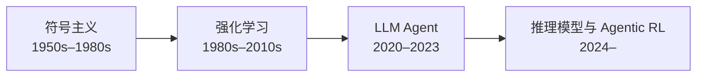
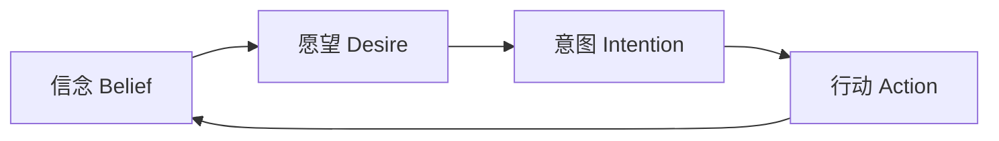
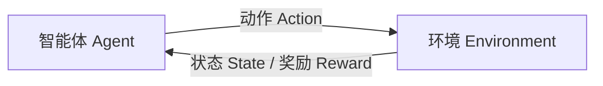
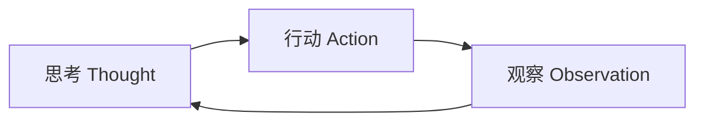

# 第 2 章 Agent 简史：从符号主义到推理模型

## 本章导读

1970 年前后，SRI 的机器人 Shakey 为了把几个箱子挪到指定位置，需要花很长时间做规划；2023 年，AutoGPT 在演示里能自己上网、写文件，却常常在同一个动作上打转。半个世纪过去，硬件和模型都换了几代，Agent 的老问题却换了一身衣服回来：知识从哪来？世界变了怎么办？什么时候该停？

⭐⭐ 入门 ｜ 适合：工程师、产品经理、研究者

## 学习目标

读完本章你将能够：

- 说出 Agent 技术四个阶段的代表系统、核心思想与时代背景
- 用“知识来源、决策机制、泛化方式、主要瓶颈”四个维度比较不同代际的 Agent
- 解释每个阶段解决了什么问题，又把什么问题留给了下一代
- 识别今天 Agent 的失败模式在历史上对应的老问题
- 判断符号主义、强化学习、大语言模型与推理模型在当代系统中是如何叠加的

## 2.1 一条时间线，三个老问题

Agent 不是 2022 年才出现的概念。它至少经历了四个阶段：

第三阶段的 Agent 由**大语言模型（Large Language Model, LLM）** 驱动，本书简称 LLM Agent。语言模型为什么会成为 Agent 的大脑，第 3 章会详细展开；这一章先把它放回历史坐标里。

每个阶段都在回答同样三个问题，只是答案不同：

1. **知识从哪来？** 规则由人写，还是从经验中学，还是从语料中预训练？
2. **世界变了怎么办？** 重新写规则，重新训练，还是靠上下文和工具临场适应？
3. **什么时候该停？** 规划器找到目标状态，回合结束，模型说完成了，还是预算耗尽？

把这三个问题记住，后面的历史就不会是一串名词，而是一部“瓶颈迁移史”。

## 2.2 符号主义：把智能写成规则

### 2.2.1 时代背景与核心想法

1950 到 1980 年代，AI 的主流思路是**符号主义（Symbolism）**：智能就是对符号进行表示、推理和搜索。纽厄尔和西蒙提出“物理符号系统假设”，认为一个物理系统只要具备符号操作能力，就具备产生智能的必要条件。

这个时期的代表性工作包括：

- **逻辑理论家（Logic Theorist，1956）**：用搜索证明数学定理
- **通用问题求解器（General Problem Solver，1957）**：把问题表示为状态空间，用启发式搜索求解
- **STRIPS（1971）**：用前提、动作和效果描述规划问题，成为经典规划的基础
- **专家系统（Expert System）**：把领域知识写成规则，如 1970 年代的 MYCIN 诊断细菌感染、1980 年代的 XCON 配置计算机

在符号主义看来，Agent 的“大脑”是一套显式的知识库和推理机。它知道什么（信念）、想要什么（目标）、打算怎么做（计划），然后执行计划。

### 2.2.2 BDI：把“意图”单独拿出来

符号主义 Agent 最有影响力的架构之一是 **BDI 模型（Belief-Desire-Intention Model）**。它来自哲学家布拉特曼对实践推理的分析，后来被 Rao 和 Georgeff 等人做成可执行的 Agent 架构。

三个概念分别是：

- **信念**：Agent 对世界状态的认知，可能不完整，也可能出错
- **愿望**：Agent 想要达成的目标，可以有多个，甚至互相冲突
- **意图**：Agent 已经承诺要去执行的计划，它约束后续的推理和行动

BDI 的关键贡献是把“权衡”与“执行”分开：先决定要做什么，再承诺去做。这个思想在今天仍然常见——规划器产出计划，执行器按计划行动，遇到异常再重新规划。

### 2.2.3 解决了什么

符号主义解决了几件今天仍然重要的事：

- **显式推理**：每一步为什么这么做，可以追溯
- **规划**：把目标拆成动作序列，并检查前提与后果
- **可验证性**：规则和逻辑让结果可以在形式上检查
- **知识工程**：把领域专家的经验沉淀成可复用的规则

专家系统在狭窄领域取得过真实成功。MYCIN 在细菌感染诊断上达到了专家水平，XCON 帮助 DEC 配置计算机订单。它们证明了“知识 + 推理”可以解决实际问题。

### 2.2.4 留下了什么

符号主义的失败也很典型：

- **知识获取瓶颈（Knowledge Acquisition Bottleneck）**：把专家知识写成规则极其昂贵，而且专家往往说不清自己是怎么判断的
- **脆弱性**：规则覆盖不到的情况，系统直接失效
- **框架问题（Frame Problem）**：世界变化后，哪些事实需要更新、哪些不需要，很难穷举
- **符号接地问题（Symbol Grounding Problem）**：符号与真实世界的感觉经验之间没有天然联系
- **封闭世界假设**：系统默认知识库之外的事情不存在，遇到新情况不会处理
- **常识缺失**：写不完的常识，成了规则系统无法承受的重量

SHRDLU 是这一时期的高光，也是局限的缩影：它能在积木世界里理解自然语言、回答问题、制定计划并执行动作，但一旦离开积木世界，能力几乎归零。**封闭世界里的优秀表现，不等于开放世界里的智能。**

符号主义不是被“证伪”了，而是被开放世界打败了。它的思想没有消失：今天的规划器、工作流引擎、规则引擎、形式化验证，仍然在承担“确定性骨架”的角色。

## 2.3 强化学习：让智能体从试错中学习

### 2.3.1 从规则到经验

1980 年代以后，另一条路线逐渐成熟：与其把知识写进规则，不如让 Agent 与环境交互，从奖励中学习策略。这就是**强化学习（Reinforcement Learning, RL）**。

RL 把问题建模为**马尔可夫决策过程（Markov Decision Process, MDP）**：Agent 在状态 `s` 下选择动作 `a`，环境返回新状态 `s'` 和奖励 `r`，Agent 的目标是最大化长期累积奖励。

核心概念包括：

- **策略（Policy）**：在某个状态下选择动作的规则，通常记为 `π(a|s)`
- **价值函数（Value Function）**：从某个状态或动作出发，未来能获得的期望回报
- **奖励函数（Reward Function）**：告诉 Agent 什么行为是好的

深入了解：MDP 的五元组

一个 MDP 通常写成 `(S, A, P, R, γ)`：

- `S`：状态空间
- `A`：动作空间
- `P(s'|s,a)`：状态转移概率
- `R(s,a,s')`：奖励函数
- `γ`：折扣因子，决定 Agent 更看重眼前还是长期回报

这个形式化的价值在于：一旦问题能写成 MDP，就可以用动态规划、蒙特卡洛、时序差分等方法求解。它的局限也在这里——真实世界很少能干净地写成 MDP。

### 2.3.2 代表性进展

- **Q-learning（1989）**：用表格或函数逼近学习动作价值，是 model-free RL 的经典算法
- **TD-Gammon（1992）**：用时序差分学习玩双陆棋，达到人类高手水平
- **DQN（2013/2015）**：用深度神经网络从像素学习玩 Atari 游戏，开启了深度强化学习
- **AlphaGo（2016）**：结合深度网络、蒙特卡洛树搜索与自我对弈，击败李世石
- **AlphaZero（2017）**：去掉人类棋谱，从零开始自我对弈，在围棋、国际象棋、将棋上达到超人类水平

这些系统的共同点是：**环境规则清晰、奖励明确、可以大量试错**。围棋有确定的规则和胜负，Atari 游戏有分数，机器人在仿真环境里可以反复训练。RL 在这些条件下能学到人类难以手写的策略。

### 2.3.3 解决了什么

- **从经验中学习**：不需要人把策略写出来
- **高维感知**：DQN 可以直接从像素学习
- **序列决策**：把“现在做什么”与“长期后果”联系起来
- **超人类窄域表现**：在规则明确、反馈密集的领域达到或超过人类

### 2.3.4 留下了什么

RL 的局限同样明显：

- **样本效率低**：AlphaGo 下了数百万盘棋，真实世界不允许这样试错
- **奖励设计困难**：奖励写错，Agent 就会优化错误的目标，这就是**奖励黑客（Reward Hacking）**
- **仿真到现实的差距（Sim-to-Real Gap）**：仿真里学会的策略，迁移到真实世界可能失效
- **迁移能力弱**：为一个任务训练的策略，换一个任务往往要从头再来
- **缺少语言与常识**：RL Agent 不天然理解“把冰箱里的牛奶拿来”这类开放指令
- **任务专用**：每个任务都要单独设计状态、动作和奖励

RL 最重要的遗产不是某个算法，而是一个观念：**策略可以从反馈中学出来**。这个观念在 LLM 时代以 RLHF、可验证奖励强化学习、Agentic RL 的形式回来了。

## 2.4 LLM Agent：用语言作为接口

### 2.4.1 为什么大模型改变了游戏

2017 年 Transformer 出现，2020 年 GPT-3 展示了少样本学习能力，2022 年 InstructGPT 与 ChatGPT 让模型学会了遵循指令。对 Agent 来说，最重要的变化不是“模型更会聊天”，而是**语言成了统一的接口**：

- 目标可以用自然语言描述
- 工具可以用自然语言描述
- 观察结果可以转成自然语言
- 推理过程可以用自然语言展开

在此之前，每换一个任务，就要重新定义状态、动作和奖励；在此之后，同一个模型可以通过不同的提示和工具，处理大量不同任务。知识也不再完全依赖人手写规则，而是来自预训练语料。

### 2.4.2 ReAct：把“想”和“做”交替起来

2022 年提出的 **ReAct（Reason + Act）** 是 LLM Agent 的奠基性范式。它让模型交替产生“思考”和“行动”：

一个典型循环是：

1. **思考**：我需要先查这个人的出生年份
2. **行动**：调用搜索工具，查询“某人的出生年份”
3. **观察**：搜索结果返回 1965 年
4. **思考**：现在可以计算年龄了
5. **行动**：调用计算器
6. **观察**：计算结果
7. **思考**：信息足够，给出答案

ReAct 的价值在于：它把符号主义的“规划—行动”、RL 的“与环境交互”、LLM 的“语言推理”放进了同一个循环。模型不再只是一次性生成答案，而是边想边做、边做边看。

### 2.4.3 一波快速演进

2022 到 2023 年，LLM Agent 出现了大量代表性工作：

- **Toolformer（2023）**：让模型学习何时、如何调用外部 API
- **Reflexion（2023）**：让 Agent 根据失败反馈写“反思”，再带着反思重试
- **Tree of Thoughts（2023）**：把推理展开成树，搜索不同思路
- **AutoGPT、BabyAGI（2023）**：把“目标—任务队列—工具—记忆”做成自主循环，第一次让大众直观看到“模型自己做事”
- **Voyager（2023）**：在 Minecraft 中自动探索、把技能写成代码存入技能库、复用技能完成更复杂的任务
- **Generative Agents（2023）**：用记忆流、反思和规划，让多个虚拟角色表现出可信的日常行为

这些工作共同确立了一个新架构：**LLM 负责推理与决策，工具负责行动，上下文负责记忆，循环负责推进。**

### 2.4.4 解决了什么

- **开放任务的语言接口**：不需要为每个任务定义状态和动作
- **零样本与少样本泛化**：靠提示和上下文快速适应新任务
- **组合性**：把搜索、代码、浏览器、文件系统等工具组合起来
- **快速原型**：一个循环加几个工具，就能做出可演示的 Agent
- **自然语言推理**：模型可以解释自己在做什么，至少表面上可读

### 2.4.5 留下了什么

LLM Agent 把老问题换成了新形态：

- **幻觉**：模型会编造事实、编造工具参数、编造执行结果
- **长程可靠性**：一步错，步步错；错误会沿着循环累积
- **上下文限制**：工具结果越堆越多，窗口很快不够用
- **成本与延迟**：多步循环意味着多次模型调用
- **评测困难**：同一个任务有多条合理路径，只看最终答案不够
- **安全面扩大**：工具结果、网页内容、文档都可能藏有恶意指令

AutoGPT 是这一阶段的典型注脚：它证明了循环可行，也证明了**只有循环远远不够**。没有停止条件、预算控制、评测和护栏，演示很容易变成事故。

## 2.5 推理模型与 Agentic RL：把“想得更久”变成能力

### 2.5.1 从“一次生成”到“测试时计算”

2022 年，**思维链（Chain-of-Thought, CoT）** 的研究发现，让模型写出中间步骤可以显著提升多步推理表现。随后出现了自洽性（多次采样后投票）、思维树（搜索不同推理路径）等方法。

2023 年的过程监督研究进一步指出：只奖励最终答案不够，对推理的每一步给出反馈，效果更好。这为后来的推理模型埋下伏笔。

2024 年以后，**推理模型（Reasoning Model）** 成为一个独立品类。以 OpenAI o1（2024）和 DeepSeek-R1（2025）为代表，这类模型在回答前会生成较长的内部推理过程，并通过强化学习优化“如何思考”。它们把**测试时计算（Test-time Compute）** 变成一个新的缩放维度：推理时多花令牌（Token），换更高的正确率。


推理模型的具体训练方法、产品能力与基准分数变化很快。本节只讨论公开可见的范式，不绑定具体版本；实际使用时以官方文档与论文为准。


### 2.5.2 Agentic RL：在环境里训练完整任务

更重要的变化是，强化学习开始直接训练 Agent 的完整行为，而不只是训练“回答问题”。这类方法通常被称为**智能体强化学习（Agentic RL）**：

- 在可交互环境中运行 Agent，收集完整任务轨迹
- 用程序判定任务是否成功，形成**可验证奖励（Verifiable Reward）**
- 用强化学习优化模型在多步任务中的决策

编码 Agent 可以在真实仓库里跑测试，网页 Agent 可以在仿真网站里完成任务，计算机操作 Agent 可以在虚拟机里操作界面。SWE-bench、WebArena、OSWorld 这类基准，既是评测工具，也逐渐成为训练环境。

这解决了传统 LLM Agent 的一个根本问题：**模型没有从“完成任务”的后果中学习过**。预训练学到的是“下一个令牌是什么”，而 Agent 需要的是“下一步做什么才能完成任务”。Agentic RL 试图把这两个目标对齐。

### 2.5.3 解决了什么

- **更强的多步推理**：长思维链让模型能处理更复杂的问题
- **自我纠错**：模型可以在推理过程中发现并修正错误
- **长时程任务**：训练过的 Agent 能在数十步任务中保持目标
- **端到端工具使用**：工具选择与参数生成可以通过环境反馈优化
- **新的缩放维度**：除了模型参数，推理时计算也成为可调的杠杆

### 2.5.4 留下了什么

- **成本与延迟**：更长的推理意味着更高的令牌消耗和更慢的响应
- **推理链的忠实性**：模型写出的推理过程，不一定反映它真实的内部计算
- **开放任务的奖励设计**：有标准答案的任务可以自动判分，开放任务很难
- **奖励黑客的新形态**：Agent 可能学会钻评测环境的空子，而不是真正完成任务
- **评测与安全**：长时程任务更难复现、更难审计、攻击面更大
- **持续学习**：模型仍然难以在不重新训练的情况下稳定积累经验


“推理链”不等于“解释”。模型可能给出看起来合理的步骤，但真实决策依据未必如此。把推理链当作调试线索可以，当作可靠的事后解释要谨慎。


## 2.6 四代 Agent 的对照

把四个阶段放在同一张表里，差异会很清楚：

| 维度 | 符号主义 Agent | 强化学习 Agent | LLM Agent | 推理模型 / Agentic RL |
|---|---|---|---|---|
| 知识来源 | 人工规则、本体、知识库 | 与环境交互的经验 | 预训练语料 + 上下文 | 预训练 + 测试时计算 + 环境训练 |
| 决策机制 | 逻辑推理、状态空间搜索 | 策略与价值函数 | 下一令牌预测 + 工具调用 | 长思维链 + 工具 + 搜索 |
| 泛化方式 | 人工补充规则 | 训练分布内，迁移弱 | 零样本、少样本、上下文适应 | 训练 + 推理时计算扩展 |
| 典型环境 | 积木世界、专家系统 | 游戏、机器人、仿真 | 网页、代码、办公软件 | 长时程任务、真实工作流 |
| 主要优势 | 可解释、可验证、可规划 | 超人类窄域表现 | 语言接口、组合性、快速原型 | 多步推理、长时程、端到端优化 |
| 主要瓶颈 | 知识获取、脆弱性 | 样本效率、奖励设计 | 幻觉、上下文、长程可靠性 | 成本、评测、安全、环境数据 |
| 代表系统 | STRIPS、BDI、MYCIN | DQN、AlphaGo、AlphaZero | ReAct、AutoGPT、Voyager | o1、R1、编码/网页/计算机操作 Agent |

### 2.6.1 三条规律

**第一，瓶颈会迁移，但不会消失。** 符号主义的瓶颈是知识获取，RL 的瓶颈是奖励设计与样本效率，LLM 的瓶颈是上下文与长程可靠性，推理模型的瓶颈是成本、评测与安全。每解决一个瓶颈，系统就会在更大的任务空间里遇到下一个瓶颈。

**第二，接口决定采用速度。** 符号主义要求专家写规则，RL 要求工程师定义状态与奖励，LLM 允许用自然语言描述目标与工具。接口越接近人的表达方式，Agent 越容易被用到新场景。MCP（Model Context Protocol）、A2A（Agent2Agent）这类协议，本质上也是在降低“接入工具”和“接入其他 Agent”的接口成本。

**第三，可靠性来自约束，不来自能力。** 每个阶段真正落地的系统，都不是“放手让它跑”，而是加了约束：规划的时间与深度限制、仿真的边界、循环的停止条件、工具的权限、输出的校验。能力决定上限，约束决定能不能上线。

### 2.6.2 这不是替代史，而是叠加史

今天的生产系统往往同时包含四代思想：

- 用**工作流**固定确定性步骤（符号主义的骨架）
- 用**强化学习**训练模型或优化策略（RL 的遗产）
- 用**LLM**理解目标、选择工具、生成行动（语言接口）
- 用**推理模型**处理复杂子问题，用评测与护栏约束行为（推理模型时代的工程）

Atlas 也是这样：`StopPolicy` 是符号主义规划终止条件的现代版本，`Budget` 是 RL 回合约束的投影，`ContextBuilder` 回应 LLM 时代的上下文问题，第 15–17 章的评测与护栏则承接推理模型时代对可验证性与安全的要求。

## 2.7 动手实践：给一个 Agent 产品做历史体检

这一章不写代码。Part 1 的实践目标是建立判断力，所以这次动手是“用历史视角做诊断”：选一个你实际用过的 Agent 产品，按下面五步产出一页纸的体检报告。不要凭宣传材料猜，只记录你亲眼看到的行为。

**第一步：选对象并取证。** 写下产品名、你用它完成的任务，以及 3 个具体行为。例如“它先列出计划再逐步执行”“它连续两次调用同一个搜索接口”“它在给出结论前回头核对了来源”。只记录行为，先不评价。

**第二步：填四代证据表。** 对每一代思想，找出产品中可观察的证据：

| 代际 | 要问的问题 | 你看到的证据 |
|---|---|---|
| 符号主义 | 哪些步骤是固定工作流、规则或校验？ |  |
| 强化学习 | 是否有试错、反馈学习或奖励优化的痕迹？ |  |
| LLM Agent | 哪些决策由模型临场做出？工具和目标如何描述？ |  |
| 推理模型 / Agentic RL | 是否有长推理、测试时计算或可验证的中间检查？ |  |

**第三步：定位瓶颈。** 把观察到的失败映射回历史上的老问题：

| 你观察到的失败 | 对应的历史老问题 | 今天可能的工程手段 |
|---|---|---|
| 反复调用同一个工具 | 停止条件、框架问题 | 显式停止策略、重复动作检测 |
| 编造工具参数 | 符号接地、知识获取 | JSON Schema 校验、错误回传 |
| 被网页内容带偏 | 开放世界、对抗输入 | 提示注入防护、来源隔离 |
| 忘记最初目标 | 意图保持、长程规划 | 计划重述、上下文重建 |
| 为通过评测钻空子 | 奖励黑客 | 多维度评测、隐藏测试集 |

**第四步：用 Atlas 做一次纸上推演。** Atlas 还没有代码，但接口已经冻结。把它的组件放回历史里看：`StopPolicy` 与 `Budget` 是符号主义规划终止条件和 RL 回合约束的现代版本；`ContextBuilder` 回应 LLM 时代的上下文限制；`Tracer` 与 `Evaluator` 把可验证性工程化；`Guard` 与 `ApprovalHandler` 约束开放世界带来的风险。这说明 Atlas 不是“纯 LLM 架构”，而是四代思想的叠加。第 4 章会把这张纸上的推演变成可运行代码。

**第五步：写结论。** 用四句话收尾：

1. 这个产品最强的一代是 ____，证据是 ____。
2. 它最像在补的历史短板是 ____。
3. 如果只加一个工程约束，我会先加 ____，因为 ____。
4. 我体检前的判断是 ____，体检后改为 ____。

## 2.8 业界案例

### 2.8.1 SHRDLU：符号主义的高光与边界

SHRDLU 是 MIT 的 Terry Winograd 在 1968 到 1970 年间开发的系统。它在一个虚拟的积木世界里工作，用户可以用自然语言指挥它：

> “把红色方块放到绿色金字塔上面。”
> “哪个方块支撑着金字塔？”
> “先拿起那个小方块，再把它放到大盒子旁边。”

SHRDLU 能理解指代、回答关于场景的问题、制定动作计划并执行。它在当时看起来像是“通用智能”的雏形。

但它的能力完全建立在积木世界的封闭假设上：物体类型有限、规则明确、语言范围受限、知识由人手工编码。换一个世界，系统就无法工作。

**启示**：在封闭世界里做到“理解—规划—行动”的闭环是可能的；难点从来不是闭环本身，而是开放世界中的知识、泛化与常识。

### 2.8.2 AlphaGo / AlphaZero：强化学习的高光与边界

2016 年，DeepMind 的 AlphaGo 击败李世石；2017 年，AlphaZero 从零开始自我对弈，在多个棋类上达到超人类水平。

它们成功的原因可以归结为三个条件：

1. **规则清晰**：围棋的状态、动作、胜负完全可定义
2. **反馈明确**：每盘棋都有确定的胜负
3. **可以大量试错**：自我对弈可以在短时间内产生海量经验

这三个条件在真实业务中很少同时成立。真实世界的规则会变，反馈往往延迟且模糊，试错有成本甚至有风险。这就是为什么 AlphaGo 式的 RL 很难直接搬到开放任务上。

**启示**：当仿真便宜、奖励明确时，RL 可以做到超人类；当环境开放、反馈昂贵时，Agent 必须依赖先验知识、工具和人的监督。

### 2.8.3 Voyager：LLM Agent 的长时程探索

2023 年的 Voyager 是一个在 Minecraft 中自主探索的 LLM Agent。它的架构包含三个关键部分：

- **自动课程**：根据当前能力生成下一个合适的目标，而不是一开始就挑战最难任务
- **技能库**：把学会的行为写成可执行代码，存入技能库，供后续复用
- **自我验证**：用执行结果判断技能是否学会，失败就迭代改进

Voyager 能在游戏中持续探索、解锁科技树、积累越来越复杂的技能。它展示了 LLM Agent 的一个重要方向：**记忆 + 可复用技能 + 自我验证**，可以让 Agent 在长时程任务中不断进步。

它的局限也同样明显：环境是游戏，接口由游戏 API 提供，试错成本低，成功标准相对明确。换到真实业务，环境更复杂、反馈更贵、错误更不可逆。

**启示**：长时程 Agent 的关键不只是“更长的循环”，而是“能积累、能复用、能验证”。

### 2.8.4 三个案例的对照

| 案例 | 时代 | 核心机制 | 解决了什么 | 没解决什么 |
|---|---|---|---|---|
| SHRDLU | 符号主义 | 规则、语义解析、规划 | 封闭世界里的语言—行动闭环 | 开放世界、学习、常识 |
| AlphaGo / AlphaZero | 强化学习 | 自我对弈、搜索、价值网络 | 规则明确领域的超人类决策 | 迁移、开放环境、语言接口 |
| Voyager | LLM Agent | 自动课程、技能库、自我验证 | 长时程探索与技能复用 | 真实环境、成本、安全 |

## 2.9 常见误区

**误区一：Agent 是 2022 年才出现的新事物。** 把“LLM Agent 的流行”当成“Agent 的起点”。目标、规划、记忆、行动这些概念，符号主义与 RL 已经研究了几十年。把今天的系统放进历史坐标里看：LLM 改变的是知识来源与交互接口，不是 Agent 的全部定义。

**误区二：符号主义已经过时，不值得学。** 只看到专家系统的失败，没看到它的思想仍在工作流引擎、规划器、规则引擎、形式化验证里发挥作用。把符号主义当作“确定性骨架”的工具箱：Agent 需要它来约束不确定的部分，而不是取代它。

**误区三：RL Agent 和 LLM Agent 是两条互斥的路线。** 把训练方式与交互方式混为一谈。RL 可以训练 LLM，LLM 可以作为 RL 的策略网络，两者正在合流。分开看“模型从哪里来”和“Agent 如何行动”，Agentic RL 就是两者结合的产物。

**误区四：模型越强，工程就越不重要。** 历史上每次能力提升，都把瓶颈从一处搬到另一处，而不是消灭瓶颈。模型更强，工具、上下文、评测、安全的问题反而更突出。把模型能力当成变量，把工程约束当成常量；无论模型多强，停止条件、权限、预算、验证都不能省。

**误区五：AutoGPT 的失败说明 Agent 不可行。** AutoGPT 证明的是“无约束的自主循环不可靠”，不是“Agent 没有价值”。它暴露的循环退化、目标漂移、成本失控，后来都变成了工程问题。把失败拆成可修复的组件：停止条件、目标保持、预算、可观测性。这些正是第 15–17 章的内容。

## 2.10 本章小结

- **四个阶段**：符号主义（规则与推理）→ 强化学习（经验与奖励）→ LLM Agent（语言与工具）→ 推理模型与 Agentic RL（测试时计算与环境训练）。
- **一条主线**：每个阶段都在回答“知识从哪来、世界变了怎么办、什么时候该停”，只是答案不同。
- **符号主义**留下了规划、可解释性与可验证性，也留下了知识获取瓶颈与脆弱性。
- **强化学习**留下了“从反馈中学习策略”的观念，也留下了样本效率、奖励设计与迁移问题。
- **LLM Agent** 用语言统一了目标、工具与观察，把 Agent 从实验室推向工程，但也放大了幻觉、长程可靠性与安全问题。
- **推理模型与 Agentic RL** 把“想得更久”和“从任务结果中学习”变成能力，代价是成本、评测与安全难度的上升。
- **三条规律**：瓶颈会迁移；接口决定采用速度；可靠性来自约束。
- **历史是叠加的**：现代 Agent 同时使用工作流、RL、LLM 与推理模型，而不是用一代替代另一代。

## 2.11 思考与练习

1. **给系统找年代**：判断以下系统主要属于哪个阶段，并说明它的核心机制：

   1. 一个用 PDDL 描述任务、用规划器生成动作序列的仓储机器人
   2. 一个用自我对弈训练、在模拟环境中玩策略游戏的系统
   3. 一个用 ReAct 循环调用搜索与计算器、回答开放问题的助手
   4. 一个在真实代码仓库中跑测试、用任务成败训练多步修复策略的编码 Agent

   对每一个，指出它最可能卡在哪个瓶颈上。

2. **失败考古**：选择三个你在真实项目或公开复盘中见过的 Agent 失败模式，例如：

   - 反复调用同一个工具，陷入循环
   - 编造不存在的工具参数
   - 被网页中的恶意指令带偏
   - 目标漂移，忘了最初的任务
   - 为了通过评测而钻空子

   把每个失败模式映射到历史上的一个老问题：知识获取、框架问题、符号接地、奖励设计、开放世界泛化、停止条件。说明它们的相似之处，以及今天的工程手段能修复哪一部分。

3. **两个产品，一句话历史定位**：选两个你熟悉的 Agent 产品，各写一句判断：它主要继承了哪一代的思想？最可能卡在哪个瓶颈？再补一句：如果只能加一个约束，你会加什么。每句判断都要附上你观察到的具体行为作为证据，不接受“感觉它很智能”这类描述。


下一章进入 Agent 的“大脑”：大语言模型。我们不再按时间线走，而是回答一个更工程化的问题——一个模型要具备哪些能力，才能支撑一个可靠的 Agent？

