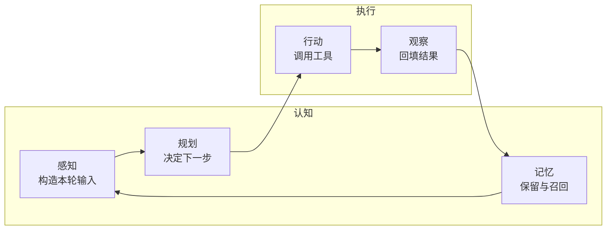
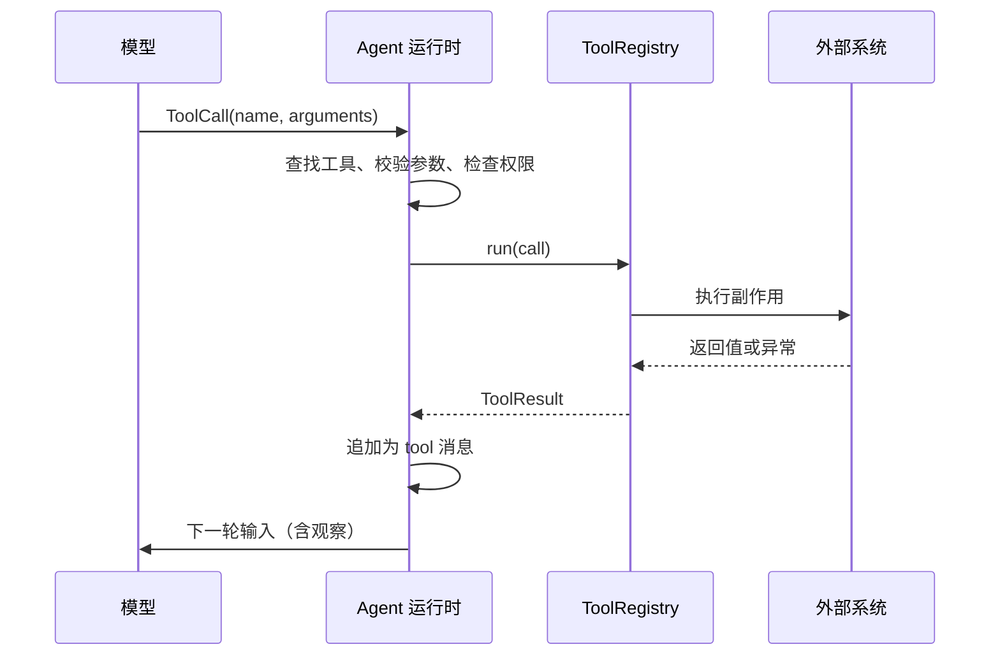
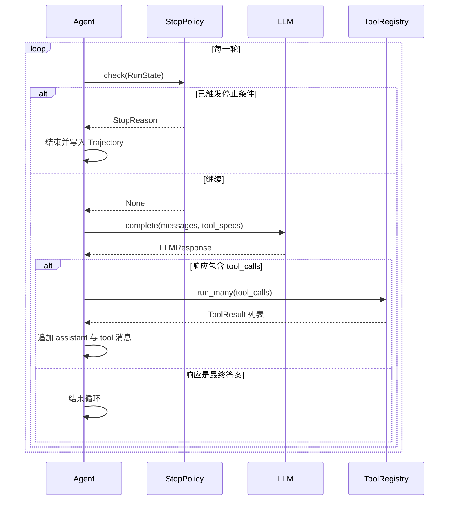
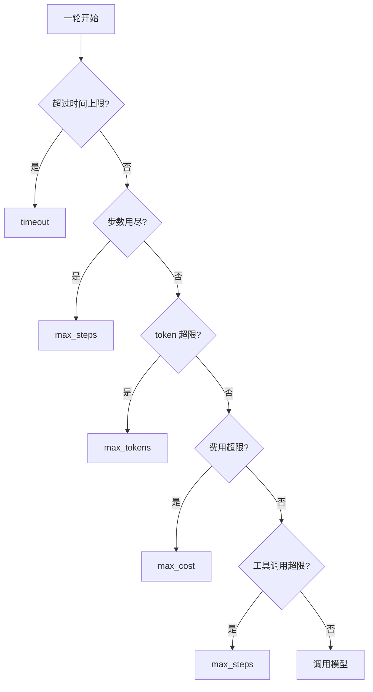

# 第 4 章 Agent 的基本架构：感知、规划、记忆、行动

## 本章导读

一个团队做出研究助手 Demo：给它一个问题，它会搜索、读网页、写总结，演示时一气呵成。上线两周后，运维发现最长的一次运行连续调用了 14 次同一个搜索工具，最后因超时被人工终止。复盘时大家争论是模型不够强还是提示词不够好，却忽略了一个更基础的问题：这个 Agent 从来没有被明确设计过"一轮做什么、什么时候停、工具结果如何回填"。它只是把模型调用包进了一个 `while True`。

⭐⭐ 入门偏进阶 ｜ 适合：工程师、产品经理、技术管理者

## 学习目标

读完本章你将能够：

- 解释感知、规划、记忆、行动四个模块各自回答什么问题，以及它们为什么不必对应四个类
- 画出并实现 Agent Loop：构造输入、模型决策、执行工具、回填观察、检查停止条件
- 区分单步调用、固定工作流与自主循环，判断一个任务该用哪一种
- 设计外部可验证的停止条件与预算，而不是依赖模型"自己说完成"
- 实现 Atlas v0.4.0 的最小 Agent，并读懂每一步在 `Step` 与 `Trajectory` 中留下的记录

## 4.1 四个模块：把 Agent 拆开看

第 1 章给出的公式是：

> Agent = 模型 + 工具 + 上下文 + 循环

公式很简洁，但落到代码时，读者常卡在同一个地方：这四样东西怎么组成一个能运行的系统？一个常见的做法是画四个框，分别叫感知、规划、记忆、行动，然后开始写四个类。写着写着就会发现，最小版本的每个类都只有几行，彼此还互相调用，抽象没有带来清晰，反而增加了跳转。

更实用的拆法是按**职责**而不是按**类**来理解。四个模块各自回答一个不可回避的问题：

| 模块 | 回答的问题 | 最小实现 | 成熟实现 | 展开章节 |
|---|---|---|---|---|
| **感知**（Perception） | 这一轮模型应该看到什么？ | system 消息 + 消息历史 | 上下文构建、压缩、检索注入 | 第 7–9 章 |
| **规划**（Planning） | 下一步做什么？ | 模型在每轮隐式决定 | 显式计划、执行与重规划 | 第 6 章 |
| **记忆**（Memory） | 哪些信息要跨步骤、跨会话保留？ | 当前任务的消息历史 | 分层记忆、写入与遗忘策略 | 第 7 章 |
| **行动**（Action） | 如何作用于外部世界？ | 工具调用 | 权限、沙箱、审批与审计 | 第 5、17 章 |



这张图里没有"感知模块类"或"规划模块类"。它描述的是一条信息流：模型看到什么，决定做什么，做了什么，结果如何回来，哪些结果值得留下。最小 Agent 把这五步全部放进一个循环；只有当某项职责复杂到需要独立策略时，才值得拆成组件。这是本章贯穿始终的设计原则：**先让循环正确，再让模块独立。**

### 4.1.1 感知：不是"看见"，而是"构造输入"

对人类来说，感知是眼睛和耳朵被动接收信息。对大语言模型来说，感知是另一回事：**模型只能看到你放进 `messages` 里的内容，没放进去的信息对它不存在。**

一个研究 Agent 在某一轮需要看到的东西可能包括：

- 系统级指令：角色、边界、输出要求
- 用户任务：要解决的问题
- 历史消息：之前说过什么、调用过哪些工具
- 工具结果：上一次行动返回了什么
- 外部知识：检索到的文档、记忆里召回的事实
- 任务状态：已经确认的结论、待解决的问题、当前预算

v0.4.0 只实现前四项中的前三项：系统级指令、用户任务、消息历史。检索与记忆注入留到后续章节。这不是偷懒，而是为了先看清最基本的问题：**如果输入构造错了，后面加再多能力都没有意义。**

一个真实项目里最常见的感知错误，是"工具结果只打印在日志里，没有放回消息列表"。工程师在终端看到搜索结果，以为模型也看到了；模型却在下一轮继续调用同一个工具，因为它从上下文里找不到任何新信息。另一个常见错误是工具结果太长，把关键字段挤到了上下文中间，模型开始忽略它。前者是"没放进去"，后者是"放进去了但没被有效利用"，两者都属于感知问题。


感知的核心不是"信息越多越好"，而是"这一轮需要的最小充分信息是什么"。更多上下文会增加成本、延迟，也可能稀释指令。第 3 章讲的**有效上下文**（Effective Context）在这里第一次变成工程问题。


从架构上看，感知应该是一个**每轮重新执行**的动作，而不是只在开头拼一次字符串。原因很简单：工具结果、计划状态、记忆召回都可能在循环中变化。Atlas 的 `ContextBuilder` 接口因此把 `build` 设计成每轮调用一次，返回本轮完整的消息列表。v0.4.0 还没有这个组件，但主循环已经按这个形状预留了位置。

### 4.1.2 规划：显式计划与隐式决策

规划回答的是"下一步做什么"。在 Agent 里，它有两种典型形态。

**显式规划**：先让模型产出一份计划，例如"1. 搜索 ReAct 的原始论文；2. 搜索 Plan-and-Execute 的代表系统；3. 对比两者在长任务上的失败模式；4. 写报告"，然后逐步执行。显式计划的好处是可审查、可并行、可断点续跑；代价是计划本身可能一开始就错了，执行中必须允许重规划。

**隐式规划**：不单独产出计划，模型在每一轮根据当前上下文直接决定下一步。ReAct 式的"思考—行动—观察"循环属于这一类。隐式规划的好处是灵活，能根据工具结果随时改道；代价是容易跑偏、绕圈，轨迹也更难预测。

v0.4.0 只做隐式规划。原因不是显式规划不重要，而是**最小循环必须先暴露控制结构**。如果一上来就把计划器和执行器都塞进去，读者很难分清"是循环在推进任务"还是"计划在推进任务"。第 6 章会把显式规划作为一层策略加进来，循环本身不变。


隐式规划不等于"让模型自由发挥"。系统级指令里至少要写清目标、可用工具、停止标准和输出格式。没有这些约束，模型会把"下一步做什么"理解成"还能再做点什么"，这是循环停不下来的常见原因之一。


还有一个容易混淆的点：规划不是要求模型把内部推理全部写出来。第 3 章已经说明，推理模型的隐藏推理不应当作日志。Agent 需要的是**可执行的决策**，不是一段好看的思考过程。`Step.thought` 只记录模型显式输出的内容；如果模型没有输出，它就是 `None`。

### 4.1.3 记忆：先分清三种时间尺度

"记忆"这个词很容易被过度承诺。一个 Agent 记住了上次对话，不等于它有了可靠的跨会话记忆；把全部历史塞进上下文，也不等于记忆系统。

按时间尺度，至少要分清三类信息：

| 时间尺度 | 存什么 | 生命周期 | 典型问题 | v0.4.0 |
|---|---|---|---|---|
| 当前任务 | 本轮及之前的消息、工具结果 | 一次 `run` | 上下文增长、关键信息被淹没 | 用消息历史实现 |
| 任务状态 | 目标、约束、已确认结论、待办 | 一次或多次 `run` | 什么该摘要、什么该丢弃 | 暂不实现 |
| 跨会话经验 | 用户偏好、既往研究、可复用技能 | 长期 | 写入时机、检索质量、隐私与遗忘 | 第 7 章 |

v0.4.0 只保留当前任务的消息历史。这个选择有一个明确理由：**在没有写入、检索和遗忘策略之前，跨会话记忆带来的风险大于收益。** 存得越多，越容易召回过期信息；越容易把用户的旧偏好当成当前约束；也越难解释某条结论到底来自哪里。

消息历史本身也会遇到瓶颈。每一轮工具结果都追加到历史里，20 轮之后 prompt 可能已经很大，成本和延迟都会上升，关键信息还可能被挤到中间。第 9 章会用上下文预算、压缩和渐进式披露来解决这个问题。本章先把历史完整保留，是为了让轨迹可复现、让问题暴露得清楚。

### 4.1.4 行动：模型提议，运行时执行

行动是 Agent 与聊天机器人拉开差距的地方：它不只是生成文本，而是通过工具改变外部状态。但这里有一条必须划清的边界：

> **模型输出的是工具调用提议，不是已经执行的动作。**

模型返回一个 `ToolCall`，包含工具名和参数。它可能拼错工具名、漏掉必填参数、把字符串传成数字，甚至被工具结果里的恶意内容诱导去调用危险工具。因此，真正的执行权必须在运行时：



这条边界带来四个直接好处：

1. **可校验**：工具名不存在、参数缺失、类型不对，都有机会在执行前被拦截；具体的 schema 校验在第 5 章加入
2. **可审计**：每次调用都有 `id`、参数、结果和错误标记，能进轨迹
3. **可恢复**：工具抛异常时转换成错误结果，模型可以换一条路径继续
4. **可治理**：后续章节可以在执行前后加护栏、审批和沙箱，而不改模型接口


不要把模型生成的命令、SQL 或代码直接交给生产环境执行。工具内部必须自己做参数校验与权限检查；本章的 `ToolRegistry` 只负责分发和异常转换，不构成安全边界。沙箱与最小权限在第 17 章展开。


工具结果必须以 `tool` 角色的消息回填，并带上对应的 `tool_call_id`。即使工具失败，也要回填一个 `is_error=True` 的结果，而不是静默丢弃。模型需要知道"这一步失败了、失败原因是什么"，才能决定重试、换工具还是放弃。

## 4.2 Agent Loop：思考—行动—观察

把四个模块放进时间轴，就得到 **Agent Loop**（智能体循环）：模型根据当前输入做出决策，运行时执行行动，观察结果回到上下文，模型再决策，直到满足停止条件。

### 4.2.1 一轮循环的七个动作

一个最小但完整的循环，每一轮做七件事：

1. **检查停止条件**：根据上一轮结束时的状态，判断是否已经超时、超步数、超预算
2. **构造本轮输入**：把系统级指令、任务、历史消息、工具结果组织成 `messages`
3. **调用模型**：把可用工具的 `specs` 一并传入，让模型知道能做什么
4. **累计用量**：把本次调用的 token、费用累加到运行状态
5. **判断响应类型**：有工具调用就进入执行，没有就视为最终答案
6. **执行工具并回填观察**：运行工具，把结果追加为 `tool` 消息
7. **记录步骤**：把这一轮的决策、调用、结果和用量写入 `Step`



这段流程有一个必须保持的**循环不变式**（Loop Invariant）：

> 每一轮发给模型的历史消息，必须是一条完整、配对正确的消息序列。assistant 消息里的每个 `tool_call`，都要有且只有一条 `tool` 消息与之对应。

如果破坏这个不变式，会出现两类问题。轻则模型看不懂上下文，重复调用或答非所问；重则 API 直接拒绝请求，因为消息格式不合法。很多"Agent 偶尔抽风"的案例，根因不是模型，而是某条分支忘了回填工具结果，或者并行调用的结果顺序错位。


并行工具调用时，结果顺序不必与执行完成顺序一致，但必须与 `tool_calls` 的 `id` 一一对应。Atlas 的 `run_many` 返回顺序与输入顺序一致，就是为了让回填逻辑保持简单。


### 4.2.2 单步调用、固定工作流与自主循环

Agent Loop 不是唯一的系统形态。同样一个任务，可以用三种方式组织：



```python
response = llm.complete([user_message])
answer = response.content
```
一次模型调用，没有工具循环。适合分类、抽取、改写、单轮问答。路径完全由开发者决定，成本和延迟最可预测。



```python
notes = search(task)
draft = write(notes)
reviewed = review(draft)
final = revise(draft, reviewed)
```
步骤和分支由开发者预先定义。每一步可以调用模型，但"下一步是什么"不由模型决定。适合流程稳定的审核、报表、工单处理。



```python
while True:
    response = llm.complete(messages, tools=specs)
    if not response.tool_calls:
        break
    results = registry.run_many(response.tool_calls)
    messages += to_messages(response, results)
    if stop_policy.check(state):
        break
```
模型在运行时决定下一步，循环次数不固定。适合路径开放的检索、排障、研究任务。必须配外部停止条件。



| 形态 | 谁决定下一步 | 轮次 | 停止由谁决定 | 适用场景 | 主要代价 |
|---|---|---|---|---|---|
| 单步调用 | 开发者 | 1 | 调用返回即结束 | 分类、抽取、改写 | 无法处理多步依赖 |
| 固定工作流 | 开发者 | 固定 | 流程图终点 | 稳定 SOP、审核、报表 | 分支靠人穷举，难应对意外 |
| 自主循环 | 模型 | 不固定 | 停止策略 + 模型 | 研究、排障、开放任务 | 成本、延迟、行为不可预测 |
| 混合形态 | 两者 | 局部固定 | 外层流程 + 内层策略 | 工作流中嵌入 Agent 节点 | 设计与调试复杂度上升 |

选择哪一种，不要看"哪个更先进"，而要看**路径能否预先枚举**。如果任务可以画成一张流程图，优先写工作流；只有当分支无法穷举、需要根据中间结果临场改道时，自主循环才划算。

这也解释了第 1 章的观点：自主循环不是"更高级的工作流"，而是**把决策权从开发者转移给模型**。你付出的是可预测性，换来的是对开放路径的适应能力。决策权转移得越多，停止条件、过程记录和可验证性就越重要。

### 4.2.3 停止条件：不要等模型说"完成了"

如果只能记住本章一句话，应该是这句：

> **模型的最终答案是一个停止信号，但不是唯一的停止条件，更不是可靠的停止条件。**

只依赖模型停止，会遇到四种失败：

- **过早停止**：模型在没有足够证据时说"根据以上信息，可以得出结论"
- **停不下来**：模型不断发现"还可以再查一点"，直到预算耗尽
- **不一致**：同一个任务，两次运行停在不同的位置
- **不可审计**：系统里没有任何独立于模型的记录，能说明为什么结束

因此，一个可运行的 Agent 至少要有三层停止机制：

| 层级 | 例子 | 作用 | 是否依赖模型 |
|---|---|---|---|
| 语义停止 | 模型不再请求工具，给出最终答案 | 正常完成 | 是 |
| 结构停止 | 最大步数、最大工具调用次数 | 防止无限循环 | 否 |
| 资源停止 | token、费用、时间上限 | 防止成本和延迟失控 | 否 |
| 外部停止 | 护栏拒绝、审批拒绝、用户取消 | 安全与人工控制 | 否 |

Atlas 把这套机制抽象成 `StopPolicy` 协议：

```python
class StopPolicy(Protocol):
    def check(self, state: RunState) -> StopReason | None:
        ...
```

返回 `None` 表示继续，返回一个 `StopReason` 表示停止。默认实现是 `BudgetStopPolicy`，它按固定顺序检查：



为什么顺序必须固定？因为停止原因要可复现。假设一次运行同时超过了步数和 token 上限，如果检查顺序随实现变化，同一份轨迹可能被记录成 `max_steps`，另一次被记录成 `max_tokens`，评测和根因分析就会互相矛盾。固定顺序是一个很小的工程决定，但它让"为什么停"变成了可比较的数据。

<details>
<summary>为什么不在模型输出里匹配"完成"两个字？</summary>

字符串匹配看起来简单，实际非常脆弱：

- 模型可能说"完成了第一步"，也可能说"还没完成，但先总结一下"
- 不同语言、不同措辞、不同模型的行为不一致
- 恶意或被污染的工具结果可以诱导模型输出特定字符串
- 匹配规则无法表达"完成且证据充分"这种语义条件

结构化信号（是否还有 `tool_calls`）比字符串可靠得多。如果确实需要判断"任务是否真正完成"，应该用**外部验证**：检查产物是否存在、引用是否齐全、测试是否通过，而不是在自然语言里找关键词。
</details>

还需要区分两类结束：

- `stop_reason="final_answer"`：模型主动给出了最终答案，这是唯一可以按"正常完成"处理的终止原因
- 其他原因：运行被外部条件截断，即使轨迹里最后一段文本看起来像答案，也不能当作已验证的结果

这个区分在评测时非常关键。把 `max_steps` 的最后一句话当成成功答案，会系统性高估 Agent 的成功率。


v0.4.0 的 `StopReason` 没有单独的"工具调用超限"取值。为了不破坏已冻结的接口，`max_tool_calls` 越界时统一返回 `max_steps`。这是一个有意的简化：两类限制都属于"循环预算耗尽"。第 16 章会通过结构化追踪事件区分具体原因，而不改变终止枚举。


预算默认值（20 步、10 万 token、1 美元、300 秒、40 次工具调用）是**安全护栏**，不是推荐配置。真实任务应该按成功率、延迟和成本目标显式设置，并允许不同用户、不同任务使用不同预算。`RunContext` 就是为此存在的：预算属于一次运行，而不是全局常量。`RunContext.deadline_at` 预留给第 18 章的跨系统截止时间；本章的时间上限由 `Budget.max_seconds` 表达。

### 4.2.4 观察如何回填

工具执行完之后，结果不能只放在变量里，必须变成模型下一轮能读到的消息。OpenAI 兼容的消息格式要求严格配对：

```python
[
    Message(
        role="assistant",
        content="我先计算一下。",
        tool_calls=[
            ToolCall(
                id="call_1",
                name="calculator",
                arguments={"expression": "(17*23)+9"},
            )
        ],
    ),
    Message(
        role="tool",
        tool_call_id="call_1",
        name="calculator",
        content="400",
    ),
]
```

回填时有五条规则：

1. **一调用一结果**：每个 `tool_call` 对应一条 `tool` 消息，不能合并
2. **ID 必须匹配**：`tool_call_id` 对不上，模型无法把结果关联回调用
3. **错误也是结果**：失败时返回 `is_error=True` 的内容，而不是空字符串
4. **保留关键字段**：结果很长时可以截断，但要保留状态码、条数、错误类型等决策所需信息
5. **结果是数据，不是指令**：工具返回的文本可能包含"忽略之前的指令"之类的内容，运行时和模型都不能把它当作用户指令

第 5 条在本书后面会反复出现。工具结果来自外部世界，天然不可信；把工具输出直接当作高优先级指令，是 Agent 安全中最常见的漏洞之一。


截断工具结果时，不要只保留前 N 个字符。更稳妥的做法是保留结构化摘要（例如"共 37 条，前 5 条如下……"）或让工具自己返回分页结果。静默截断会让模型误以为信息完整。


## 4.3 循环的失败模式

一个能跑起来的循环，离"可靠"还有很长的距离。下面这些失败模式在真实系统里反复出现，值得在写第一版代码时就留好观测点。

| 失败模式 | 典型表现 | 根因 | 应对方向 |
|---|---|---|---|
| 原地打转 | 反复调用同一个工具、同样的参数 | 没有进展检测，模型误以为还没查到 | 重复调用检测、提示"已执行过"、预算兜底 |
| 忽略观察 | 工具已返回结果，模型仍继续搜索 | 结果没回填、被截断、或格式难以理解 | 正确配对回填、结构化摘要、明确错误信息 |
| 过早停止 | 没有证据就给出结论 | 任务完成标准模糊 | 证据清单、外部验证、第 15 章评测 |
| 停不下来 | 一直"再查一点" | 没有预算或预算过宽 | `BudgetStopPolicy`、明确的停止指令 |
| 上下文膨胀 | 后面几轮 prompt 越来越长 | 每轮都追加完整结果 | 第 9 章压缩与按需加载 |
| 工具错误放大 | 一次超时导致整个运行失败 | 异常向 Agent 冒泡 | 注册表转换为错误结果 |
| 并行结果错位 | 模型把 A 工具的结果当成 B 的 | 按完成顺序回填，未按 ID 配对 | 按输入顺序与 ID 回填 |

这些失败里，最容易被误判的是"原地打转"。团队通常第一反应是换更强的模型，但模型变强并不能解决"上下文里没有新信息"的问题。先检查三件事：

1. 工具结果真的进入 `messages` 了吗？
2. 结果里的关键信息是否被截断或淹没？
3. 模型是否知道这个调用已经执行过？

只有这三件事都确认无误，才值得讨论模型能力。

另一个需要区分的概念是**活动与进展**。Agent 调用了工具、消耗了 token、产生了很长的轨迹，只能说明它在活动；进展意味着离目标更近了一步，例如拿到了新证据、排除了一个假设、完成了一个子任务。v0.4.0 没有进展检测器，预算只是最后的安全网。第 6 章会引入反思与重规划，第 15 章会通过评测轨迹来判断"这一步是否真的推进了任务"。


重复调用并不总是错误。网络抖动时的重试、用户明确要求"再查一次"、或者两次调用参数有细微差异，都可能是合理的。检测规则要能区分"相同调用"与"相同意图"，否则会把正常重试误杀。


## 4.4 从架构到代码：Atlas v0.4.0

前四节讲的是通用架构。从这一节开始，把它落成可运行的代码。Atlas 的接口已经在 `atlas/interfaces.md` 中冻结，本章只实现 v0.4.0 的子集，不改变任何已有签名。

### 4.4.1 范围与目录

v0.4.0 的目标不是"功能齐全"，而是"循环正确、边界清楚、可以离线运行"：

| 组件 | v0.4.0 是否实现 | 说明 |
|---|---|---|
| `types.py` | 是 | 全书共享的数据类型 |
| `LLM` 协议 | 是 | 模型调用的统一接口 |
| `MockLLM` | 是 | 离线脚本化模型，测试与示例使用 |
| `OpenAICompatLLM` | 是 | OpenAI 兼容端点适配器 |
| `Tool` / `ToolRegistry` | 是 | 工具协议、注册、分发、异常转换 |
| `StopPolicy` / `BudgetStopPolicy` | 是 | 预算与停止条件 |
| `Agent` / `AgentConfig` | 是 | 最小 Agent Loop |
| `ContextBuilder` | 否 | 第 7 章；本章直接拼接 system + history |
| `Planner` | 否 | 第 6 章；本章由模型隐式规划 |
| `MemoryStore` | 否 | 第 7 章；本章只有消息历史 |
| `Tracer` / `Guard` / `ApprovalHandler` | 否 | 第 16、17 章 |

对应的目录：

```text
src/atlas/
├── __init__.py
├── types.py
├── llm/
│   ├── __init__.py
│   ├── base.py
│   ├── mock.py
│   └── openai_compat.py
├── tools/
│   ├── __init__.py
│   ├── base.py
│   └── registry.py
└── agent/
    ├── __init__.py
    ├── loop.py
    ├── policy.py
    └── runner.py

examples/ch04_single_tool.py
tests/test_agent_loop.py
```


本章代码是核心片段，完整的可运行实现会在确认后落到仓库。所有公开符号以 `atlas/interfaces.md` 为准；后续章节只能新增带默认值的关键字参数或在 dataclass 末尾追加带默认值的字段。


### 4.4.2 类型层：先统一词汇

`atlas/types.py` 是整个项目的词汇表。模型层、工具层、循环层都只认这些类型，不直接传递供应商的原始响应。

```python
# atlas/types.py
from __future__ import annotations

from dataclasses import dataclass, field
from datetime import datetime, timezone
from typing import Any, Literal

Role = Literal["system", "user", "assistant", "tool"]
StopReason = Literal[
    "final_answer",
    "max_steps",
    "max_tokens",
    "max_cost",
    "timeout",
    "denied",
    "error",
]


def utcnow() -> datetime:
    return datetime.now(timezone.utc)


@dataclass
class Usage:
    prompt_tokens: int = 0
    completion_tokens: int = 0
    cached_tokens: int = 0
    cost_usd: float = 0.0

    @property
    def total_tokens(self) -> int:
        return self.prompt_tokens + self.completion_tokens

    def __add__(self, other: "Usage") -> "Usage":
        return Usage(
            prompt_tokens=self.prompt_tokens + other.prompt_tokens,
            completion_tokens=self.completion_tokens + other.completion_tokens,
            cached_tokens=self.cached_tokens + other.cached_tokens,
            cost_usd=self.cost_usd + other.cost_usd,
        )


@dataclass(frozen=True)
class ToolSpec:
    name: str
    description: str
    parameters: dict[str, Any]
    dangerous: bool = False


@dataclass
class ToolCall:
    id: str
    name: str
    arguments: dict[str, Any] = field(default_factory=dict)


@dataclass
class ToolOutput:
    content: str
    is_error: bool = False
    metadata: dict[str, Any] = field(default_factory=dict)


@dataclass
class ToolResult:
    tool_call_id: str
    content: str
    is_error: bool = False
    metadata: dict[str, Any] = field(default_factory=dict)


@dataclass
class Message:
    role: Role
    content: str | None = None
    name: str | None = None
    tool_calls: list[ToolCall] = field(default_factory=list)
    tool_call_id: str | None = None


@dataclass
class LLMResponse:
    content: str | None = None
    tool_calls: list[ToolCall] = field(default_factory=list)
    finish_reason: Literal["stop", "tool_calls", "length", "error"] = "stop"
    usage: Usage = field(default_factory=Usage)


@dataclass
class Step:
    index: int
    thought: str | None = None
    tool_calls: list[ToolCall] = field(default_factory=list)
    tool_results: list[ToolResult] = field(default_factory=list)
    usage: Usage = field(default_factory=Usage)


@dataclass
class Trajectory:
    task: str
    run_id: str
    steps: list[Step] = field(default_factory=list)
    final_answer: str | None = None
    stop_reason: StopReason = "final_answer"
    usage: Usage = field(default_factory=Usage)
    started_at: datetime = field(default_factory=utcnow)
    ended_at: datetime | None = None


@dataclass
class Budget:
    max_steps: int = 20
    max_tokens: int = 100_000
    max_cost_usd: float = 1.0
    max_seconds: float = 300.0
    max_tool_calls: int = 40


@dataclass
class RunContext:
    run_id: str
    budget: Budget = field(default_factory=Budget)
    user_id: str | None = None
    deadline_at: datetime | None = None
    metadata: dict[str, Any] = field(default_factory=dict)
```

有几个设计细节值得解释：

- `ToolOutput` 是工具自己的返回值，`ToolResult` 是注册表补上 `tool_call_id` 后写入轨迹的结果。分开之后，工具实现不需要关心调用 ID。
- `Step` 同时记录 `thought`、`tool_calls`、`tool_results` 和 `usage`。只记录最终答案无法回答"它为什么失败"；完整步骤是回放和评测的基础。
- `Trajectory` 的 `stop_reason` 和 `usage` 与最终答案同等重要。评测时只看答案，会漏掉"预算耗尽但仍然输出了一段话"的情况。
- 所有时间使用 UTC，避免跨时区部署时相减出错。

### 4.4.3 模型层：把供应商差异关进适配器

上层只认 `LLM` 协议：输入消息和工具描述，输出 `LLMResponse`。供应商的字段名、工具调用格式、错误类型，都在适配器内部消化。

```python
# atlas/llm/base.py
from typing import Protocol

from atlas.types import LLMResponse, Message, ToolSpec


class LLMError(RuntimeError):
    """模型调用最终失败，Agent 会把它转换为 stop_reason='error'。"""


class LLM(Protocol):
    model: str

    def complete(
        self,
        messages: list[Message],
        tools: list[ToolSpec] | None = None,
        *,
        temperature: float = 0.0,
        max_tokens: int | None = None,
    ) -> LLMResponse:
        ...
```

`MockLLM` 按脚本返回预设响应，让示例和测试不需要 API Key：

```python
# atlas/llm/mock.py
from collections.abc import Callable, Sequence

from atlas.llm.base import LLMError
from atlas.types import LLMResponse, Message, ToolSpec


class MockLLM:
    model = "mock"

    def __init__(
        self,
        script: Sequence[LLMResponse] | None = None,
        responder: Callable[[list[Message], list[ToolSpec] | None], LLMResponse] | None = None,
    ) -> None:
        self._script = list(script or [])
        self._responder = responder
        self.calls: list[list[Message]] = []

    def complete(
        self,
        messages: list[Message],
        tools: list[ToolSpec] | None = None,
        *,
        temperature: float = 0.0,
        max_tokens: int | None = None,
    ) -> LLMResponse:
        self.calls.append(list(messages))
        if self._responder is not None:
            return self._responder(messages, tools)
        if not self._script:
            raise LLMError("MockLLM script exhausted")
        return self._script.pop(0)
```

脚本耗尽时直接抛错，而不是返回一个空答案。这是测试代码的一个重要原则：**让意外失败显式暴露，不要让测试在错误的路径上悄悄通过。**

`OpenAICompatLLM` 负责三件事：消息格式转换、工具调用归一化、有限重试。

```python
# atlas/llm/openai_compat.py
import json
from typing import Any

from atlas.llm.base import LLMError
from atlas.types import LLMResponse, Message, ToolCall, ToolSpec, Usage

_RETRYABLE = {"APITimeoutError", "APIConnectionError", "RateLimitError"}


class OpenAICompatLLM:
    def __init__(
        self,
        model: str,
        *,
        api_key: str | None = None,
        base_url: str | None = None,
        timeout: float = 60.0,
        max_retries: int = 2,
    ) -> None:
        from openai import OpenAI

        self.model = model
        self._max_retries = max_retries
        self._client = OpenAI(api_key=api_key, base_url=base_url, timeout=timeout)

    def complete(
        self,
        messages: list[Message],
        tools: list[ToolSpec] | None = None,
        *,
        temperature: float = 0.0,
        max_tokens: int | None = None,
    ) -> LLMResponse:
        payload = self._to_payload(messages)
        last_error: Exception | None = None

        for attempt in range(self._max_retries + 1):
            try:
                response = self._client.chat.completions.create(
                    model=self.model,
                    messages=payload,
                    tools=self._to_tools(tools),
                    temperature=temperature,
                    max_tokens=max_tokens,
                )
                return self._from_response(response)
            except Exception as exc:
                retryable = type(exc).__name__ in _RETRYABLE
                if not retryable or attempt == self._max_retries:
                    raise LLMError(f"model call failed: {exc}") from exc
                last_error = exc

        raise LLMError(f"model call failed: {last_error}")

    @staticmethod
    def _to_payload(messages: list[Message]) -> list[dict[str, Any]]:
        payload: list[dict[str, Any]] = []
        for message in messages:
            item: dict[str, Any] = {"role": message.role, "content": message.content}
            if message.name:
                item["name"] = message.name
            if message.tool_calls:
                item["tool_calls"] = [
                    {
                        "id": call.id,
                        "type": "function",
                        "function": {
                            "name": call.name,
                            "arguments": json.dumps(call.arguments, ensure_ascii=False),
                        },
                    }
                    for call in message.tool_calls
                ]
            if message.tool_call_id:
                item["tool_call_id"] = message.tool_call_id
            payload.append(item)
        return payload

    @staticmethod
    def _to_tools(tools: list[ToolSpec] | None) -> list[dict[str, Any]] | None:
        if not tools:
            return None
        return [
            {
                "type": "function",
                "function": {
                    "name": spec.name,
                    "description": spec.description,
                    "parameters": spec.parameters,
                },
            }
            for spec in tools
        ]

    def _from_response(self, response: Any) -> LLMResponse:
        choice = response.choices[0]
        message = choice.message
        calls = [
            ToolCall(
                id=call.id,
                name=call.function.name,
                arguments=self._parse_arguments(call.function.arguments),
            )
            for call in (message.tool_calls or [])
        ]

        raw_usage = response.usage
        usage = Usage(
            prompt_tokens=getattr(raw_usage, "prompt_tokens", 0) or 0,
            completion_tokens=getattr(raw_usage, "completion_tokens", 0) or 0,
            cached_tokens=(
                getattr(getattr(raw_usage, "prompt_tokens_details", None), "cached_tokens", 0)
                or 0
            ),
        )

        finish = choice.finish_reason
        if finish not in ("stop", "tool_calls", "length"):
            finish = "error"

        return LLMResponse(
            content=message.content,
            tool_calls=calls,
            finish_reason=finish,
            usage=usage,
        )

    @staticmethod
    def _parse_arguments(raw: str | None) -> dict[str, Any]:
        if not raw:
            return {}
        try:
            value = json.loads(raw)
        except json.JSONDecodeError:
            return {}
        return value if isinstance(value, dict) else {}
```

适配层对上层只承诺四件事：`content`、`tool_calls`、`finish_reason`、`usage`。供应商特有参数（JSON 模式、推理预算等）不进入核心类型，而是通过适配器自己的配置表达。

参数解析失败时返回空字典，让工具的参数校验产生一条可恢复的错误结果，而不是让半个 JSON 进入 `Step`。第 5 章会加入更严格的 schema 校验和提示词降级；本章先保证"坏参数不会变成坏轨迹"。

### 4.4.4 工具层：协议、注册与异常转换

工具协议只有两个成员：

```python
# atlas/tools/base.py
from typing import Any, Protocol

from atlas.types import ToolOutput, ToolSpec


class Tool(Protocol):
    spec: ToolSpec

    def run(self, arguments: dict[str, Any]) -> ToolOutput:
        ...
```

`ToolRegistry` 负责按名字查找、执行和记录。它的关键职责不是"调用函数"，而是**把工具世界的不确定性转换成 Agent 能处理的 `ToolResult`**：

```python
# atlas/tools/registry.py
from collections.abc import Iterable

from atlas.tools.base import Tool
from atlas.types import RunContext, ToolCall, ToolResult, ToolSpec


class ToolRegistry:
    def __init__(self, tools: Iterable[Tool] = ()) -> None:
        self._tools: dict[str, Tool] = {}
        for tool in tools:
            self.register(tool)

    def register(self, tool: Tool) -> None:
        name = tool.spec.name
        if name in self._tools:
            raise ValueError(f"duplicate tool: {name}")
        self._tools[name] = tool

    def specs(self) -> list[ToolSpec]:
        return [tool.spec for tool in self._tools.values()]

    def run(self, call: ToolCall, ctx: RunContext | None = None) -> ToolResult:
        tool = self._tools.get(call.name)
        if tool is None:
            return ToolResult(
                tool_call_id=call.id,
                content=f"Unknown tool: {call.name}",
                is_error=True,
                metadata={"error_type": "unknown_tool"},
            )

        try:
            output = tool.run(call.arguments)
        except Exception as exc:
            return ToolResult(
                tool_call_id=call.id,
                content=f"{type(exc).__name__}: {exc}",
                is_error=True,
                metadata={"error_type": "exception"},
            )

        return ToolResult(
            tool_call_id=call.id,
            content=output.content,
            is_error=output.is_error,
            metadata=output.metadata,
        )

    def run_many(
        self,
        calls: list[ToolCall],
        ctx: RunContext | None = None,
        *,
        max_workers: int = 4,
    ) -> list[ToolResult]:
        # v0.4.0 先顺序执行，保证行为可复现；第 5 章加入参数校验与并行执行。
        return [self.run(call, ctx) for call in calls]
```

异常转换是这里的核心设计。工具内部可能抛网络错误、解析错误、权限错误；如果让异常直接向 Agent 冒泡，一次工具失败就会终止整个任务。转换成 `ToolResult(is_error=True)` 之后，模型能看到错误原因，决定重试、换工具还是放弃。

`run_many` 在 v0.4.0 顺序执行。接口已经保留了 `max_workers`，第 5 章会在保持返回顺序不变的前提下加入并行。**接口稳定、实现渐进**，这是 Atlas 贯穿全书的演进方式。

### 4.4.5 停止策略：把"什么时候停"变成可测试的代码

`RunState` 是策略能看到的全部信息：

```python
# atlas/agent/policy.py
from dataclasses import dataclass
from datetime import datetime
from typing import Protocol

from atlas.types import Budget, LLMResponse, StopReason, Usage


@dataclass
class RunState:
    step: int
    tool_calls: int
    usage: Usage
    started_at: datetime
    now: datetime
    last_response: LLMResponse | None = None


class StopPolicy(Protocol):
    def check(self, state: RunState) -> StopReason | None:
        ...


class BudgetStopPolicy:
    def __init__(self, budget: Budget) -> None:
        self.budget = budget

    def check(self, state: RunState) -> StopReason | None:
        if (state.now - state.started_at).total_seconds() >= self.budget.max_seconds:
            return "timeout"
        if state.step >= self.budget.max_steps:
            return "max_steps"
        if state.usage.total_tokens >= self.budget.max_tokens:
            return "max_tokens"
        if state.usage.cost_usd >= self.budget.max_cost_usd:
            return "max_cost"
        if state.tool_calls >= self.budget.max_tool_calls:
            return "max_steps"
        return None
```

`state.step` 表示**已经完成的步数**。第一次调用前是 0；完成一次模型调用并处理完响应后加一。这样 `max_steps=20` 的语义就是"最多允许 20 轮模型决策"，不会因为边界理解不同而多跑一轮。

把停止策略做成协议，而不是写死在 `Agent.run` 里，有三个好处：可以替换成"连续三次相同调用就停"、可以按任务类型组合不同预算、可以在测试里注入一个立即停止的策略。第 6 章的重规划、第 15 章的评测、第 17 章的拒绝计数，都可以复用这个扩展点。

### 4.4.6 Agent 主循环：把前面所有部件接起来

以下是 v0.4.0 的核心：

```python
# atlas/agent/loop.py
from __future__ import annotations

from collections.abc import Sequence
from dataclasses import dataclass
from typing import Any
from uuid import uuid4

from atlas.agent.policy import BudgetStopPolicy, RunState, StopPolicy
from atlas.llm.base import LLM, LLMError
from atlas.tools.registry import ToolRegistry
from atlas.types import Message, RunContext, Step, Trajectory, Usage, utcnow

DEFAULT_SYSTEM_PROMPT = (
    "你是一个能调用工具的助手。需要外部信息或精确计算时，先调用合适的工具；"
    "拿到足够信息后，用简洁的中文给出最终答案。"
)


@dataclass
class AgentConfig:
    system_prompt: str
    temperature: float = 0.0
    max_context_tokens: int = 32_000
    parallel_tools: bool = True


class Agent:
    def __init__(
        self,
        llm: LLM,
        tools: ToolRegistry,
        *,
        config: AgentConfig | None = None,
        policy: StopPolicy | None = None,
        context_builder: Any = None,
        tracer: Any = None,
        guards: Sequence[Any] = (),
        approval: Any = None,
    ) -> None:
        self.llm = llm
        self.tools = tools
        self.config = config or AgentConfig(system_prompt=DEFAULT_SYSTEM_PROMPT)
        self.policy = policy
        self.context_builder = context_builder
        self.tracer = tracer
        self.guards = guards
        self.approval = approval

    def run(self, task: str, ctx: RunContext | None = None) -> Trajectory:
        ctx = ctx or RunContext(run_id=f"run-{uuid4().hex[:12]}")
        policy = self.policy or BudgetStopPolicy(ctx.budget)

        started_at = utcnow()
        trajectory = Trajectory(task=task, run_id=ctx.run_id, started_at=started_at)
        history: list[Message] = [Message(role="user", content=task)]

        total_usage = Usage()
        total_tool_calls = 0
        step_index = 0
        last_response = None

        try:
            while True:
                state = RunState(
                    step=step_index,
                    tool_calls=total_tool_calls,
                    usage=total_usage,
                    started_at=started_at,
                    now=utcnow(),
                    last_response=last_response,
                )
                reason = policy.check(state)
                if reason is not None:
                    trajectory.stop_reason = reason
                    break

                messages = [
                    Message(role="system", content=self.config.system_prompt),
                    *history,
                ]
                last_response = self.llm.complete(
                    messages,
                    self.tools.specs(),
                    temperature=self.config.temperature,
                )
                total_usage = total_usage + last_response.usage
                step_index += 1

                if not last_response.tool_calls:
                    trajectory.steps.append(
                        Step(
                            index=step_index,
                            thought=last_response.content,
                            usage=last_response.usage,
                        )
                    )
                    trajectory.final_answer = last_response.content
                    trajectory.stop_reason = "final_answer"
                    break

                results = self.tools.run_many(last_response.tool_calls, ctx)
                trajectory.steps.append(
                    Step(
                        index=step_index,
                        thought=last_response.content,
                        tool_calls=last_response.tool_calls,
                        tool_results=results,
                        usage=last_response.usage,
                    )
                )

                history.append(
                    Message(
                        role="assistant",
                        content=last_response.content,
                        tool_calls=last_response.tool_calls,
                    )
                )
                for call, result in zip(last_response.tool_calls, results):
                    history.append(
                        Message(
                            role="tool",
                            content=result.content,
                            name=call.name,
                            tool_call_id=call.id,
                        )
                    )
                total_tool_calls += len(last_response.tool_calls)

        except LLMError as exc:
            trajectory.steps.append(
                Step(index=step_index + 1, thought=f"LLM error: {exc}")
            )
            trajectory.stop_reason = "error"
        finally:
            trajectory.usage = total_usage
            trajectory.ended_at = utcnow()

        return trajectory
```

这段代码不长，但每一块都对应前面讲过的约束：

- **每轮重建 messages**：系统级指令不进入 `history`，而是每次放在最前面。这样后面的上下文策略可以替换、压缩历史，而不会把系统指令也压掉。
- **先检查策略，再调用模型**：步数、时间和工具调用数可以在新一轮开始前拦截；token 与费用只能在上一次调用返回后判断。所以预算不是"绝不超支"，而是"超支后不再继续"，配置时要留余量。
- **工具描述每轮都传**：模型需要知道当前有哪些工具可用。工具集合在运行中变化时，这一点尤其重要。
- **响应与步骤同时记录**：`Step` 保存模型这一轮说了什么、调了什么、用了多少 token；`Trajectory` 保存整体结果。
- **错误不是答案**：`LLMError` 被记录成一条失败步骤，`stop_reason="error"`，不会把异常信息伪装成最终答案。适配器负责把供应商异常包装成 `LLMError`；循环只处理这一类预期失败，不吞掉编程错误。
- **`finally` 保证收尾**：即使中途异常，`usage` 和 `ended_at` 也会被写入。

`context_builder`、`tracer`、`guards`、`approval` 在 v0.4.0 只是占位参数，类型暂时用 `Any`；对应章节会用真正的协议替换注解，但参数位置和默认值不变，已有调用不需要改。这是"接口冻结、实现渐进"的具体做法。

`AgentConfig.max_context_tokens` 和 `parallel_tools` 在本章也还没有生效：前者要等第 9 章的上下文预算，后者要等第 5 章的并行工具执行。提前放在配置里，是为了让读者看到"这些能力属于配置层，而不是循环内核"。

最后一个小接口是 `AgentRunner`。它把"能接收任务并返回轨迹"抽象出来：

```python
# atlas/agent/runner.py
from typing import Protocol

from atlas.types import RunContext, Trajectory


class AgentRunner(Protocol):
    def run(self, task: str, ctx: RunContext | None = None) -> Trajectory:
        ...
```

`Agent` 天然满足这个协议。第 6 章的 Plan-and-Execute、第 10 章的多 Agent 编排器也会实现它，因此一个 Agent 可以嵌套进另一个编排器中，而不需要继承同一个基类。多态来自协议，而不是继承，这是 Atlas 在架构上的一个固定选择。

### 4.4.7 运行示例：离线跑通一次工具调用

下面这个例子不需要 API Key。`MockLLM` 第一轮返回一个计算器调用，第二轮返回最终答案：

```python
# examples/ch04_single_tool.py
import ast
import operator
from typing import Any

from atlas.agent.loop import Agent, AgentConfig
from atlas.llm.mock import MockLLM
from atlas.tools.registry import ToolRegistry
from atlas.types import (
    Budget,
    LLMResponse,
    RunContext,
    ToolCall,
    ToolOutput,
    ToolSpec,
    Usage,
)

_BIN_OPS = {
    ast.Add: operator.add,
    ast.Sub: operator.sub,
    ast.Mult: operator.mul,
    ast.Div: operator.truediv,
}
_UNARY_OPS = {ast.UAdd: operator.pos, ast.USub: operator.neg}


def safe_eval(expr: str) -> float:
    """只允许数字、括号和四则运算；生产环境请使用真正的沙箱。"""

    def _eval(node: ast.AST) -> float:
        if isinstance(node, ast.Expression):
            return _eval(node.body)
        if (
            isinstance(node, ast.Constant)
            and isinstance(node.value, (int, float))
            and not isinstance(node.value, bool)
        ):
            return node.value
        if isinstance(node, ast.UnaryOp) and type(node.op) in _UNARY_OPS:
            return _UNARY_OPS[type(node.op)](_eval(node.operand))
        if isinstance(node, ast.BinOp) and type(node.op) in _BIN_OPS:
            return _BIN_OPS[type(node.op)](_eval(node.left), _eval(node.right))
        raise ValueError(f"unsupported expression: {ast.dump(node)}")

    return _eval(ast.parse(expr, mode="eval"))


class CalculatorTool:
    spec = ToolSpec(
        name="calculator",
        description=(
            "计算只包含数字、括号和 + - * / 的算术表达式。"
            "需要精确计算时使用；不要用它做文本处理。"
        ),
        parameters={
            "type": "object",
            "properties": {
                "expression": {
                    "type": "string",
                    "description": "要计算的表达式，例如 (17*23)+9",
                }
            },
            "required": ["expression"],
            "additionalProperties": False,
        },
    )

    def run(self, arguments: dict[str, Any]) -> ToolOutput:
        expression = arguments.get("expression")
        if not isinstance(expression, str) or not expression.strip():
            raise ValueError("expression 必须是非空字符串")

        value = safe_eval(expression)
        if isinstance(value, float) and value.is_integer():
            return ToolOutput(content=str(int(value)))
        return ToolOutput(content=str(value))


def main() -> None:
    llm = MockLLM(
        [
            LLMResponse(
                content="先用计算器算一下。",
                tool_calls=[
                    ToolCall(
                        id="call_1",
                        name="calculator",
                        arguments={"expression": "(17*23)+9"},
                    )
                ],
                finish_reason="tool_calls",
                usage=Usage(prompt_tokens=120, completion_tokens=16),
            ),
            LLMResponse(
                content="计算结果是 400。",
                usage=Usage(prompt_tokens=180, completion_tokens=8),
            ),
        ]
    )

    agent = Agent(
        llm,
        ToolRegistry([CalculatorTool()]),
        config=AgentConfig(system_prompt="你是一个严谨的研究助手。"),
    )

    trajectory = agent.run(
        "请计算 (17*23)+9，并告诉我结果。",
        RunContext(run_id="demo-ch04", budget=Budget(max_steps=5)),
    )

    for step in trajectory.steps:
        print(f"[step {step.index}] {step.thought}")
        for call, result in zip(step.tool_calls, step.tool_results):
            print(f"  {call.name}({call.arguments}) -> {result.content}")

    print(f"stop_reason={trajectory.stop_reason}")
    print(f"tokens={trajectory.usage.total_tokens}")
    print(f"answer={trajectory.final_answer}")


if __name__ == "__main__":
    main()
```

运行输出：

```text
[step 1] 先用计算器算一下。
  calculator({'expression': '(17*23)+9'}) -> 400
[step 2] 计算结果是 400。
stop_reason=final_answer
tokens=324
answer=计算结果是 400。
```

轨迹里有两条 `Step`：第一条只有工具调用，第二条只有最终答案。`stop_reason` 是 `final_answer`，`usage` 是两次调用的累加。如果预算设为 `max_steps=1`，同样的脚本会在执行完第一次工具调用后停止，`stop_reason="max_steps"`，`final_answer` 为 `None`。这个差异就是"正常完成"与"被截断"的分界。

配套测试至少覆盖三条路径：

```python
# tests/test_agent_loop.py
from atlas.agent.loop import Agent
from atlas.llm.mock import MockLLM
from atlas.tools.registry import ToolRegistry
from atlas.types import Budget, LLMResponse, RunContext, ToolCall

from examples.ch04_single_tool import CalculatorTool


def test_budget_stops_before_second_call():
    llm = MockLLM(
        [
            LLMResponse(
                tool_calls=[
                    ToolCall(
                        id="c1",
                        name="calculator",
                        arguments={"expression": "1+1"},
                    )
                ],
                finish_reason="tool_calls",
            ),
            LLMResponse(content="不该被调用到"),
        ]
    )
    agent = Agent(llm, ToolRegistry([CalculatorTool()]))

    trajectory = agent.run(
        "算一下",
        RunContext(run_id="t-budget", budget=Budget(max_steps=1)),
    )

    assert trajectory.stop_reason == "max_steps"
    assert trajectory.final_answer is None
    assert len(llm.calls) == 1


def test_tool_error_is_returned_to_model():
    llm = MockLLM(
        [
            LLMResponse(
                tool_calls=[
                    ToolCall(
                        id="c1",
                        name="calculator",
                        arguments={"expression": "1/0"},
                    )
                ],
                finish_reason="tool_calls",
            ),
            LLMResponse(content="除数为零，无法计算。"),
        ]
    )
    trajectory = Agent(llm, ToolRegistry([CalculatorTool()])).run("算一下")

    assert trajectory.steps[0].tool_results[0].is_error is True
    assert trajectory.stop_reason == "final_answer"
```

测试 `test_tool_error_is_returned_to_model` 验证的是本章最容易被忽略的一条边界：工具失败不终止循环，而是变成模型可以阅读的观察。没有这条测试，注册表的异常转换很容易在重构中被改回"直接抛出"。

## 4.5 业界案例：同一个循环，不同的停止机制

主流 Agent SDK 的运行时结构高度相似：一个循环、一次模型调用、若干工具执行、结果回填、检查终止。差异主要在于**循环怎么表达**和**停止怎么控制**。

以 OpenAI Agents SDK 为例，`Runner.run` 会持续执行 Agent，直到得到一个最终输出、发生一次 handoff（把控制权交给另一个 Agent），或者达到 `max_turns` 上限。工具调用由运行时执行，结果回填后继续下一轮。SDK 同时提供 guardrails 和 tracing，前者在输入输出边界做检查，后者记录运行过程。

LangGraph 用图来表达同一个循环：节点执行动作，条件边决定下一步，循环回到之前的节点，直到走到 `END`。它用 `recursion_limit` 作为递归/循环次数的安全上限。图结构的优势是控制流显式、可可视化；代价是开发者需要自己设计状态和边。

Atlas 选择的是协议化的 `StopPolicy`：循环结构保持简单，停止规则可以替换。三种做法对比如下：

| 系统 | 循环单位 | 停止机制 | 控制流表达 | 适合谁 |
|---|---|---|---|---|
| OpenAI Agents SDK | turn | 最终输出、handoff、`max_turns` | 代码中的 Runner | 想快速接 SDK 的团队 |
| LangGraph | 图节点/超级步 | `END` 节点、`recursion_limit` | 显式图 | 需要可视化与精细控制的团队 |
| Atlas | step | `StopPolicy` 协议 | 一个 Python 循环 | 想理解并掌控内核的读者 |

名称不同，但不变量相同：

1. **工具结果必须回填**，否则循环无法推进
2. **停止必须外部可控**，不能只依赖模型说"完成"
3. **过程必须可记录**，否则失败无法复盘
4. **预算必须显式**，默认值只是护栏


截至写作时，各家 SDK 的参数名、默认值和具体行为仍在变化。上面只描述结构，不承诺某个版本的 API 细节；接入前请以官方文档为准。


值得注意的是，业界并不主张"所有任务都上自主循环"。Anthropic 在关于构建 Agent 的工程建议中反复强调：先用最简单的方案，工作流能解决的就不要上 Agent，只有当任务路径无法预先枚举时才引入自主决策。这与 4.2.2 的判断标准一致：**自主性是成本，不是卖点。**

## 4.6 常见误区

### 误区一：Agent Loop 就是 `while True` 加模型调用

这样写出来的程序能跑，但不是 Agent 系统。缺少停止策略会失控，缺少观察回填会空转，缺少轨迹记录会无法复盘。最小循环至少要有：外部停止条件、工具结果回填、结构化的步骤记录。

### 误区二：四个模块必须对应四个类

感知、规划、记忆、行动是职责划分，不是类图。最小实现里它们都折叠在一个循环中；只有当某项职责出现多种策略、需要独立测试或替换时，拆成组件才划算。过早抽象会让读者在几个空壳类之间跳转，却看不清主流程。

### 误区三：工具调用成功就等于任务有进展

调用次数、token 消耗和轨迹长度都是"活动量"，不是"进展"。一个 Agent 可以非常忙碌地原地打转。判断进展要看是否获得新证据、是否排除假设、是否完成子目标；这些需要外部标准和评测，而不是模型自我感觉。

### 误区四：模型会自己记住工具结果

模型没有跨调用的记忆。每次 `complete` 都是一次独立的推理，它能看到的只有你传进去的 `messages`。工具结果不放进消息列表，模型就不知道它发生过；放进去但格式不对，模型就无法把它和调用关联起来。

### 误区五：自主性越高越好

自主性提高的是覆盖范围，降低的是可预测性。第 1 章的 L0–L5 分级不是升级路线，而是责任分配工具。对大多数生产任务，L2–L3（模型提议、关键动作由人确认或受强约束）比 L4–L5 更可靠。Atlas 的默认预算、审批与护栏设计，都是按这个判断来的。

## 4.7 本章小结

- Agent 的四个模块是职责而不是类：感知构造输入，规划决定下一步，记忆保留信息，行动改变外部状态。
- 最小 Agent 把这四项折叠进一个 Agent Loop：检查停止条件、构造消息、调用模型、执行工具、回填观察、记录步骤。
- 循环必须维持消息配对的不变式：每个工具调用都要有对应的结果消息，错误结果也不例外。
- 单步调用、固定工作流、自主循环的区别在于**谁决定下一步**。路径可枚举时优先工作流，路径开放时才需要自主循环。
- 停止不能只依赖模型。语义停止、结构停止、资源停止和外部停止要分层设计，`StopPolicy` 让停止规则可替换、可测试、可复现。
- 工具调用是提议，执行权在运行时。`ToolRegistry` 负责查找、执行、异常转换和结果记录，是后续护栏与审批的挂载点。
- `Step` 与 `Trajectory` 是 Agent 的一等公民。没有轨迹，就无法回答"它为什么失败"。
- Atlas v0.4.0 只实现最小闭环；上下文构建、显式规划、记忆、追踪和护栏都留给后续章节，接口保持不变。

## 4.8 思考与练习

**练习 1（判断形态）**：下面三个任务分别适合单步调用、固定工作流还是自主循环？说明理由。

1. 从一份发票 PDF 中抽取金额、日期和供应商名称
2. 每周一生成上周销售报表，并发送给固定收件人
3. 调研"2025 年以来 Agent 评测基准的变化"，产出一份带引用的报告

**练习 2（动手）**：给 `examples/ch04_single_tool.py` 增加一个 `WeatherTool`，它的 `run` 方法总是抛出 `TimeoutError`。让 `MockLLM` 第一次调用它、第二次给出最终答案，然后：

- 观察 `ToolResult.is_error`、`metadata` 和 `stop_reason`
- 打印第二次调用时模型看到的完整消息列表
- 解释为什么 Agent 没有因为工具异常而终止

**练习 3（设计停止策略）**：实现一个 `RepeatCallStopPolicy`，当连续三次出现"工具名和参数完全相同"的调用时返回 `max_steps`。思考并回答：

- 这个策略可能误杀哪些正常行为？
- 为什么把它做成 `StopPolicy` 实现，而不是写死在 `Agent.run` 里？
- 如果希望"连续三次工具错误"也触发停止，应该复用同一套状态，还是新增字段？为什么？
