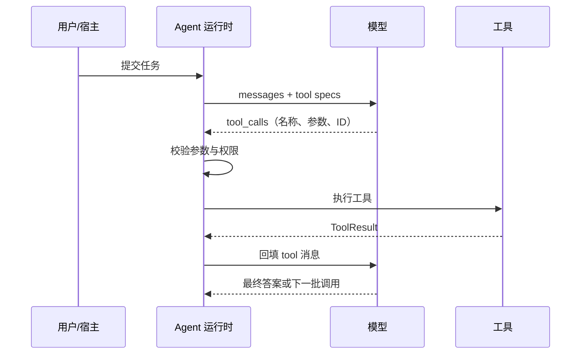
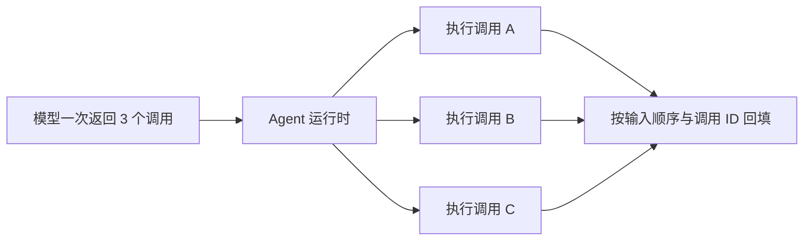
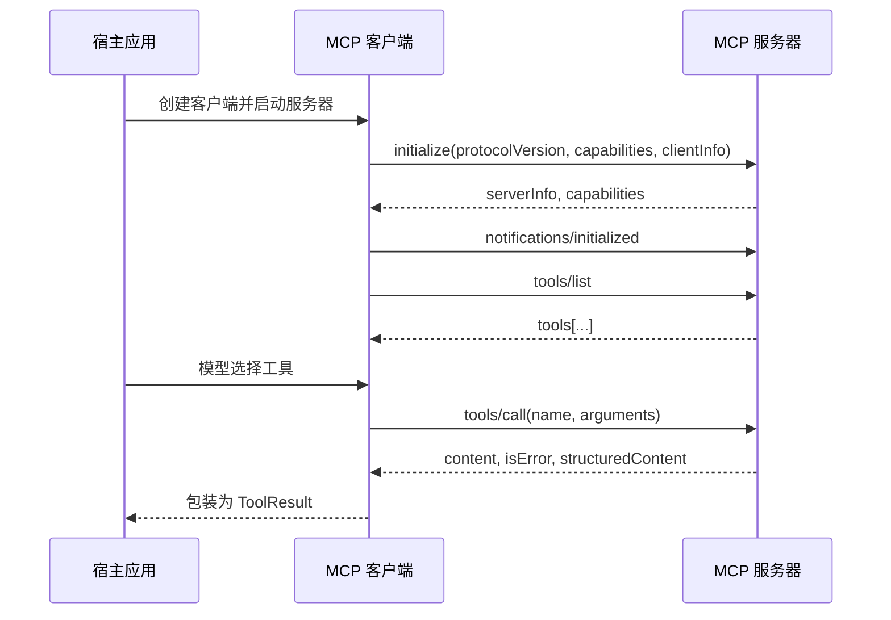
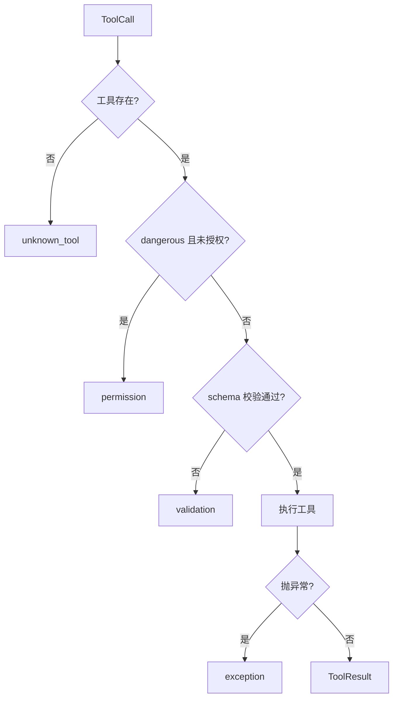

# 第 5 章 工具使用：Function Calling 与 MCP

## 本章导读

一个研究助手接入了搜索、网页抓取和代码执行三个工具。上线一周，团队发现约三成失败与模型能力无关：模型把 `query` 传给了需要 `q` 的搜索工具，把 `limit` 写成字符串 `"10"`，还有一次把整页 HTML 当成结果塞回上下文，导致下一轮 prompt 超限。换更强的模型只带来几个点的改善。复盘结论很朴素：工具是模型唯一能看到的"世界接口"，描述含糊、schema 过宽、错误不可读，模型再强也只能猜。本章讨论如何设计这个接口，以及如何用 MCP 把工具接入成本降下来。

⭐⭐ 入门偏进阶 ｜ 适合：工程师、产品经理、技术管理者

## 学习目标

读完本章你将能够：

- 解释函数调用（Function Calling）的完整链路：模型生成结构化提议，运行时校验、授权、执行并回填观察
- 按"可发现、可调用、可恢复"的标准设计工具名称、描述、参数 schema 与返回格式
- 判断哪些工具调用可以并行，处理顺序、失败隔离、副作用与权限
- 说清 MCP 的主机、客户端、服务器模型，生命周期、三种原语与两种传输，并区分 MCP 与函数调用、OpenAPI、A2A
- 在 Atlas v0.5.0 中接入 MCP 工具、参数校验、危险工具约束与并行执行

## 5.1 函数调用：模型如何"调用"一个函数

### 5.1.1 一次调用，两次决策

函数调用（Function Calling）常被误解为"模型执行函数"。更准确的类比是填报销单：员工决定报什么、填哪些字段；财务系统决定单据是否合规、钱怎么打。员工填单不等于打款，模型给出调用也不等于动作已经发生。

严格地说，函数调用是模型 API 的一种能力：模型在回复中返回结构化的工具名、参数和调用 ID，由宿主运行时校验并执行。它就是第 4 章"模型提议、运行时执行"在 API 层的具体形式。

这个能力带来三个直接变化：

1. **解析从自然语言变成结构**。不再需要从一段文本里用正则抠出函数名，模型直接返回 `tool_calls`。
2. **一次可以返回多个调用**。模型可以在一个回复里请求多个互不依赖的工具。
3. **参数有 schema**。工具可以声明必填字段、类型和取值范围，运行时据此校验。

但"结构化"只保证了语法可解析，不保证语义正确。模型仍可能选错工具、把字符串传成数字、把两个参数拼错。工具调用是概率性的决策，不是确定性的函数调用。运行时的校验、授权与错误回填，才是把它变成可靠系统的部分。

在许多 OpenAI 兼容 API 中，模型返回的原始结构大致如下：

```json
{
  "id": "call_01",
  "type": "function",
  "function": {
    "name": "search_web",
    "arguments": "{\"query\": \"MCP 协议\", \"limit\": 5}"
  }
}
```

注意 `arguments` 通常是一个 JSON **字符串**，不是对象。适配层要先解析，再交给运行时。解析失败时，Atlas 的 `OpenAICompatLLM` 返回空字典，让参数校验产生一条可恢复的错误结果，而不是把半截 JSON 写进轨迹。

### 5.1.2 一次调用的完整生命周期



这条链路里有两类决策，分别属于不同角色：

| 阶段 | 负责人 | 失败时的表现 | 系统应该怎么处理 |
|---|---|---|---|
| 工具描述 | 开发者 | 模型选错工具、不选工具 | 改描述、改 schema、减少工具数量 |
| 选择与填参 | 模型 | 调用不存在的工具、参数缺失或类型错误 | 运行时校验，把错误回填给模型 |
| 参数校验 | 运行时 | 必填字段缺失、额外字段、范围越界 | 返回 `validation` 错误结果，模型可改参重试 |
| 授权 | 运行时或用户 | 危险工具、越权访问 | 返回 `permission` 错误，或请求审批 |
| 执行 | 工具 | 超时、网络错误、解析失败 | 转成错误结果，不向 Agent 冒泡 |
| 回填 | 运行时 | 结果丢失、调用与结果对不上 | 按 `tool_call_id` 一一配对 |
| 继续或结束 | 模型 + 停止策略 | 过早停止、停不下来 | 语义停止与预算停止配合 |

这张表解释了为什么"换个更强的模型"通常解决不了工具调用失败：模型只负责前两行，后五行都是工程问题。

### 5.1.3 原生调用与提示词降级

不是所有模型或端点都支持原生工具调用。工程上通常有两条路径：



```python
from atlas.types import Message, ToolSpec

search_spec = ToolSpec(
    name="search_web",
    description="在公开网页中搜索信息，返回标题、URL 和摘要。",
    parameters={
        "type": "object",
        "properties": {"query": {"type": "string"}},
        "required": ["query"],
        "additionalProperties": False,
    },
)

response = llm.complete(
    [Message(role="user", content="查一下 MCP 协议的最新进展")],
    tools=[search_spec],
)

for call in response.tool_calls:
    result = registry.run(call)
    # 把 result.content 以 tool 角色回填，并带上 call.id
```
模型直接返回结构化的 `tool_calls`，运行时无需猜测格式。多调用、调用 ID 和参数 schema 都由 API 层支持。



```python
PROMPT = """你可以使用以下工具：
{tools}

只输出一个 JSON 对象，格式为：
{"name": "工具名", "arguments": {"参数名": "参数值"}}
不要输出解释、Markdown 或额外文本。"""

raw = llm.complete(
    [Message(role="user", content=PROMPT.format(tools=tool_catalog))]
).content

try:
    payload = json.loads(raw)
    call = ToolCall(
        id="call_1",
        name=payload["name"],
        arguments=payload["arguments"],
    )
except (json.JSONDecodeError, KeyError, TypeError):
    call = None  # 解析失败，交给上层决定重试还是报错
```
降级路径能工作，但模型可能多写一句解释、少一个括号、把参数写成字符串，或者编造不存在的工具名。约束解码（Constrained Decoding）能提高语法合法率，但不能保证语义正确。



| 维度 | 原生调用 | 提示词降级 |
|---|---|---|
| 结构可靠性 | 高，API 直接返回结构化字段 | 取决于模型与提示词，需解析与修复 |
| 多调用 | 原生支持并行工具调用 | 通常只能一次一个，或自己约定数组格式 |
| 工具名约束 | 可由 API 限制在给定工具集内 | 模型可能编造工具名 |
| 供应商支持 | 取决于模型与端点 | 几乎所有文本模型都能用 |
| 维护成本 | 低，格式稳定 | 高，提示词、解析器与重试逻辑都要维护 |


不同供应商对工具调用的字段名、参数格式、并行能力和严格模式支持不同。截至写作时，相关 API 仍在演进，接入前请以官方文档为准。Atlas 的做法是在 `OpenAICompatLLM` 里把差异归一化成 `ToolCall` 与 `LLMResponse`，上层只认内部类型。


### 5.1.4 结构化不等于正确

函数调用解决了"怎么把动作表达出来"，没有解决"该不该做这个动作"。两类错误要分开看：

- **选择错误**：该用 A 工具却用了 B，或者该查两次却只查一次。这通常由描述、工具粒度、上下文和模型判断共同决定。
- **参数错误**：工具选对了，但参数缺失、类型错误、取值越界。这可以由 schema 校验和错误回填兜住。

一个常见的工程误区是"只要 schema 写得足够严，模型就不会犯错"。schema 能让错误更早暴露，也能让模型看到可读的错误信息，但它不能阻止模型在语义上选错。工具设计的目标不是让模型"不可能犯错"，而是让错误**容易发生得早、容易被发现、容易被纠正**。

## 5.2 工具设计：模型看到的只有接口

### 5.2.1 描述是接口的一部分

模型看不到工具的实现，只能看到名称、描述和参数 schema。描述不是注释，它是模型选择工具的主要依据。一个可用的工具描述至少回答三个问题：

1. **做什么**：一句话说明动作和对象。
2. **什么时候用、什么时候不用**：与相邻工具划清边界。
3. **返回什么、有什么副作用**：让模型知道调用后的预期。

对比下面两版描述：

| 版本 | 描述 | 问题 |
|---|---|---|
| 差 | `"搜索工具"` | 不知道搜什么、什么时候用、返回什么 |
| 差 | `"查询数据库"` | 数据库有几十张表，模型只能猜 |
| 好 | `"在公开网页中搜索信息。适合查找最新事实、新闻和需要来源链接的内容；不要用它读取已知 URL（改用 fetch_url），也不要用于计算。返回标题、URL 和摘要；摘要可能不完整，需要时再抓取原文。"` | 用途、边界、返回和限制都清楚 |

好描述不是越长越好。它应该像一份简短的 API 文档：把模型做选择时真正需要的差异写出来，删掉营销语言和实现细节。

命名同样重要。推荐"动词 + 对象"的稳定命名，例如 `search_web`、`fetch_url`、`list_issues`、`create_note`。有多个来源时加命名空间，例如 `github_list_issues`、`jira_list_issues`，避免两个 `search` 让模型无法区分。名称一旦用于评测、缓存或提示词，就不要随意改。

工具数量也需要控制。工具越多，模型的选择空间越大，描述之间的细微差别越重要。没有统一的"最多几个"阈值，但当工具达到几十个时，模型选错的概率会明显上升。更稳妥的做法是按角色或任务阶段暴露工具子集，而不是把所有工具一次性塞给模型。

### 5.2.2 参数 schema：把约束写进接口

参数 schema 同时服务两个读者：模型用它理解"该填什么"，运行时用它校验"填得对不对"。两者共用一份定义，可以避免文档和实现漂移。

下面是一份较好的 schema：

```python
ToolSpec(
    name="search_web",
    description=(
        "在公开网页中搜索信息。适合查找最新事实、新闻和需要来源链接的内容；"
        "不要用它读取已知 URL，也不要用于计算。返回标题、URL 和摘要。"
    ),
    parameters={
        "type": "object",
        "properties": {
            "query": {
                "type": "string",
                "minLength": 1,
                "description": "搜索关键词，使用自然语言，不要传 URL",
            },
            "limit": {
                "type": "integer",
                "minimum": 1,
                "maximum": 20,
                "default": 5,
                "description": "返回结果数量，默认 5",
            },
            "recency": {
                "type": "string",
                "enum": ["day", "week", "month", "any"],
                "default": "any",
                "description": "时间范围；需要最新信息时用 day 或 week",
            },
        },
        "required": ["query"],
        "additionalProperties": False,
    },
)
```

几条实用规则：

| 规则 | 反例 | 正例 | 原因 |
|---|---|---|---|
| 必填字段显式声明 | 所有字段都可选 | `required: ["query"]` | 模型知道哪些不能省 |
| 用 `enum` 收窄取值 | `"recency": {"type": "string"}` | `enum: ["day", "week", "month", "any"]` | 避免模型自造取值 |
| 禁止额外字段 | `additionalProperties: true` | `additionalProperties: false` | 及早发现模型发明参数 |
| 扁平优先 | 三层嵌套对象 | 少量顶层参数 | 嵌套越深，模型填错概率越高 |
| 单位写进字段名 | `timeout` | `timeout_seconds` | 避免秒与毫秒混淆 |
| 优先稳定 ID | 传名称让工具自己解析 | 传 `user_id` | 名称会变、会重名、会有歧义 |
| 不要把 JSON 塞进字符串 | `filters: "{\"a\":1}"` | 结构化对象或数组 | 双重编码最容易出错 |

`default` 在 JSON Schema 里是**注解**，不是自动填充。Atlas 的运行时不会替模型补默认值，工具实现必须自己处理缺省。把默认值写进描述，是为了让模型知道省略时会发生什么，而不是依赖运行时魔法。

如果参数确实是自由文本，例如"用自然语言描述要分析的问题"，那就用一个带说明的 `string`，不要用空 schema。空 schema 等于告诉模型"随便填"，模型通常会填得过多或过少。

### 5.2.3 返回结果：模型要的是决策信息

工具结果会进入下一轮上下文，消耗 token，也占用模型的注意力。返回原始 HTML、整页 JSON 或 200 行表格，通常是最差的选择。好的结果应该让模型能快速回答："成功了没有？拿到了什么？下一步该做什么？"

| 差的结果 | 问题 | 好的结果 |
|---|---|---|
| 整页 HTML | token 爆炸，关键信息被淹没 | 标题、URL、摘要、发布时间 |
| 200 条原始记录 | 模型看不完，容易忽略后面的内容 | 总数 + 前 5 条 + 下一页游标 |
| 只有 `"ok"` | 模型不知道拿到了什么 | 状态 + 关键字段 + 数量 |
| 一长串堆栈 | 模型无法据此恢复 | 错误类型 + 可读原因 + 是否可重试 |
| base64 图片 | 浪费上下文，模型也读不了 | `[image image/png, 12 KB]` 加资源链接 |

Atlas 的一个返回示例：

```python
ToolOutput(
    content=json.dumps(
        {
            "status": "ok",
            "count": 37,
            "items": items[:5],
            "next_cursor": "eyJwYWdlIjoyfQ==",
            "note": "只显示前 5 条；需要更多请带 next_cursor 继续",
        },
        ensure_ascii=False,
    ),
    metadata={"source": "search_web", "latency_ms": 412},
)
```

两个字段的职责要分清：`content` 会回填给模型，`metadata` 留在运行时，用于日志、追踪和评测。不要把密钥、内部 URL、用户隐私放进 `content`；也不要把模型必须知道的信息只放在 `metadata` 里，因为模型看不到它。

截断是必须的，但不要静默截断。告诉模型"共 37 条，以下是前 5 条"，比悄悄只给 5 条要好得多。静默截断会让模型误以为信息完整，从而过早下结论。

最后一条边界在第 4 章已经出现过，这里再强调一次：**工具结果是数据，不是指令**。网页、文档、数据库字段里都可能藏着"忽略之前的指令"之类的文本。运行时和模型都不应把它当成用户指令。第 17 章会专门讨论间接提示注入；本章先在工具设计层面避免把不可信内容包装成高优先级消息。

### 5.2.4 错误也要能被模型理解

工具失败是常态，不是异常。关键不是"不要失败"，而是"失败后模型能不能做出正确反应"。建议把错误分成可识别的类别，并放进 `metadata["error_type"]`：

| 错误类型 | 含义 | 模型可以做什么 |
|---|---|---|
| `validation` | 参数缺失、类型错误、额外字段、范围越界 | 修正参数后重试 |
| `not_found` | 查询对象不存在 | 换关键词、换 ID、扩大范围 |
| `permission` | 没有权限或未授权 | 请求用户批准，或换一条路径 |
| `rate_limited` | 触发限流 | 等待后重试，或降低频率 |
| `timeout` | 执行超时 | 缩小范围、换工具、重试一次 |
| `upstream` | 上游服务错误 | 重试或降级到备用来源 |
| `exception` | 未预期异常，通常是 bug | 不要盲目重试，报告或换路径 |
| `mcp` | MCP 协议或传输错误 | 检查服务器状态，重连或换服务器 |

除了 `error_type`，还可以带 `retryable`、`retry_after_seconds` 等提示。错误内容是给模型看的，所以要避免堆栈和内部细节；但也不能只写"失败了"，那等于让模型猜。

写工具要特别小心副作用。一个写操作如果失败后被自动重试，可能产生两条记录。解决办法不是"永远不重试"，而是让写工具支持幂等键（Idempotency Key），或者先提供 `dry_run`/预览能力。第 17、18 章会展开重试与幂等；本章先在接口上把"读"和"写"分开。

### 5.2.5 粒度与权限：少而准，还是多而细

工具粒度没有唯一答案，但有一条判断标准：**这个工具是给多个任务复用的原子能力，还是为某个固定流程封装的任务级动作？**

| 粒度 | 例子 | 优点 | 代价 |
|---|---|---|---|
| 原子工具 | `read_file`、`search_web`、`run_python` | 可组合、可复用、行为可预测 | 完成一个任务需要更多步 |
| 任务级工具 | `write_research_report` | 一步完成、输出稳定 | 内部不透明、难以改道、复用性差 |

开放式研究任务通常更适合原子工具，因为路径无法预先枚举；稳定的企业流程更适合任务级工具，因为输出格式和审核规则固定。混合使用也常见：外层用任务级工具保证产物，内层用原子工具处理异常。

权限上应遵循最小权限（Least Privilege）：只读工具不要给写权限，只访问一个仓库的工具不要给整个组织的 token，需要用户确认的动作不要默认自动执行。Atlas 用 `ToolSpec.dangerous` 标记可能产生不可逆副作用或访问高敏感资源的工具；v0.5.0 的默认行为是拒绝，直到运行配置或用户显式授权。完整审批、沙箱与审计在第 17 章实现。


`dangerous` 标记只是第一道门，不是完整的安全边界。工具实现内部仍必须做权限检查、参数校验和资源隔离。不要因为工具"已经标记为安全"就假设它不会被滥用。


## 5.3 并行工具调用：一次决策，多个行动

当模型在一个回复里返回多个互不依赖的调用时，运行时可以并发执行，把总延迟从"求和"变成"取最大值"。这就是并行工具调用（Parallel Tool Calling）。



但"模型说它们独立"不等于"它们真的独立"。运行时需要按以下标准判断：

1. **无数据依赖**：B 的参数不来自 A 的结果。
2. **无共享可变状态**：两个调用不会同时修改同一份数据。
3. **无顺序要求**：先执行哪个都不影响结果。
4. **不触发同一限流**：并发不会把上游打到 429。
5. **工具实现线程安全**：同一个工具实例被多个线程调用不会出错。

第 5 条最容易被忽略。很多工具内部持有连接、游标或缓存，默认并不是线程安全的。Atlas 的保守策略是：**一批调用里只要出现未知工具或 `dangerous` 工具，整批退化为串行**；只有全部是已知的只读工具时才并发。这样既保留了常见的"多源检索"加速，又避免写操作与共享状态带来的顺序问题。

结果回填必须按调用 ID 一一对应，不能按完成顺序。Atlas 的 `run_many` 返回顺序与输入顺序一致，`Agent` 再按 `zip(tool_calls, results)` 回填。这样即使 B 比 A 先完成，模型看到的仍然是 A 的结果在前、B 的结果在后。

失败也要隔离。并行执行时，一个工具失败不应该取消其他工具；每个调用都应得到自己的 `ToolResult`，模型看到的是"部分成功"。这比"一个失败就整批失败"更有利于恢复，但也要求模型能读懂部分结果并决定下一步。

| 维度 | 串行 | 并行 |
|---|---|---|
| 延迟 | 各调用之和 | 最慢调用的时间 |
| 顺序 | 天然确定 | 需要按 ID/输入顺序回填 |
| 副作用 | 容易控制 | 需要保证无共享状态 |
| 失败处理 | 一个失败可立即停止 | 需要隔离，返回部分结果 |
| 适用场景 | 有依赖、写操作、限流敏感 | 多源检索、独立读取、批量查询 |

并行不是默认越多越好。并发会放大突发流量、成本和限流风险；在预算紧张或上游脆弱时，串行反而更稳。

## 5.4 MCP：把工具接入从"每家一套"变成"一个协议"

### 5.4.1 为什么需要 MCP

假设有 N 个宿主应用（IDE、聊天客户端、Agent 框架）和 M 个工具服务（代码仓库、数据库、工单系统、搜索）。如果每个宿主都为每个工具写一套适配，集成数量是 N×M。每加一个宿主或一个工具，都要重复一遍认证、发现、调用和错误处理。

模型上下文协议（Model Context Protocol, MCP）把这个矩阵拆成两层：工具服务实现一个 MCP 服务器，宿主实现一个 MCP 客户端，双方按同一套协议通信。集成数量从 N×M 降到 N+M。类比 USB-C：设备不需要为每个主机重新设计接口，只要遵守同一个连接标准。

MCP 由 Anthropic 于 2024 年底提出并开源，随后多家厂商与开源项目提供了支持。它的定位不是"让模型更聪明"，而是**标准化模型应用与外部工具、资源、提示模板之间的连接**。

### 5.4.2 协议解剖

MCP 基于 JSON-RPC 2.0。一次会话的基本结构是：



几个关键角色和概念：

- **主机（Host）**：承载模型和用户交互的应用，决定把哪些工具暴露给模型、什么时候请求用户授权。
- **客户端（Client）**：主机内部与**单个**服务器保持 1:1 连接的组件，负责 JSON-RPC 消息收发。
- **服务器（Server）**：按 MCP 协议暴露工具、资源或提示模板的服务端，可以是本地子进程，也可以是远程服务。

MCP 服务器可以暴露三类原语：

| 原语 | 谁控制 | 作用 | 典型方法 |
|---|---|---|---|
| 工具（Tools） | 模型 | 可执行的函数，模型决定何时调用 | `tools/list`、`tools/call` |
| 资源（Resources） | 应用 | 可读取的上下文数据，如文件、记录、文档 | `resources/list`、`resources/read` |
| 提示模板（Prompts） | 用户 | 预置的提示模板，用户主动选择 | `prompts/list`、`prompts/get` |

此外，客户端也可以向服务器提供能力，例如采样（Sampling）、根目录（Roots）和引导（Elicitation）。这些能力让服务器在需要时请求模型生成内容或向用户提问，但本章只实现最常用的工具路径。

一次完整生命周期通常包括：

1. **初始化**：客户端发送 `initialize`，带上协议版本、客户端能力和客户端信息；服务器返回自己的版本、能力和服务器信息。
2. **确认**：客户端发送 `notifications/initialized`，表示握手完成。
3. **发现**：客户端调用 `tools/list` 获取工具定义，支持分页游标。
4. **调用**：客户端调用 `tools/call`，传入工具名和参数。
5. **关闭**：关闭连接或终止子进程。

传输层主要有两种：

- **stdio**：客户端启动一个本地子进程，通过标准输入/输出交换 JSON-RPC 消息。消息一行一条，标准错误留给日志。适合本地工具、文件系统、命令行程序。
- **Streamable HTTP**：通过 HTTP POST/GET 交换消息，可选服务器推送。适合远程服务、多用户、需要认证的场景。早期的 HTTP+SSE 传输已被 Streamable HTTP 取代。

<details>
<summary>为什么 stdio 用"一行一条 JSON"，而不是 HTTP 风格的长度头？</summary>

stdio 是本地管道，没有 HTTP 的头部和分块概念。换行分隔足够简单：JSON 字符串里的换行会被转义成 `\n`，所以一条消息不会跨行。客户端逐行读取、逐行解析即可。标准输出专门用于协议消息，标准错误用于日志，这样调试信息不会污染协议流。代价是不能在消息里放未转义的原始换行，也不能依赖操作系统的消息边界。

</details>

错误语义要分清两类：

- **协议错误**：方法不存在、工具名未知、参数结构不合法等，用 JSON-RPC 的 `error` 对象返回。
- **工具执行错误**：工具正常运行但业务失败，用结果里的 `isError: true` 表示，仍然返回 `content`。

把两者混在一起，会让客户端难以区分"协议坏了"和"工具告诉我失败了"。Atlas 的 `MCPTool` 会把后者映射成 `ToolOutput(is_error=True)`，让模型看到可读的失败原因。


MCP 规范仍在快速演进，协议版本、传输方式、能力字段和工具注解都可能变化。截至写作时，Atlas 默认使用 `2025-06-18` 版本的协议字段，并把版本号做成 `StdioMCPClient` 的参数。接入具体服务器前，请核对它的协议版本与官方文档。


### 5.4.3 安全边界：服务器不可信

MCP 让接入变容易，也让攻击面变大。一个 MCP 服务器可以：

- 返回带有恶意指令的网页内容或文档，诱导模型泄露数据；
- 在工具描述里写"忽略之前的指令"，试图改变模型行为；
- 声称自己是只读的，实际执行写操作；
- 请求过多的文件系统、网络或凭据权限。

因此，MCP 的安全原则和普通工具一样，甚至更严格：

1. **服务器不可信**：工具描述、工具结果、资源内容都按不可信数据处理，不当作系统指令。
2. **注解只是提示**：`readOnlyHint`、`destructiveHint` 等注解不构成安全保证，恶意服务器可以撒谎。
3. **最小权限**：每个服务器单独配置凭据、文件根目录和网络出口；不要用一个全权限 token 接所有服务器。
4. **用户知情**：首次连接、新增工具、危险调用都应让用户知道；不要默认全自动批准。
5. **隔离执行**：本地服务器尽量在沙箱或受限用户下运行；远程服务器使用认证与租户隔离。
6. **审计**：记录哪个服务器、哪个工具、什么参数、什么结果，便于事后追查。

Atlas v0.5.0 只实现了最小的一层：把没有明确声明只读的 MCP 工具视为危险，默认拒绝，直到显式授权。审批、沙箱、凭据隔离和间接提示注入防护在第 17 章展开。

### 5.4.4 MCP 与相邻技术的关系

MCP 经常被误解为函数调用的替代品。实际上它们解决的是不同层次的问题：

| 技术 | 解决的问题 | 模型看到什么 | 谁执行 | 最适合 |
|---|---|---|---|---|
| 函数调用 | 模型如何表达"我要调用哪个工具、参数是什么" | 工具名、描述、参数 schema | 宿主运行时 | 单个应用内的工具调用 |
| MCP | 工具如何被发现、连接、认证和跨宿主复用 | 仍由宿主转成工具描述 | MCP 服务器 | 多宿主、第三方工具生态 |
| OpenAPI | 如何描述一个 HTTP API | 由工具包装层转成 schema | 应用或网关 | 已有 REST API 的接入 |
| A2A | 智能体之间如何委派任务、交换结果 | 任务与能力描述 | 另一个智能体 | 多智能体协作 |
| RAG | 如何检索外部知识 | 检索到的文档 | 应用 | 知识增强，不是动作 |

关键关系是：**MCP 不替代函数调用**。MCP 负责把工具送到宿主，宿主仍然用函数调用（或等价的工具调用机制）把工具暴露给模型。OpenAPI 描述的是 HTTP 接口，可以由一个 MCP 服务器包装；A2A 面向智能体之间的协作，和工具接入不是同一层。

### 5.4.5 什么时候不该用 MCP

MCP 不是所有场景的最优解。以下情况直接实现一个 `Tool` 更简单：

- 只有一个应用、一个内部工具，没有复用需求；
- 延迟极其敏感，不能接受额外的进程或网络跳转；
- 工具与业务逻辑强耦合，拆成独立服务器反而增加部署复杂度；
- 需要高度定制的流式输出或私有传输，MCP 的通用协议不划算。

MCP 的价值在复用和生态：多个宿主共享同一批工具、第三方工具可以即插即用、工具可以独立部署和升级。没有这些需求时，简单直接的函数调用更可靠。

## 5.5 动手实践：Atlas v0.5.0

### 5.5.1 范围与目录

v0.5.0 的目标是"把工具接口做扎实"，不是"接入所有工具"：

| 组件 | v0.4.0 | v0.5.0 |
|---|---|---|
| `ToolSpec.dangerous` | 声明字段，无运行时语义 | 危险工具默认拒绝，需显式授权 |
| `ToolRegistry.run` | 查找、执行、异常转换 | 增加 schema 校验、权限检查、错误分类 |
| `ToolRegistry.run_many` | 顺序执行 | 只读调用并行；未知/危险调用整批串行 |
| `AgentConfig.parallel_tools` | 占位配置 | 接入 `run_many`，`False` 时串行 |
| `MCPTool` / `StdioMCPClient` | 无 | 新增 MCP 工具与 stdio 客户端 |
| `examples/ch05_mcp.py` | 无 | 离线端到端示例 |
| `tests/test_tools.py`、`tests/test_mcp.py` | 无 | 校验、权限、并行、协议测试 |

目录增量：

```text
src/atlas/
├── tools/
│   ├── schema.py          # 新增：JSON Schema 子集校验
│   ├── registry.py        # 修改：校验、权限、并行
│   └── mcp.py             # 新增：MCP 客户端与工具包装
└── agent/
    └── loop.py            # 修改：接入 parallel_tools

examples/
├── ch05_mcp_server.py     # 新增：最小 MCP 服务器
└── ch05_mcp.py            # 新增：端到端示例

tests/
├── test_tools.py          # 新增
└── test_mcp.py            # 新增
```


Atlas 的公开接口仍然以 `atlas/interfaces.md` 为准。本章只新增关键字参数和独立模块，不改变 `LLM.complete`、`Tool.run`、`ToolRegistry.run/run_many`、`Agent.run` 的签名。


### 5.5.2 参数校验：把 schema 变成可执行的检查

Atlas 不引入第三方 JSON Schema 库，而是实现一个够用的子集。原因有两个：示例要离线可跑；同时让读者看清"校验到底检查了什么"。生产环境可以换成完整的 `jsonschema` 实现，接口不变。

```python
# atlas/tools/schema.py
from __future__ import annotations

import re
from typing import Any

_TYPE_CHECKS = {
    "object": lambda value: isinstance(value, dict),
    "array": lambda value: isinstance(value, list),
    "string": lambda value: isinstance(value, str),
    "integer": lambda value: isinstance(value, int) and not isinstance(value, bool),
    "number": lambda value: isinstance(value, (int, float)) and not isinstance(value, bool),
    "boolean": lambda value: isinstance(value, bool),
    "null": lambda value: value is None,
}


def validate_arguments(schema: dict[str, Any], arguments: dict[str, Any]) -> list[str]:
    """按 JSON Schema 的子集校验参数，返回可直接回传模型的错误列表。"""
    errors: list[str] = []
    _validate(schema, arguments, "arguments", errors)
    return errors


def _validate(schema: Any, value: Any, path: str, errors: list[str]) -> None:
    if not isinstance(schema, dict):
        return

    expected = schema.get("type")
    if expected is not None:
        expected_types = expected if isinstance(expected, list) else [expected]
        checks = [_TYPE_CHECKS.get(name) for name in expected_types]
        if any(check is not None for check in checks) and not any(
            check is not None and check(value) for check in checks
        ):
            errors.append(
                f"{path}: 期望类型 {' / '.join(map(str, expected_types))}，"
                f"实际是 {type(value).__name__}"
            )
            return

    if "enum" in schema and value not in schema["enum"]:
        errors.append(f"{path}: 必须是 {schema['enum']!r} 之一")

    if isinstance(value, str):
        _validate_string(schema, value, path, errors)
    elif isinstance(value, (int, float)) and not isinstance(value, bool):
        _validate_number(schema, value, path, errors)
    elif isinstance(value, dict):
        _validate_object(schema, value, path, errors)
    elif isinstance(value, list):
        _validate_array(schema, value, path, errors)

    all_of = schema.get("allOf")
    if isinstance(all_of, list):
        for option in all_of:
            _validate(option, value, path, errors)

    for keyword in ("anyOf", "oneOf"):
        options = schema.get(keyword)
        if not isinstance(options, list) or not options:
            continue
        matches = 0
        for option in options:
            trial: list[str] = []
            _validate(option, value, path, trial)
            if not trial:
                matches += 1
        if keyword == "anyOf" and matches == 0:
            errors.append(f"{path}: 不满足 anyOf 中的任何一项")
        if keyword == "oneOf" and matches != 1:
            errors.append(f"{path}: 必须恰好满足 oneOf 中的一项")


def _validate_string(
    schema: dict[str, Any], value: str, path: str, errors: list[str]
) -> None:
    if "minLength" in schema and len(value) < schema["minLength"]:
        errors.append(f"{path}: 长度不能小于 {schema['minLength']}")
    if "maxLength" in schema and len(value) > schema["maxLength"]:
        errors.append(f"{path}: 长度不能大于 {schema['maxLength']}")
    pattern = schema.get("pattern")
    if isinstance(pattern, str):
        try:
            if re.search(pattern, value) is None:
                errors.append(f"{path}: 不匹配模式 {pattern!r}")
        except re.error:
            pass


def _validate_number(
    schema: dict[str, Any], value: float, path: str, errors: list[str]
) -> None:
    if "minimum" in schema and value < schema["minimum"]:
        errors.append(f"{path}: 不能小于 {schema['minimum']}")
    if "maximum" in schema and value > schema["maximum"]:
        errors.append(f"{path}: 不能大于 {schema['maximum']}")
    if "exclusiveMinimum" in schema and value <= schema["exclusiveMinimum"]:
        errors.append(f"{path}: 必须大于 {schema['exclusiveMinimum']}")
    if "exclusiveMaximum" in schema and value >= schema["exclusiveMaximum"]:
        errors.append(f"{path}: 必须小于 {schema['exclusiveMaximum']}")


def _validate_object(
    schema: dict[str, Any], value: dict[str, Any], path: str, errors: list[str]
) -> None:
    required = schema.get("required", [])
    if isinstance(required, list):
        for key in required:
            if isinstance(key, str) and key not in value:
                errors.append(f"{path}: 缺少必填字段 '{key}'")

    properties = schema.get("properties", {})
    if not isinstance(properties, dict):
        properties = {}
    additional = schema.get("additionalProperties", True)

    for key, item in value.items():
        if key in properties:
            _validate(properties[key], item, f"{path}.{key}", errors)
        elif additional is False:
            errors.append(f"{path}: 不允许字段 '{key}'")
        elif isinstance(additional, dict):
            _validate(additional, item, f"{path}.{key}", errors)


def _validate_array(
    schema: dict[str, Any], value: list[Any], path: str, errors: list[str]
) -> None:
    if "minItems" in schema and len(value) < schema["minItems"]:
        errors.append(f"{path}: 元素个数不能少于 {schema['minItems']}")
    if "maxItems" in schema and len(value) > schema["maxItems"]:
        errors.append(f"{path}: 元素个数不能多于 {schema['maxItems']}")
    item_schema = schema.get("items")
    if isinstance(item_schema, dict):
        for index, item in enumerate(value):
            _validate(item_schema, item, f"{path}[{index}]", errors)
```

几个设计决定：

- **错误信息给模型看**。路径、期望类型、实际类型都写清楚，模型才能改对参数。只返回 `"invalid arguments"` 没有价值。
- **遇到类型错误立即返回**。类型不对时继续检查长度、范围没有意义，还会产生一串噪音错误。
- **支持常用关键字，不支持的全部忽略**。这是有意的取舍：完整 JSON Schema 很复杂，教学实现只覆盖工具参数最常见的约束。生产环境如果依赖复杂 schema，应换用完整实现。
- **schema 不是安全边界**。它只能检查形状，不能防止工具实现里的注入、越权或资源耗尽。

一次校验失败的 `ToolResult` 大致是：

```python
ToolResult(
    tool_call_id="call_01",
    content=(
        "Invalid arguments for search_web: "
        "arguments.limit: 期望类型 integer，实际是 str"
    ),
    is_error=True,
    metadata={
        "error_type": "validation",
        "errors": ["arguments.limit: 期望类型 integer，实际是 str"],
    },
)
```

### 5.5.3 注册表升级：查找、授权、校验、执行

`ToolRegistry.run` 是工具世界的入口。v0.5.0 把检查顺序固定为：**工具是否存在 → 是否允许危险工具 → 参数是否合法 → 执行 → 异常转换**。

```python
# atlas/tools/registry.py
from __future__ import annotations

from collections.abc import Iterable
from concurrent.futures import ThreadPoolExecutor

from atlas.tools.base import Tool
from atlas.tools.schema import validate_arguments
from atlas.types import RunContext, ToolCall, ToolResult, ToolSpec


class ToolRegistry:
    def __init__(
        self,
        tools: Iterable[Tool] = (),
        *,
        allow_dangerous: bool = False,
    ) -> None:
        self._tools: dict[str, Tool] = {}
        self._allow_dangerous = allow_dangerous
        for tool in tools:
            self.register(tool)

    def register(self, tool: Tool) -> None:
        name = tool.spec.name
        if name in self._tools:
            raise ValueError(f"duplicate tool: {name}")
        self._tools[name] = tool

    def specs(self) -> list[ToolSpec]:
        return [tool.spec for tool in self._tools.values()]

    def run(self, call: ToolCall, ctx: RunContext | None = None) -> ToolResult:
        tool = self._tools.get(call.name)
        if tool is None:
            return ToolResult(
                tool_call_id=call.id,
                content=f"Unknown tool: {call.name}",
                is_error=True,
                metadata={"error_type": "unknown_tool"},
            )

        allowed = self._allow_dangerous or bool(
            ctx and ctx.metadata.get("allow_dangerous")
        )
        if tool.spec.dangerous and not allowed:
            return ToolResult(
                tool_call_id=call.id,
                content=(
                    f"工具 {call.name} 被标记为危险，本次运行未授权。"
                    "需要用户批准或在运行配置中显式允许后重试。"
                ),
                is_error=True,
                metadata={
                    "error_type": "permission",
                    "denied": True,
                    "dangerous": True,
                    "tool": call.name,
                },
            )

        errors = validate_arguments(tool.spec.parameters, call.arguments)
        if errors:
            return ToolResult(
                tool_call_id=call.id,
                content=f"Invalid arguments for {call.name}: " + "; ".join(errors),
                is_error=True,
                metadata={"error_type": "validation", "errors": errors},
            )

        try:
            output = tool.run(call.arguments)
        except Exception as exc:
            return ToolResult(
                tool_call_id=call.id,
                content=f"{type(exc).__name__}: {exc}",
                is_error=True,
                metadata={"error_type": "exception", "retryable": False},
            )

        return ToolResult(
            tool_call_id=call.id,
            content=output.content,
            is_error=output.is_error,
            metadata=output.metadata,
        )

    def run_many(
        self,
        calls: list[ToolCall],
        ctx: RunContext | None = None,
        *,
        max_workers: int = 4,
    ) -> list[ToolResult]:
        if not calls:
            return []
        if len(calls) == 1 or max_workers <= 1:
            return [self.run(call, ctx) for call in calls]

        tools = [self._tools.get(call.name) for call in calls]
        if any(tool is None or tool.spec.dangerous for tool in tools):
            # 只要一批调用里出现未知或危险工具，整批退化为串行，
            # 保证副作用顺序与输入顺序一致。
            return [self.run(call, ctx) for call in calls]

        workers = min(max_workers, len(calls))
        with ThreadPoolExecutor(
            max_workers=workers, thread_name_prefix="atlas-tool"
        ) as pool:
            return list(pool.map(lambda call: self.run(call, ctx), calls))
```



为什么把权限检查放在参数校验之前？因为危险工具在未授权时不应该被执行，也不应该让调用方通过错误信息探测它的参数细节。这个顺序不是安全上的绝对要求，但它让"拒绝"更早、更明确。

并行策略是一个有意的保守选择：**只要一批里有一个未知或危险工具，整批串行**。未知工具可能是拼写错误，也可能是危险工具的别名；危险工具有副作用，线程安全和顺序都难以保证。全只读的批次才并发，既覆盖了最常见的多源检索，也避免把写操作放进线程池。

`run_many` 的返回顺序始终与输入一致。`ThreadPoolExecutor.map` 本身按输入顺序返回结果，这一点比"按完成顺序收集"更适合 Agent 回填。单个工具的异常已经被 `run` 转换成错误结果，所以并发里的 `future.result()` 不会因为业务失败而抛出。

### 5.5.4 Agent 接线：让 `parallel_tools` 生效

主循环只需要改一处：根据配置决定 `max_workers`。

```python
# atlas/agent/loop.py（片段）
max_workers = 4 if self.config.parallel_tools else 1
results = self.tools.run_many(
    last_response.tool_calls, ctx, max_workers=max_workers
)
```

这行改动没有改变 `Agent.run` 的签名，也没有改变 `Step` 或 `Trajectory` 的结构。`AgentConfig.parallel_tools` 从第 4 章的占位配置变成真正生效的开关；设为 `False` 时，整批调用严格串行。

注意预算仍然按**调用次数**计数：`total_tool_calls += len(last_response.tool_calls)`。并行不会让 3 次调用变成 1 次；它只改变执行时间，不改变成本计量。

### 5.5.5 MCP 客户端：把协议细节关在工具层

下面是一个最小的 stdio MCP 客户端。它不做认证、不做远程传输，只覆盖本地服务器最常用的路径：初始化、列工具、调工具、读资源。

```python
# atlas/tools/mcp.py
from __future__ import annotations

import json
import queue
import subprocess
import threading
from collections.abc import Sequence
from typing import Any

from atlas.types import ToolOutput, ToolSpec


class MCPError(RuntimeError):
    """MCP 协议或传输层错误。"""


class MCPTimeout(MCPError):
    """等待 MCP 响应超时。"""


class StdioMCPClient:
    """最小的 MCP stdio 客户端：JSON-RPC 2.0，一行一条消息。"""

    def __init__(
        self,
        command: Sequence[str],
        *,
        cwd: str | None = None,
        env: dict[str, str] | None = None,
        protocol_version: str = "2025-06-18",
        timeout: float = 30.0,
    ) -> None:
        self.command = list(command)
        self.timeout = timeout
        self.protocol_version = protocol_version
        self.server_info: dict[str, Any] = {}
        self.capabilities: dict[str, Any] = {}
        self._closed = False

        self._proc = subprocess.Popen(
            self.command,
            cwd=cwd,
            env=env,
            stdin=subprocess.PIPE,
            stdout=subprocess.PIPE,
            stderr=subprocess.PIPE,
            text=True,
            encoding="utf-8",
            bufsize=1,
        )
        self._write_lock = threading.Lock()
        self._pending_lock = threading.Lock()
        self._pending: dict[int, queue.Queue[dict[str, Any]]] = {}
        self._next_id = 0
        self._stderr_tail: list[str] = []

        threading.Thread(target=self._read_stdout, daemon=True).start()
        threading.Thread(target=self._read_stderr, daemon=True).start()

    def initialize(self) -> dict[str, Any]:
        result = self._request(
            "initialize",
            {
                "protocolVersion": self.protocol_version,
                "capabilities": {},
                "clientInfo": {"name": "atlas", "version": "0.5.0"},
            },
        )
        self.server_info = result.get("serverInfo", {}) or {}
        self.capabilities = result.get("capabilities", {}) or {}
        self._notify("notifications/initialized")
        return result

    def list_tools(self) -> list[dict[str, Any]]:
        tools: list[dict[str, Any]] = []
        cursor: str | None = None
        while True:
            params = {"cursor": cursor} if cursor else {}
            result = self._request("tools/list", params)
            tools.extend(result.get("tools", []) or [])
            cursor = result.get("nextCursor")
            if not cursor:
                return tools

    def call_tool(self, name: str, arguments: dict[str, Any]) -> dict[str, Any]:
        return self._request("tools/call", {"name": name, "arguments": arguments})

    def list_resources(self) -> list[dict[str, Any]]:
        result = self._request("resources/list", {})
        return result.get("resources", []) or []

    def read_resource(self, uri: str) -> dict[str, Any]:
        return self._request("resources/read", {"uri": uri})

    def close(self) -> None:
        if self._closed:
            return
        self._closed = True
        stdin = self._proc.stdin
        if stdin is not None:
            try:
                stdin.close()
            except OSError:
                pass
        try:
            self._proc.terminate()
            self._proc.wait(timeout=3)
        except Exception:
            self._proc.kill()
        for stream in (self._proc.stdout, self._proc.stderr):
            if stream is not None:
                try:
                    stream.close()
                except OSError:
                    pass

    def __enter__(self) -> "StdioMCPClient":
        return self

    def __exit__(self, *_: Any) -> None:
        self.close()

    def _request(
        self, method: str, params: dict[str, Any] | None = None
    ) -> dict[str, Any]:
        if self._closed:
            raise MCPError("MCP client is closed")

        with self._pending_lock:
            self._next_id += 1
            request_id = self._next_id
            waiter: queue.Queue[dict[str, Any]] = queue.Queue(maxsize=1)
            self._pending[request_id] = waiter

        message: dict[str, Any] = {"jsonrpc": "2.0", "id": request_id, "method": method}
        if params is not None:
            message["params"] = params

        try:
            self._send(message)
            try:
                response = waiter.get(timeout=self.timeout)
            except queue.Empty as exc:
                raise MCPTimeout(
                    f"MCP request timed out after {self.timeout}s: {method}"
                ) from exc
        finally:
            with self._pending_lock:
                self._pending.pop(request_id, None)

        if "error" in response:
            error = response["error"] or {}
            raise MCPError(f"MCP error {error.get('code')}: {error.get('message')}")
        result = response.get("result", {})
        return result if isinstance(result, dict) else {"value": result}

    def _notify(self, method: str, params: dict[str, Any] | None = None) -> None:
        message: dict[str, Any] = {"jsonrpc": "2.0", "method": method}
        if params is not None:
            message["params"] = params
        self._send(message)

    def _send(self, message: dict[str, Any]) -> None:
        stdin = self._proc.stdin
        if stdin is None:
            raise MCPError("MCP server stdin is not available")
        line = json.dumps(message, ensure_ascii=False)
        with self._write_lock:
            try:
                stdin.write(line + "\n")
                stdin.flush()
            except (BrokenPipeError, OSError) as exc:
                raise MCPError(f"MCP server is not writable: {exc}") from exc

    def _read_stdout(self) -> None:
        stdout = self._proc.stdout
        if stdout is None:
            return
        for line in stdout:
            line = line.strip()
            if not line:
                continue
            try:
                message = json.loads(line)
            except json.JSONDecodeError:
                continue
            if not isinstance(message, dict):
                continue

            if "id" in message and ("result" in message or "error" in message):
                with self._pending_lock:
                    waiter = self._pending.pop(message["id"], None)
                if waiter is not None:
                    waiter.put(message)
            elif "id" in message and "method" in message:
                self._answer_server_request(message)

    def _answer_server_request(self, message: dict[str, Any]) -> None:
        method = message.get("method")
        if method == "ping":
            response = {"jsonrpc": "2.0", "id": message["id"], "result": {}}
        else:
            response = {
                "jsonrpc": "2.0",
                "id": message["id"],
                "error": {"code": -32601, "message": f"method not supported: {method}"},
            }
        try:
            self._send(response)
        except MCPError:
            pass

    def _read_stderr(self) -> None:
        stderr = self._proc.stderr
        if stderr is None:
            return
        for line in stderr:
            self._stderr_tail.append(line.rstrip())
            if len(self._stderr_tail) > 200:
                del self._stderr_tail[:100]


class MCPTool:
    def __init__(
        self,
        server: StdioMCPClient,
        remote_name: str,
        *,
        spec: ToolSpec | None = None,
    ) -> None:
        self.server = server
        self.remote_name = remote_name
        self.spec = spec or ToolSpec(
            name=remote_name,
            description=f"MCP tool {remote_name}",
            parameters={"type": "object"},
        )

    def run(self, arguments: dict[str, Any]) -> ToolOutput:
        try:
            result = self.server.call_tool(self.remote_name, arguments)
        except MCPError as exc:
            return ToolOutput(
                content=f"MCP error: {exc}",
                is_error=True,
                metadata={"error_type": "mcp", "retryable": isinstance(exc, MCPTimeout)},
            )

        content, content_types = _render_content(result.get("content", []))
        metadata: dict[str, Any] = {
            "mcp_server": self.server.server_info.get("name", "unknown"),
            "content_types": content_types,
        }
        structured = result.get("structuredContent")
        if structured is not None:
            metadata["structured_content"] = structured
            if not content:
                content = json.dumps(structured, ensure_ascii=False)

        return ToolOutput(
            content=content,
            is_error=bool(result.get("isError", False)),
            metadata=metadata,
        )


def tool_spec_from_mcp(definition: dict[str, Any]) -> ToolSpec:
    annotations = definition.get("annotations") or {}
    read_only = annotations.get("readOnlyHint")
    destructive = annotations.get("destructiveHint")
    dangerous = not (read_only is True or destructive is False)
    return ToolSpec(
        name=str(definition.get("name", "")),
        description=str(definition.get("description", "")),
        parameters=definition.get("inputSchema") or {"type": "object"},
        dangerous=dangerous,
    )


def load_mcp_tools(server: StdioMCPClient) -> list[MCPTool]:
    tools: list[MCPTool] = []
    for definition in server.list_tools():
        name = definition.get("name")
        if not isinstance(name, str) or not name:
            continue
        tools.append(MCPTool(server, name, spec=tool_spec_from_mcp(definition)))
    return tools


def _render_content(items: Any) -> tuple[str, list[str]]:
    if not isinstance(items, list):
        return "", []
    parts: list[str] = []
    kinds: list[str] = []
    for item in items:
        if not isinstance(item, dict):
            continue
        kind = str(item.get("type", "unknown"))
        kinds.append(kind)
        if kind == "text":
            parts.append(str(item.get("text", "")))
        elif kind == "resource":
            resource = item.get("resource", {}) or {}
            if "text" in resource:
                parts.append(str(resource["text"]))
            else:
                parts.append(
                    f"[resource {resource.get('uri', '')} "
                    f"{resource.get('mimeType', '')}]"
                )
        elif kind in {"image", "audio"}:
            parts.append(f"[{kind} {item.get('mimeType', '')}]")
        else:
            parts.append(json.dumps(item, ensure_ascii=False))
    return "\n".join(part for part in parts if part), kinds
```

几个实现要点：

- **读线程 + 待办表**。所有响应由后台线程读取，按 JSON-RPC `id` 放到对应的队列；主线程只等待自己的队列。这样既不会阻塞协议流，也能处理服务器主动发来的通知或请求。
- **写锁**。多个线程可能同时发起请求，`stdin.write` 必须串行，否则消息会交错。
- **初始化后发通知**。`initialize` 只完成能力协商，`notifications/initialized` 才表示客户端准备好接收正常请求。
- **分页**。`tools/list` 可能返回 `nextCursor`，客户端要循环取完。
- **服务器请求**。最小实现只回应 `ping`，其他方法返回 `-32601`（方法不存在）。生产客户端还应处理采样、根目录等能力。
- **stderr 只做诊断**。服务器日志写到标准错误，客户端保存在 `_stderr_tail` 里，协议流不受污染。
- **内容渲染**。MCP 的 `content` 是数组，可能是文本、图片、音频、资源链接或嵌入资源。Atlas 只把文本和资源文本放进上下文，图片/音频用摘要占位，避免 base64 撑爆 prompt。

MCP 工具的危险性映射采取保守默认：**只有明确声明 `readOnlyHint: true` 或 `destructiveHint: false` 的工具才视为安全，其余一律视为危险**。注解只是提示，不是保证；这个默认值让未知服务器不会因为"没写注解"就获得写权限。


上面的客户端是为了讲清协议而写的最小实现。生产环境建议使用官方或社区维护的 MCP SDK，它们通常覆盖认证、Streamable HTTP、重连、采样和更多边界情况。截至写作时，SDK 与协议细节仍在演进，请以官方文档为准。


### 5.5.6 最小 MCP 服务器：离线可跑的对照实现

为了让示例不依赖外部服务，我们写一个标准库实现的 stdio 服务器。它暴露两个工具和一个资源：

```python
# examples/ch05_mcp_server.py
"""最小 MCP stdio 服务器：用于第 5 章离线示例。"""

from __future__ import annotations

import json
import sys
from typing import Any

NOTES: list[dict[str, str]] = []

TOOLS = [
    {
        "name": "word_count",
        "description": "统计一段文本中的单词数量。只读，不修改任何状态。",
        "inputSchema": {
            "type": "object",
            "properties": {
                "text": {"type": "string", "description": "要统计的文本"}
            },
            "required": ["text"],
            "additionalProperties": False,
        },
        "outputSchema": {
            "type": "object",
            "properties": {"count": {"type": "integer"}},
            "required": ["count"],
            "additionalProperties": False,
        },
        "annotations": {"readOnlyHint": True},
    },
    {
        "name": "save_note",
        "description": "把一条笔记写入当前会话的内存笔记库，返回保存后的编号。",
        "inputSchema": {
            "type": "object",
            "properties": {
                "title": {"type": "string", "description": "笔记标题"},
                "body": {"type": "string", "description": "笔记正文"},
            },
            "required": ["title", "body"],
            "additionalProperties": False,
        },
        "annotations": {"destructiveHint": True, "idempotentHint": False},
    },
]


class RPCError(Exception):
    def __init__(self, code: int, message: str) -> None:
        super().__init__(message)
        self.code = code
        self.message = message


def _text_result(
    text: str, *, is_error: bool = False, structured: Any = None
) -> dict[str, Any]:
    result: dict[str, Any] = {
        "content": [{"type": "text", "text": text}],
        "isError": is_error,
    }
    if structured is not None:
        result["structuredContent"] = structured
    return result


def _handle_tools_call(params: dict[str, Any]) -> dict[str, Any]:
    name = params.get("name")
    arguments = params.get("arguments") or {}
    if name == "word_count":
        text = arguments.get("text")
        if not isinstance(text, str):
            return _text_result("text 必须是字符串", is_error=True)
        count = len(text.split())
        return _text_result(str(count), structured={"count": count})
    if name == "save_note":
        title = arguments.get("title")
        body = arguments.get("body")
        if not isinstance(title, str) or not isinstance(body, str):
            return _text_result("title 和 body 都必须是字符串", is_error=True)
        NOTES.append({"title": title, "body": body})
        return _text_result(
            f"saved note #{len(NOTES)}", structured={"saved": len(NOTES)}
        )
    raise RPCError(-32602, f"unknown tool: {name}")


def handle(method: str, params: dict[str, Any]) -> dict[str, Any]:
    if method == "initialize":
        return {
            "protocolVersion": params.get("protocolVersion", "2025-06-18"),
            "capabilities": {"tools": {}, "resources": {}},
            "serverInfo": {"name": "atlas-notes", "version": "0.1.0"},
        }
    if method == "ping":
        return {}
    if method == "tools/list":
        return {"tools": TOOLS}
    if method == "tools/call":
        return _handle_tools_call(params)
    if method == "resources/list":
        return {
            "resources": [
                {
                    "uri": "atlas://handbook",
                    "name": "Atlas Handbook",
                    "mimeType": "text/plain",
                }
            ]
        }
    if method == "resources/read":
        uri = params.get("uri")
        if uri != "atlas://handbook":
            raise RPCError(-32602, f"unknown resource: {uri}")
        return {
            "contents": [
                {
                    "uri": uri,
                    "mimeType": "text/plain",
                    "text": "Atlas 是一个研究助手示例。",
                }
            ]
        }
    raise RPCError(-32601, f"method not found: {method}")


def main() -> None:
    for line in sys.stdin:
        line = line.strip()
        if not line:
            continue
        try:
            message = json.loads(line)
        except json.JSONDecodeError:
            continue
        if not isinstance(message, dict):
            continue
        method = message.get("method")
        if not isinstance(method, str):
            continue
        if "id" not in message:
            continue  # 通知不需要响应
        params = message.get("params")
        if not isinstance(params, dict):
            params = {}
        try:
            result = handle(method, params)
            reply = {"jsonrpc": "2.0", "id": message["id"], "result": result}
        except RPCError as exc:
            reply = {
                "jsonrpc": "2.0",
                "id": message["id"],
                "error": {"code": exc.code, "message": exc.message},
            }
        except Exception as exc:
            reply = {
                "jsonrpc": "2.0",
                "id": message["id"],
                "error": {"code": -32603, "message": str(exc)},
            }
        print(json.dumps(reply, ensure_ascii=False), flush=True)


if __name__ == "__main__":
    main()
```

这个服务器有几个刻意保留的教学点：

- **标准输出只写协议消息**，日志一律走标准错误。混用 stdout 会让客户端收到无法解析的行。
- **`tools/call` 的业务失败用 `isError: true`**，未知工具用 JSON-RPC 错误 `-32602`。两者语义不同。
- **`word_count` 声明 `outputSchema` 并返回 `structuredContent`**，展示较新协议版本的结构化结果；客户端把结构化内容放进 `metadata`，没有文本时才序列化进 `content`。
- **`save_note` 标记 `destructiveHint`**，Atlas 会把它映射成危险工具，默认拒绝。
- 服务器没有认证、没有沙箱、没有持久化，只适合本地教学。生产服务器要考虑凭据、租户、限流、审计和资源隔离。

### 5.5.7 端到端示例：从启动服务器到拒绝危险调用

```python
# examples/ch05_mcp.py
from __future__ import annotations

import sys
from pathlib import Path

from atlas.agent.loop import Agent, AgentConfig
from atlas.llm.mock import MockLLM
from atlas.tools.mcp import StdioMCPClient, load_mcp_tools
from atlas.tools.registry import ToolRegistry
from atlas.types import LLMResponse, RunContext, ToolCall

SERVER = Path(__file__).with_name("ch05_mcp_server.py")


def main() -> None:
    client = StdioMCPClient([sys.executable, str(SERVER)], timeout=10)
    try:
        client.initialize()
        tools = load_mcp_tools(client)
        print("tools:", [(tool.spec.name, tool.spec.dangerous) for tool in tools])

        registry = ToolRegistry(tools, allow_dangerous=False)
        llm = MockLLM(
            [
                LLMResponse(
                    content="先统计单词数。",
                    tool_calls=[
                        ToolCall(
                            id="call_1",
                            name="word_count",
                            arguments={"text": "Atlas uses tools"},
                        )
                    ],
                    finish_reason="tool_calls",
                ),
                LLMResponse(content="这段文本有 3 个单词。"),
            ]
        )
        agent = Agent(
            llm,
            registry,
            config=AgentConfig(system_prompt="你是一名严谨的研究助手。"),
        )
        trajectory = agent.run(
            "统计 'Atlas uses tools' 的单词数。",
            RunContext(run_id="demo-ch05"),
        )

        for step in trajectory.steps:
            print(f"[step {step.index}] {step.thought}")
            for call, result in zip(step.tool_calls, step.tool_results):
                print(f"  {call.name}({call.arguments}) -> {result.content}")
        print(f"stop_reason={trajectory.stop_reason}")
        print(f"answer={trajectory.final_answer}")

        denied = registry.run(
            ToolCall(
                id="call_2",
                name="save_note",
                arguments={"title": "周报", "body": "本周完成 v0.5.0。"},
            )
        )
        print(f"denied={denied.is_error} metadata={denied.metadata}")

        allowed_registry = ToolRegistry(tools, allow_dangerous=True)
        saved = allowed_registry.run(
            ToolCall(
                id="call_3",
                name="save_note",
                arguments={"title": "周报", "body": "本周完成 v0.5.0。"},
            )
        )
        print(f"saved={saved.is_error} content={saved.content}")

        resources = client.list_resources()
        print(f"resources={[item['uri'] for item in resources]}")
        handbook = client.read_resource("atlas://handbook")
        print(f"handbook={handbook['contents'][0]['text']}")
    finally:
        client.close()


if __name__ == "__main__":
    main()
```

运行输出：

```text
tools: [('word_count', False), ('save_note', True)]
[step 1] 先统计单词数。
  word_count({'text': 'Atlas uses tools'}) -> 3
[step 2] 这段文本有 3 个单词。
stop_reason=final_answer
answer=这段文本有 3 个单词。
denied=True metadata={'error_type': 'permission', 'denied': True, 'dangerous': True, 'tool': 'save_note'}
saved=False content=saved note #1
resources=['atlas://handbook']
handbook=Atlas 是一个研究助手示例。
```

这段输出对应本章的几个关键结论：

1. **MCP 工具就是普通工具**。`word_count` 被加载成 `ToolSpec`，`Agent` 完全不知道它来自 MCP；工具调用路径没有第二套。
2. **危险工具默认拒绝**。`save_note` 被标注为破坏性，`ToolRegistry` 在未授权时返回可读的 `permission` 错误，模型可以据此请求用户批准。
3. **显式授权后才执行**。`allow_dangerous=True` 是一个粗粒度开关，生产环境应换成按工具、按用户的审批策略。
4. **资源是另一条读取路径**。`resources/list` 和 `resources/read` 不经过模型函数调用，适合由宿主按需注入上下文。本章只演示客户端，不把它接入 Agent Loop；第 7、9 章会讨论上下文注入的时机。

把 `MockLLM` 换成 `OpenAICompatLLM`，同一段装配代码就能接真实模型。模型看到的仍然是 `ToolSpec`，MCP 只是工具的来源之一。

### 5.5.8 测试：把接口约束固定下来

```python
# tests/test_tools.py
from __future__ import annotations

import time
from typing import Any

from atlas.tools.registry import ToolRegistry
from atlas.types import ToolCall, ToolOutput, ToolSpec


class EchoTool:
    spec = ToolSpec(
        name="echo",
        description="回显文本",
        parameters={
            "type": "object",
            "properties": {"text": {"type": "string"}},
            "required": ["text"],
            "additionalProperties": False,
        },
    )

    def run(self, arguments: dict[str, Any]) -> ToolOutput:
        return ToolOutput(content=arguments["text"])


class SleepTool:
    def __init__(self, name: str, delay: float) -> None:
        self.spec = ToolSpec(name=name, description="sleep", parameters={"type": "object"})
        self.delay = delay

    def run(self, arguments: dict[str, Any]) -> ToolOutput:
        time.sleep(self.delay)
        return ToolOutput(content=self.spec.name)


class DangerousTool:
    spec = ToolSpec(
        name="dangerous",
        description="危险工具",
        parameters={"type": "object"},
        dangerous=True,
    )

    def run(self, arguments: dict[str, Any]) -> ToolOutput:
        return ToolOutput(content="executed")


def test_validation_rejects_missing_and_extra():
    registry = ToolRegistry([EchoTool()])
    missing = registry.run(ToolCall(id="1", name="echo", arguments={}))
    assert missing.is_error
    assert missing.metadata["error_type"] == "validation"
    extra = registry.run(ToolCall(id="2", name="echo", arguments={"text": "x", "y": 1}))
    assert extra.is_error
    assert "不允许字段" in extra.content


def test_dangerous_tool_requires_opt_in():
    registry = ToolRegistry([DangerousTool()])
    denied = registry.run(ToolCall(id="1", name="dangerous"))
    assert denied.is_error
    assert denied.metadata == {
        "error_type": "permission",
        "denied": True,
        "dangerous": True,
        "tool": "dangerous",
    }
    allowed = ToolRegistry([DangerousTool()], allow_dangerous=True)
    assert allowed.run(ToolCall(id="2", name="dangerous")).content == "executed"


def test_run_many_preserves_order_and_runs_in_parallel():
    tools = [SleepTool("a", 0.2), SleepTool("b", 0.2), SleepTool("c", 0.2)]
    registry = ToolRegistry(tools)
    calls = [
        ToolCall(id=str(index), name=name)
        for index, name in enumerate(["a", "b", "c"])
    ]
    started = time.monotonic()
    results = registry.run_many(calls, max_workers=3)
    elapsed = time.monotonic() - started
    assert [result.content for result in results] == ["a", "b", "c"]
    assert elapsed < 0.5
```

```python
# tests/test_mcp.py
from __future__ import annotations

import sys
from pathlib import Path

import pytest

from atlas.tools.mcp import MCPError, StdioMCPClient, load_mcp_tools

SERVER = Path(__file__).resolve().parents[1] / "examples" / "ch05_mcp_server.py"


@pytest.fixture()
def client():
    mcp = StdioMCPClient([sys.executable, str(SERVER)], timeout=10)
    try:
        mcp.initialize()
        yield mcp
    finally:
        mcp.close()


def test_list_and_call_tools(client):
    tools = client.list_tools()
    names = {tool["name"] for tool in tools}
    assert {"word_count", "save_note"} <= names

    result = client.call_tool("word_count", {"text": "Atlas uses tools"})
    assert result["isError"] is False
    assert result["content"][0]["text"] == "3"
    assert result["structuredContent"] == {"count": 3}


def test_tool_execution_error_is_flagged(client):
    result = client.call_tool("save_note", {"title": "只有标题"})
    assert result["isError"] is True


def test_unknown_tool_is_protocol_error(client):
    with pytest.raises(MCPError):
        client.call_tool("missing", {})


def test_mcp_tool_marks_destructive_as_dangerous(client):
    tools = {tool.spec.name: tool for tool in load_mcp_tools(client)}
    assert tools["word_count"].spec.dangerous is False
    assert tools["save_note"].spec.dangerous is True
```

这些测试分别保护四条边界：

- 参数校验：缺必填、额外字段都必须变成 `validation` 错误，而不是进入工具实现。
- 权限：危险工具默认拒绝，只有显式授权才执行。
- 并行：只读调用并发执行，且返回顺序与输入一致。
- 协议：初始化、工具发现、调用、`isError`、未知工具和注解映射都能往返。

在独立临时目录按本章清单装配后，`pytest -q` 的结果是 **17 passed**：原有 10 条契约与循环测试全部保持通过，新增 7 条工具与 MCP 测试通过。原有契约测试仍然检查 `LLM.complete`、`Tool.run`、`ToolRegistry.run/run_many`、`Agent.run`、`StopPolicy.check` 与 `Budget` 默认值，说明本章的扩展没有破坏 v0.4.0 的冻结接口。

### 5.5.9 兼容性与取舍

| 变更 | 兼容性 | 说明 |
|---|---|---|
| `ToolRegistry.__init__` 新增 `allow_dangerous` | 向后兼容 | 关键字参数、默认 `False`；已有位置参数调用不变 |
| `ToolRegistry.run` 增加校验与权限 | 行为增强 | 签名不变；合法调用行为不变；非法参数从"工具内部报错"前移到注册表 |
| `ToolRegistry.run_many` 并行化 | 行为增强 | 签名不变；返回顺序不变；只读批次执行更快 |
| `AgentConfig.parallel_tools` 生效 | 行为增强 | 字段不变；默认 `True`，与接口注释一致 |
| `ToolSpec.dangerous` 生效 | 有意行为变化 | v0.4.0 中该字段只是声明；v0.5.0 起 `True` 会被默认拒绝 |
| `MCPTool`、`StdioMCPClient` 等 | 新增 | 不修改已有模块 |

已知取舍：

- JSON Schema 只实现常用子集，复杂约束不会校验。需要完整支持时换实现，不改 `ToolSpec`。
- 危险工具整批串行，混合读写时并行度下降。这是安全优先的默认值。
- MCP stdio 客户端把同一服务器的并发请求串行化在连接层；跨服务器的并行不受影响。
- `allow_dangerous` 是粗粒度开关，不能表达"允许这个用户在这个任务里写这一条记录"。第 17 章会用 `Guard` 与 `ApprovalHandler` 替换。
- MCP 注解只是提示，恶意服务器可以撒谎。本章的默认拒绝降低了风险，但不能替代沙箱与权限最小化。

## 5.6 业界案例：从 API 原语到协议标准

函数调用和 MCP 代表了工具使用的两个阶段。

**阶段一：把工具调用变成 API 原语。** 2023 年，OpenAI 在 Chat Completions API 中引入函数调用，让模型直接返回结构化的工具名与参数，而不是让开发者从自然语言里解析。随后，`tools` 参数、并行工具调用、严格结构化输出等能力逐步补齐。这个变化的意义不在于"模型更会调函数"，而在于**工具调用从提示词技巧变成了接口契约**：参数有 schema，调用有 ID，结果可以按 ID 回填，评测可以按调用统计。今天多数主流模型 API 都提供类似能力，字段名和细节不同，但结构一致。

**阶段二：把工具接入变成协议。** 2024 年底，Anthropic 提出并开源了 MCP，把"宿主如何发现、连接、调用工具服务器"标准化。MCP 解决的不是"模型怎么表达调用"，而是"工具怎么被复用"：同一个 GitHub MCP 服务器可以被 IDE、聊天客户端和 Agent 框架使用，不需要每个宿主重写一遍认证、发现和错误处理。随后多家厂商与开源项目提供了 MCP 支持，具体名单和版本以官方文档为准。

**产品层面的案例：Claude Code 的工具与权限设计。** Claude Code 把文件读取、编辑、搜索、执行命令等能力做成一组通用工具，并通过权限模式与逐次确认控制风险。它没有为每个任务做一个专用工具，而是提供少量强能力工具，把"组合"交给模型，把"授权"留给用户。这个取舍和本章的建议一致：工具数量不是越多越好，权限边界必须是一等公民。公开文档对权限模式和工具行为的描述会随版本变化，接入时以官方文档为准。

| 案例 | 主要贡献 | 对工具设计的启示 |
|---|---|---|
| OpenAI 函数调用 | 把工具调用变成模型 API 的结构化原语 | 参数 schema、调用 ID、并行调用是基础设施 |
| Anthropic MCP | 把工具接入标准化为客户端/服务器协议 | 工具应可发现、可复用、可独立部署 |
| Claude Code | 少量通用工具 + 明确权限模式 | 工具粒度与授权体验决定可用性 |

三个案例的共同点是：**工具的价值不取决于数量，而取决于接口是否清晰、权限是否可控、失败是否可恢复。** 一个只有五个工具但描述准确、错误可读的系统，通常比一个有五十个工具但接口混乱的系统更可靠。


本节涉及的产品功能、协议版本和生态支持截至写作时有效，且仍在快速变化。具体 API、权限模式和 MCP 实现请以官方文档为准。


## 5.7 常见误区

**误区一：工具描述是注释，随便写就行。** 模型看不到实现，只能根据名称、描述和 schema 做选择。描述含糊会直接转化为选错工具、漏传参数和重复调用。把描述当成 API 文档来写：用途、边界、输入、输出、副作用，一个都不能少。

**误区二：schema 越宽松越灵活。** 宽松的 schema 把选择成本转嫁给模型。`additionalProperties: true` 和空对象看起来“什么都能传”，实际上让模型失去了约束，也让运行时失去了早期发现错误的机会。好的 schema 是窄而有解释力的，不是宽而模糊的。

**误区三：工具返回的原始数据越多越好。** 工具结果会进入上下文，消耗 token 并稀释注意力。整页 HTML、完整 JSON、200 条记录通常弊大于利。返回决策所需的关键字段、数量和分页信息，把原始数据留在工具侧或 metadata 里。

**误区四：并行调用一定更快，可以随便并行。** 并行只对互不依赖、无共享状态、线程安全的调用有效。写操作、共享连接、限流敏感的服务并发后可能更慢，甚至产生数据竞争。Atlas 的保守策略是只读批次并发，出现危险或未知工具就整批串行；这不是性能最优，而是可靠性优先。

**误区五：接了 MCP 就自动安全，或者 MCP 会替代函数调用。** MCP 标准化的是连接与发现，不是信任与权限。服务器仍然不可信，注解仍然只是提示，工具结果仍然可能包含恶意指令。另一方面，MCP 不替代函数调用：宿主仍然要把 MCP 工具转成模型能调用的工具描述。把两者混为一谈，会导致安全边界和集成层次都设计错。

## 5.8 本章小结

- 函数调用是模型 API 的结构化提议机制：模型返回工具名、参数和调用 ID，运行时负责校验、授权、执行与回填。
- 结构化只保证语法可解析，不保证语义正确。工具调用是概率性决策，运行时约束才是可靠性的来源。
- 工具描述是接口的一部分，应写清"做什么、何时用/不用、返回什么、有什么副作用"；名称要稳定、可区分。
- 参数 schema 同时服务模型与运行时：必填、类型、枚举、范围、额外字段约束；扁平、显式单位、优先稳定 ID。
- 返回结果应给决策信息，而不是原始数据；截断要说明；错误要分类、可读、可恢复；工具结果是数据，不是指令。
- 并行调用只适用于互不依赖、无共享状态、线程安全的工具；结果按调用 ID 与输入顺序回填，失败要隔离。
- MCP 基于 JSON-RPC 2.0，通过主机—客户端—服务器模型标准化工具、资源与提示模板的连接；它不替代函数调用，而是工具的来源之一。
- Atlas v0.5.0 在不改变冻结接口的前提下，加入了 schema 校验、危险工具默认拒绝、并行 `run_many` 与 `MCPTool`，并用本地 stdio 服务器离线验证。

## 5.9 思考与练习

1. **设计工具接口**：为“查询学术论文”设计一个 `search_papers` 工具。要求写出：

   - 一句用途描述，以及至少一条“什么时候不要用”；
   - 参数 schema，包含查询词、返回数量、年份范围和排序方式；
   - 返回结果应包含哪些字段，如何分页，如何处理“没有结果”和“上游超时”。

   然后找一个你熟悉的 API，把它的参数原样暴露给模型，看看哪些字段会让模型困惑，并改写它们。

2. **新增破坏性工具**：在 `examples/ch05_mcp_server.py` 中新增一个 `delete_note` 工具，声明为破坏性操作，并让它接受一个可选的 `idempotency_key`。

   - 观察 Atlas 在默认配置下如何拒绝它；
   - 为 `ToolRegistry` 增加一个按工具名授权的开关，或者用 `RunContext.metadata` 传递授权；
   - 思考：如果模型连续三次尝试调用被拒绝的工具，系统应该如何停止？这个逻辑应该放在 `ToolRegistry`、`StopPolicy` 还是 `Guard` 里？

3. **分析并行**：假设模型一次返回三个调用：`get_user(id)`、`list_orders(user_id)`、`send_email(order_id)`。哪些可以并行？哪些必须串行？如果模型把三个都放在同一批里，运行时应该怎么处理？请给出一种不依赖模型“自觉”的检测或降级策略，并说明它的局限。
