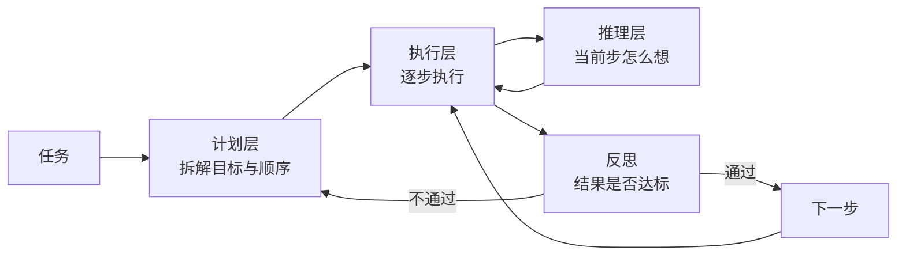
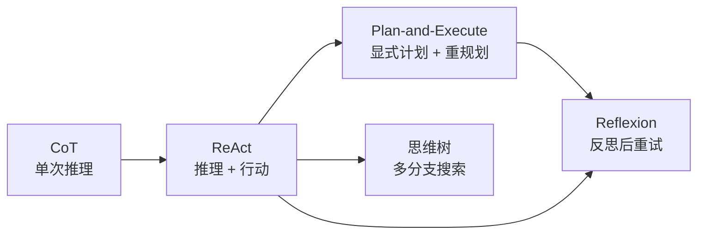
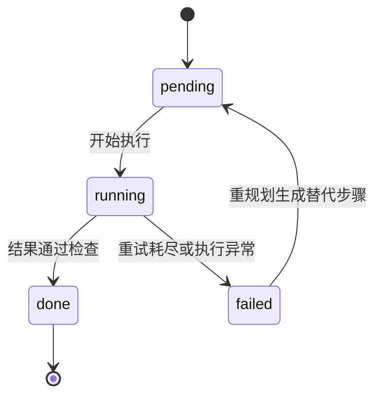
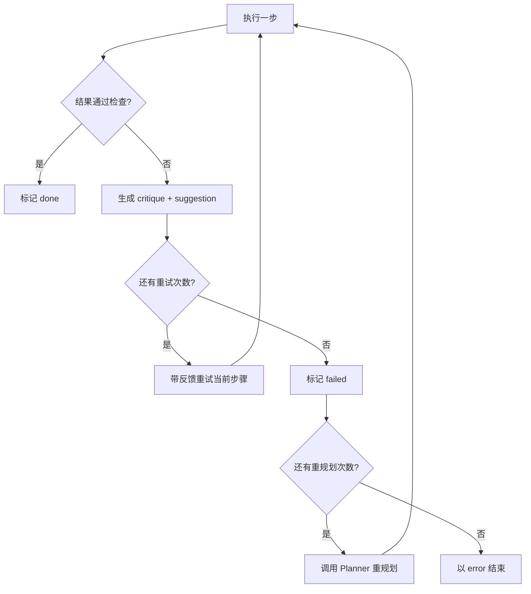
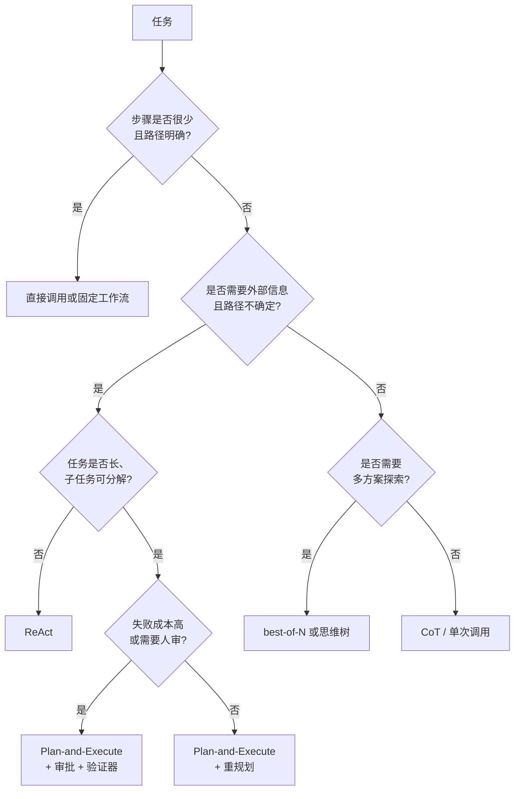
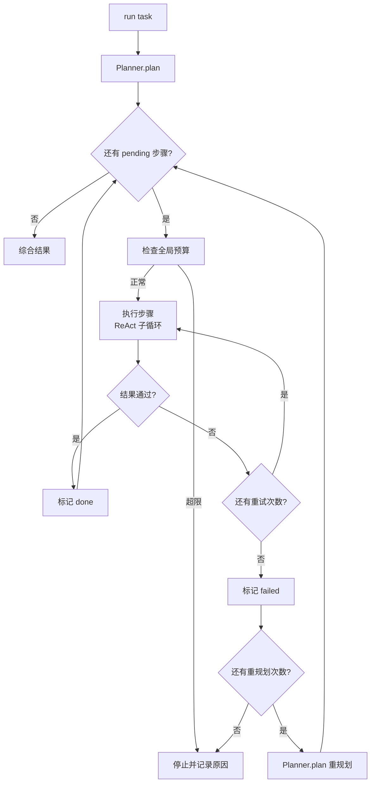

# 第 6 章 规划与推理：从 CoT 到 Reflexion

## 本章导读

研究助手接到一个开放任务，v0.5.0 的 ReAct 循环跑了十二步，却反复搜索同一个关键词；另一次轨迹很快给出答案，却漏掉了“失败模式”这个关键子问题。两次失败都不是模型或工具能力不足，而是缺少一个可检查的“下一步做什么”的结构。本章讨论 CoT、ReAct、Plan-and-Execute、思维树与 Reflexion 各自解决什么问题、付出什么代价，以及如何把规划做成可执行、可停止、可重试的状态。

⭐⭐⭐ 进阶 ｜ 适合：工程师、研究者、技术管理者

## 学习目标

读完本章你将能够：

- 区分推理与规划：前者决定“这一步怎么想”，后者决定“有哪几步、按什么顺序做”
- 解释 CoT、ReAct、Plan-and-Execute、思维树（Tree of Thoughts, ToT）与 Reflexion 的机制、适用场景和主要失败模式
- 判断一个任务应该直接调用、交给 ReAct 自反应，还是需要显式计划与重规划
- 设计 `Plan`、`PlanStep`、`Planner`，并为步骤定义可验证的完成标准
- 在 Atlas v0.6.0 中实现 `PlanExecuteAgent`，在不改 `Agent` 与冻结接口的前提下加入反思、重试与重规划

## 6.1 推理与规划：两个不同的问题

先看一个生活化的类比。开车去一个陌生城市，**规划**是出发前决定走哪条高速、在哪里休息；**推理**是路上看到前方拥堵时，判断该变道还是下匝道。规划关心的是“有哪几步、顺序如何”，推理关心的是“当前这一步怎么做得更好”。两者都会影响最终结果，但失败方式完全不同：规划错了，可能南辕北辙；推理错了，可能只是多绕一个路口。

在 Agent 里，这两个概念经常被混为一谈。一个模型在回答前写出“首先……其次……最后……”，这是**思维链（Chain-of-Thought, CoT）**，属于推理；它并没有产生一个可以被执行、被检查、被中断的计划对象。一个 Agent 先列出三个子任务，再逐个调用工具完成，这才是**规划**。前者改变的是单次模型调用的内部过程，后者改变的是多次调用之间的控制结构。

可以用三层来划分：

| 层次 | 回答的问题 | 典型产物 | 失败模式 |
|---|---|---|---|
| 计划层 | 要做哪几件事，顺序与完成标准是什么 | `Plan`、待办列表、里程碑 | 计划过时、步骤过粗或过细 |
| 推理层 | 当前这一步应该怎么做 | 思维链、假设、对比分析 | 推理跳跃、依据不足、自我矛盾 |
| 执行层 | 调用哪个工具、参数是什么、结果如何 | 工具调用与观察 | 参数错误、工具失败、循环调用 |

三层不是必须同时存在。简单任务可以只有执行层；中等任务可以是“推理 + 执行”的 ReAct；长任务才需要把计划层显式化。**显式计划的价值不在于让模型更聪明，而在于把隐式的多步决策变成可观察、可中断、可复用的状态。**



这张图里有一个容易被忽略的反馈边：反思的结果既可以回到执行层重试，也可以回到计划层重规划。选择哪条边，取决于失败是“这一步没做好”还是“计划本身不成立”。第 6.5 节会展开这个判断。

## 6.2 五种范式与适用边界

### 6.2.1 思维链：把推理写出来

CoT 的核心是让模型在给出答案前显式写出中间步骤。它之所以有效，是因为自回归模型逐令牌生成，显式的中间步骤相当于给后续推理提供了更多可用的上下文，也降低了“一步跳到结论”的概率。对数学题、逻辑题、需要多条件约束的任务，CoT 往往能明显改善结果。

但 CoT 有三个边界。第一，它不引入外部信息，模型不知道的事实，写多少步推理也推不出来。第二，它没有行动，无法通过工具验证假设，也无法在发现错误后重新观察环境。第三，它是一次调用内的过程，无法在执行中途被人工审查或中断。CoT 适合“知识已经在模型里、只需要组织推理”的任务，不适合“必须查资料、必须操作外部系统”的任务。

还要注意，推理模型可能生成用户看不见的内部推理。**不要把供应商隐藏的推理链当作可审计日志**；Agent 的轨迹应该记录模型显式输出的结论、工具调用与观察，而不是假设自己能拿到全部内部过程。

### 6.2.2 ReAct：让推理与行动交替

ReAct（Reason + Act）把一次任务拆成多轮“思考—行动—观察”：模型先写出当前判断，再决定调用哪个工具；工具返回结果后，模型基于新观察继续思考。它解决的是 CoT 的核心缺陷——**推理无法接触外部世界**。搜索结果、网页内容、代码执行输出都会成为下一轮推理的依据，这让 Agent 能够纠正事实错误，而不是在错误前提上继续推演。

ReAct 的代价是轮次不固定。模型可能三步完成，也可能三十步还在原地打转。常见失败模式包括：重复调用相同工具、目标漂移、过早收敛、观察结果挤爆上下文。第 4 章的 `Agent.run` 已经是一个 ReAct 循环：`LLMResponse.content` 是思考，`tool_calls` 是行动，`ToolResult` 是观察。区别只在于 Atlas 不强制模型输出“Thought:”前缀，而是使用原生工具调用，把思考与行动放在同一个响应里。这是有意的设计：**用结构化协议而不是文本解析来驱动循环**。

### 6.2.3 Plan-and-Execute：先规划，后执行

Plan-and-Execute 把一次任务分成两个阶段：规划器先产出一个完整计划，执行器再逐步完成。计划不是一段自然语言，而是一个数据结构：目标、步骤列表、每步的状态。这样做的直接收益是可观察、可恢复、可审查：你可以看到第几步失败、失败原因是什么、是否需要改计划。

它也有明显的代价。计划是在信息不完整时做出的假设，执行过程中出现新事实，原计划可能过时；步骤粒度过细，执行器会被琐碎的指令束缚；粒度过粗，又退化成“一句话目标”。因此 Plan-and-Execute 的关键不是“先写计划”，而是**重规划机制**：什么时候放弃旧计划、保留哪些已完成结果、如何避免重复劳动。

### 6.2.4 思维树：把推理变成搜索

思维树（Tree of Thoughts, ToT）把推理过程展开成树：每个节点是一个中间想法，模型生成多个候选，评估器给候选打分，搜索策略决定继续展开、剪枝还是回溯。它适合解空间不大、但需要试错的场景，例如谜题、约束满足、需要多方案比较的写作。

ToT 的成本随分支因子和深度快速增长。每展开一层，都要生成多个候选并逐个评估；如果评估器本身是一次模型调用，成本会成倍上升。更现实的问题是，开放式研究任务很难定义可靠的“状态评估函数”——你怎么判断一个中间结论值不值得继续？因此 ToT 更像一种研究范式，而不是 Agent 的默认配置。工程上更常见的是**计划级别的 best-of-N**：让规划器生成多个候选计划，用规则或验证器选一个，再顺序执行。

### 6.2.5 Reflexion：让失败进入下一轮

Reflexion 在 ReAct 或 Plan-and-Execute 之上加了一层反思：执行结束后，模型根据结果与目标生成批评，把批评写入下一轮尝试的上下文，再重试。它不更新模型权重，而是用自然语言反馈实现“语言化的强化学习”。对可以重复尝试、且有明确成功标准的任务（代码修复、结构化抽取、有测试用例的编程题），Reflexion 往往比单纯重试更有效。

Reflexion 的边界同样明显。反思的质量取决于模型能否正确判断自己错了；如果模型看不出问题，反思只会重复原来的答案。批评如果太泛（“再仔细一点”），对下一轮没有帮助。反思还会增加调用次数和延迟，因此不应该对每个步骤无条件执行。

| 范式 | 决策单位 | 是否使用工具 | 纠错方式 | 相对成本 | 适用场景 | 主要风险 |
|---|---|---|---|---|---|---|
| CoT | 单次调用内的推理步 | 否 | 无外部纠错 | 低 | 数学、逻辑、文本分析 | 事实错误无法发现 |
| ReAct | 一轮思考—行动 | 是 | 观察驱动改道 | 中 | 路径未知、需要外部信息 | 循环、漂移、上下文膨胀 |
| Plan-and-Execute | 计划步骤 | 是 | 重规划 | 中高 | 长任务、子任务可分解 | 计划过时、粒度失当 |
| 思维树 | 推理树节点 | 可选 | 搜索与回溯 | 高 | 小搜索空间、可评估状态 | 分支爆炸、评估器不可靠 |
| Reflexion | 一次尝试 | 是 | 反思后重试 | 中高 | 可重复尝试、有成功标准 | 自我评估偏差、空泛批评 |



这不是一条“越往后越强”的升级路线。它们是不同成本下的不同工具，很多生产系统只使用 ReAct 加一个轻量待办列表，效果已经足够。

## 6.3 ReAct：交替推理与行动

ReAct 的形式化循环可以写成：

```text
thought_0 = 分析任务与当前观察
while not done:
    action_t = 选择工具与参数
    observation_t = 执行工具
    thought_{t+1} = 基于 observation_t 更新判断
    if 已有足够信息:
        answer = 生成最终答案
```

它的关键不是“每轮都写一段思考”，而是**行动会产生新的观察，观察会改变下一步决策**。如果工具返回的结果没有进入下一轮上下文，ReAct 就退化成“带工具的 CoT”，失去纠错能力。

ReAct 最常见的四种失败模式：

1. **重复调用**：模型反复搜索同一个查询，或反复读取同一个页面。原因通常是工具结果没有给出新信息，模型却不知道如何换策略。
2. **目标漂移**：子问题越查越多，逐渐偏离原始目标。开放研究任务尤其常见。
3. **过早收敛**：只查一次就下结论，把“没搜到”当成“不存在”。
4. **上下文膨胀**：每次观察都完整保留，几轮之后关键信息被淹没。

对应的缓解手段分别是指令约束、显式计划、验证器和上下文压缩。注意这些手段不在同一层：重复调用可以用停止策略兜底，目标漂移需要计划层，过早收敛需要验证器，上下文膨胀属于第 9 章的上下文工程。**不要指望一个提示词同时解决四种问题。**

ReAct 不适合所有任务。确定性的固定流程（例如“读取发票—抽取字段—写入表格”）用工作流更便宜、更可控；单次 API 查询不需要循环；高风险副作用操作需要审批与沙箱，不能只靠模型自觉。


ReAct 里的“推理”指模型显式输出的内容。推理模型的隐藏推理链不进入 `Step.thought`，也不应该被当作审计依据。Atlas 只记录模型输出给调用方的部分。


## 6.4 Plan-and-Execute：把计划变成可检查的状态

Plan-and-Execute 的第一个设计决定是：**计划是数据，不是散文**。一段“首先调研背景，然后分析，最后总结”的文字无法被程序检查，也无法知道哪一步完成了。Atlas 用三个字段表达计划：

```python
@dataclass
class PlanStep:
    id: str
    description: str
    status: PlanStatus = "pending"

@dataclass
class Plan:
    goal: str
    steps: list[PlanStep] = field(default_factory=list)
```

`PlanStatus` 只有四个取值：`pending`、`running`、`done`、`failed`。这个状态机看起来简单，却解决了三个工程问题：执行器知道下一步做什么；轨迹可以回答“卡在哪一步”；重规划可以保留已完成结果，只替换剩余步骤。



计划步骤的设计比计划的数量更重要。一个好的步骤应该满足：

- **面向产出**：写“产出一份包含三个失败模式的对比表”，而不是“思考一下失败模式”
- **可验证**：完成标准能被外部检查，至少能被一个反思器检查
- **粒度适中**：一个步骤对应一次或少数几次工具调用，通常 3–7 步足够
- **顺序有依据**：后一步依赖前一步的产出，而不是随意排列

步骤太细，执行器会失去自主调整空间；步骤太粗，计划退化成一句目标。判断标准是：**这一步失败时，你是否知道该改什么**。如果不知道，说明步骤还不够具体；如果每一步都要改，说明计划过细。

执行阶段，Atlas 让每个计划步骤都走一次完整的 ReAct 循环：把“总目标 + 当前步骤 + 已完成结果”交给执行器，执行器可以自由调用工具。这样既保留了计划的结构，又没有牺牲单步的灵活性。这就是常见的**混合策略**：粗粒度计划，细粒度 ReAct。

重规划由失败触发，而不是定时触发。常见触发条件包括：步骤执行异常、反思判定结果不达标、新观察推翻了计划假设、预算接近上限。重规划时必须保留已完成结果，否则会重复劳动；必须设置上限，否则会陷入“计划—失败—再计划”的循环；必须把失败原因写进规划上下文，否则新计划可能重复同一个错误。

| 维度 | ReAct | Plan-and-Execute |
|---|---|---|
| 计划产物 | 无显式计划 | `Plan` + `PlanStep` 状态 |
| 适应性 | 每一步都可改道 | 计划内适应，失败后重规划 |
| 可观测性 | 看轨迹才知道走向 | 直接看计划状态 |
| 延迟 | 通常更低 | 多一次规划调用 |
| 成本 | 随轮次增长 | 规划与重规划增加开销 |
| 适用场景 | 中等长度、路径开放 | 长任务、子任务可分解 |
| 主要风险 | 循环、漂移 | 计划过时、粒度失当 |

## 6.5 反思与 Reflexion：让失败进入下一轮

反思（Reflection）是对结果做一次结构化评估：结果是否满足当前步骤的完成标准？缺口是什么？下一次应该具体改什么？它输出的不是一句“做得不错”，而是三个字段：`ok`、`critique`、`suggestion`。`ok` 决定是否继续，`critique` 说明哪里不足，`suggestion` 给出可执行的修改方向。

Reflexion 则把反思结果写入下一轮尝试的上下文，形成“执行—反思—重试”的闭环。它不更新权重，因此成本远低于微调；它也不依赖外部奖励模型，因此适用范围更广。但它的效果高度依赖反思质量。一个只说“答案不够详细”的批评，和“缺少 2024 年之后的三个代表性系统，请补充并给出来源”的批评，对下一轮的帮助完全不同。

好的批评应该满足三条：

1. **具体**：指出缺失的事实、未覆盖的子问题、未满足的约束
2. **可执行**：告诉下一轮具体做什么，而不是泛泛要求“更好”
3. **有依据**：引用当前结果或任务要求，而不是凭感觉

反思也有盲区。模型可能高估自己的结果，也可能过度挑剔；如果没有外部验证器，反思本质上仍是“模型评价模型”。工程上常见的缓解手段是：用独立的提示词或独立模型做反思；在代码、数学等可验证任务上优先使用测试或规则；限制重试次数；把反思结果写入轨迹，便于事后分析。



重试、反思、重规划是三个不同层次的动作：

| 动作 | 改变什么 | 成本 | 适用情况 |
|---|---|---|---|
| 重试 | 同一提示再执行一次 | 低 | 偶发工具失败、输出为空 |
| 反思后重试 | 在提示中加入批评与建议 | 中 | 结果方向对，但缺口明确 |
| 重规划 | 修改剩余步骤 | 高 | 原计划假设不成立，或步骤本身不可行 |

很多系统把三者混在一起，结果是一失败就重规划，成本高且不稳定。Atlas v0.6.0 的选择是：先反思，再重试；重试耗尽才重规划；重规划次数有上限。

## 6.6 树搜索与思维树：探索的代价

思维树把推理过程建模成搜索问题。每个节点是一个中间状态，生成器负责扩展候选，评估器负责打分，搜索策略决定下一步扩展哪个节点。它适合那些“正确答案需要试错”的任务：二十四点、数独、约束规划、需要比较多个叙事方案的写作。

ToT 的工程成本可以用一个简单公式估算：如果每层生成 `b` 个候选、搜索深度为 `d`，最坏情况下要评估 `O(b^d)` 个节点。每个节点至少一次生成调用，通常还有一次评估调用。分支因子为 3、深度为 4，就是 81 个节点；如果每个节点还要调用工具，成本会迅速失控。

因此 ToT 适合满足以下条件的场景：

- 状态可以清晰表示，候选之间可以比较
- 评估器便宜且相对可靠，例如规则、单元测试、明确的评分标准
- 搜索空间不大，或者可以用强剪枝快速缩小
- 任务价值足够高，能承担额外的延迟与费用

开放式研究通常不满足这些条件。你很难判断“某个中间结论是否值得继续查”，网页抓取和模型调用也不便宜。更现实的做法是**计划级 best-of-N**：让规划器生成 3 个候选计划，用规则或一次轻量评估选一个，再顺序执行。它保留了“多方案比较”的收益，又避免了逐节点搜索的爆炸。


树搜索、自洽性等方法的论文结论依赖具体任务、模型与评估器。把它们迁移到自己的任务时，应先用小规模评测比较成功率、延迟与成本，不要仅凭论文中的任务表现做决策。


## 6.7 什么时候需要显式规划

判断是否需要显式计划，可以看六个因素：

| 因素 | 倾向直接执行 / ReAct | 倾向显式计划 |
|---|---|---|
| 任务长度 | 1–3 步 | 多步、跨多个子问题 |
| 可分解性 | 子任务强耦合，难以拆分 | 子任务边界清晰 |
| 路径确定性 | 下一步高度依赖上一步观察 | 大致路径可以预先列出 |
| 可验证性 | 结果只能主观判断 | 每步有明确产出或测试 |
| 失败成本 | 错了可以低成本重来 | 错误代价高、不可逆 |
| 环境变化 | 信息实时变化，计划很快过时 | 环境相对稳定 |
| 延迟与成本 | 对延迟敏感 | 可接受规划与重规划开销 |
| 人工审查 | 不需要人看过程 | 需要人审计划或关键步骤 |



实践中最常见的不是“完全不规划”，而是“规划得太重”。一个三步任务硬套完整计划系统，增加了规划和重规划调用，却没有带来可观测性收益。反过来，一个需要十几步、跨多个来源的研究任务完全交给 ReAct，很容易在第 8 步之后失去方向。

Atlas v0.6.0 采用混合策略：

- 计划层只做粗粒度拆解，通常 3–6 步
- 每个步骤内部用 ReAct 自由调用工具
- 步骤结束做一次轻量反思
- 反思失败先重试，重试耗尽再重规划
- 预算、重规划上限、重试上限始终生效

用一句话概括：**计划是假设，不是合同**。它的作用是给执行器一个可检查的起点，而不是限制执行器根据新信息调整。

## 6.8 动手实践：Atlas v0.6.0

### 6.8.1 范围与目录

本章新增 `planning/` 模块，不修改 `Agent`、`LLM`、`Tool`、`ToolRegistry` 的任何冻结签名：

| 文件 | 内容 |
|---|---|
| `src/atlas/planning/base.py` | `PlanStatus`、`PlanStep`、`Plan`、`Planner` |
| `src/atlas/planning/planner.py` | `LLMPlanner`、`StaticPlanner`、`parse_plan`、`PlanParseError` |
| `src/atlas/planning/reflect.py` | `Reflection`、`Reflector`、`LLMReflector`、`parse_reflection` |
| `src/atlas/planning/plan_execute.py` | `PlanExecuteAgent` |
| `src/atlas/planning/__init__.py` | 模块导出 |
| `examples/ch06_plan.py` | 三步研究任务，含反思重试 |
| `tests/test_planning.py` | 计划解析、反思、重试、重规划、预算测试 |

`PlanExecuteAgent` 实现 `AgentRunner` 协议，因此可以像普通 `Agent` 一样被调用，也可以在未来被多 Agent 编排器当作子节点。

### 6.8.2 计划数据结构与协议

```python
# src/atlas/planning/base.py
from __future__ import annotations

from dataclasses import dataclass, field
from typing import Literal, Protocol

from atlas.types import Message

PlanStatus = Literal["pending", "running", "done", "failed"]


@dataclass
class PlanStep:
    id: str
    description: str
    status: PlanStatus = "pending"


@dataclass
class Plan:
    goal: str
    steps: list[PlanStep] = field(default_factory=list)


class Planner(Protocol):
    def plan(self, task: str, history: list[Message]) -> Plan:
        ...
```

这与第 4 章在 `atlas/interfaces.md` 中承诺的 `Planner.plan(task, history)` 完全一致。`history` 同时承载“原始任务”和“已完成/失败步骤”的摘要，因此重规划不需要新增接口。

### 6.8.3 LLMPlanner：把模型输出解析成计划

```python
# src/atlas/planning/planner.py
from __future__ import annotations

import json
import re
from collections.abc import Iterable

from atlas.llm.base import LLM
from atlas.planning.base import Plan, PlanStep
from atlas.types import Message

_FENCED = re.compile(r"```(?:json)?\s*(.*?)```", re.DOTALL)

PLANNER_PROMPT = """你是任务规划器。把用户任务拆成 2–6 个可独立执行的步骤。
只输出 JSON，不要解释：
{"goal": "一句话目标", "steps": [{"id": "1", "description": "..."}]}
每个步骤要说明产出物与完成标准；不要写"思考一下"这类无法验证的步骤。"""


class PlanParseError(ValueError):
    """计划输出无法解析成 Plan 时抛出。"""


def _strip_fences(text: str) -> str:
    match = _FENCED.search(text)
    if match:
        return match.group(1).strip()
    start = text.find("{")
    end = text.rfind("}")
    if start != -1 and end > start:
        return text[start : end + 1]
    return text.strip()


def parse_plan(text: str, *, max_steps: int = 6) -> Plan:
    payload = _strip_fences(text)
    try:
        data = json.loads(payload)
    except json.JSONDecodeError as exc:
        raise PlanParseError(f"计划不是合法 JSON：{exc}") from exc
    if not isinstance(data, dict):
        raise PlanParseError("计划顶层必须是对象")
    raw_steps = data.get("steps")
    if not isinstance(raw_steps, list) or not raw_steps:
        raise PlanParseError("计划缺少非空 steps 数组")

    steps: list[PlanStep] = []
    seen: set[str] = set()
    for index, raw in enumerate(raw_steps, start=1):
        if len(steps) >= max_steps:
            break
        if isinstance(raw, str):
            description = raw.strip()
            step_id = str(index)
        elif isinstance(raw, dict):
            description = str(raw.get("description", "")).strip()
            step_id = str(raw.get("id") or index).strip()
        else:
            raise PlanParseError(f"第 {index} 个步骤格式不正确")
        if not description:
            raise PlanParseError(f"第 {index} 个步骤缺少 description")
        if not step_id or step_id in seen:
            step_id = f"s{index}"
        seen.add(step_id)
        steps.append(PlanStep(id=step_id, description=description))

    if not steps:
        raise PlanParseError("计划没有有效步骤")
    goal = str(data.get("goal") or "").strip()
    return Plan(goal=goal, steps=steps)


class LLMPlanner:
    def __init__(
        self,
        llm: LLM,
        *,
        max_steps: int = 6,
        temperature: float = 0.0,
        system_prompt: str = PLANNER_PROMPT,
        max_history: int = 8,
        max_history_chars: int = 800,
    ) -> None:
        self.llm = llm
        self.max_steps = max_steps
        self.temperature = temperature
        self.system_prompt = system_prompt
        self.max_history = max_history
        self.max_history_chars = max_history_chars
        self.last_plan: Plan | None = None

    def plan(self, task: str, history: list[Message]) -> Plan:
        messages = [
            Message(role="system", content=self.system_prompt),
            Message(role="user", content=self._render(task, history)),
        ]
        response = self.llm.complete(messages, temperature=self.temperature)
        plan = parse_plan(response.content or "", max_steps=self.max_steps)
        if not plan.goal:
            plan.goal = task
        self.last_plan = plan
        return plan

    def _render(self, task: str, history: list[Message]) -> str:
        lines = [f"任务：{task}", "", "已有进展："]
        recent = [message for message in history if (message.content or "").strip()]
        if not recent:
            lines.append("（无）")
        else:
            for message in recent[-self.max_history :]:
                content = (message.content or "").strip()
                lines.append(
                    f"- {message.role}: {content[: self.max_history_chars]}"
                )
        lines.extend(["", "请输出 JSON 计划。"])
        return "\n".join(lines)


class StaticPlanner:
    """按顺序返回预设计划，主要用于测试与离线演示。"""

    def __init__(self, plans: Iterable[Plan]) -> None:
        self._plans = list(plans)
        self.calls = 0
        self.last_plan: Plan | None = None

    def plan(self, task: str, history: list[Message]) -> Plan:
        if self.calls >= len(self._plans):
            raise PlanParseError("StaticPlanner 没有更多计划")
        template = self._plans[self.calls]
        self.calls += 1
        plan = Plan(
            goal=template.goal or task,
            steps=[
                PlanStep(id=step.id, description=step.description)
                for step in template.steps
            ],
        )
        self.last_plan = plan
        return plan
```

这里有两个关键点。第一，**计划输出是不可信输入**：模型可能返回 Markdown 代码块、前后解释、缺字段、重复 ID。`parse_plan` 先剥离代码块，再按字段校验，失败时抛 `PlanParseError`，由上层决定是退化还是重试。第二，**步骤数量必须设上限**：不加限制时，模型可能生成二十步的“完美计划”，执行成本远超预算。

### 6.8.4 反思器：把批评变成结构

```python
# src/atlas/planning/reflect.py
from __future__ import annotations

import json
import re
from dataclasses import dataclass
from typing import Protocol

from atlas.llm.base import LLM
from atlas.planning.base import PlanStep
from atlas.types import Message

_FENCED = re.compile(r"```(?:json)?\s*(.*?)```", re.DOTALL)

REFLECT_PROMPT = """你是严格的审稿人。判断给定步骤的结果是否足以支撑任务目标。
只输出 JSON：{"ok": true, "critique": "...", "suggestion": "..."}
critique 必须指出具体缺口；suggestion 必须是下一次尝试可执行的修改。"""


@dataclass
class Reflection:
    ok: bool
    critique: str = ""
    suggestion: str = ""


class Reflector(Protocol):
    def reflect(
        self,
        task: str,
        step: PlanStep,
        answer: str,
        history: list[Message],
    ) -> Reflection:
        ...


def _strip_fences(text: str) -> str:
    match = _FENCED.search(text)
    if match:
        return match.group(1).strip()
    start = text.find("{")
    end = text.rfind("}")
    if start != -1 and end > start:
        return text[start : end + 1]
    return text.strip()


def _as_bool(value: object, default: bool = True) -> bool:
    if isinstance(value, bool):
        return value
    if isinstance(value, str):
        return value.strip().lower() in {"true", "1", "yes", "y"}
    if isinstance(value, (int, float)):
        return bool(value)
    return default


def parse_reflection(text: str) -> Reflection:
    try:
        data = json.loads(_strip_fences(text))
    except json.JSONDecodeError as exc:
        # 反思器是辅助组件；解析失败时不阻断主流程，但把原因写进 critique。
        return Reflection(ok=True, critique=f"反思输出无法解析，按通过处理：{exc}")
    if not isinstance(data, dict):
        return Reflection(ok=True, critique="反思输出不是对象，按通过处理")
    return Reflection(
        ok=_as_bool(data.get("ok"), default=True),
        critique=str(data.get("critique") or ""),
        suggestion=str(data.get("suggestion") or ""),
    )


class LLMReflector:
    def __init__(
        self,
        llm: LLM,
        *,
        temperature: float = 0.0,
        system_prompt: str = REFLECT_PROMPT,
        max_history: int = 6,
        max_history_chars: int = 600,
    ) -> None:
        self.llm = llm
        self.temperature = temperature
        self.system_prompt = system_prompt
        self.max_history = max_history
        self.max_history_chars = max_history_chars

    def reflect(
        self,
        task: str,
        step: PlanStep,
        answer: str,
        history: list[Message],
    ) -> Reflection:
        messages = [
            Message(role="system", content=self.system_prompt),
            Message(
                role="user",
                content=(
                    f"任务：{task}\n步骤：{step.description}\n"
                    f"步骤结果：\n{answer}\n\n已有进展：\n{self._history(history)}"
                ),
            ),
        ]
        response = self.llm.complete(messages, temperature=self.temperature)
        return parse_reflection(response.content or "")

    def _history(self, history: list[Message]) -> str:
        recent = [message for message in history if (message.content or "").strip()]
        if not recent:
            return "（无）"
        return "\n".join(
            f"- {message.role}: {(message.content or '')[: self.max_history_chars]}"
            for message in recent[-self.max_history :]
        )
```

反思解析失败时选择**放行**（`ok=True`），这是一个有意的取舍：反思器是辅助组件，不应该因为一次格式错误阻断整个任务。但放行不等于忽略——`critique` 仍然记录了失败原因，轨迹里可以看到。反过来，如果任务对正确性要求极高，可以把策略改成 fail-closed，让解析失败直接触发重试或终止。

### 6.8.5 PlanExecuteAgent：执行、反思、重规划

```python
# src/atlas/planning/plan_execute.py
from __future__ import annotations

from collections.abc import Callable
from uuid import uuid4

from atlas.agent.policy import BudgetStopPolicy, RunState
from atlas.agent.runner import AgentRunner
from atlas.planning.base import Plan, PlanStep, Planner
from atlas.planning.reflect import Reflection, Reflector
from atlas.types import Budget, Message, RunContext, Step, Trajectory, Usage, utcnow

Synthesizer = Callable[[str, list[tuple[PlanStep, str]]], str]


class PlanExecuteAgent:
    """先规划、再逐步执行；失败时反思、重试或重规划。"""

    def __init__(
        self,
        planner: Planner,
        executor: AgentRunner,
        *,
        reflector: Reflector | None = None,
        max_replans: int = 2,
        max_step_retries: int = 1,
        synthesizer: Synthesizer | None = None,
    ) -> None:
        self.planner = planner
        self.executor = executor
        self.reflector = reflector
        self.max_replans = max_replans
        self.max_step_retries = max_step_retries
        self.synthesizer = synthesizer or self._default_synthesize
        self.last_plan: Plan | None = None

    def run(self, task: str, ctx: RunContext | None = None) -> Trajectory:
        ctx = ctx or RunContext(run_id=f"plan-{uuid4().hex[:12]}")
        started_at = utcnow()
        trajectory = Trajectory(task=task, run_id=ctx.run_id, started_at=started_at)
        history: list[Message] = [Message(role="user", content=task)]
        results: list[tuple[PlanStep, str]] = []
        usage = Usage()
        llm_steps = 0
        tool_calls = 0
        parent_steps = 0
        replans = 0
        stop_reason = "final_answer"

        try:
            plan = self._initial_plan(task, history)
            self.last_plan = plan

            while True:
                pending = [step for step in plan.steps if step.status == "pending"]
                if not pending:
                    break

                reason = self._budget_reason(
                    ctx, started_at, llm_steps, tool_calls, usage
                )
                if reason is not None:
                    stop_reason = reason
                    break

                step = pending[0]
                step.status = "running"
                children, ok, reflection = self._run_step(
                    ctx,
                    task,
                    plan,
                    step,
                    results,
                    history,
                    started_at,
                    llm_steps,
                    tool_calls,
                    usage,
                )

                for child in children:
                    usage = usage + child.usage
                    llm_steps += len(child.steps)
                    tool_calls += sum(len(item.tool_calls) for item in child.steps)
                child = children[-1]
                answer = (child.final_answer or "").strip()
                parent_steps += 1
                trajectory.steps.append(
                    Step(
                        index=parent_steps,
                        thought=(
                            f"[计划步骤 {step.id}] {step.description}"
                            f"（尝试 {len(children)} 次）\n{answer}"
                        ),
                        tool_calls=[
                            call
                            for attempt in children
                            for item in attempt.steps
                            for call in item.tool_calls
                        ],
                        tool_results=[
                            result
                            for attempt in children
                            for item in attempt.steps
                            for result in item.tool_results
                        ],
                        usage=sum((item.usage for item in children), Usage()),
                    )
                )

                if ok:
                    step.status = "done"
                    results.append((step, answer))
                    history.append(
                        Message(
                            role="assistant",
                            content=f"步骤 {step.id} 完成：{answer}",
                        )
                    )
                    continue

                step.status = "failed"
                critique = (
                    reflection.critique
                    if reflection is not None
                    else "结果为空或执行未正常结束"
                )
                history.append(
                    Message(
                        role="user",
                        content=(
                            f"步骤 {step.id} 失败：{critique}。"
                            f"已完成结果：{self._results_digest(results)}"
                        ),
                    )
                )
                replans += 1
                if replans > self.max_replans:
                    stop_reason = "error"
                    break
                try:
                    new_plan = self.planner.plan(task, history)
                except Exception as exc:
                    history.append(
                        Message(role="user", content=f"重规划失败：{exc}")
                    )
                    stop_reason = "error"
                    break
                plan = self._merge_plan(plan, new_plan)
                self.last_plan = plan
                history.append(
                    Message(
                        role="user",
                        content=(
                            "已重规划。当前计划："
                            f"{self._plan_digest(plan)}"
                        ),
                    )
                )
                if not any(item.status == "pending" for item in plan.steps):
                    stop_reason = "error"
                    break

            if stop_reason == "final_answer":
                trajectory.final_answer = self.synthesizer(task, results)
        except Exception as exc:
            parent_steps += 1
            trajectory.steps.append(
                Step(
                    index=parent_steps,
                    thought=f"规划执行失败：{type(exc).__name__}: {exc}",
                )
            )
            stop_reason = "error"
        finally:
            trajectory.usage = usage
            trajectory.stop_reason = stop_reason
            trajectory.ended_at = utcnow()

        return trajectory
```

执行器的单步逻辑、预算共享与重规划合并如下：

```python
    def _run_step(
        self,
        ctx: RunContext,
        task: str,
        plan: Plan,
        step: PlanStep,
        results: list[tuple[PlanStep, str]],
        history: list[Message],
        started_at,
        llm_steps: int,
        tool_calls: int,
        usage: Usage,
    ) -> tuple[list[Trajectory], bool, Reflection | None]:
        children: list[Trajectory] = []
        reflection: Reflection | None = None
        feedback: str | None = None
        attempt = 0
        attempt_usage = usage
        attempt_steps = llm_steps
        attempt_tool_calls = tool_calls

        while True:
            prompt = self._step_prompt(plan, step, results, feedback=feedback)
            child_ctx = self._child_context(
                ctx, step, started_at, attempt_steps, attempt_tool_calls, attempt_usage
            )
            child = self.executor.run(prompt, child_ctx)
            children.append(child)
            attempt_usage = attempt_usage + child.usage
            attempt_steps += len(child.steps)
            attempt_tool_calls += sum(len(item.tool_calls) for item in child.steps)
            answer = (child.final_answer or "").strip()
            ok = child.stop_reason == "final_answer" and bool(answer)

            if ok and self.reflector is not None:
                try:
                    reflection = self.reflector.reflect(task, step, answer, history)
                except Exception as exc:
                    reflection = Reflection(
                        ok=True,
                        critique=f"反思器异常，按通过处理：{exc}",
                    )
                ok = reflection.ok

            if ok:
                return children, True, reflection
            if attempt >= self.max_step_retries:
                return children, False, reflection
            if child.stop_reason != "final_answer":
                return children, False, reflection

            attempt += 1
            critique = reflection.critique if reflection else "结果为空"
            suggestion = (
                reflection.suggestion if reflection else "重新执行并给出完整结果"
            )
            feedback = f"{critique}。建议：{suggestion}"
            history.append(
                Message(
                    role="user",
                    content=f"步骤 {step.id} 未通过检查：{feedback}。请重试。",
                )
            )

    def _child_context(
        self,
        ctx: RunContext,
        step: PlanStep,
        started_at,
        llm_steps: int,
        tool_calls: int,
        usage: Usage,
    ) -> RunContext:
        elapsed = (utcnow() - started_at).total_seconds()
        remaining = Budget(
            max_steps=max(0, ctx.budget.max_steps - llm_steps),
            max_tokens=max(0, ctx.budget.max_tokens - usage.total_tokens),
            max_cost_usd=max(0.0, ctx.budget.max_cost_usd - usage.cost_usd),
            max_seconds=max(0.0, ctx.budget.max_seconds - elapsed),
            max_tool_calls=max(0, ctx.budget.max_tool_calls - tool_calls),
        )
        return RunContext(
            run_id=f"{ctx.run_id}:{step.id}",
            budget=remaining,
            user_id=ctx.user_id,
            deadline_at=ctx.deadline_at,
            metadata={
                **ctx.metadata,
                "parent_run_id": ctx.run_id,
                "plan_step": step.id,
            },
        )

    def _budget_reason(
        self,
        ctx: RunContext,
        started_at,
        llm_steps: int,
        tool_calls: int,
        usage: Usage,
    ) -> str | None:
        state = RunState(
            step=llm_steps,
            tool_calls=tool_calls,
            usage=usage,
            started_at=started_at,
            now=utcnow(),
        )
        return BudgetStopPolicy(ctx.budget).check(state)

    def _step_prompt(
        self,
        plan: Plan,
        step: PlanStep,
        results: list[tuple[PlanStep, str]],
        *,
        feedback: str | None = None,
    ) -> str:
        lines = [
            f"总目标：{plan.goal}",
            f"当前步骤（{step.id}）：{step.description}",
            "已完成步骤：",
        ]
        if results:
            for done_step, answer in results:
                lines.append(f"- {done_step.id} {done_step.description}：{answer}")
        else:
            lines.append("（无）")
        if feedback:
            lines.extend(["", f"上一次尝试的问题：{feedback}"])
        lines.extend(
            [
                "",
                "请完成当前步骤。需要外部信息时调用工具；完成后给出可验证的结论。",
            ]
        )
        return "\n".join(lines)

    def _merge_plan(self, old: Plan, new: Plan) -> Plan:
        done = [step for step in old.steps if step.status == "done"]
        failed = [step for step in old.steps if step.status == "failed"]
        done_desc = {step.description.strip() for step in done}
        replacement = [
            step for step in new.steps if step.description.strip() not in done_desc
        ]
        steps = done + failed + replacement
        seen: set[str] = set()
        for index, step in enumerate(steps, start=1):
            if not step.id or step.id in seen:
                step.id = f"s{index}"
            seen.add(step.id)
        return Plan(goal=new.goal or old.goal, steps=steps)

    @staticmethod
    def _results_digest(results: list[tuple[PlanStep, str]]) -> str:
        if not results:
            return "（无）"
        return "；".join(
            f"{step.id}={answer[:120]}" for step, answer in results
        )

    @staticmethod
    def _plan_digest(plan: Plan) -> str:
        return " -> ".join(
            f"{step.id}:{step.description}[{step.status}]" for step in plan.steps
        )

    @staticmethod
    def _default_synthesize(
        task: str, results: list[tuple[PlanStep, str]]
    ) -> str | None:
        if not results:
            return None
        sections = [f"# {task}", ""]
        for step, answer in results:
            sections.extend(
                [f"## {step.id} {step.description}", answer, ""]
            )
        return "\n".join(sections).strip()
```

这里有几个值得展开的实现细节。

**预算共享。** 每个计划步骤都创建一个子 `RunContext`，把剩余步数、token、费用、时间和工具调用数传进去。子运行仍然使用第 4 章的 `BudgetStopPolicy`，因此预算约束在所有层级都生效。父级则累计所有尝试的用量，包括失败的重试；否则重试会变成预算黑洞。

**重试与重规划的边界。** 只有“子运行正常结束、但结果未通过反思”才重试；如果子运行因为预算或异常终止，重试通常没有意义，直接进入重规划。重规划会保留已完成步骤、保留失败步骤作为记录，只把新计划中的替代步骤加入待执行队列。

**计划状态的归属。** `PlanStep.status` 由 `PlanExecuteAgent` 修改，`Planner` 只负责生成初始状态。这样同一条计划可以被执行器检查、被轨迹记录、被人类审阅。注意 `Plan` 是运行期对象，不要跨运行复用同一个实例，否则状态会串。

**综合（synthesis）。** v0.6.0 默认把各步骤结果按标题拼接成报告。这是一个有意的简化：它保留可追溯性，但不做跨步骤的压缩与改写。生产系统通常会在最后增加一次“综合写作”调用，第 9 章会讨论它和上下文预算的关系。



### 6.8.6 端到端示例

```python
# examples/ch06_plan.py
from __future__ import annotations

import json

from atlas.agent.loop import Agent, AgentConfig
from atlas.llm.mock import MockLLM
from atlas.planning import LLMPlanner, LLMReflector, PlanExecuteAgent
from atlas.tools import ToolRegistry
from atlas.types import LLMResponse, ToolCall, ToolOutput, ToolSpec, Usage

TOKEN_USAGE = Usage(prompt_tokens=120, completion_tokens=40)


def reply(content: str, **kwargs) -> LLMResponse:
    return LLMResponse(content=content, usage=TOKEN_USAGE, **kwargs)


class CorpusSearchTool:
    spec = ToolSpec(
        name="search",
        description=(
            "检索 Atlas 本地语料。输入查询词，返回与 Agent 规划相关的段落。"
            "适合查概念定义与失败模式；不用于实时新闻。"
        ),
        parameters={
            "type": "object",
            "properties": {"query": {"type": "string"}},
            "required": ["query"],
            "additionalProperties": False,
        },
    )

    def run(self, arguments):
        query = arguments["query"]
        return ToolOutput(
            content=(
                f"检索“{query}”：ReAct 交替进行推理与行动；"
                "Plan-and-Execute 先生成计划再逐步执行。"
                "前者容易重复调用与目标漂移，后者容易计划过时。"
            )
        )


def main() -> None:
    planner_llm = MockLLM(
        [
            LLMResponse(
                content=json.dumps(
                    {
                        "goal": "对比 ReAct 与 Plan-and-Execute",
                        "steps": [
                            {
                                "id": "1",
                                "description": "检索 ReAct 的机制与常见失败模式",
                            },
                            {
                                "id": "2",
                                "description": "检索 Plan-and-Execute 的机制与常见失败模式",
                            },
                            {
                                "id": "3",
                                "description": "给出两种范式的适用建议",
                            },
                        ],
                    },
                    ensure_ascii=False,
                )
            )
        ]
    )
    executor_llm = MockLLM(
        [
            reply(
                "先检索 ReAct 的资料。",
                tool_calls=[
                    ToolCall(
                        id="c1",
                        name="search",
                        arguments={"query": "ReAct 失败模式"},
                    )
                ],
                finish_reason="tool_calls",
            ),
            reply("ReAct 的常见失败模式是重复调用、目标漂移和过早收敛。"),
            reply("Plan-and-Execute 先规划再执行。"),
            reply(
                "Plan-and-Execute 的失败模式包括计划过时、"
                "步骤过细和重规划成本高。"
            ),
            reply(
                "短任务适合 ReAct，长任务适合 Plan-and-Execute，"
                "并保留重规划与预算上限。"
            ),
        ]
    )
    reflector_llm = MockLLM(
        [
            LLMResponse(content='{"ok": true, "critique": "", "suggestion": ""}'),
            LLMResponse(
                content=(
                    '{"ok": false, "critique": "只说了定义，没有失败模式", '
                    '"suggestion": "补充失败模式与适用边界"}'
                )
            ),
            LLMResponse(content='{"ok": true, "critique": "", "suggestion": ""}'),
            LLMResponse(content='{"ok": true, "critique": "", "suggestion": ""}'),
        ]
    )

    executor = Agent(
        executor_llm,
        ToolRegistry([CorpusSearchTool()]),
        config=AgentConfig(system_prompt="你是一名严谨的研究助手。"),
    )
    agent = PlanExecuteAgent(
        LLMPlanner(planner_llm),
        executor,
        reflector=LLMReflector(reflector_llm),
        max_step_retries=1,
    )
    trajectory = agent.run("对比 ReAct 与 Plan-and-Execute，并给出适用建议。")

    print("plan:")
    for step in agent.last_plan.steps:
        print(f"  {step.id}. {step.description} [{step.status}]")
    for step in trajectory.steps:
        print(f"[step {step.index}] {step.thought}")
    print(f"stop_reason={trajectory.stop_reason}")
    print(f"answer={trajectory.final_answer}")
    print(
        "usage="
        f"{trajectory.usage.total_tokens} tokens, "
        f"tool_calls={sum(len(item.tool_calls) for item in trajectory.steps)}"
    )


if __name__ == "__main__":
    main()
```

运行结果：

```text
plan:
  1. 检索 ReAct 的机制与常见失败模式 [done]
  2. 检索 Plan-and-Execute 的机制与常见失败模式 [done]
  3. 给出两种范式的适用建议 [done]
[step 1] [计划步骤 1] 检索 ReAct 的机制与常见失败模式（尝试 1 次）
ReAct 的常见失败模式是重复调用、目标漂移和过早收敛。
[step 2] [计划步骤 2] 检索 Plan-and-Execute 的机制与常见失败模式（尝试 2 次）
Plan-and-Execute 的失败模式包括计划过时、步骤过细和重规划成本高。
[step 3] [计划步骤 3] 给出两种范式的适用建议（尝试 1 次）
短任务适合 ReAct，长任务适合 Plan-and-Execute，并保留重规划与预算上限。
stop_reason=final_answer
answer=# 对比 ReAct 与 Plan-and-Execute，并给出适用建议。

## 1 检索 ReAct 的机制与常见失败模式
ReAct 的常见失败模式是重复调用、目标漂移和过早收敛。

## 2 检索 Plan-and-Execute 的机制与常见失败模式
Plan-and-Execute 的失败模式包括计划过时、步骤过细和重规划成本高。

## 3 给出两种范式的适用建议
短任务适合 ReAct，长任务适合 Plan-and-Execute，并保留重规划与预算上限。
usage=800 tokens, tool_calls=1
```

第二个步骤第一次只回答了定义，反思器判定“没有失败模式”，于是带反馈重试；第二次补齐后通过。这正是 Reflexion 在单步上的最小形态。

### 6.8.7 测试

```python
# tests/test_planning.py（节选）
from __future__ import annotations

import pytest

from atlas.llm.mock import MockLLM
from atlas.planning import (
    LLMPlanner,
    LLMReflector,
    Plan,
    PlanExecuteAgent,
    PlanParseError,
    PlanStep,
    Reflection,
    StaticPlanner,
)
from atlas.types import Budget, LLMResponse, RunContext, Trajectory, Usage


def trajectory(
    answer: str | None,
    *,
    stop_reason: str = "final_answer",
    usage: Usage | None = None,
) -> Trajectory:
    return Trajectory(
        task="",
        run_id="child",
        final_answer=answer,
        stop_reason=stop_reason,
        usage=usage or Usage(),
    )


class ScriptedRunner:
    def __init__(self, outcomes: list[Trajectory]) -> None:
        self.outcomes = list(outcomes)
        self.tasks: list[str] = []

    def run(self, task: str, ctx: RunContext | None = None) -> Trajectory:
        self.tasks.append(task)
        return self.outcomes.pop(0)


class ScriptedReflector:
    def __init__(self, reflections: list[Reflection]) -> None:
        self.reflections = list(reflections)

    def reflect(self, task, step, answer, history):
        return self.reflections.pop(0)


def test_llm_planner_parses_fenced_json_and_caps_steps():
    content = (
        "```json\n"
        '{"goal": "g", "steps": ['
        '{"id": "a", "description": "one"}, '
        '{"description": "two"}, '
        '{"description": "three"}]}\n'
        "```"
    )
    planner = LLMPlanner(MockLLM([LLMResponse(content=content)]), max_steps=2)
    plan = planner.plan("task", [])

    assert plan.goal == "g"
    assert [step.id for step in plan.steps] == ["a", "2"]
    assert [step.description for step in plan.steps] == ["one", "two"]
    assert all(step.status == "pending" for step in plan.steps)


def test_llm_reflector_fails_open_on_bad_output():
    reflector = LLMReflector(MockLLM([LLMResponse(content="我觉得还行")]))
    reflection = reflector.reflect("task", PlanStep("1", "写结论"), "答案", [])

    assert reflection.ok is True
    assert "无法解析" in reflection.critique


def test_reflection_triggers_retry_then_succeeds():
    planner = StaticPlanner([Plan(goal="g", steps=[PlanStep("1", "a")])])
    runner = ScriptedRunner([trajectory("short"), trajectory("long answer")])
    reflector = ScriptedReflector(
        [
            Reflection(ok=False, critique="太短", suggestion="展开"),
            Reflection(ok=True),
        ]
    )
    agent = PlanExecuteAgent(
        planner, runner, reflector=reflector, max_step_retries=1
    )

    result = agent.run("task")

    assert result.stop_reason == "final_answer"
    assert "long answer" in result.final_answer
    assert len(runner.tasks) == 2
    assert "上一次尝试的问题" in runner.tasks[1]
    assert agent.last_plan.steps[0].status == "done"


def test_failed_step_triggers_replan():
    planner = StaticPlanner(
        [
            Plan(goal="g", steps=[PlanStep("1", "a"), PlanStep("2", "b")]),
            Plan(goal="g", steps=[PlanStep("3", "c")]),
        ]
    )
    runner = ScriptedRunner([trajectory(None, stop_reason="error"), trajectory("C")])
    agent = PlanExecuteAgent(planner, runner, max_replans=1)

    result = agent.run("task")

    assert result.stop_reason == "final_answer"
    assert "C" in result.final_answer
    assert planner.calls == 2
    assert [step.status for step in agent.last_plan.steps] == ["failed", "done"]


def test_budget_is_shared_across_steps():
    planner = StaticPlanner(
        [Plan(goal="g", steps=[PlanStep("1", "a"), PlanStep("2", "b")])]
    )
    runner = ScriptedRunner(
        [trajectory("A", usage=Usage(prompt_tokens=100))]
    )
    agent = PlanExecuteAgent(planner, runner)
    ctx = RunContext(
        run_id="run",
        budget=Budget(
            max_steps=10,
            max_tokens=50,
            max_cost_usd=10.0,
            max_seconds=60.0,
            max_tool_calls=10,
        ),
    )

    result = agent.run("task", ctx)

    assert result.stop_reason == "max_tokens"
    assert len(runner.tasks) == 1
    assert agent.last_plan.steps[0].status == "done"
    assert agent.last_plan.steps[1].status == "pending"
```

完整测试套件共 8 条，覆盖计划解析、反思解析、反思重试、重规划、预算共享与失败退化。运行结果：

```text
25 passed in 0.34s
```

其中 17 条是前五章已有的契约与循环测试，新增 8 条本章测试。

### 6.8.8 兼容性与取舍

| 取舍 | 影响 | 后续 |
|---|---|---|
| 只统计执行器轨迹的 token/费用 | 规划器与反思器的调用未计入 `Trajectory.usage` | 生产实现应在 `LLM` 适配层统一计量，或给 `Planner`/`Reflector` 增加用量字段 |
| 步骤顺序执行 | 无法利用可并行的子任务 | 第 10 章多 Agent 或后续 DAG 执行器 |
| 重规划可能重复已完成工作 | 依赖规划器理解历史摘要 | 可在计划中显式传递 `done` 步骤的产出 ID |
| 反思默认放行解析失败 | 格式错误可能漏过质量问题 | 高可靠性场景改为 fail-closed 或引入外部验证器 |
| 综合只是拼接 | 缺少跨步骤压缩与统一文风 | 第 9 章上下文工程、第 12 章完整实现 |
| 计划状态是可变对象 | 不能跨运行共享同一个 `Plan` 实例 | 运行前深拷贝，或把状态放入独立存储 |


v0.6.0 已按本章清单写入仓库并验证：示例输出与 6.8.6 一致，`pytest -q` 为 25 passed，未改动任何 v0.5.0 冻结签名。


## 6.9 业界案例

**ReAct（Yao 等，2022）** 是这一章所有工程讨论的起点。它把推理与行动交替起来，在问答、事实核查和多跳任务上展示了“观察驱动推理”的价值。今天大多数 Agent 框架的循环骨架仍然是 ReAct：模型输出工具调用，运行时执行，结果回填，再调用模型。

**Reflexion（Shinn 等，2023）** 把反思从一次提示技巧提升为一种学习循环。它让 Agent 在失败后生成语言化反馈，把反馈保存在记忆里，下一次尝试时带上。论文中的任务通常有明确成功信号（例如单元测试是否通过），这也是 Reflexion 最有效的前提。没有外部信号时，反思容易变成模型的自说自话。

**思维树（Yao 等，2023）** 展示了搜索式推理的潜力，尤其在需要试错和回溯的任务上。但它的成本结构也提醒我们：搜索不是免费的，评估器的质量决定了搜索的上限。把 ToT 直接套到开放式研究任务上，通常会得到大量昂贵但无法排序的中间结论。

**产品侧**，编码 Agent 普遍采用“计划模式 + 待办列表”：先让模型给出改动计划，人类确认后再逐步执行；执行过程中维护一个可视化的 todo 列表。深度研究类产品则通常采用“规划子问题—并行或顺序检索—综合写作”的结构。具体交互与功能会随产品版本变化，使用时应以官方文档为准。


上述产品功能、论文结论与基准表现均可能随版本和任务变化。工程选型应基于自己的评测集，而不是只看公开演示或论文中的单一任务结果。


## 6.10 常见误区

**误区一：CoT 就是规划。** CoT 是单次调用内的推理展开，不产生可执行、可检查的计划状态。它能改善“怎么想”，但不能替代“做什么、按什么顺序做”。

**误区二：计划越细越好。** 过细的计划会让执行器失去调整空间，也会增加计划过时后的重规划成本。步骤应该按“可验证的产出”划分，而不是按模型的思考动作划分。

**误区三：反思一定能纠错。** 反思的质量取决于模型能否发现自己的问题。没有外部验证器时，反思可能只是重复原来的判断。应该限制重试次数，并把反思结果写入轨迹，便于人工检查。

**误区四：思维树或多分支搜索总是更强。** 分支与评估的成本随深度快速增长。大多数生产任务用“粗粒度计划 + 单步 ReAct + 失败重规划”就能获得大部分收益，搜索只适合状态可评估、空间较小的场景。

**误区五：有了计划就不需要停止条件。** 计划本身也会循环：重规划可能反复生成相似步骤，执行器可能在某个步骤内无限调用工具。预算、重规划上限、重试上限和工具调用上限仍然必须生效。

## 6.11 本章小结

- 推理决定“这一步怎么想”，规划决定“有哪几步、按什么顺序做”；两者可以组合，但不能互相替代。
- CoT 适合知识已在模型内的单次推理；ReAct 通过观察引入外部纠错；Plan-and-Execute 把多步决策变成可检查的状态。
- 思维树把推理变成搜索，收益依赖可评估的状态与便宜的评估器；它不是 Agent 的默认配置。
- Reflexion 用语言化反馈实现“反思后重试”，适合可重复尝试且有成功标准的任务。
- 好的计划步骤面向产出、可验证、粒度适中；计划是假设，不是合同。
- 重试、反思、重规划是三个层次的动作，应该按失败原因选择，而不是一律重规划。
- Atlas v0.6.0 用 `PlanExecuteAgent` 组合 `Planner` 与 `AgentRunner`，在不改冻结接口的前提下实现计划、反思、重试、重规划与预算共享。
- 显式规划带来可观测性与可控性，也带来额外调用与重规划成本；是否使用应由任务长度、可分解性、失败成本和延迟预算共同决定。

## 6.12 思考与练习

1. **选择范式**：下面三个任务分别适合直接调用、ReAct、Plan-and-Execute 还是思维树？说明理由，并指出主要失败模式。

   1. 从一段合同文本中抽取签约方、金额和生效日期
   2. 调研“2024 年以来 Agent 评测基准的变化”，产出一份带引用的报告
   3. 在给定规则下安排一个包含 8 个约束的排班表

2. **实现步骤级并行**：给 `PlanExecuteAgent` 增加“步骤级并行”能力：当两个 `pending` 步骤的描述都包含 `[parallel]` 前缀时，用 `ThreadPoolExecutor` 同时执行它们，并保证结果按计划顺序合并。

   - 说明哪些步骤可以安全并行，哪些必须串行；
   - 处理两个步骤同时修改 `history` 的竞争问题；
   - 为并行失败设计一个降级策略，并补充测试。

3. **设计反思器**：为“研究报告中每条结论必须带来源”设计一个反思器。

   - 它会检查哪些字段？如何判断“来源”是否有效？
   - 当反思器本身无法判断时，应该放行还是阻断？为什么？
   - 如果反思器的调用成本很高，你会把它放在步骤级还是运行级？给出你的取舍。
