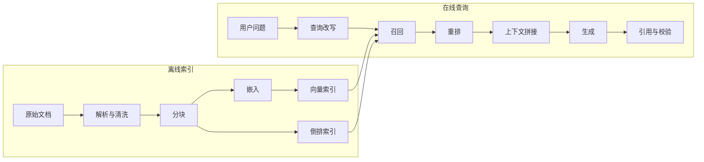
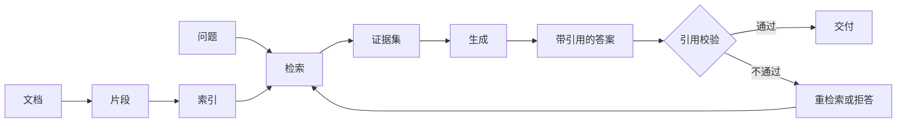
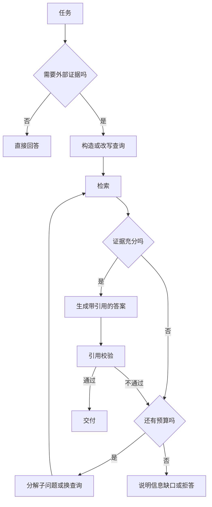
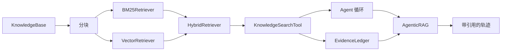

# 第 8 章 知识增强：从 RAG 到 Agentic RAG

## 本章导读

一个团队把产品文档接进检索增强生成（Retrieval-Augmented Generation, RAG），演示时很惊艳，上线后却收到两类投诉：一类是答案引用了文档里根本不存在的段落，另一类是用户追问后答案自相矛盾。检查发现，系统每次只检索一次、固定取前三条、从不核对引用。问题不在模型，而在把 RAG 当成了一次性的“检索—拼接—生成”。

⭐⭐⭐ 进阶 ｜ 适合：工程师、产品经理、技术管理者

## 学习目标

读完本章你将能够：

- 说明传统 RAG 的五类典型失效，并判断问题出在索引、检索还是生成
- 设计分块、混合检索、元数据过滤与重排，理解每种手段的代价
- 判断什么时候需要 Agentic RAG，如何用预算、去重与停止条件约束它
- 实现引用、证据台账与有据性检查，区分“检索到了”和“答案被支持”
- 在 Atlas v0.8.0 中实现 `Retriever`、`KnowledgeSearchTool` 与 `AgenticRAG`，并接入现有 Agent 循环

## 8.1 传统 RAG 为什么不够

RAG 最初解决的是一个很具体的问题：模型的参数化知识有截止时间，也无法覆盖企业私有文档。与其把新知识塞进权重，不如在回答前检索相关段落，把证据放进上下文，让模型基于证据生成。

标准流水线分两段。离线阶段做解析、分块、嵌入和建索引；在线阶段做查询、召回、重排、拼接、生成和引用。看起来每一步都很直接，但每一段都可能成为瓶颈。



这条流水线最容易被忽略的事实是：**生成端永远会给出一个流畅的答案**。检索错了，模型不会报错，它会用错误的证据编出一个看起来合理的结论。所以 RAG 的质量问题，通常要往前追溯到检索，而不是停留在“模型幻觉”这个标签上。

### 8.1.1 五类典型失效

| 失效 | 典型症状 | 根因 | 常见缓解 |
|---|---|---|---|
| 查询与文档不匹配 | 用户说“怎么退款”，文档写“售后资金原路退回”，检索不到 | 查询口语化、文档书面化；单一路径召回不足 | 查询改写、混合检索、同义词与领域词典 |
| 分块切断语义 | 答案被切成两半，模型只看到半句 | 固定长度分块、缺少上下文 | 重叠窗口、按结构分块、父子块、上下文检索 |
| 召回噪声过多 | 前十条只有一条相关，答案被带偏 | 只看相似度、没有阈值与重排 | 重排、相关性阈值、元数据过滤 |
| 一次性检索不足 | 多跳问题只查一次，缺少关键实体 | 检索时机由代码写死 | 多轮检索、查询分解、Agentic RAG |
| 引用不可信 | 答案标注了来源，但来源不支持结论 | 只生成引用、不校验引用 | 证据台账、引用存在性检查、有据性评估 |

这五类失效有一个共同点：它们都不是“换一个更强的模型”就能解决的。模型只能基于你给它的证据推理；证据链断了，模型越强，错误答案越有说服力。

### 8.1.2 一个判断原则

遇到 RAG 效果不好时，先问三个问题：

1. **正确证据在索引里吗？** 如果根本没收进来，问题在解析、分块或权限同步。
2. **正确证据被召回了吗？** 如果召不回，问题在查询构造、检索算法或过滤条件。
3. **模型用对证据了吗？** 如果召回正确但答案错误，问题在上下文组织、提示词或引用校验。

只有第三问才轮到“模型能力”。把这三问按顺序排查，能避免大量无效的换模型和调提示词。

## 8.2 RAG 的本质是证据链

把 RAG 看成一条证据链，比把它看成一个“向量数据库 + 提示词模板”更准确。链上的每个环节都要满足三个不变量：

- **可追溯**：答案中的每个事实性结论，都能落到某个检索片段或明确的推理步骤
- **可审计**：每个片段都有来源、版本、时间和权限信息，能回答“这句话从哪来”
- **可失败**：没有足够证据时，系统能明确说“不知道”，而不是用流畅的语言填空



这条链有两个容易断的地方。第一是**片段脱离原文**：分块之后，代词指代、章节前提、表格表头都可能丢失，片段单独看是歧义的。第二是**证据集没有边界**：检索结果被无限塞进上下文，模型分不清哪条是权威来源、哪条是过时版本。

所以本章后面讨论的所有技术，都可以归到两个目标：让片段保留足够上下文，让证据集有明确边界。

## 8.3 检索：词法、向量与混合

### 8.3.1 词法检索：BM25 仍然是基线

BM25 是关键词检索的经典算法。它做三件事：词频越高越相关，但收益递减；文档越长，单个词命中的权重越低；稀有词的区分度高于常见词。

用一句话概括它的优势：**精确、可解释、对专有名词和编号特别可靠**。用户查“ERR_2041”“RFC 9110”或“SKU-7788”时，BM25 往往比向量检索更稳。

它的短板也明确：不理解同义改写。用户说“退钱”，文档写“原路退回”，两者没有共同词，BM25 就召不回。

### 8.3.2 向量检索：语义相似，但不擅长精确匹配

向量检索先用嵌入（Embedding）模型把文本映射成稠密向量，再用余弦相似度或内积找近邻。它擅长处理“意思相近但用词不同”的情况，也能跨语言召回。

代价有三点。第一，嵌入模型有领域偏差，通用模型未必理解你的业务术语。第二，向量相似不等于事实相关，两个都在讲“退款”的段落，可能一个是政策、一个是故障公告。第三，向量索引需要更新，文档改了但嵌入没重算，就会出现“索引里的旧版本”。


不同嵌入模型、不同归一化方式产生的相似度分数不可直接比较。把 BM25 分数和余弦相似度相加，是没有意义的。混合检索要用排名融合，而不是分数相加。


### 8.3.3 混合检索与倒数排名融合

混合检索（Hybrid Search）同时跑词法和向量两路召回，再合并结果。合并方式里，倒数排名融合（Reciprocal Rank Fusion, RRF）最简单也最稳：

```text
score(d) = Σ_i  weight_i / (k + rank_i(d))
```

其中 `rank_i(d)` 是文档 `d` 在第 `i` 路结果中的名次，`k` 是平滑常数，常用 60。RRF 只使用名次，不使用原始分数，因此不受“BM25 分数和余弦分数不可比”的影响。

<details>
<summary>深入了解：RRF 为什么用名次而不是分数</summary>

不同检索器的分数分布差异很大：BM25 的分数可能从 0 到 20，余弦相似度通常在 0 到 1 之间，重排模型的分数又是另一种尺度。直接相加或加权平均，等于让分数尺度大的那一路主导结果。

RRF 只保留名次，把“排第一”转换成可比较的信号。`k` 的作用是压低头部差距：`k` 越大，第一名与第十名的差距越小，融合越平滑；`k` 越小，头部结果的主导性越强。它不解决“某一路整体很差”的问题，所以两路检索器的基本质量仍然要过关。

</details>

| 维度 | BM25 | 向量检索 | 混合检索 |
|---|---|---|---|
| 精确词、编号、专名 | 强 | 弱 | 强 |
| 同义改写、跨语言 | 弱 | 强 | 较强 |
| 可解释性 | 高 | 低 | 中 |
| 索引成本 | 低 | 中到高 | 高 |
| 更新一致性 | 容易 | 需重算嵌入 | 两者都要维护 |
| 适用场景 | 法规、日志、代码 | 客服、开放问答 | 大多数生产知识库 |

混合检索不是“永远更好”。如果语料很小、查询以精确词为主，BM25 单路就够；如果语料高度口语化、同义表达多，向量检索权重应更高。RRF 的权重需要用自己的评测集调，而不是照搬默认值。

### 8.3.4 分块：检索质量的上限

分块（Chunking）决定了检索的最小单位。块太大，一个块里混着多个主题，相似度被稀释；块太小，语义不完整，模型拿到半句话。

工程上常用四种策略：

| 策略 | 做法 | 优点 | 代价 |
|---|---|---|---|
| 固定长度 | 每 N 个字符切一刀 | 简单、块大小可控 | 容易切断句子与表格 |
| 结构分块 | 按标题、段落、列表切 | 保留文档结构 | 依赖解析质量 |
| 重叠窗口 | 相邻块保留一段重叠 | 缓解边界丢失 | 索引体积与重复召回增加 |
| 父子块 | 子块用于检索，父块用于生成 | 检索精度与上下文兼顾 | 需要两层存储与映射 |

一个实用的默认值是 300–500 字、10%–20% 重叠，再根据文档类型调整。API 文档适合按接口分块，会议纪要适合按议题分块，合同适合按条款分块。不存在通用最优值。


“上下文检索”（Contextual Retrieval）是分块问题的一个有效补丁：在嵌入和建索引之前，让模型为每个片段生成一句所属文档的上下文，并拼在片段前面。这样片段脱离原文后仍然知道“这段话在讲哪个产品、哪条政策”。代价是索引阶段要为每个片段调用一次模型。


### 8.3.5 过滤与隔离

元数据过滤不是可选项。企业知识库至少需要三类过滤：

- **权限**：用户只能检索自己有权访问的文档，过滤必须在检索层执行，不能靠提示词约束
- **时效**：只检索当前有效版本，历史版本显式标记为归档
- **来源类型**：区分官方文档、工单、社区帖子、模型生成内容，不同来源的可信度不同

过滤要尽量在召回前做。先召回再过滤，会浪费候选名额，也可能把唯一正确的片段挤掉。过滤条件必须由服务端根据用户身份注入，不能由模型或用户输入自由决定。

## 8.4 从 RAG 到 Agentic RAG

传统 RAG 的检索时机由代码决定：每轮固定检索一次，取前 k 条。Agentic RAG 的检索时机由模型决定：它可以先判断需不需要查，查什么，查完够不够，不够再查。

这个区别听起来只是“多循环几次”，实际改变的是责任分配。传统 RAG 把“检索什么”写死在流程里；Agentic RAG 把“下一步查什么”交给模型，同时用运行时约束兜底。

### 8.4.1 模型需要做的四个决定

| 决定 | 传统 RAG | Agentic RAG |
|---|---|---|
| 是否检索 | 总是检索 | 按问题类型与风险决定 |
| 检索什么 | 原始问题 | 改写、分解后的子查询 |
| 是否继续 | 不继续 | 根据证据充分性决定 |
| 何时停止 | 生成完即停 | 证据足够、预算耗尽或明确无法回答 |

`Agentic RAG` 中的 “Agentic” 不是指“让模型无限循环”，而是指**把检索纳入 Agent 的决策循环**。循环本身仍然需要停止条件、预算和可观测的记录。



### 8.4.2 查询构造与分解

多跳检索（Multi-hop Retrieval）的关键不是“多查几次”，而是“每次查得更准”。常见手段有三种：

- **改写**：把口语问题改成文档里的术语，例如“退钱”改成“退款流程”
- **分解**：把复合问题拆成子问题，例如“A 和 B 在长任务上的差异”拆成“A 的适用场景”和“B 的适用场景”
- **桥接**：先查实体，再用实体查关系，例如先查“论文作者”，再查“该作者的后续工作”

查询改写可以用规则、词典或模型完成。规则便宜且可预测，模型灵活但可能改偏。生产系统通常先用规则做保守改写，模型改写只作为补充，并保留原始查询作为兜底。

### 8.4.3 证据充分性与停止

“证据够不够”不能只让模型自我判断。至少要有三类信号：

1. **覆盖度**：每个子问题是否都有对应证据
2. **一致性**：多个来源是否冲突，冲突是否已解释
3. **来源质量**：证据是官方文档、一手数据，还是二手转述

工程上可以把这些信号做成检查表，让模型在最终回答前逐项确认；也可以让运行时统计检索次数、去重结果数和新信息增量。当新查询不再带来新证据时，继续检索的收益很低，应该停止。

### 8.4.4 检索预算与循环保护

Agent 自主检索最大的风险是“查不到就一直查”。运行时必须设置硬约束：

- 最大检索次数，例如 6 次
- 相同查询去重，重复查询直接返回提示
- 单次返回片段数与总字符预算
- 连续无新证据时提前停止
- 检索失败与知识库为空要区分，前者可重试，后者应直接说明

这些约束不应该写在提示词里“请模型遵守”，而应该由工具和运行时强制执行。模型可以决定策略，但不能决定自己有没有超出预算。


Agentic RAG 的成本通常高于传统 RAG：更多检索、更长上下文、更多模型调用。它适合多跳、开放、证据要求高的问题；简单的单事实问答用它，往往只是增加延迟与费用。


## 8.5 引用与可验证性

引用（Citation）不是装饰，而是 RAG 的审计接口。没有引用，用户无法判断答案是来自文档还是模型记忆；有引用但不校验，比没有引用更危险，因为它制造了虚假的可信度。

### 8.5.1 引用的粒度

| 粒度 | 形式 | 精度 | 成本 |
|---|---|---|---|
| 文档级 | `[doc-123]` | 低，只能说明来自哪篇 | 低 |
| 片段级 | `[doc-123#4]` | 中，能定位到段落 | 中 |
| 跨度级 | 引用具体句子与字符区间 | 高，可逐句核对 | 高 |

Atlas 采用片段级引用：分块时生成稳定的 `doc_id#index`，工具返回结果时把 ID 放在片段开头，模型回答时原样引用。ID 必须稳定，不能因为重新排序就变化；否则引用会漂移。

### 8.5.2 引用校验的四个层次

1. **存在性**：引用的 ID 是否在本轮证据台账里
2. **来源性**：该证据是否有可访问的来源、版本和时间
3. **支持性**：证据文本是否真的蕴含答案中的结论
4. **一致性**：不同证据之间是否冲突，冲突是否被说明

大多数系统只做第一层。Atlas v0.8.0 也只做第一层，并在正文中明确这个边界。第二层靠元数据，第三层需要自然语言推理或模型评委，第四层需要来源管理与人工判断。


“检索到了”不等于“答案被支持”。一个片段可能提到某个概念，却不足以支撑一个强结论。引用存在性检查只能发现伪造引用，不能发现“引用真实但结论过度”的问题。


### 8.5.3 常见引用失败

| 失败 | 例子 | 检测方式 |
|---|---|---|
| 伪造引用 | 答案写 `[doc-999]`，但从未检索到 | 证据台账存在性检查 |
| 引用错配 | 引用段落讲的是旧政策 | 版本与时效字段 |
| 支持不足 | 片段说“可能”，答案说“一定” | 有据性评估、人工抽检 |
| 引用漂移 | 重建索引后 ID 变化，旧答案引用失效 | 稳定 ID、引用快照 |
| 过度引用 | 每句话后都挂一串来源，用户无法判断 | 引用覆盖率与可读性评估 |

有据性（Groundedness）衡量的是答案中的事实性陈述被证据支持的比例。它和“答案正确”不是一回事：一个答案可以有据但过时，也可以正确但没有引用。评测时要分开看。

## 8.6 深度研究模式

深度研究（Deep Research）是 Agentic RAG 的一种任务形态：面对开放问题，系统自己拆解子问题、多源检索、交叉验证，最后产出一份带引用的报告。

它和普通问答的差别不在“检索次数”，而在**产物形态与验证责任**。普通问答输出一段话；深度研究输出结构化报告，里面每个关键结论都要有来源，冲突要显式说明，信息缺口要标注。

| 模式 | 检索次数 | 主要能力 | 适用任务 | 成本 |
|---|---|---|---|---|
| 单次 RAG | 1 | 召回与拼接 | 事实查询、文档问答 | 低 |
| 迭代 RAG | 2–5 | 查询改写、补充检索 | 多跳问题、比较分析 | 中 |
| 深度研究 | 5–50+ | 规划、分解、交叉验证、报告写作 | 市场调研、技术选型、尽调 | 高 |

深度研究的核心组件包括：

- **研究计划**：把问题拆成可检索的子问题，并定义完成标准
- **证据表**：记录每个结论对应的来源、时间、可信度与冲突
- **来源多样性**：避免所有证据来自同一站点或同一立场
- **交叉验证**：关键数字至少两个独立来源，冲突时保留双方
- **报告结构**：结论、证据、反例、信息缺口、参考来源
- **检查点**：在高成本阶段前让用户确认方向，避免跑偏后浪费预算


深度研究类产品的具体能力、价格与限制变化很快。本章讨论的是通用架构与工程约束；涉及具体产品时，以官方文档和当期条款为准。


## 8.7 工程实现的六个决策

把上面的概念落到系统里，通常要在六个地方做决策。

| 决策 | 关键问题 | 默认建议 |
|---|---|---|
| 解析 | PDF、表格、代码、扫描件能否正确抽取 | 先解决解析质量，再谈检索算法 |
| 分块 | 按什么边界切，块多大 | 结构优先，300–500 字，10%–20% 重叠 |
| 召回 | 词法、向量还是混合 | 先从混合检索起步，再用评测调权重 |
| 重排（Rerank） | 是否需要第二段排序 | 候选多、噪声大时加交叉编码器重排 |
| 上下文 | 放多少、怎么排序 | 去重、按相关性排序、控制总字符 |
| 评测 | 怎么知道改好了 | 固定问题集 + 召回率 + 引用精度 + 有据性 |

其中评测最容易被跳过。没有评测集，调分块、调 top-k、换嵌入模型都只能靠感觉。一个最小可用的评测集应该包含：问题、标准答案要点、应召回的文档 ID、可接受的引用范围。每次改动后重跑，观察召回率与引用精度的变化。

评测指标要分层看，不能只盯最终答案的“像不像”。召回率（Recall@k）衡量正确片段有没有进入前 k 条；平均倒数排名（MRR）衡量第一个正确结果排得有多靠前；引用精度衡量答案里被引用的片段有多少真正支持结论；有据性衡量答案中的事实性陈述被证据覆盖的比例。四个指标分别对应检索、排序、引用和生成，任何一个掉下去，都能定位到不同的环节。

上下文拼接也有细节。模型对上下文中间部分的信息利用较弱，重要证据应放在开头或结尾；同一文档的多个片段应合并，避免重复；片段之间要有清晰分隔，并标明来源，防止模型把不同文档的内容混成一句。

## 8.8 动手实践：Atlas v0.8.0

本章在 Atlas 中新增 `rag/` 模块，实现四件事：可替换的检索协议、BM25 与向量混合检索、带引用与预算控制的检索工具、以及循环外的引用审计。`Agent`、`LLM`、`Tool` 等冻结接口不变。



### 8.8.1 冻结的检索协议

`atlas/interfaces.md` 在第 8 章之前就定义了 `Document` 与 `Retriever`。本章按原签名实现，不新增必选字段，不改方法名。

```python
# src/atlas/rag/base.py
@dataclass
class Document:
    doc_id: str
    content: str
    source: str
    score: float = 0.0
    metadata: dict[str, Any] = field(default_factory=dict)


class Retriever(Protocol):
    def retrieve(
        self,
        query: str,
        k: int = 5,
        filters: dict[str, Any] | None = None,
    ) -> list[Document]:
        ...
```

`score` 的含义由实现决定。BM25 返回 BM25 分数，向量检索返回余弦相似度，混合检索返回 RRF 融合分。上层只按 `score` 排序，不跨实现比较绝对值。

### 8.8.2 分块与稳定引用 ID

分块函数优先在段落、句号、换行等边界收尾，并保留尾部重叠。每个块生成 `doc_id#index` 作为引用 ID。

```python
# src/atlas/rag/chunking.py（节选）
def chunk_text(text: str, *, max_chars: int = 400,
               overlap_chars: int = 80) -> list[str]:
    ...
    while start < length:
        end = min(start + max_chars, length)
        if end < length:
            window = clean[start:end]
            floor = int(max_chars * 0.6)
            cut = -1
            for marker in _BOUNDARIES:
                position = window.rfind(marker)
                if position >= floor:
                    cut = max(cut, position + len(marker))
            if cut > 0:
                end = start + cut

        piece = clean[start:end].strip()
        if piece:
            chunks.append(piece)
        if end >= length:
            break
        start = max(end - overlap_chars, start + 1)
    return chunks
```

这里没有做“智能分块”。Atlas 的目标是展示可运行的最小实现；生产系统还要处理表格、代码块、标题层级和父子块映射。

### 8.8.3 BM25 与向量检索

BM25 使用标准公式，英文按词、中文按二元组切分。向量检索使用一个离线哈希词袋嵌入器，只模拟向量索引的形状。

```python
# src/atlas/rag/bm25.py（节选）
for term, query_frequency in query_terms.items():
    term_frequency = frequencies.get(term, 0)
    if term_frequency == 0:
        continue
    document_frequency = self._document_frequency[term]
    idf = math.log(
        1.0 + (total - document_frequency + 0.5) / (document_frequency + 0.5)
    )
    denominator = term_frequency + self.k1 * (
        1.0 - self.b + self.b * length / self._average_length
    )
    score += idf * term_frequency * (self.k1 + 1.0) / denominator * query_frequency
```

```python
# src/atlas/rag/vector.py（节选）
def embed(self, text: str) -> list[float]:
    vector = [0.0] * self.dimensions
    for token, frequency in Counter(tokenize(text)).items():
        digest = hashlib.blake2b(token.encode("utf-8"), digest_size=8).digest()
        raw = int.from_bytes(digest, "big")
        index = raw % self.dimensions
        sign = 1.0 if (raw >> 8) & 1 else -1.0
        vector[index] += sign * (1.0 + math.log(frequency))
    ...
```


`HashingEmbedder` 不是语义嵌入。它把词映射到固定维度，能演示索引、相似度和融合流程，但不能理解同义改写。生产环境应把它替换成真实嵌入模型；`VectorRetriever` 接受任意实现 `Embedder` 协议的对象，替换时不需要改检索逻辑。


混合检索用 RRF 合并两路结果，候选池默认是三倍 `k`，避免某一路的次优结果过早被截断。

```python
# src/atlas/rag/hybrid.py（节选）
for retriever, weight in zip(self.retrievers, self.weights):
    results = retriever.retrieve(query, k=pool_size, filters=filters)
    for rank, document in enumerate(results, start=1):
        scores[document.doc_id] = scores.get(document.doc_id, 0.0) + (
            weight / (self.rrf_k + rank)
        )
        documents.setdefault(document.doc_id, document)
```

`KnowledgeBase` 负责累积文档、自动分块，并在第一次检索时构建 BM25 与向量两路索引。新增文档会使索引失效，下次检索时重建。这是教学实现；生产系统应做增量索引与后台重建。

### 8.8.4 检索工具与证据台账

`KnowledgeSearchTool` 把检索器包装成模型可调用的工具。它做四件额外的事：限制单次返回长度、拒绝重复查询、限制总检索次数、把结果写入证据台账。

```python
# src/atlas/rag/tool.py（节选）
normalized = " ".join(query.lower().split())
if normalized in self._seen_queries():
    return ToolOutput(
        content="这个查询已经执行过。请换一个更具体的关键词，或基于已有结果继续推理。",
        is_error=True,
        metadata={"error_type": "duplicate_query", "query": query},
    )
if self._call_count() >= self.max_queries:
    return ToolOutput(
        content=f"本次运行的检索次数已达上限（{self.max_queries}）。请基于已有证据作答，并说明信息缺口。",
        is_error=True,
        metadata={"error_type": "retrieval_budget", "query": query},
    )
```

当工具绑定了证据台账时，查询历史与检索次数从台账读取；否则使用工具内部计数器。这样 `AgenticRAG` 在每次运行开始时重置台账，检索预算也会随之重置，同一个工具实例可以安全地服务多个任务。

工具返回的文本把引用 ID 放在片段开头：

```text
检索：ReAct 适合什么任务

[react#0] ReAct｜来源：https://example.test/react
ReAct 让模型交替进行推理与行动，并根据工具观察调整下一步。它适合 3–5 步、路径不确定的任务。
```

证据台账（Evidence Ledger）记录本轮检索过的所有片段，并提供引用存在性检查。

```python
# src/atlas/rag/evidence.py（节选）
def verify(self, answer: str) -> CitationReport:
    cited = extract_citations(answer)
    unknown = [citation for citation in cited if citation not in self._documents]
    return CitationReport(
        cited=cited,
        unknown=unknown,
        retrieved=len(self._documents),
        queries=len(self._queries),
    )
```

### 8.8.5 AgenticRAG：循环外的引用审计

`AgenticRAG` 实现 `AgentRunner` 协议，内部调用现有的 `Agent`，运行结束后检查最终答案里的引用是否都在证据台账中。

```python
# src/atlas/rag/agentic.py（节选）
class AgenticRAG:
    def __init__(self, runner, *, ledger=None, require_citations=True,
                 min_citations=1, on_missing="warn") -> None: ...

    def run(self, task: str, ctx: RunContext | None = None) -> Trajectory:
        self.ledger.reset()
        trajectory = self.runner.run(task, ctx)
        report = self.ledger.verify(trajectory.final_answer or "")
        self.last_report = report

        problems: list[str] = []
        if self.require_citations:
            if len(report.cited) < self.min_citations:
                problems.append(...)
            if report.unknown:
                problems.append("以下引用不在本轮证据中：" + "、".join(report.unknown))

        if problems:
            note = "引用检查未通过：" + "；".join(problems)
            trajectory.steps.append(Step(index=len(trajectory.steps) + 1, thought=note))
            if self.on_missing == "refuse":
                trajectory.final_answer = "无法给出有据可查的答案：本轮检索没有提供足够的可引用证据。"
        return trajectory
```

它不强制模型检索，也不改变 `Agent` 的循环。这样设计的原因是：有些问题不需要外部证据，强制检索反而增加成本；而引用审计是独立的横切关注点，放在循环外更容易替换和评测。

`on_missing="warn"` 保留原答案，只在轨迹末尾追加一条检查失败记录；`on_missing="refuse"` 则用拒答替换最终答案。审计结果同时保存在 `last_report` 中，方便评测与调试。默认选 `warn`，是因为“引用缺失”不等于“答案错误”，是否拒答应由具体产品的风险等级决定。

### 8.8.6 端到端示例

示例构建一个小型知识库，让 Agent 先查 ReAct、再查 Plan-and-Execute，最后给出带引用的比较结论，并演示重复查询与伪造引用的检查。

```python
# examples/ch08_rag.py（节选）
kb = KnowledgeBase(max_chars=240, overlap_chars=40)
kb.add_document("react", "ReAct 让模型交替进行推理与行动……", "https://example.test/react",
                title="ReAct", metadata={"topic": "planning"})
kb.add_document("plan", "Plan-and-Execute 先制定完整计划，再逐步执行……",
                "https://example.test/plan", title="Plan-and-Execute",
                metadata={"topic": "planning"})

ledger = EvidenceLedger()
search = KnowledgeSearchTool(kb, ledger=ledger)
llm = MockLLM([
    LLMResponse(tool_calls=[ToolCall(id="c1", name="search_knowledge",
                 arguments={"query": "ReAct 适合什么任务", "k": 2})]),
    LLMResponse(tool_calls=[ToolCall(id="c2", name="search_knowledge",
                 arguments={"query": "Plan-and-Execute 长任务 重规划", "k": 2})]),
    LLMResponse(content="短任务、路径不确定时优先 ReAct [react#0]；"
                        "步骤较多、依赖清晰时优先 Plan-and-Execute [plan#0]。"),
])
agent = Agent(llm, ToolRegistry([search]),
              config=AgentConfig(system_prompt="先检索证据，再回答，并用 [doc_id] 标注引用。"))
app = AgenticRAG(agent, ledger=ledger)
trajectory = app.run("比较 ReAct 与 Plan-and-Execute 的适用场景",
                     RunContext(run_id="ch08"))
```

运行结果：

```text
混合检索：ReAct 推理 行动
  react#0    score=0.0328 retrievers=['BM25Retriever', 'VectorRetriever']

轨迹：
  step 1: search_knowledge('ReAct 适合什么任务')
  step 2: search_knowledge('Plan-and-Execute 长任务 重规划')
  step 3: final_answer

最终答案：
  短任务、路径不确定时优先 ReAct [react#0]；步骤较多、依赖清晰时优先 Plan-and-Execute [plan#0]。

引用审计：
  cited=['react#0', 'plan#0']
  unknown=[]
  retrieved=2 queries=2
  ok=True

重复查询保护：
  is_error=True type=duplicate_query

伪造引用的检查：
  cited=['react#0', 'made-up#0'] unknown=['made-up#0'] ok=False
```

### 8.8.7 测试

新增 15 条测试，覆盖分块、BM25、元数据过滤、向量检索、RRF、知识库、工具引用与预算、证据台账、引用校验、AgenticRAG 与多跳接入。

```python
# tests/test_rag.py（节选）
def test_hybrid_uses_reciprocal_rank_fusion():
    a, b, c = doc("a", "A"), doc("b", "B"), doc("c", "C")
    hybrid = HybridRetriever(
        [StaticRetriever([a, b, c]), StaticRetriever([b, c, a])],
        rrf_k=60,
    )

    results = hybrid.retrieve("query", k=3)

    assert [item.doc_id for item in results] == ["b", "a", "c"]
    assert results[0].score > results[1].score


def test_agent_calls_search_tool_twice_and_answers_with_citations():
    # ... 省略知识库与脚本准备 ...
    rag = AgenticRAG(agent, ledger=ledger)
    trajectory = rag.run("比较 ReAct 与 Plan-and-Execute", RunContext(run_id="r2"))

    assert trajectory.stop_reason == "final_answer"
    assert rag.last_report.ok
    assert set(rag.last_report.cited) == {"react#0", "plan#0"}
```

完整测试结果：

```text
51 passed
```

其中 36 条是前七章已有的测试，新增 15 条本章测试。

### 8.8.8 兼容性与取舍

| 取舍 | 影响 | 后续 |
|---|---|---|
| 哈希嵌入不是语义嵌入 | 无法演示同义改写召回 | 生产替换为真实嵌入模型 |
| 内存索引、全量重建 | 文档多时构建慢 | 后续做增量索引与持久化 |
| 引用只做存在性检查 | 发现伪造引用，发现不了过度结论 | 第 15 章加入有据性评测 |
| 检索预算按工具实例计数 | 多工具共享预算需额外封装 | 第 18 章统一运行时预算 |
| 无重排器 | 噪声大时精度有限 | 增加交叉编码器或模型重排 |

## 8.9 业界案例

### 8.9.1 Contextual Retrieval：把上下文还给片段

Anthropic 公布的 Contextual Retrieval 方法针对的正是分块导致的信息丢失：在嵌入和建索引之前，让模型为每个片段生成一段简短的上下文说明，拼接到片段前面。这样同一个片段既保留原文，又知道自己在整篇文档中的位置。

它通常与两路检索和重排组合：上下文增强后的片段同时进入 BM25 与向量索引，合并后再用重排模型精排。这个案例的启示不是“照抄某个参数”，而是**检索质量的上游在数据准备**。如果片段本身就是歧义的，后面换再强的检索器也只能在噪声里挑。

代价也很直接：索引阶段要为每个片段调用模型，文档量大时成本显著；上下文说明的质量依赖模型与提示词；文档更新后要重新生成。它适合高价值、更新不频繁的知识库，不适合每天全量变化的语料。

### 8.9.2 GraphRAG：从片段检索到全局理解

Microsoft 的 GraphRAG 走了另一条路：先从文档中抽取实体与关系，构建知识图谱，再为社区生成摘要。回答“这份报告的主要风险有哪些”这类需要全局归纳的问题时，它不依赖单个片段，而是用图谱和社区摘要提供结构化证据。

它的优势是能回答“跨文档、需要聚合”的问题，也能显式呈现实体之间的关系。代价是构建成本高、抽取错误会传播、图谱维护复杂。它不适合简单的事实查询，也不适合频繁变化的语料。

这两个案例代表两种方向：Contextual Retrieval 优化“片段级证据”，GraphRAG 优化“全局结构”。生产系统往往先用前者打好基础，再在确有全局问题时引入后者，而不是一开始就上最复杂的架构。

## 8.10 常见误区

**误区一：RAG 就是向量数据库。** 向量数据库只是索引的一种。解析、分块、过滤、重排、引用校验，任何一环出问题，向量数据库都救不了。

**误区二：top-k 越大越好。** 召回更多片段会增加噪声、挤占上下文，还可能把关键证据埋在中部。top-k 要与重排、阈值和上下文预算一起调。

**误区三：存在通用的最佳分块大小。** 分块要服从文档结构。API 文档、合同、会议纪要的最优切法完全不同；固定 512 字只是起点，不是答案。

**误区四：检索到了就等于答案被支持。** 片段可能只提到概念，不足以支撑强结论。引用存在性检查只能发现伪造引用，支持性需要单独评估。

**误区五：Agentic RAG 就是让模型自由循环。** 没有预算、去重和停止条件的自主检索，只会把一次错误放大成十次。Agent 可以决定策略，运行时必须守住边界。

## 8.11 本章小结

- RAG 的本质是一条证据链：文档、片段、索引、检索、生成、引用、校验，任何一环断裂都会由流畅的语言掩盖。
- 词法检索精确，向量检索擅长改写，混合检索用 RRF 合并排名，避免跨实现比较分数。
- 分块决定检索质量的上限；结构分块、重叠窗口、父子块和上下文检索，都是在补片段丢失的上下文。
- Agentic RAG 把检索时机交给模型，但必须用查询改写、多跳、证据充分性判断、检索预算和去重来约束。
- 引用是审计接口。存在性检查只能发现伪造引用；有据性、来源性和一致性需要额外验证。
- Atlas v0.8.0 用冻结的 `Retriever` 协议接入 BM25、向量与混合检索，用 `KnowledgeSearchTool` 控制预算，用 `AgenticRAG` 在循环外做引用审计。

## 8.12 思考与练习

1. **分块设计**：为一个包含 API 文档、故障公告和会议纪要的知识库设计分块策略。说明每类文档的切分边界、块大小、元数据字段，以及如何避免跨文档串味。

2. **混合检索评测**：在 Atlas 的 `KnowledgeBase` 上构造 20 个问题，分别记录 BM25、向量和混合检索的前 5 条结果。计算召回率与引用精度，观察混合检索在哪些问题上更好、哪些更差，并解释原因。

3. **查询分解**：给 `AgenticRAG` 增加一个“子问题分解”工具或前置步骤，把复合问题拆成两个子查询，分别检索后再合并证据。要求：保留原始查询、限制子查询数量、在证据不足时明确说明缺口，并为新增逻辑补测试。
