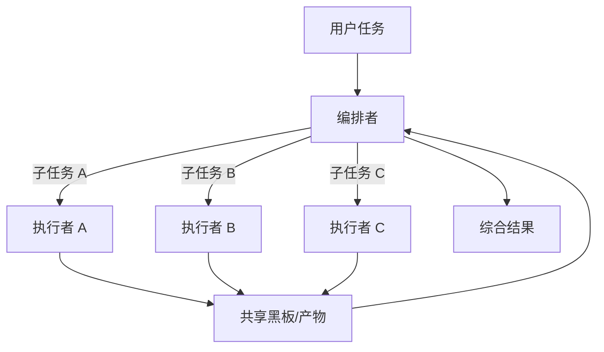
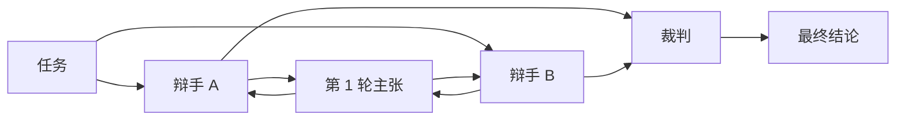
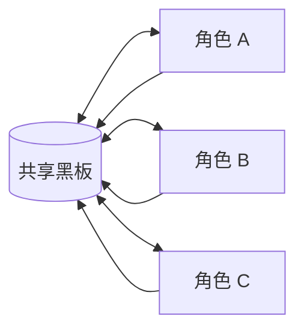
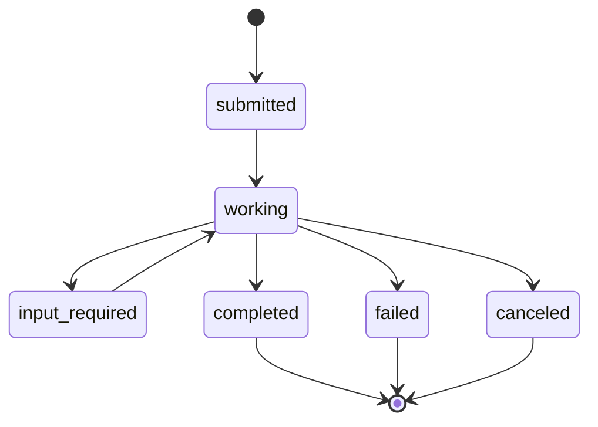
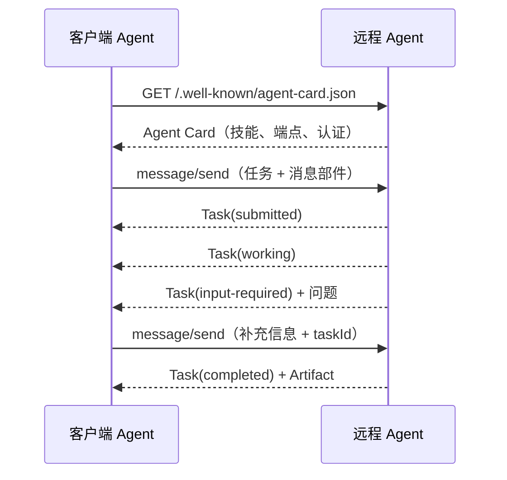
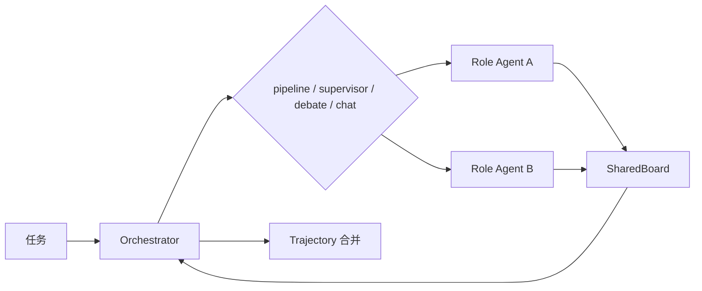

# 第 10 章 多智能体系统：协作模式与 A2A

## 本章导读

一家团队把研究助手拆成检索员、分析员、撰稿人三个 Agent。演示时分工清晰，上线后却出现三种怪象：检索员和分析员重复查同一批资料；撰稿人拿到两份互相矛盾的结论；一次任务烧掉了单 Agent 四倍的成本，质量却没有提升。问题不在模型，而在他们只复制了“角色”，没有设计协作的边界与交接。

⭐⭐⭐ 进阶 ｜ 适合：工程师、架构师、技术管理者

## 学习目标

读完本章你将能够：

- 判断什么时候真的需要多个 Agent，什么时候单 Agent 加计划、工具或工作流更合适
- 比较编排者—执行者、流水线、辩论、群聊四种协作模式的机制、代价与适用场景
- 设计角色契约、上下文隔离、工具权限与共享状态，避免重复劳动和责任扩散
- 解释 A2A 的核心对象与任务生命周期，区分 A2A 与 MCP 各自解决的问题
- 在 Atlas v0.10.0 中实现 `Orchestrator`、`RoleSpec` 与 `SharedBoard`，且不修改任何冻结接口

## 10.1 多智能体不是默认答案

### 10.1.1 单 Agent 的三个约束

一个 Agent 像一个全能员工：上下文是它的桌面，工具是它的权限，系统提示词是它的岗位说明。桌面越堆越满、权限越来越大、岗位说明越来越长，它不会立刻报错，只会变得更慢、更容易漏看关键信息，也更难被追责。

单 Agent 在三种情况下会碰到天花板：

| 约束 | 表现 | 后果 |
|---|---|---|
| 上下文约束 | 证据、历史、计划都挤在一个窗口里 | 中段丢失、注意力稀释、忽略早期约束 |
| 工具约束 | 工具数量多、描述长、权限混杂 | 选错工具、参数错误、越权风险上升 |
| 职责约束 | 一个提示词同时要求检索、批判、写作 | 指令冲突、自我验证偏弱、输出风格摇摆 |

多智能体的出发点，是把这三类约束拆开：让不同角色拥有各自的上下文、工具和职责。但拆分本身不产生能力，它只产生**边界**。边界是否值得，取决于协作成本是否低于单 Agent 的约束成本。

这里要先厘清一个定义。**多智能体系统（Multi-Agent System, MAS）**，是由多个具有独立目标、上下文与工具边界的智能体，通过消息、共享状态或编排器协作完成任务的系统。关键词是“独立决策循环”和“边界”。如果只是在一个循环里让模型轮流扮演检索员、分析员和撰稿人，那仍然是单 Agent 的角色扮演，不是多智能体。


一个实用的判断方法：如果两个“角色”共享同一份完整对话、同一套工具、同一个决策循环，它们只是提示词里的两顶帽子。真正的角色拆分，至少要有一个独立的输入输出契约，最好还有独立的工具集或上下文。


### 10.1.2 四项新增成本

多智能体不会免费获得并行与隔离，它至少新增四类成本。

**通信成本。** 每一次交接都要把上游产物写清楚，再读进下游上下文。产物太长会挤占窗口，太短会丢信息；角色越多，消息往返越多，延迟也越高。通信不是“发一条消息”这么简单，它是一次有损压缩。

**协调成本。** 谁决定下一步、谁负责拆任务、谁处理冲突，都需要机制。编排器要维护全局状态， worker 要理解自己的局部任务；任务分解不当会带来重复劳动，分解过细会带来集成负担。团队协作里的会议开销，在 Agent 系统里就是额外的模型调用和令牌。

**一致性成本。** 多个角色可能基于不同时间点的证据得出不同结论。共享黑板如果没有版本和来源，后写的会悄悄覆盖先写的；如果没有冲突处理，最终报告可能把两种矛盾说法拼在一起。责任扩散也会出现：每个角色都以为别人会核对，结果没人核对。

**验证与可观测成本。** 单 Agent 只有一条轨迹，多 Agent 有多条子轨迹。要回答“这个错误是谁引入的”“这次失败该怪分解、交接还是执行”，就必须合并轨迹、对齐时间线、归集用量。没有这些，多 Agent 系统会变得难以调试，也难以评测。


Anthropic 在 2025 年公开的多智能体研究系统报告中提到，其多 Agent 系统的 token 消耗约为普通聊天的 15 倍。这个数字来自其特定研究任务与实现，不能直接外推到所有场景，但它说明了一个量级：多智能体的收益必须足够大，才配得上这样的成本。


### 10.1.3 判断框架

决定是否拆分时，先找四个正向信号：

- **任务可并行拆分**：多个子问题彼此独立，可以同时检索、同时计算、同时评审。
- **上下文需要隔离**：不同角色只应看到自己权限内的资料，共享完整对话会带来噪声、泄漏或注入传播。
- **工具或提示词冲突**：一个角色需要大量只读检索工具，另一个角色需要少量高风险写操作，混在一起会放大误用风险。
- **需要独立验证或对抗**：生产者与验证者的视角必须分开，才能发现系统性偏差。

再找五个反向信号：

- **步骤强耦合**：后一步依赖前一步的完整推理过程，拆开后交接损失大于并行收益。
- **共享可变状态多**：多个角色频繁修改同一份状态，协调成本会吞掉收益。
- **延迟或成本敏感**：用户等待时间和单任务预算不允许数倍开销。
- **任务很小**：一次模型调用或一个固定工作流就能完成。
- **结果不可验证**：没有客观标准时，多 Agent 往往只是放大分歧，而不是收敛答案。

| 信号 | 更合适的形态 |
|---|---|
| 子任务独立、需要并行 | 编排者—执行者 |
| 阶段固定、产物逐级加工 | 流水线 |
| 高风险判断、需要对抗审查 | 辩论加裁判 |
| 开放探索、需要多视角碰撞 | 群聊与共享黑板 |
| 强耦合、低延迟、小任务 | 单 Agent 或固定工作流 |

一条简单的决策规则是：**先做单 Agent 基线，只有当你能写出新角色的输入契约、输出契约和边界时，才值得拆分。** 写不出契约，说明你需要的可能只是更好的提示词、计划或工具设计。

## 10.2 四种协作模式

### 10.2.1 编排者—执行者

编排者—执行者（Orchestrator-Worker）是最常见的多智能体形态。一个中心角色负责理解目标、拆解任务、分派工作和综合结果；多个执行者各自完成一个边界清晰的子任务。



它的控制权集中在编排者，执行者之间通常不直接对话。好处是分解与综合可以统一设计，执行者可以并行，单个执行者失败也能被隔离。代价是编排者容易成为瓶颈：它要写清每个子任务，还要理解所有产物；子任务描述不够自包含时，执行者会重复劳动或留下空白。

编排者本身也可以是模型驱动的。Atlas 把“选择下一个角色”抽象成 `Supervisor` 协议：脚本化实现用于离线复现，模型实现则多一次结构化决策调用。这样，编排逻辑与执行角色解耦，编排器也可以被替换或嵌套。

### 10.2.2 流水线

流水线（Pipeline）把任务拆成固定顺序的阶段，每个阶段的输出是下一阶段的输入。它本质上是一条有明确交接契约的工作流，只是每个阶段可以由独立的 Agent 承担。


流水线的优点是确定、可测试、可归因。每个阶段可以单独评测，失败位置容易定位，提示词和工具也能各自优化。缺点是延迟串行，错误会沿链路传播；上游少给一个关键事实，下游可能整篇报告都建立在错误前提上。交接时的有损压缩是最大的风险：检索员只写结论不写来源，分析员就无法核对；分析员只写判断不写依据，撰稿人只能编造过渡句。

因此，流水线适合阶段清晰、产物可验证的任务，例如“检索—分析—写作”“抽取—校验—入库”“生成—审查—发布”。如果阶段完全固定、每步只是格式转换，那么用普通工作流可能更便宜；流水线引入多 Agent 的价值，主要在于阶段之间的上下文隔离与独立工具权限。

### 10.2.3 辩论

辩论（Debate）让多个角色针对同一问题独立给出主张，再经过若干轮互相批评，最后由裁判综合。它的目标不是“投票”，而是把分歧显性化，让错误主张在对抗中暴露。



辩论适合高风险、可检查的判断：方案评审、风险评估、事实核查、设计取舍。它不适合只有一个权威答案的事实查询——那种问题应该去检索证据，而不是让两个模型互相说服。辩论也不能自动产生新证据；没有外部观察时，它只是在既有信息上重新分配置信度。

辩论的成本随辩手数量和轮数线性增长，裁判还可能被更自信、更冗长的表达带偏。一个常见失败是“自信地收敛到错误答案”：双方都缺乏关键证据，却在第二轮形成了一致但错误的共识。因此，辩论必须配合证据台账、裁判评分标准和轮数上限；必要时让裁判在证据不足时明确说“无法判断”。

### 10.2.4 群聊与共享黑板

群聊（Group Chat）让多个角色围绕共享黑板轮流发言，或由主持人动态选择下一个发言者。它比流水线灵活，比编排者—执行者更去中心化。



共享黑板是群聊的核心：每个角色读写同一份结构化状态，发言记录、证据、待办和决策都带版本与作者。它适合早期探索、头脑风暴、模拟讨论和多视角碰撞。问题是终止条件难设计：角色可能互相附和、反复改写同一段话，或者越聊越偏离任务。没有主持人和轮数上限，群聊很容易变成成本黑洞。

工程上要给群聊加三样东西：明确的收敛信号（例如以 `FINAL:` 开头的最终答案）、最大轮数或预算、以及黑板版本控制。Atlas 的 `chat` 策略就采用“轮询 + `FINAL:` 标记 + 最大轮数”的最小组合，保证离线可复现。

### 10.2.5 对比与选择

| 模式 | 控制权 | 并行度 | 通信成本 | 可预测性 | 适用场景 | 典型失败 |
|---|---|---|---|---|---|---|
| 编排者—执行者 | 集中 | 高 | 中高 | 中 | 研究、检索、独立子任务 | 分解不当、重复劳动 |
| 流水线 | 固定 | 低 | 低 | 高 | 内容生产、抽取校验、发布流程 | 错误沿链路传播 |
| 辩论 | 分散加裁判 | 中 | 高 | 低 | 方案评审、风险判断、事实核查 | 自信地收敛到错误 |
| 群聊与黑板 | 去中心或主持人 | 中 | 很高 | 低 | 探索、头脑风暴、模拟 | 空转、跑题、难归因 |

选择时先问三个问题：任务是“可并行”还是“强顺序”？需要的是“分工”还是“对抗”？失败能否被验证？可并行、需要分工，优先编排者—执行者；强顺序、阶段清晰，优先流水线；高风险、需要对抗，考虑辩论；目标本身还没想清楚，才用群聊探索。四者也可以组合：编排者把子任务分给几条流水线，流水线内部再用一个辩论阶段做评审。

## 10.3 角色、上下文与责任边界

### 10.3.1 角色是契约，不是人格

“你是一位严谨的检索专家”这句话不构成角色。角色是一份契约，至少包含七项：

| 契约项 | 要回答的问题 |
|---|---|
| 目标 | 这个角色只对什么结果负责？ |
| 输入 | 它从上游接收什么，格式是什么？ |
| 输出 | 它必须产出什么，字段有哪些？ |
| 工具 | 它能调用哪些工具，权限边界在哪？ |
| 预算 | 它最多花多少步、多少令牌、多少时间？ |
| 停止条件 | 什么算完成，什么算失败，失败后找谁？ |
| 升级路径 | 信息不足或越权时，如何交回编排器？ |

把角色写成契约，才能评测它、替换它、限制它。只写人格提示词，角色会退化成“同一模型的另一种口吻”，既没有独立边界，也无法解释错误来源。

### 10.3.2 上下文隔离与结构化交接

每个角色都应该拥有独立的消息历史。角色之间传递的不是完整对话，而是**结构化产物**：结论、证据 ID、置信度、未决问题、约束条件、下一步建议。完整对话只留在产生它的角色那里。

这样做有四个理由：

- **控制上下文腐化**：完整对话会把无关的工具结果和早期试错带给下游，稀释注意力。
- **限制注入传播**：上游读到的一段恶意文档，如果原样进入所有角色，会变成全系统的污染源。
- **降低成本**：交接产物通常比原始轨迹短一个数量级。
- **明确责任**：产物带作者和来源，出错时能定位到具体角色与具体证据。

<details>
<summary>深入了解：为什么“共享完整对话保持一致性”常常适得其反</summary>

共享完整对话看似能让所有角色看到同样的信息，但它同时带来了三类问题。第一，信息过载：下游要在一大堆无关内容里找自己需要的那几条，反而更容易漏看。第二，权威混淆：上游的猜测和下游的事实混在同一段历史里，模型分不清哪句已经验证。第三，污染放大：任何一个角色读到的不可信内容都会成为所有角色的上下文，提示注入的传播面被放大。更可靠的一致性来自“共享结构化状态”，而不是“共享全部原文”。状态有字段、有版本、有来源，冲突可以被显式发现；原文没有这些约束。

</details>

### 10.3.3 工具与权限按角色切分

工具集是角色的行动空间，也是安全边界。检索员只需要只读搜索和读取；分析员通常不需要工具；撰稿人不需要写数据库；真正执行高风险操作的角色才需要危险工具，并且应该配合审批与沙箱。

Atlas 用 `ToolRegistry.subset` 在构造角色时裁剪工具。这个裁剪不是提示词建议，而是运行时事实：没有注册的工具，模型即使编造出调用，也只会得到 `unknown_tool` 错误。第 5 章的参数校验、危险工具默认拒绝与第 17 章的护栏，仍然在这层边界之上生效。


工具裁剪不能替代授权。共享同一个只读工具的角色仍可能读到不该读的数据；危险工具即使只给一个角色，也需要审批、沙箱和审计。最小权限是运行时约束，不是角色描述里的一句话。


### 10.3.4 共享黑板：版本、来源与冲突

共享黑板（Shared Blackboard）是多 Agent 系统里最实用的协作设施。它把角色产物放进一个带键的空间，后来者按需读取。一个可用的黑板至少要记录：键、值、作者、运行 ID、版本、时间和元数据。

写入应该是追加而不是覆盖：同一个键的新值产生新版本，旧版本保留在历史里。这样，冲突不会被悄悄抹掉，审计时能看到“谁在什么时候改了什么”。读取默认取最新版本，但验证角色可以同时读取多个版本做比较。

黑板里的内容是数据，不是指令。上游产物可能包含恶意文本，下游不能因为它写在黑板上就当作系统规则执行。这一点与第 3 章的指令层级、第 7 章的记忆投毒、第 17 章的提示注入是同一个问题。

### 10.3.5 验证者不能是生产者

让同一个角色检查自己的输出，效果通常有限：它倾向于沿用自己已经做出的判断，也看不到自己没检索到的证据。多 Agent 的一个核心价值，是把验证者独立出来。

验证者需要三样东西：明确的验收标准、可访问的证据、以及拒绝的权力。没有标准，验证者只能凭感觉；没有证据，它无法判断结论是否被支持；没有拒绝权，它只是一个礼貌的复读机。辩论里的裁判、流水线里的审查阶段、编排者下的检查角色，都是验证者的不同形态。

但验证不是免费的。高风险场景值得为独立验证付出额外调用；低风险、可自动校验的任务，用规则或测试可能更便宜。选择验证方式时，先问“错误代价有多大”，再问“验证能否自动化”。

## 10.4 协作的可靠性

### 10.4.1 用结构化产物通信

自然语言适合表达细微差别，结构化产物适合承担契约。多 Agent 的交接建议同时保留两者：用固定字段承载必须可检查的部分，用一段自然语言承载解释和保留意见。

一个最小产物模板可以是这样：

```text
结论：……
证据：note#12、note#13
置信度：中
未决问题：缺少近三个月的数据
下一步：请分析员核对 note#13 的适用范围
```

如果系统需要自动路由或校验，可以把同样的字段写成 JSON，并在边界层做 schema 校验。关键不是格式本身，而是**每个字段都有明确语义，且能被下游或评测器检查**。

### 10.4.2 预算与终止

多智能体系统必须同时有全局预算和角色预算。全局预算防止“角色越多越贵”，角色预算防止单个角色把整条链路拖垮。Atlas 的做法是：每次调用角色前检查全局预算，再把剩余预算作为子运行的上限传下去；子角色的用量回收到父级统计。

终止条件也要分层：

- **角色级**：完成、失败、预算耗尽、需要上游补充信息。
- **协作级**：达到最大轮数、达到最大决策次数、裁判给出结论、收敛标记出现。
- **系统级**：全局时间、令牌、费用或工具调用上限。

没有全局预算的多 Agent 系统，本质上是一次成本事故的预约。尤其要注意编排器自身的模型调用、裁判调用和重试，它们往往不在子角色的用量里，容易被漏算。

### 10.4.3 失败隔离与部分成功

多 Agent 的一个优势是失败可以隔离。一个检索员超时，不应该让整个任务直接失败；编排器可以记录错误、跳过该子任务，或者换一个执行者重试。但“继续执行”不等于“假装成功”：最终报告必须能看出哪些部分缺失、哪些结论证据不足。

工程上要区分关键角色和非关键角色。关键角色失败时应快速失败（fail closed），非关键角色失败时可以降级为部分成功。重试也要有上限，并且只对可重试错误重试；参数错误、权限拒绝和确定性失败重试多少次都一样。

### 10.4.4 轨迹合并与可观测

多 Agent 系统不能只返回最后一个角色的轨迹。父级轨迹应该合并所有子角色的步骤，并用角色名前缀标注来源；用量要累加，运行 ID 要形成父子层级，黑板条目要带作者和版本。这样，评测和调试才能回答“哪一步、哪个角色、基于哪条证据做出了这个决定”。

Atlas 的 `Orchestrator` 就是这样做的：子轨迹的每一步加 `[role]` 前缀后写入父轨迹，工具调用与结果保持原样，用量累加，子运行的 `run_id` 使用 `parent:role` 形式。第 16 章会把这条合并轨迹接入结构化追踪，进一步支持回放与根因分析。

### 10.4.5 常见失败模式

| 失败模式 | 症状 | 缓解 |
|---|---|---|
| 重复劳动 | 多个角色查同一批资料 | 黑板去重、编排器显式分工、任务描述写清边界 |
| 上下文污染 | 错误信息在角色间扩散 | 只交接结构化产物、保留来源、验证者独立 |
| 无限辩论 | 轮数增加但结论不变 | 最大轮数、收敛标记、裁判终止权 |
| 责任扩散 | 每个角色都以为别人会核对 | 明确验收人、独立验证者、关键角色 fail closed |
| 成本爆炸 | 角色多、重试多、裁判多 | 全局预算、角色预算、调用次数上限 |
| 产物冲突 | 黑板出现矛盾结论 | 版本化、来源、冲突显式记录、裁判裁决 |
| 错误传播 | 上游小错被下游放大 | 交接校验、证据 ID、阶段验收 |

## 10.5 A2A：让 Agent 跨边界协作

### 10.5.1 为什么需要 A2A

MCP 解决的是“Agent 怎么用工具”：它把工具、资源、提示模板以标准协议暴露给模型应用。A2A（Agent2Agent）解决的是另一个问题：“一个 Agent 怎么把任务交给另一个 Agent”。前者是纵向的 Agent—工具连接，后者是横向的 Agent—Agent 连接。

这个区分很重要。工具通常是无状态的、短时的、被调用的；远程 Agent 可能是一个长期运行、拥有自己的工具、记忆和内部流程的独立系统。A2A 的目标是让这种协作跨框架、跨厂商、跨组织进行，同时不要求双方暴露内部实现。

A2A 的一个核心设计原则是**不透明性**：客户端不需要知道远程 Agent 用了什么模型、什么工具、什么记忆，只需要知道它对外声明了什么能力，以及如何提交任务、获取状态和接收产物。

### 10.5.2 Agent Card 与任务生命周期

**智能体卡片（Agent Card）** 是远程 Agent 的能力声明，通常是一个 JSON 文档，包含身份、能力、技能、服务端点、支持的输入输出模式和认证方式。客户端先获取卡片，判断这个 Agent 能不能做当前任务，再决定是否调用。

**任务（Task）** 是 A2A 中有状态的工作单元。一个任务通常包含任务 ID、上下文 ID、状态、状态消息、历史消息和产物。状态机的主干大致是：



`input-required` 是 A2A 与普通工具调用最不一样的地方：远程 Agent 可以中途要求客户端补充信息，而不是一次性返回或直接失败。这让长任务、需要人工确认的任务和跨组织流程成为可能。规范还可能包含 `rejected`、`auth-required` 等状态，具体以官方文档为准。


A2A 规范仍在快速演进，Agent Card 的路径、JSON-RPC 方法名、任务状态集合与传输细节可能变化。本节讨论的是稳定的设计思想；实现时请以官方规范与所用 SDK 的文档为准。


### 10.5.3 消息、部件与产物

A2A 用**消息（Message）** 表示客户端与远程 Agent 之间的一次交流，消息有角色（用户或 Agent）和若干**部件（Part）**。常见的部件类型包括文本、文件和结构化数据。部件让协议可以承载多模态内容，而不只是纯文本。

**产物（Artifact）** 是任务的输出，和消息分开。消息是过程，产物是结果；消息可以有很多条，产物应该是可交付、可引用的。产物同样由部件组成，并带有标识、名称和元数据。

这种拆分对工程很有用：客户端可以只订阅产物，不必把全部中间消息都塞进自己的上下文；审计时也可以区分“说过什么”和“交付了什么”。

### 10.5.4 一次跨 Agent 调用

一个典型调用流程如下：



流程里有三个工程要点。第一，任务是有 ID 的，重试和恢复必须基于同一个任务 ID，避免重复执行副作用。第二，长任务需要流式事件或推送通知，客户端不能靠一直阻塞等待。第三，`input-required` 意味着协作是双向的，客户端要把补充信息写清楚，远程 Agent 也要能区分“补充信息”和“新任务”。

### 10.5.5 A2A 与 MCP 的分工

| 维度 | MCP | A2A |
|---|---|---|
| 连接对象 | Agent 与工具、资源、提示模板 | Agent 与远程 Agent |
| 发现方式 | 服务器能力列表 | Agent Card |
| 核心原语 | 工具调用、资源读取、提示模板 | 任务、消息、部件、产物 |
| 状态模型 | 通常是一次请求—响应 | 有状态任务，可中途要求输入 |
| 生命周期 | 连接与工具调用 | 任务提交、执行、补充、完成、取消 |
| 典型场景 | 本地或远程工具接入 | 跨框架、跨厂商、跨组织协作 |
| 安全边界 | 工具权限、参数校验、沙箱 | 身份认证、授权、任务隔离、内容不可信 |

二者是互补关系，不是替代关系。一个远程 Agent 可以在内部使用 MCP 工具，但对外只暴露 A2A 的任务接口；客户端看到的是 Agent Card 和任务状态，看不到内部工具。反过来，一个 MCP 服务器通常不承担多轮任务编排和产物交付，它只提供能力。

### 10.5.6 工程注意事项

接入 A2A 时，至少要处理六件事：

- **身份与授权**：Agent Card 声明的认证方式必须真正校验；不要因为对方“看起来是内部 Agent”就跳过授权。
- **内容不可信**：远程 Agent 的产物是数据，不是指令。不能把它的文本直接拼进系统提示词，也不能自动执行其中的操作建议。
- **长任务管理**：设置超时、取消、重订阅和幂等键；客户端重启后要能恢复任务状态。
- **版本与能力协商**：Agent Card 会变化，客户端要处理技能缺失、协议版本不匹配和降级路径。
- **审计与计费**：记录任务 ID、调用方、产物来源、用量与失败原因；跨组织调用还要明确计费与责任边界。
- **限流与隔离**：远程 Agent 可能被滥用或攻击，客户端要有速率限制、内容过滤和故障隔离。

A2A 让 Agent 之间可以互相调用，但它不会自动带来信任。跨边界协作的安全模型，仍然要回到第 17 章的原则：最小权限、身份验证、内容隔离、审批与审计。

## 10.6 动手实践：Atlas v0.10.0

本章新增 `multi_agent/` 模块。冻结的 `Orchestrator` 接口保持不变；实现只增加关键字默认参数，因此对已有调用完全兼容。



### 10.6.1 设计：一个编排器，四种策略

Atlas 没有为四种模式各写一个类，而是用一个 `Orchestrator` 加 `strategy` 参数。原因是四种模式的差异主要在调度方式，而不是在角色本身；角色始终是 `AgentRunner`，编排器始终返回一条合并后的 `Trajectory`。

```python
# 冻结接口（atlas/interfaces.md）
class Orchestrator:
    def __init__(
        self,
        roles: dict[str, AgentRunner],
        *,
        tracer: Tracer | None = None,
    ) -> None: ...

    def run(self, task: str, ctx: RunContext | None = None) -> Trajectory: ...
```

v0.10.0 在不改变上述签名的前提下，增加了 `strategy`、`supervisor`、`judge`、`board`、`max_rounds`、`continue_on_error` 与 `synthesizer` 等仅关键字参数。`roles` 的插入顺序就是流水线的执行顺序，也是辩论与群聊的默认发言顺序。

### 10.6.2 共享黑板

`SharedBoard` 按 `(run_id, key)` 分区，同一个键的写入追加版本而不是覆盖。这样，不同运行之间默认隔离，同一次运行内的冲突仍然可追溯。

```python
# src/atlas/multi_agent/board.py（节选）
@dataclass
class BoardEntry:
    key: str
    value: str
    author: str
    run_id: str = ""
    version: int = 1
    created_at: datetime = field(default_factory=utcnow)
    metadata: dict[str, Any] = field(default_factory=dict)


class SharedBoard:
    def write(self, key, value, *, author, run_id="", metadata=None):
        with self._lock:
            history = self._entries.setdefault((run_id, key), [])
            entry = BoardEntry(
                key=key,
                value=value,
                author=author,
                run_id=run_id,
                version=len(history) + 1,
                metadata=dict(metadata or {}),
            )
            history.append(entry)
            return entry
```

`render(run_id=...)` 只渲染当前运行的条目，并支持按前缀筛选。辩论和群聊用它只读取自己相关的记录，避免把无关角色的话带进上下文。

### 10.6.3 角色与工具子集

`RoleSpec` 把角色契约落成数据：名字、系统提示词、可见工具和温度。`build_role_agent` 根据 `tools` 字段裁剪注册表；`None` 表示继承全部工具，空元组表示不调用工具。

```python
# src/atlas/multi_agent/roles.py（节选）
@dataclass(frozen=True)
class RoleSpec:
    name: str
    system_prompt: str
    tools: tuple[str, ...] | None = None
    temperature: float = 0.0


def build_role_agent(
    llm: LLM,
    tools: ToolRegistry,
    role: RoleSpec,
    *,
    context_builder: ContextBuilder | None = None,
    policy: StopPolicy | None = None,
) -> Agent:
    registry = tools if role.tools is None else tools.subset(role.tools)
    return Agent(
        llm,
        registry,
        config=AgentConfig(
            system_prompt=role.system_prompt,
            temperature=role.temperature,
        ),
        policy=policy,
        context_builder=context_builder,
    )
```

每个角色都是一个独立的 `Agent`，因此拥有独立的消息历史。跨角色的信息只能通过编排器传入的任务提示和共享黑板交接，这从结构上保证了上下文隔离。

### 10.6.4 编排器：预算、失败与轨迹合并

流水线的主体是一个顺序循环：每轮先检查全局预算，再把任务和上游产物交给当前角色。角色成功后，产物写入黑板；失败时按 `continue_on_error` 决定继续还是终止。

```python
# src/atlas/multi_agent/orchestrator.py（节选）
for role, runner in self.roles.items():
    reason = self._budget_reason(ctx, stats, started_at)
    if reason is not None:
        return final_answer, reason

    child = self._run_role(
        role,
        runner,
        self._pipeline_prompt(task, role, artifacts),
        ctx,
        stats,
        started_at,
    )
    ...
    board.write(f"artifact/{role}", answer, author=role, run_id=ctx.run_id)
    artifacts.append((role, answer))
    final_answer = answer
```

预算不是平均分配，而是“剩余额度共享”：每个子角色拿到父级预算减去已用量的剩余部分，并从自己的运行 ID 中体现父子关系。

```python
# src/atlas/multi_agent/orchestrator.py（节选）
remaining = Budget(
    max_steps=max(0, ctx.budget.max_steps - stats.step_count),
    max_tokens=max(0, ctx.budget.max_tokens - stats.usage.total_tokens),
    max_cost_usd=max(0.0, ctx.budget.max_cost_usd - stats.usage.cost_usd),
    max_seconds=max(0.0, ctx.budget.max_seconds - elapsed),
    max_tool_calls=max(0, ctx.budget.max_tool_calls - stats.tool_calls),
)
return RunContext(
    run_id=f"{ctx.run_id}:{role}",
    budget=remaining,
    user_id=ctx.user_id,
    deadline_at=ctx.deadline_at,
    metadata={
        **ctx.metadata,
        "parent_run_id": ctx.run_id,
        "role": role,
        "strategy": self.strategy,
    },
)
```

父轨迹合并子轨迹时，不丢步骤、不重排工具调用，只在思考内容前加角色前缀，并累加用量。这样，一次多 Agent 运行仍然只有一条可审计的轨迹。

```python
# src/atlas/multi_agent/orchestrator.py（节选）
for step in child.steps:
    stats.step_count += 1
    stats.tool_calls += len(step.tool_calls)
    thought = f"[{role}] {step.thought}" if step.thought else f"[{role}]"
    stats.steps.append(
        Step(
            index=stats.step_count,
            thought=thought,
            tool_calls=list(step.tool_calls),
            tool_results=list(step.tool_results),
            usage=step.usage,
        )
    )
stats.usage = stats.usage + child.usage
```

四种策略共享同一套角色、预算、失败与合并逻辑，差异只在调度：`pipeline` 按顺序走；`supervisor` 由 `Supervisor` 决定下一个角色；`debate` 跑多轮并由裁判收尾；`chat` 轮询直到出现 `FINAL:` 标记或达到最大轮数。

### 10.6.5 端到端示例

示例构造三个角色：检索员可以调用 `search_notes`，分析员和撰稿人都没有工具。流水线依次执行，并把每一步的产物写入黑板。

```python
# examples/ch10_multi_agent.py（节选）
roles = {
    "researcher": build_role_agent(
        r_llm,
        tools,
        RoleSpec(
            "researcher",
            "你是检索员。只负责找证据；每条结论必须带来源 ID。",
            tools=("search_notes",),
        ),
    ),
    "analyst": build_role_agent(
        a_llm,
        tools,
        RoleSpec(
            "analyst",
            "你是分析员。只负责核对证据、比较方案、指出矛盾；不要写最终报告。",
            tools=(),
        ),
    ),
    "writer": build_role_agent(
        w_llm,
        tools,
        RoleSpec(
            "writer",
            "你是撰稿人。把上游产物整理成给决策者的报告；不要新增未出现的事实。",
            tools=(),
        ),
    ),
}

orchestrator = Orchestrator(roles, strategy="pipeline", board=SharedBoard())
trajectory = orchestrator.run(
    "比较多智能体与单智能体，给出是否采用的建议",
    RunContext(run_id="ch10"),
)
```

运行结果：

```text
角色顺序：researcher -> analyst -> writer

角色工具：
  researcher: ['search_notes']
  analyst: []
  writer: []

父轨迹：
  step 1: [researcher] (tools: search_notes)
  step 2: [researcher] 证据清单： (tools: -)
  step 3: [analyst] 分析： (tools: -)
  step 4: [writer] # 多智能体使用建议 (tools: -)

共享黑板：
  artifact/researcher v1 by researcher: 证据清单：
  artifact/analyst v1 by analyst: 分析：
  artifact/writer v1 by writer: # 多智能体使用建议

上下文隔离：
  researcher 模型调用=2 最后输入消息=4
  analyst    模型调用=1 最后输入消息=2
  writer     模型调用=1 最后输入消息=2
  writer 输入包含上游证据=True
  writer 输入包含原始记录=False

总令牌：1210 停止原因：final_answer

编排者—执行者：
  决策顺序：researcher -> analyst
  最终答案：分析：只在广度并行任务上建议采用多 Agent。
  停止原因：final_answer
```

这段输出有三个值得注意的地方。

第一，**工具边界是运行时事实**。检索员的工具列表只有 `search_notes`，分析员和撰稿人为空；它们即使想调用工具，也只会得到未知工具错误。

第二，**上下文是隔离的**。检索员经历了“工具调用—观察—总结”两轮模型调用，最后输入有 4 条消息；分析员和撰稿人各自只有 2 条消息。撰稿人能读到上游的证据结论，但读不到检索工具的原始记录。这正是“交接产物，而不是共享完整轨迹”。

第三，**轨迹与黑板互补**。父轨迹保留了四个步骤的完整过程，黑板只保留可交付的产物。前者用于调试和评测，后者用于协作和审计。

### 10.6.6 测试

本章新增 15 条测试，覆盖黑板版本与运行隔离、工具子集、角色构造、流水线顺序与交接、失败继续与终止、全局预算、编排者决策、辩论裁判、群聊收敛、子上下文命名、嵌套编排与综合器。全部测试通过：

```text
78 passed
```

其中 63 条是前九章已有的测试，新增 15 条。下面这条测试验证了流水线的两个关键行为：按角色顺序执行，以及上游产物确实进入下游任务。

```python
# tests/test_multi_agent.py（节选）
def test_pipeline_runs_in_order_and_hands_off_artifacts():
    researcher = FixedRunner(
        "证据 A", usage=Usage(prompt_tokens=10, completion_tokens=5)
    )
    writer = FixedRunner(
        "报告 B", usage=Usage(prompt_tokens=20, completion_tokens=5)
    )
    orchestrator = Orchestrator({"researcher": researcher, "writer": writer})
    ctx = RunContext(
        run_id="r",
        budget=Budget(max_steps=20, max_tokens=1000, max_cost_usd=10.0),
    )

    result = orchestrator.run("任务", ctx)

    assert result.final_answer == "报告 B"
    assert "证据 A" in writer.tasks[0]
    assert result.usage.total_tokens == 40
    assert [step.thought.split("]")[0] + "]" for step in result.steps] == [
        "[researcher]",
        "[writer]",
    ]
```

### 10.6.7 兼容性与取舍

| 取舍 | 影响 | 后续 |
|---|---|---|
| 辩论与群聊顺序执行角色 | 无法利用并行，延迟较高 | 第 18 章并发运行时，或扩展为并行调度 |
| 编排器的模型调用未计入用量 | 使用 `LLMSupervisor` 时成本被低估 | 在适配层统一计量，或扩展 `Supervisor` 的用量字段 |
| 黑板只存在内存 | 进程退出后产物丢失 | 第 18 章接入持久化存储 |
| 未实现 A2A 传输 | 只演示协议思想，不能跨进程调用 | 后续增加 A2A 适配层，内核不变 |
| 角色记忆除工具外未强制隔离 | 共享记忆库可能造成跨角色泄漏 | 第 7、17 章的作用域过滤与权限 |
| 默认 `continue_on_error=True` | 非关键角色失败可降级，关键角色失败也可能被放过 | 按角色配置关键性，关键角色 fail closed |
| 合并轨迹以角色前缀标注 | 步骤没有独立的结构化角色字段 | 第 16 章用追踪事件补充角色与父运行信息 |
| 流水线串行执行 | 比单 Agent 多出交接与调用开销 | 只在隔离或并行收益明确时拆分 |

## 10.7 业界案例

### 10.7.1 Anthropic 的多智能体研究系统

Anthropic 在 2025 年公开了其多智能体研究系统的工程实践。系统采用编排者—执行者结构：主研究员（LeadResearcher）负责理解问题、制定研究计划、把任务分给多个子研究员（subagents）；子研究员并行搜索、阅读、评估来源，把发现交回主研究员；最后还有一个引用 Agent 专门整理引用。主研究员把研究计划保存在外部存储中，因为上下文可能超出窗口，长任务需要能恢复。

这个案例与本章的判断框架高度一致：研究任务天然可并行、子问题相对独立、信息来源多且需要交叉验证，因此适合编排者—执行者。反过来，多数编码任务步骤紧耦合，后一步依赖前一步的完整上下文，拆分收益有限；这也是 Anthropic 明确提到的边界。

### 10.7.2 数据与教训

根据该报告，多 Agent 系统在其内部研究评测上比单 Agent 基线提升了 90.1%，但 token 消耗约为普通聊天的 15 倍；报告还指出，token 使用量本身能解释性能差异的很大一部分。这个数据说明多智能体的收益来自“更多并行探索与更多计算”，而不是角色数量本身。

报告总结的失败模式也很典型：子研究员重复搜索、遗漏关键方向、彼此沟通不畅；主研究员的任务描述如果不清楚，子研究员就会跑偏。为此，他们强调三点：给子任务写清楚目标、边界和输出格式；明确工具使用建议；对轨迹做评测，而不是只看最终报告。


上述数字来自 Anthropic 的特定内部评测，任务类型、模型版本与实现细节都会影响结果。把它当作“多智能体通常能提升 90%”是误读；正确的结论是：在适合并行研究、且愿意付出约一个数量级 token 成本的场景，多智能体可能带来显著收益。


### 10.7.3 对 Atlas 的映射

Atlas 的 `supervisor` 策略对应这个案例的编排者—执行者；`SharedBoard` 对应主研究员维护的研究计划与发现；`Orchestrator` 的全局预算与轨迹合并对应其成本控制和过程审计。区别在于，Atlas 用内存黑板和同步执行做教学演示，Anthropic 的系统需要持久化记忆、并行调度和生产级可观测性。

这个案例也解释了为什么本章没有把“辩论”或“群聊”当作默认方案。真实生产系统更偏好边界清晰、可验证的编排者—执行者，因为它的失败模式更容易定位，成本也更容易控制。

## 10.8 常见误区

**误区一：Agent 越多，系统越强。** 多 Agent 买来的是并行与隔离，代价是通信、协调、一致性和验证成本。角色数量不是能力指标，边界质量才是。

**误区二：多个角色提示词就是多智能体。** 共享同一份对话、同一套工具、同一个循环的角色，只是单 Agent 的多次角色扮演。真正的拆分需要独立的决策循环与交接契约。

**误区三：共享完整对话能保持一致性。** 共享原文会放大上下文腐化与注入传播，也会让责任边界消失。一致性应该来自带版本和来源的结构化状态，而不是共享全部历史。

**误区四：辩论一定能得到更真实的答案。** 辩论只能暴露分歧，不能创造证据。没有外部检索与验证时，它可能让多个角色自信地收敛到同一个错误结论。

**误区五：A2A 会取代 MCP。** 两者连接的对象不同：MCP 连接工具，A2A 连接 Agent。一个远程 Agent 可以内部使用 MCP 工具，对外用 A2A 协作；它们是互补关系。

## 10.9 本章小结

- 多智能体的本质是把上下文、工具与职责拆成独立边界；没有边界的“多角色”只是单 Agent 的角色扮演。
- 拆分带来通信、协调、一致性与验证四类新增成本；先做单 Agent 基线，再为明确的并行或隔离需求付费。
- 编排者—执行者适合可并行、需要分工的任务；流水线适合阶段固定、产物逐级加工的任务；辩论适合高风险对抗审查；群聊适合早期探索。
- 角色是契约而不是人格：目标、输入、输出、工具、预算、停止条件与升级路径缺一不可。
- 上下文隔离要求只交接结构化产物；共享黑板要带运行隔离、版本、作者与来源，且黑板内容是数据不是指令。
- 多 Agent 必须有全局与角色两级预算、分层终止条件、失败隔离与合并轨迹；否则成本与责任都会失控。
- A2A 用 Agent Card、任务、消息部件与产物定义跨边界协作；它与 MCP 是横向与纵向的分工，不是替代关系。
- Atlas v0.10.0 用 `Orchestrator`、`RoleSpec` 与 `SharedBoard` 实现四种策略，保持全部冻结接口不变。

## 10.10 思考与练习

1. **模式选择**：为一个“竞品调研助手”设计协作方案。它需要检索公开资料、核对数据、撰写报告，并允许人工补充内部信息。请判断是否需要多 Agent，选择一种主模式，写出角色契约、交接产物字段、全局预算与终止条件，并说明哪些部分不需要拆分。

2. **加入验证者**：在 `Orchestrator` 的流水线中加入一个独立的验证角色。验证者读取撰稿人的产物和黑板证据，按验收标准返回“通过”或“拒绝 + 原因”。拒绝时把任务退回撰稿人重写一次，仍不通过则以 `error` 结束。要求记录拒绝原因、限制重试次数、共享剩余预算，并补充“通过”“拒绝后重写成功”“重试超限”三条测试。

3. **A2A 能力声明**：为 Atlas 研究助手设计一份 Agent Card，列出技能、输入输出模式与认证方式；再描述一个“需要人工补充内部资料”的长任务，在 A2A 状态机中如何从 `working` 进入 `input-required` 再回到 `working`。最后说明哪些内部信息绝不能出现在 Agent Card 或产物中，以及客户端应如何验证远程产物的可信度。
