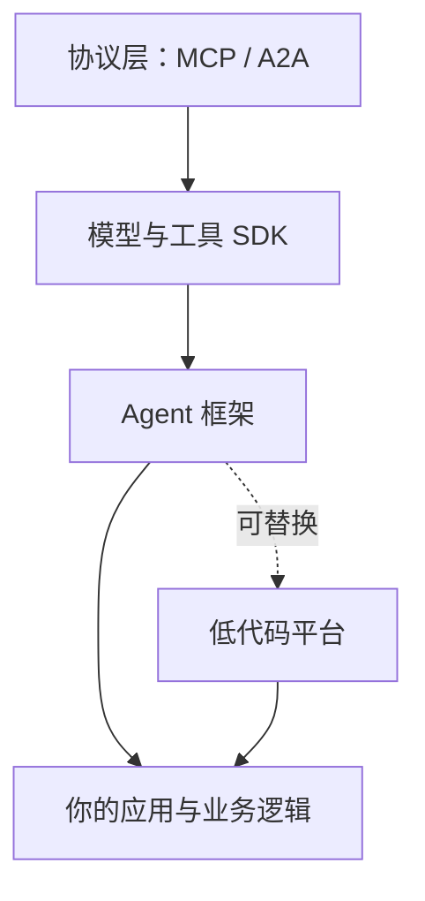
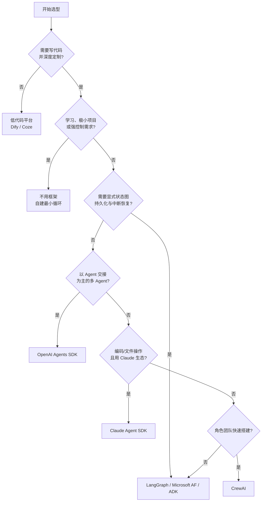
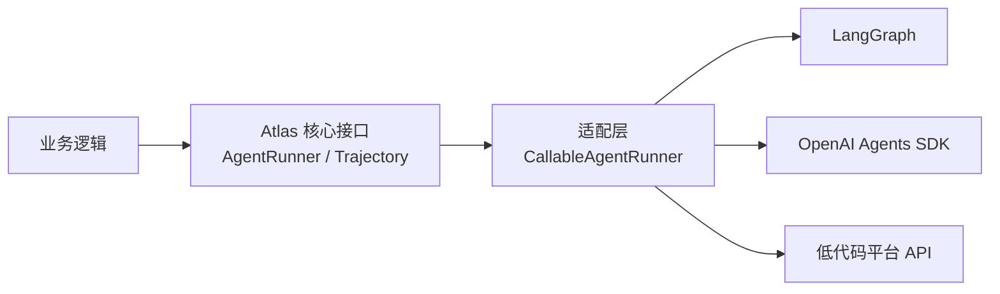

# 第 11 章 开发框架全景与选型

## 本章导读

一个团队用某框架两周做出了研究助手演示：接模型、挂工具、跑通多 Agent，进度飞快。半年后需求变了：要换模型供应商、加人工审批、把长任务从中断处恢复、把追踪数据接入自有平台。他们发现核心逻辑散落在框架的回调、装饰器和隐式状态里，换任何一项都要动全身。框架本身没有错，错在选型时只比了“搭 demo 多快”，没有比“运行时语义”和“退出成本”。

⭐⭐ 入门 ｜ 适合：工程师、技术负责人、产品经理

## 学习目标

读完本章你将能够：

- 说清 Agent 框架、SDK、平台与协议各自解决什么问题，避免把框架当架构
- 比较主流代码框架与低代码平台的定位、核心抽象、适用场景与主要代价
- 用控制粒度、状态与持久化、多 Agent、工具生态、模型绑定、可观测与退出成本等维度做选型
- 根据决策树缩小候选范围，并用小规模验证而不是功能清单做最终判断
- 在 Atlas v0.11.0 中用适配层与契约测试隔离框架，保证系统可替换

## 11.1 框架替你做了什么

自己从零写 Agent，至少要处理五件事：调用模型并把不同供应商的响应归一化；解析工具调用、校验参数、执行并回填结果；维护消息历史与上下文预算；实现循环、停止条件与错误恢复；把过程记录下来以便调试。框架的价值，是把这些重复工作沉淀成一套约定和运行时。

可以用装修来类比。协议是水电煤标准，SDK 是买来的电器，框架是装修套餐，平台是拎包入住的公寓。套餐省心，但墙怎么砌、线怎么走，往往由套餐决定；想改承重结构，成本可能比一开始自己装还高。



四层的职责不同：

- **协议**定义连接方式，比如 MCP 连接工具、A2A 连接远程 Agent，它们不负责编排。
- **SDK**通常只封装模型或工具的一类能力，例如模型客户端、工具调用协议。
- **框架**提供 Agent 循环、状态管理、编排原语和运行时，是本章的主角。
- **平台**把模型、工具、知识库、发布渠道打包成可视化产品，牺牲一部分控制力换开发速度。

框架带来三种价值：**约定**（大家按同一套抽象组织代码）、**运行时**（持久化、流式、中断恢复、并发）、**生态**（工具、集成、部署与观测）。它也带来三种成本：**抽象税**（简单问题被复杂抽象包住）、**版本税**（框架演进快，升级要改代码）、**锁定税**（业务逻辑与框架类型纠缠，迁移困难）。

最关键的一句话是：**框架不是架构。** 架构回答“状态放在哪、边界怎么划、失败如何隔离、如何观测”，这些问题不会因为换了框架就消失。框架只是架构的一种实现材料。

还要区分框架与库。库是你调用它，框架是它调用你：控制权反转之后，你的代码要符合框架的生命周期、状态模型与错误约定。这也是为什么“引入一个库”通常风险可控，而“引入一个框架”往往意味着一次架构决策。判断标准很简单：如果去掉这个依赖，你的业务代码还能不能独立运行？能，它是库；不能，它已经在充当框架。

## 11.2 框架全景


截至写作时，下列框架的能力、API 与部署方式都在快速变化。本节只描述其稳定定位与核心抽象，具体接口请以官方文档为准；不要把这里的分类当作能力排名。


### 11.2.1 代码优先框架

**LangGraph** 把自己定位为低层编排框架与运行时。它用状态图（State Graph）表达流程：节点是步骤，边是转移，状态在节点之间传递；检查点（Checkpointer）把状态持久化，支持中断（Interrupt）与恢复，并提供不同的持久化强度。它适合需要显式控制状态、长任务恢复和人工介入的场景。代价是状态结构、图与持久化都要自己设计，学习曲线比“几行代码跑起来”的框架陡。

**OpenAI Agents SDK** 提供一组轻量原语：Agent、Handoff、Guardrail、Session 与 Tracing。它把“一个 Agent 把控制权交给另一个 Agent”做成一等公民，适合以交接为主的多 Agent 流程，内置追踪降低了调试成本。它不试图替你解决所有长任务状态问题；复杂持久化、复杂分支仍要自己补。

**Claude Agent SDK** 把 Claude Code 的 Agent 循环、工具执行与上下文管理开放成 Python/TypeScript 库。它提供查询接口、子 Agent 定义、钩子、会话、MCP 接入与工具权限控制，适合编码、文件操作、需要细粒度工具治理的 Agent。它的优势来自与 Claude 生态的深度整合，代价也在这里：模型绑定较深，换供应商不是改一个字符串那么简单。

**Google ADK** 是代码优先的 Agent 开发工具包，针对 Gemini 优化，但宣称模型无关、部署无关。它提供 LLM Agent、工作流 Agent（顺序、并行、循环）、工具、会话与记忆、评测以及部署配套，支持 Python、TypeScript、Go、Java 等语言。它适合已经在 Google Cloud 体系内、或需要多语言团队的场景；离开该体系部署需要额外工作。

**CrewAI** 用“角色—目标—任务—团队”的隐喻组织多 Agent：Agent 有 role、goal、backstory，Task 描述期望输出，Crew 按顺序或层级流程执行；Flow 则用事件驱动的方式表达更复杂的控制流。它上手直观，适合快速搭出角色分工明确的团队。代价是当控制流变得复杂时，仍要退回 Flow 或自定义代码，角色隐喻本身不解决状态与恢复问题。

**Microsoft Agent Framework** 是微软在 .NET 与 Python 上的 Agent 框架，整合了 Semantic Kernel 与 AutoGen 的经验，提供 Agent、工作流以及顺序、并发、交接、群聊、Magentic 等内置编排模式，并强调企业集成。它适合 .NET 技术栈或 Azure 体系；生态较新，版本演进需要关注。

此外还有更聚焦的库：**Pydantic AI** 强调类型安全与 FastAPI 式的开发体验，适合把结构化输出和依赖注入做扎实的 Python 项目；**LlamaIndex** 在数据接入、索引与 RAG 上积累深厚，Agent 能力围绕“数据上的智能体”展开；**Semantic Kernel** 的企业集成能力正在向 Agent Framework 收敛迁移。

### 11.2.2 低代码平台

**Dify** 是开源的 LLM 应用开发平台，把可视化工作流、RAG 管线、Agent、模型管理、插件与可观测性放在同一个界面里，支持自托管，并提供 Service API。它适合业务边界清晰、需要快速上线和运营的应用，例如知识库问答、内容处理、表单审批辅助。

**Coze** 是面向 Bot 与应用的可视化开发平台，核心是插件、工作流、知识库与多渠道发布，零代码门槛低。托管版开箱即用；Coze Studio 也提供了开源版本。它适合快速验证、轻量运营和渠道分发，但深度控制、私有化与可移植性需要单独评估。

低代码不是“不能上生产”，而是“生产边界由平台决定”。当你的需求落在平台的能力范围内，它的交付效率很高；当需求涉及自定义运行时、复杂状态恢复、深度调试或严格的数据驻留，平台边界就会变成产品边界。

评估低代码平台时，建议固定检查五件事：数据能否导出、API 能否被外部系统稳定调用、权限与审计能否细化到操作级、失败能否拿到可诊断的日志、以及最坏情况下能否迁移。前四项决定它能不能用，最后一项决定你敢不敢用。很多团队在试用阶段只看拖拽体验，上线后才发现限流、私有化或迁移成本无法接受。

### 11.2.3 不用框架的基线

第 12 章会用约 300 行代码从零实现一个 Agent。不用框架不是反智，而是一种重要的基线：它让你看清循环、工具、上下文与停止条件的最小实现，也让你在选框架时知道哪些能力是“框架替你做的”，哪些是“业务必须自己负责的”。对学习、极小项目、强控制需求的系统，基线往往比框架更合适。

### 11.2.4 横向对比

| 框架/平台 | 核心抽象 | 控制粒度 | 状态与恢复 | 多 Agent | 模型绑定 | 主要代价 |
|---|---|---|---|---|---|---|
| LangGraph | 状态图、检查点、中断 | 高 | 强，支持持久化与恢复 | 图与子图 | 开放 | 需自行设计状态与图 |
| OpenAI Agents SDK | Agent、Handoff、Guardrail、Session | 中 | 基础会话 | 交接式 | 较开放 | 复杂状态需自补 |
| Claude Agent SDK | Agent 循环、子 Agent、钩子 | 中高 | 会话与恢复 | 子 Agent | 偏 Claude | 生态绑定较深 |
| Google ADK | LLM Agent、工作流 Agent | 中高 | 会话与记忆 | 顺序/并行/循环 | 较开放 | 云外部署需额外工作 |
| CrewAI | Agent、Task、Crew、Flow | 中 | 基础 | 角色团队 | 开放 | 复杂控制流需 Flow |
| Microsoft Agent Framework | Agent、工作流、编排模式 | 中高 | 会话与工作流 | 内置多种模式 | 较开放 | 生态较新 |
| Dify | 可视化工作流、RAG、插件 | 低到中 | 平台管理 | 有限 | 开放 | 深度定制受平台限制 |
| Coze | Bot、插件、工作流、知识库 | 低 | 平台管理 | 有限 | 平台决定 | 托管与可移植性 |
| 不用框架 | 自己的循环与类型 | 最高 | 自己实现 | 自己实现 | 完全自主 | 开发与维护成本 |

这张表只回答“定位像什么”，不回答“哪个更好”。同一个框架在不同团队、不同运维体系里的实际成本可能完全不同。

## 11.3 选型维度

选型最容易犯的错，是拿功能清单逐项打勾。功能多不等于适合，关键要看**你的约束是否被满足**，以及**不符合时退出的代价**。下面十个维度，前五个决定能不能做，后五个决定做得久不久。

| 维度 | 要问的问题 | 典型信号 |
|---|---|---|
| 控制粒度 | 流程是固定还是需要运行时决策？ | 需要自定义循环、分支、中断恢复 |
| 状态与持久化 | 任务能否中断、恢复、重放？ | 长任务、人工审批、跨进程恢复 |
| 多 Agent | 是交接、图、角色团队还是工作流？ | 已有明确的协作模式 |
| 工具与协议 | 是否需要 MCP、并行工具、权限控制？ | 工具多、来源杂、需要最小权限 |
| 模型绑定 | 是否必须支持多供应商或私有模型？ | 有合规、成本或容灾要求 |
| 可观测与评测 | 能否拿到结构化轨迹与用量？ | 需要归因、回归测试、线上排障 |
| 部署形态 | 自托管、云托管、Serverless、长驻进程？ | 数据驻留、网络隔离、弹性要求 |
| 许可与社区 | 许可证、版本节奏、issue 响应？ | 长期维护、二次开发 |
| 团队技能 | 团队熟悉 Python、.NET、TypeScript 还是可视化？ | 招聘与协作成本 |
| 退出成本 | 业务逻辑与框架类型的耦合有多深？ | 是否有适配层与契约测试 |

其中两个维度最容易被低估。

**状态与持久化**决定系统能不能“活过长任务”。一个只能一次跑完的框架，遇到人工审批、进程重启、工具超时就会暴露问题。选型时要问：状态存在哪？能否从中断处恢复？恢复后工具调用会不会重复执行？这些问题比“支持多少工具”重要得多。

**退出成本**决定你未来还有没有选择权。框架锁定通常分四层：API 锁定（代码调用方式）、状态锁定（历史数据与检查点格式）、部署锁定（只能跑在某云或某运行时）、观测锁定（追踪数据只能进某平台）。API 层最容易察觉，后三层往往在上线后才发作。

一个实用做法是把需求写成两类：**硬约束**（缺了就淘汰）和**偏好**（影响排序）。例如“必须自托管、必须支持开放模型、必须能中断恢复”是硬约束；“有内置追踪、支持 MCP”是偏好。这样选型就从“感觉哪个好”变成“先过滤、再排序、最后验证”。

硬约束不要写太多。把“最好有”误写成“必须有”，会把本来合适的候选全部淘汰；反过来，把真正的合规要求降级成偏好，又会在上线前返工。一个可操作的检验是：每条硬约束都追问一次“如果它不满足，项目是否必须停止？”答案是否定的，就把它移到偏好里。

## 11.4 决策树

下面的决策树用于把候选从“十几个”缩到“两三个”，不是最终裁决。



三个典型场景：

- **生产级研究助手**：长任务、需要人工补充资料、要能从中断处恢复、要求自托管与开放模型。优先看 LangGraph、Google ADK、Microsoft Agent Framework，重点验证持久化、恢复与观测。
- **轻量多 Agent 流程**：几个 Agent 之间按规则交接，任务通常在分钟级完成。OpenAI Agents SDK 的原语更贴近问题，代码量小，追踪开箱即用。
- **业务人员快速原型**：知识库问答、表单处理、渠道发布。Dify 或 Coze 能在一两天内跑通；但要提前确认数据驻留、私有化与后续迁移路径。

决策树给出候选后，必须做一次小规模验证（spike）。验证不看“能不能跑通 demo”，而看三件事：**目标任务的完成质量、失败时的可诊断性、退出时你要改多少代码**。第 11.6 节的契约测试就是为第三件事准备的。

一次合格的 spike 应该留下可比较的记录：同一组任务、同一组工具、同一份预算，分别跑两个候选；记录成功率、平均延迟、令牌消耗、失败类型，以及“从错误发生到定位原因”的时间。还要故意制造一次故障，例如让工具超时或让进程在中途重启，观察框架能否恢复、恢复后是否重复执行副作用。没有经过故障注入的验证，只证明了顺利路径可用。

对团队而言，还有一个软约束常被忽略：**谁能维护它**。一个能力很强但只有一个人熟悉的框架，在人员变动后就是风险；一个能力普通但团队都理解的方案，长期成本可能更低。选型报告里应该写清维护者、升级策略与知识转移计划，而不只是架构图。

## 11.5 集成策略与退出成本

### 11.5.1 在边界处适配，而不是到处调用

健康的结构是：业务核心只依赖你自己的类型与接口，框架只出现在一个薄薄的适配层里。Atlas 的做法是把外部框架包装成 `AgentRunner`，核心的 `Orchestrator`、`SharedBoard`、`Budget` 完全不知道对方用了什么框架。





```python
from some_framework import Graph, State

def build():
    graph = Graph(State)
    graph.add_node("research", research_node)
    return graph.compile()
```
业务代码、状态定义与框架 API 绑在一起；换框架时，调用点、状态、持久化全要改。


```python
from atlas import as_agent_runner

runner = as_agent_runner(framework_entrypoint, name="langgraph")
trajectory = runner.run(task, ctx)
```
核心只依赖 `AgentRunner` 与 `Trajectory`；换框架时只替换适配层。



### 11.5.2 用契约测试验证“包装后仍然可靠”

包装不等于兼容。外部框架可能返回自己的结果对象、丢失运行 ID、把错误吞掉、或把用量记在别处。适配层必须通过一组契约测试：返回类型正确、任务与运行 ID 一致、步骤编号连续、停止原因可解释、失败会显式暴露。

这组测试还有第二个用途：升级框架版本时先跑它。如果新版本改变了返回结构或错误语义，测试会先失败，而不是等线上出问题。

### 11.5.3 版本、部署与数据的锁定

- **版本**：锁定主版本，升级走独立分支；不要在生产环境使用浮动版本。
- **部署**：确认框架能否在你需要的地方运行；Serverless、长驻进程、私有网络对运行时要求不同。
- **数据**：检查点、会话、追踪数据的格式是否可导出；不能导出的状态就是锁定。
- **观测**：优先选择能输出开放格式（如结构化日志、OpenTelemetry）的方案，避免追踪只进某家平台。

| 锁定层 | 表现 | 缓解 |
|---|---|---|
| API | 业务代码到处 import 框架类型 | 适配层 + 自有接口 |
| 状态 | 检查点/会话格式不可导出 | 定期导出、保留原始事件 |
| 部署 | 只能跑在某云或某运行时 | 容器化、抽象运行时依赖 |
| 观测 | 追踪数据只能进某平台 | 双写开放格式、保留本地日志 |

<details>
<summary>深入了解：从框架 A 迁到框架 B 的最小步骤</summary>

迁移不要从“重写”开始，而要从“并行”开始。第一步，把现有系统的输入输出、状态快照与关键副作用记录下来，形成一组回归用例；这些用例不依赖任何框架，只描述“给定任务，应该产生什么可观察结果”。第二步，在新框架里实现同一组用例，先只跑只读任务，确认结果与轨迹结构可比。第三步，做双跑：同一请求同时走新旧实现，比较答案、用量与延迟，但只让旧实现产生真实副作用。第四步，按流量比例灰度切换，保留一键回退。第五步，确认稳定后再移除旧实现与适配代码。

这个过程中最容易漏掉的是**状态迁移**：旧的检查点、会话与产物格式未必能直接导入新框架。如果历史状态很重要，就要先写导出与转换脚本，并在迁移前验证“恢复后不会重复执行副作用”。如果历史状态不重要，就明确约定一个切换时间点，避免新旧状态混用。

</details>

## 11.6 动手实践：Atlas v0.11.0

本章不新增内核接口，只增加 `integrations/` 适配层。它由三部分组成：框架画像与选型、外部调用包装、契约检查。

### 11.6.1 把框架画像变成数据

选型讨论常见的失败，是每个人对“某框架支持什么”各有一套印象。把这些印象写成结构化画像，至少能让分歧变得可讨论。

```python
# src/atlas/integrations/profiles.py（节选）
@dataclass(frozen=True)
class FrameworkProfile:
    name: str
    kind: Literal["code", "platform"]
    supports: frozenset[str] = frozenset()
    model_binding: Literal["open", "vendor"] = "open"
    self_hosted: bool = True
    maturity: Maturity = "stable"
    strengths: tuple[str, ...] = ()
    constraints: tuple[str, ...] = ()
```

`Requirements` 把需求分成硬约束与偏好，`select_frameworks` 先过滤、再排序。排序分数只用于给出候选顺序，不代表客观质量；代码里甚至刻意保留了“同分按名称排序”的确定性规则，避免结果随输入顺序漂移。

```python
# src/atlas/integrations/profiles.py（节选）
matched = requirements.preferred & profile.supports
score = (
    len(matched) * 2.0
    + _MATURITY_ORDER[profile.maturity] * 0.25
    + (0.25 if profile.model_binding == "open" else 0.0)
    + (0.25 if profile.self_hosted else 0.0)
)
```

### 11.6.2 把外部框架包装成 AgentRunner

适配器只做两件事：调用外部入口，把结果归一化成 `Trajectory`。它不接管对方内部的循环，也不假装理解对方的语义。

```python
# src/atlas/integrations/runner.py（节选）
class CallableAgentRunner:
    def __init__(self, func: FrameworkCall, *, name: str = "framework") -> None:
        if not callable(func):
            raise TypeError("func must be callable")
        self.func = func
        self.name = name

    def run(self, task: str, ctx: RunContext | None = None) -> Trajectory:
        ctx = ctx or RunContext(run_id=f"{self.name}-{uuid4().hex[:12]}")
        result = self.func(task, ctx)
        if isinstance(result, Trajectory):
            return _normalize(result, task, ctx)
        if isinstance(result, str):
            return Trajectory(
                task=task,
                run_id=ctx.run_id,
                steps=[Step(index=1, thought=result)],
                final_answer=result,
                stop_reason="final_answer",
                ended_at=utcnow(),
            )
        raise TypeError(...)
```

如果框架返回自己的结果对象，适配器负责转换成 Atlas 的 `Trajectory`；如果只返回字符串，就补一条最小步骤。关键是不让框架类型越过边界。

### 11.6.3 契约检查

```python
# src/atlas/integrations/conformance.py（节选）
def check_runner(runner, cases, *, name="runner") -> ConformanceReport:
    checks, failures = [], []
    for index, case in enumerate(cases, start=1):
        ctx = RunContext(run_id=f"conformance:{index}")
        try:
            trajectory = runner.run(case.task, ctx)
        except Exception as exc:
            failures.append(f"case {index}: raised {type(exc).__name__}: {exc}")
            continue
        ...
        _check(label, "run_id", trajectory.run_id == ctx.run_id, failures)
        _check(label, "step_index", indexes == list(range(1, len(steps) + 1)), failures)
        _check(label, "stop_reason", trajectory.stop_reason == case.expect_stop_reason, failures)
```

### 11.6.4 运行示例

示例构造了八个框架画像，并用两组需求做筛选。第一组要求多 Agent、人工介入、自托管、开放模型、稳定成熟度；第二组只要求低代码。

```text
场景一：生产级研究助手（自托管、开放模型、多 Agent）
  硬约束=['human_in_loop', 'multi_agent']
  偏好=['evaluation', 'mcp', 'tracing']
  候选顺序：
    1. Google ADK (kind=code, score=6.75)
    2. LangGraph (kind=code, score=6.75)
  被排除：
    OpenAI Agents SDK: 缺少 human_in_loop
    Claude Agent SDK: 绑定供应商模型
    CrewAI: 缺少 human_in_loop
    Microsoft Agent Framework: 成熟度低于 stable
    Dify: 缺少 human_in_loop, multi_agent
    Coze: 缺少 human_in_loop, multi_agent；不可自托管

场景二：业务人员快速搭原型（低代码优先）
  候选顺序：
    1. Dify (kind=platform, score=4.75)
    2. Coze (kind=platform, score=4.5)

适配层契约检查：
  runner=LangGraph passed=True
  checks=['case 1', 'case 2']
  failures=[]
```

两个框架同分时按名称排序，这只说明在当前需求下它们通过了同样的硬约束、命中了同样的偏好，**不说明它们等价**。最终选择仍要靠 spike：用真实任务测质量、延迟、失败可诊断性和迁移成本。

### 11.6.5 测试与取舍

新增 13 条测试，覆盖硬约束过滤、成熟度过滤、偏好排序、确定性、异常输入、字符串与轨迹包装、默认运行 ID、非法返回类型、契约通过、契约违规与异常上报。全量测试：

```text
91 passed
```

| 取舍 | 影响 | 后续 |
|---|---|---|
| 画像靠人工维护 | 容易过时，且带主观性 | 第 15 章用评测数据校准 |
| 评分规则简单 | 只适合粗筛，不适合精细排序 | 引入加权需求与团队约束 |
| 适配器只支持 `(task, ctx)` 入口 | 复杂框架需写闭包或子类 | 按框架补充专用适配器 |
| 契约检查是黑盒 | 无法验证内部预算与恢复语义 | 第 16、18 章加入追踪与运行时检查 |
| 未接入真实框架依赖 | 示例离线、可复现，但不证明集成可用 | 第 12 章用真实框架重写并对比 |

## 11.7 业界案例：LangGraph 把 Agent 当有状态图

LangGraph 的一个关键设计选择，是把 Agent 执行看成**有状态图的推进**，而不是一次函数调用。状态在每个节点后被检查点保存；遇到 `interrupt()` 暂停，人工处理后用 `Command(resume=...)` 从原处继续。持久化强度还可以按场景选择：只在退出时写、异步写、或每步同步写。

这个设计揭示了一个常被忽略的事实：**很多框架选型，本质上是在选运行时语义**。持久化、恢复、人工介入、流式事件，这些能力不是提示词能补出来的，必须由运行时提供。反过来，如果你的任务都很短、失败后重跑即可，那么强持久化就是不必要的复杂度。

映射到 Atlas：`Trajectory` 记录过程，`Budget` 控制资源，`SharedBoard` 保存跨角色产物，但没有实现检查点与恢复；这正是第 18 章要补的运行时能力。Atlas 的教学价值在于把“最小充分集”写清楚，让你在选框架时能判断哪些能力是必需的，哪些只是听起来高级。

另一个行业信号是框架边界本身在移动：Semantic Kernel 与 AutoGen 的经验被整合进 Microsoft Agent Framework，说明今天的“标准抽象”明天可能被重组。对抗这种不确定性的办法不是押注某个框架永远正确，而是把业务核心放在稳定接口后面，让框架成为可替换的实现。

这个案例对应用开发者有三条启示。第一，**先确定运行时需求，再看框架功能**：需不需要持久化、需不需要中断恢复、需不需要跨进程，这些问题决定了候选范围。第二，**把“可恢复”当成一项独立能力验收**：不仅要能暂停和继续，还要验证继续之后工具不会重复执行、预算不会重新计数。第三，**不要用框架的抽象替代自己的领域模型**：图、节点、检查点可以描述执行，但任务、证据、审批状态仍应是你自己的类型，否则迁移时会把领域知识一起丢掉。

## 11.8 常见误区

**误区一：框架就是架构。** 框架提供循环、状态与编排的材料，但状态放哪、边界怎么划、失败如何隔离仍要你自己决定。换了框架，架构问题不会自动消失。

**误区二：功能越多越值得选。** 功能清单不衡量代价。一个支持十种编排模式的框架，如果你只需要顺序执行，多出来的抽象只会增加学习和升级成本。

**误区三：低代码不能上生产。** 低代码的生产边界由平台能力决定。边界内的业务可以很稳定；真正的问题是要提前确认数据驻留、私有化、限流、审计与迁移路径。

**误区四：锁定只发生在 API 层。** 状态格式、部署环境、观测数据同样会锁定你，而且往往在上线后才暴露。选型时要把这四层都问一遍。

**误区五：选型一次定终身。** 框架在演进，需求也在变。合理的做法是保留适配层与契约测试，把“换框架”从重写变成替换一个实现。

## 11.9 本章小结

- 框架的价值是约定、运行时与生态；代价是抽象税、版本税与锁定税。框架不是架构。
- 代码框架在控制粒度、状态与编排上差异很大；低代码平台用控制力换交付速度，适合边界清晰的应用。
- 选型先区分硬约束与偏好，再看控制粒度、持久化、多 Agent、工具协议、模型绑定、可观测、部署与退出成本。
- 决策树只用于缩小候选；最终判断要靠真实任务的 spike，而不是功能清单。
- 退出成本分 API、状态、部署、观测四层；适配层与契约测试是保留选择权的核心手段。
- Atlas v0.11.0 用 `FrameworkProfile`、`select_frameworks`、`CallableAgentRunner` 与 `check_runner` 把框架隔离在边界之外，不改任何冻结接口。
- 框架选型的本质，常常是运行时语义的选择；先想清楚任务需要哪些运行时能力，再选实现。

## 11.10 思考与练习

1. **需求矩阵**：为“企业内部合同审查助手”写一份选型需求。列出硬约束与偏好，用 `Requirements` 与 `select_frameworks` 跑一遍候选，解释为什么某些框架被排除，并说明还缺哪些信息才能做最终决定。

2. **扩展画像与契约测试**：为 `FrameworkProfile` 增加一个你关心的维度（例如“是否支持流式事件”或“是否支持本地部署”），更新排序逻辑与测试。再写一个故意返回错误 `run_id` 的假框架，验证 `check_runner` 能定位到具体失败项。

3. **两周 spike 计划**：选两个候选框架，设计一个两周验证计划。要求包含三个真实任务、一次故障注入（工具超时或进程重启）、明确的通过标准（质量、延迟、可诊断性、迁移代码量），并给出“继续、换框架、自建”的决策规则。
