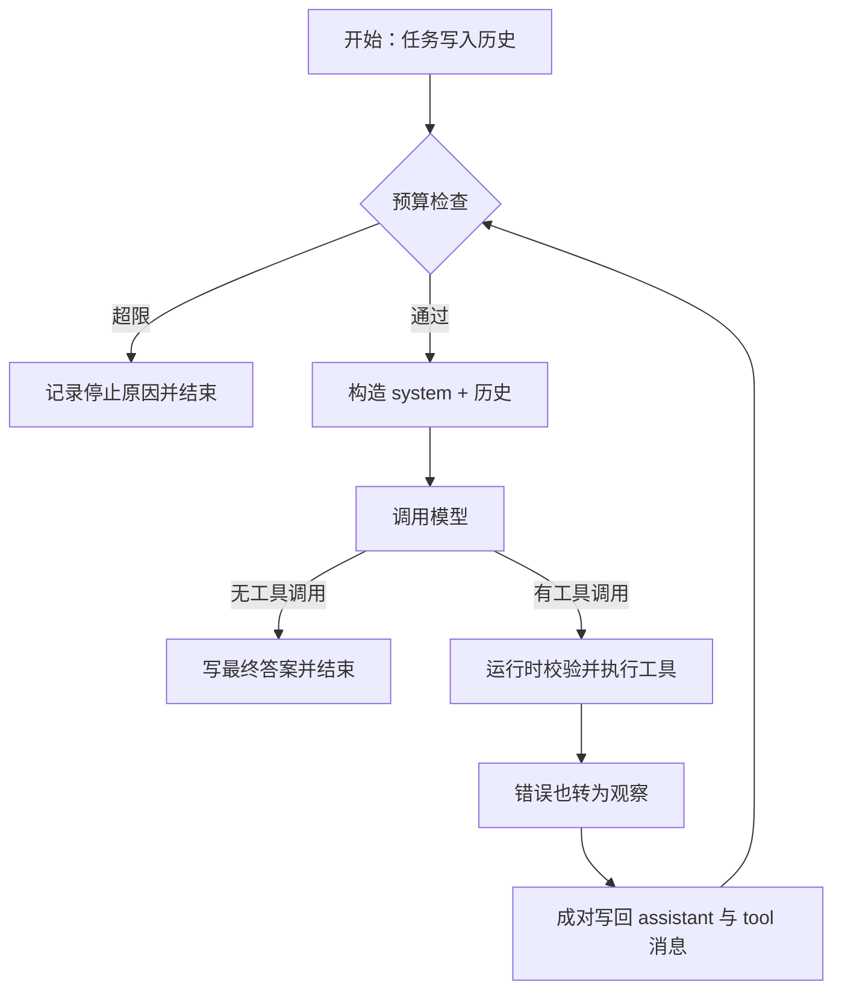
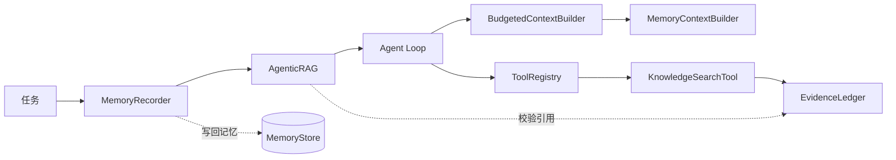
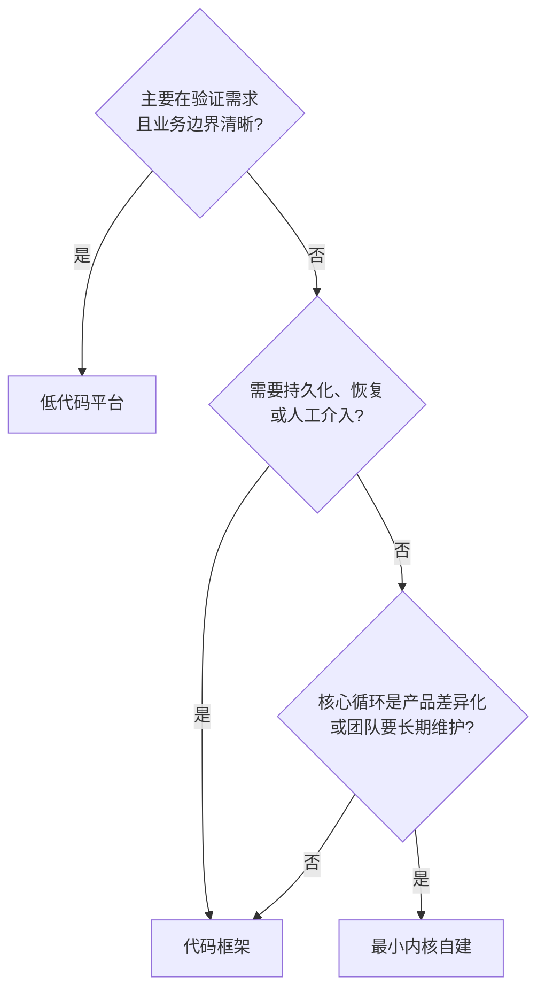

# 第 12 章 从零构建第一个 Agent

## 本章导读

把一个 Agent 拆到最小，只剩四件事：把消息发给模型、执行模型点名的工具、把观察写回历史、判断何时停。很多人第一次写 Agent 时，把框架当成这些问题的答案，结果连循环里发生了什么都不知道。本章先手写一个约 300 行的内核，再用 Atlas 与 LangGraph 分别装配同一任务，看清哪些复杂度是问题固有的，哪些是工具带来的。

⭐⭐⭐ 进阶 ｜ 适合：工程师、技术负责人

## 学习目标

读完本章你将能够：

- 不依赖框架，用约 300 行代码实现带工具调用、短期记忆与循环控制的 Agent
- 解释最小内核的五个关键设计决定，以及每个决定放弃的便利
- 把模型、工具、记忆、检索与上下文预算按正确顺序装配成 Atlas v1.0.0
- 用 LangGraph 重写同一任务，从代码量、状态、可观测与退出成本四方面做对比
- 判断一个项目应该用最小内核、代码框架还是低代码平台，并说清理由

## 12.1 为什么要先手写一遍

框架最擅长的事情，是把 Agent Loop 藏起来。你写几个节点、连几条边、注册几个工具，循环就跑起来了。顺利时这很高效；出问题时，你面对的是框架的日志、回调栈和抽象类型，很难回答几个最基本的问题：这一轮到底把哪些消息发给了模型？工具错误是变成观察还是终止了运行？预算是在调用前还是调用后检查的？

手写一遍的价值，不是证明“不用框架也能做”，而是获得一张内部地图。之后无论用哪个框架，你都能判断它替你做了什么、在哪个环节改变了语义、失败时该往哪里看。这和学开车要先理解离合与档位是一个道理：自动挡很好，但你得知道它替你换了几次档。

可以先记住一个粗略的比例：一个能跑的研究助手，核心循环通常只占代码量的很小一部分，大部分代码在处理工具、记忆、检索、预算与错误。手写内核让你看清这个比例，也让你在选框架时不被“几行代码跑起来”的演示迷惑。

最小内核还有第二个用途：它可以充当对照实现。当框架版本出现难以解释的行为时，把同一任务、同一工具、同一脚本模型接到最小内核上跑一遍，就能判断问题出在模型、工具还是框架的运行时。这种“用简单实现给复杂实现做对照”的方法，比逐行读框架源码更快，也更适合放进回归测试。

建议把这个文件留在仓库里。后续每增加一层能力，都用它跑一次同样的任务；如果最小内核与完整 Atlas 的答案出现无法解释的差异，差异本身就是线索，能指出是新层的输入组装、工具执行，还是停止条件改变了行为。

## 12.2 约 300 行的最小 Agent

本章的完整实现是 `examples/ch12_minimal_agent.py`。文件共 389 行，去掉空行与注释后约 298 行有效代码，只依赖 Python 标准库。它不包含长期记忆、检索、上下文压缩与持久化，但包含一个 Agent 不可缺少的全部结构。

### 12.2.1 类型层：先把词汇固定下来

最小实现的第一步不是写循环，而是定义消息、工具调用、工具结果、步骤与轨迹。这些类型决定了后面所有代码能表达什么。

```python
@dataclass
class Message:
    role: Role
    content: str | None = None
    name: str | None = None
    tool_calls: list[ToolCall] = field(default_factory=list)
    tool_call_id: str | None = None


@dataclass
class Step:
    index: int
    thought: str | None = None
    tool_calls: list[ToolCall] = field(default_factory=list)
    tool_results: list[ToolResult] = field(default_factory=list)
    usage: Usage = field(default_factory=Usage)


@dataclass
class Trajectory:
    task: str
    run_id: str
    steps: list[Step] = field(default_factory=list)
    final_answer: str | None = None
    stop_reason: StopReason = "final_answer"
    usage: Usage = field(default_factory=Usage)
```

`Message` 是发给模型的输入，`Step` 是运行时记录的过程，`Trajectory` 是一次运行的完整产物。三者分开，是为了让“模型看到什么”和“审计需要什么”不必是同一份数据。

### 12.2.2 模型层与工具层：两个窄协议

模型只需要一个方法：接收消息与工具描述，返回内容或工具调用。工具也只需要一个方法：接收参数字典，返回字符串。协议越窄，替换实现越容易。

```python
class LLM(Protocol):
    model: str

    def complete(
        self,
        messages: list[Message],
        tools: list[ToolSpec] | None = None,
    ) -> LLMResponse: ...


class Tool(Protocol):
    spec: ToolSpec

    def run(self, arguments: dict[str, Any]) -> str: ...
```

工具注册表承担三件事：按名字查找、检查必填参数、把异常转成错误观察。第三件事最容易被漏掉：如果工具异常直接冒泡，整个 Agent 会终止；而把它变成 `ToolResult(is_error=True)`，模型就有机会换一个参数或换一条路径。**错误是观察的一种，不是循环的终点。**

这里还隐含一条循环不变式：assistant 消息里的每个 `tool_call`，在历史中必须有且只有一条对应的 `tool` 消息，且 `tool_call_id` 一致。很多模型接口会强制检查这种配对；一旦回填时漏掉一条、重复一条或顺序错乱，下一轮请求就会直接失败。最小内核用 `zip` 同时回填调用与结果，Atlas 的上下文压缩器则把二者当成一个不可拆分的组，原因相同：工具调用与观察在语义上是一条原子记录。

示例中的计算器只接受数字与四则运算，用 AST 白名单求值，而不是 `eval`。这既演示了参数校验，也提醒一件事：工具执行的是模型生成的参数，默认不可信。

### 12.2.3 循环与停止：把控制权写清楚

循环的骨架可以用五步概括：检查预算、构造输入、请求模型、执行工具、回填观察。停止条件放在每轮开头检查，检查顺序固定为时间、步数、令牌、工具调用次数。

```python
while True:
    reason = check_budget(ctx.budget, step=step_index, tool_calls=tool_calls,
                          usage=usage, started_at=trajectory.started_at)
    if reason is not None:
        trajectory.stop_reason = reason
        break

    response = self.llm.complete(
        [Message("system", self.system_prompt), *history],
        self.tools.specs(),
    )
    if not response.tool_calls:
        trajectory.final_answer = response.content
        trajectory.stop_reason = "final_answer"
        break

    results = [self.tools.run(call) for call in response.tool_calls]
    # 把 assistant 的 tool_calls 与 tool 结果成对写回历史
```

这里的历史是列表，上下文就是 `[system] + history`。短期记忆在这个最小实现里就是完整的消息历史；长期记忆、检索与压缩都不在循环内，而是后续通过“每轮重建输入”的钩子接入。



### 12.2.4 运行结果

示例让脚本模型先调用计算器，再根据观察给出答案：

```text
任务：计算 (128 + 64) * 3，并给出结果。
停止原因：final_answer
最终答案：(128 + 64) * 3 = 576。
  步骤 1：工具=calculator｜用量=138
  步骤 2：工具=无｜用量=226
总用量：364 tokens
```

这段输出已经包含了 Agent 的四个可审计要素：任务、决策、行动与用量。它没有长期记忆，不知道昨天的对话；没有检索，不能回答知识问题；没有压缩，历史长了会撞上窗口；没有持久化，进程退出就丢失。这些不是“写得不够多”，而是**问题本身需要额外机制**。

## 12.3 最小内核的五个设计决定

同样的 300 行可以有无数种写法。下面五个决定，决定了内核是否可扩展、可调试、可替换。

### 12.3.1 模型只提议，运行时执行

模型返回的工具名与参数只是提议。查找工具、校验参数、判断权限、执行、捕获异常，全部由运行时完成。这样做的好处是安全边界清晰：模型永远不能直接调用一个未注册的函数。代价是运行时必须维护工具 schema，并在模型与真实函数之间做一层转换。

权限判断也应放在这一层。一个工具是否危险、是否需要审批、是否允许在本次运行中使用，不能靠提示词告诉模型“不要调用”，而要靠运行时在真正执行前检查。最小内核用 `dangerous` 字段预留了这个位置；Atlas 在第 5 章把它变成默认拒绝，在第 17 章接入审批与护栏。**模型可以提出任何调用，运行时决定哪些能发生。**

### 12.3.2 历史是数据，上下文是每轮重建

最小实现把历史直接拼成输入；Atlas 则在每轮调用 `ContextBuilder.build`。区别在于：历史是“发生过什么”，上下文是“这一轮让模型看到什么”。把两者分开，才能在中间插入记忆检索、证据排序、压缩与渐进式披露，而不改写原始历史。

### 12.3.3 停止条件外置，顺序固定

停止条件不能交给模型“自己说停”。内核检查时间、步数、令牌与工具调用次数；顺序固定，才能让同一输入产生可复现的停止原因。评测时，`stop_reason` 与最终答案同等重要，因为它告诉你失败是“不会做”还是“没来得及做”。

### 12.3.4 轨迹是一等产物

每一步都记录思考摘要、工具调用、工具结果与用量。轨迹不是日志的副产品，而是评测、回放与根因分析的输入。没有轨迹，你只能看到最终答案；有了轨迹，你能回答“它在第几步走错、错误观察是什么、预算花在哪”。

### 12.3.5 工具 schema 是行动边界

工具描述与参数 schema 是模型选择工具的唯一依据。描述写不清“何时用、何时不用”，模型就会乱调；参数约束写不全，运行时就要替模型兜底。行动空间不是提示词里的一句话，而是注册表里真实存在的工具集合。

<details>
<summary>深入了解：最小内核与 Atlas 的职责边界</summary>

最小内核回答“一个 Agent 至少需要什么”。Atlas 回答“一个可上线的研究助手需要什么”。后者多出来的部分，大致分三类：

- **数据层**：长期记忆、知识库、证据台账、上下文存储。
- **控制层**：规划与重规划、多角色编排、预算共享、失败隔离。
- **工程层**：配置、装配、CLI、追踪、评测、安全护栏与运行时。

这三类都不是循环本身，但都会改变循环的输入、输出或停止方式。分层的意义是：每增加一层，都通过既有接口接入，而不是在 `while True` 里再加一个 `if`。

</details>

## 12.4 从 300 行到 Atlas：装配与 CLI

最小内核解决“有没有”，Atlas v1.0.0 解决“怎么把已经实现的能力装成一个系统”。本章不新增内核接口，只增加配置、装配与命令行入口。

### 12.4.1 配置：把环境差异挡在入口

```python
@dataclass
class AtlasConfig:
    model: str
    api_key: str | None = None
    base_url: str | None = None
    temperature: float = 0.0
    offline: bool = False
    max_context_tokens: int = 32_000
    budget: Budget = field(default_factory=Budget)

    @classmethod
    def from_env(cls, prefix: str = "ATLAS_") -> "AtlasConfig": ...
```

配置只回答“用什么模型、预算是多少、是否离线”，不回答“状态放哪、失败怎么办”。这些问题属于架构，不能被一个环境变量掩盖。


把 API Key 放在环境变量里只是教学示例。生产环境应使用密钥管理服务、最小权限与轮换策略；不要把密钥写进代码、配置文件或日志。


### 12.4.2 装配：顺序比清单重要

`build_app` 的装配顺序是固定的：工具 → 模型 → 记忆与检索 → 上下文构建 → Agent 循环 → 记忆写回与引用审计。

```python
memory_builder = MemoryContextBuilder(store, system_prompt=system_prompt)
context_builder = BudgetedContextBuilder(
    inner=memory_builder,
    system_prompt=system_prompt,
    max_tokens=config.max_context_tokens,
)

agent = Agent(
    llm,
    registry,
    config=AgentConfig(system_prompt=system_prompt, temperature=config.temperature),
    context_builder=context_builder,
)

core: AgentRunner = AgenticRAG(agent, ledger=ledger) if knowledge else agent
runner = MemoryRecorder(core, MemoryWriter(store))
```

这个顺序有两个容易被忽略的约束。

第一，**记忆检索必须在预算压缩之前**。如果先压缩再检索，压缩器不知道这一轮会新增多少记忆；如果先检索再压缩，预算才能把记忆、历史与证据放在一起权衡。

第二，**引用审计必须在记忆写回之前**。如果审计把答案改成“无法给出有据可查的答案”，记忆里应该记录修改后的结果，而不是被拒绝的草稿。因此 `AgenticRAG` 在 `MemoryRecorder` 内层，`MemoryRecorder` 在 `AtlasApp` 的最外层。



### 12.4.3 CLI：一条命令跑完整链路

```bash
PYTHONPATH=src python3 -m atlas --offline
```

离线模式使用内置知识库、预置偏好与脚本模型，不发起网络请求。输出如下：

```text
Atlas · 离线演示
任务：Atlas 如何把记忆、检索与上下文预算组合起来？
答案：Atlas 把三者放在不同层：记忆由 MemoryBuilder 检索后注入系统消息[atlas-memory#0]；知识检索被封装成工具，结果进入证据台账[atlas-rag#0]；上下文预算在两者之后统一压缩[atlas-context#0]。
停止原因：final_answer ｜ 步骤：2 ｜ 工具调用：1 ｜ 令牌：968
引用：atlas-memory#0、atlas-rag#0、atlas-context#0 ｜ 检索：1 次
长期记忆：2 条
```

这条输出对应四个层次：记忆层注入了一条偏好；检索层执行了一次知识检索；上下文层在三份材料之后做预算；审计层确认三条引用都来自本轮证据。最后，记忆层把本次任务摘要写回，条目从 1 条变成 2 条。

装配顺序的价值，在失败时最明显。如果答案是“没有检索到资料”，问题可能出在知识库为空、检索工具未注册，或模型根本没调用工具；如果答案是“引用不在本轮证据中”，问题出在证据台账与最终答案不一致；如果记忆条目没有增加，问题可能出在写入闸门或 `MemoryRecorder` 没包在最外层。把每一层的输入输出固定下来，故障就会落在某一层，而不是散落在整条链路里。反过来，如果所有能力都塞进一个函数，最终答案错了，你很难判断该先查记忆、查检索，还是查循环。

需要处理本地资料时，可以不用内置知识库：

```bash
PYTHONPATH=src python3 -m atlas "总结这些文档的共识" --knowledge-dir ./notes
```

`--knowledge-dir` 会把目录下的 Markdown 与文本文件按相对路径生成稳定 `doc_id`，再交给同一套装配。真实模型由 `ATLAS_MODEL`、`ATLAS_API_KEY` 与 `ATLAS_BASE_URL` 配置；没有可用模型时，运行会以 `stop_reason="error"` 结束，而不是静默返回空答案。

## 12.5 用框架重写：以 LangGraph 为例

同一个任务，可以用状态图重写。下面的代码是 `examples/ch12_langgraph.py` 的节选，完整示例 115 行，需要额外安装 `langgraph`。



```python
while True:
    response = self.llm.complete(messages, self.tools.specs())
    if not response.tool_calls:
        return response.content
    results = [self.tools.run(call) for call in response.tool_calls]
    history.extend(to_messages(response.tool_calls, results))
```
循环、停止与状态更新都在你的代码里。


```python
builder = StateGraph(MessagesState)
builder.add_node("llm_call", llm_call)
builder.add_node("tools", ToolNode([calculator]))
builder.add_edge(START, "llm_call")
builder.add_conditional_edges("llm_call", should_continue, ["tools", END])
builder.add_edge("tools", "llm_call")
graph = builder.compile(checkpointer=InMemorySaver())

result = graph.invoke(
    {"messages": [HumanMessage(content=task)]},
    {"configurable": {"thread_id": "ch12"}},
)
```
节点负责状态更新，条件边负责路由，检查点负责持久化。



在临时环境安装 LangGraph 后，示例的真实输出是：

```text
消息序列：
- HumanMessage: '计算 (128 + 64) * 3，并给出结果。'
- AIMessage: ''
- calculator: '576'
- AIMessage: '(128 + 64) * 3 = 576。'
```

四个消息对应一次完整的循环：用户任务、带工具调用的 assistant 消息、工具结果、最终答案。框架没有改变语义，只是把“下一节点是谁”从代码里的 `if` 变成了图上的边。

### 12.5.1 代码量不等于复杂度

| 实现 | 文件行数 | 有效代码 | 依赖 | 主要工作在哪 |
|---|---|---|---|---|
| 最小内核 | 389 | 约 298 | 标准库 | 循环、工具执行、停止与轨迹 |
| LangGraph 示例 | 115 | 约 90 | langgraph | 节点、边、状态与调用约定 |
| Atlas 装配层 | 351（config + app + cli） | 约 300 | 标准库 + 已有模块 | 配置、组合顺序、入口与错误处理 |

LangGraph 版本更短，但它把循环、工具执行与检查点交给了框架。你省下的是运行时样板代码，不是领域建模：任务怎么拆、工具返回什么、失败如何呈现、引用如何审计，仍然要自己决定。

把两个实现按环节对齐，会发现它们一一对应：`llm_call` 对应“请求模型”，`should_continue` 对应“有没有工具调用”，`ToolNode` 对应工具注册表，消息列表对应历史，检查点对应“把状态存下来以便恢复”。差异不在语义，而在谁维护这些部件、谁保证工具调用与结果的配对不变式。看清对应关系，迁移时就不必把框架概念重新学一遍，只需要问：这个部件在我的系统里叫什么？

### 12.5.2 框架真正带来的三样东西

- **状态语义**：`MessagesState` 规定了消息如何累积，检查点规定了状态如何保存与恢复。
- **路由语义**：条件边把“下一步去哪”变成可检查的结构，而不是散落在循环里的分支。
- **运行时能力**：可替换后端的检查点、中断恢复、流式事件与可视化，单靠手写循环要补很多。

代价同样明确：你要学习框架的状态模型与生命周期，升级时跟随它的版本节奏，并把业务类型放在适配层之后。


截至写作时，LangGraph 的导入路径与推荐 API 仍在演进。示例使用 `StateGraph`、`ToolNode`、`MessagesState` 与 `InMemorySaver`；人工介入场景另用 `interrupt()` 与 `Command(resume=...)`。具体签名请以官方文档为准。


## 12.6 三种构建方式对比

| 维度 | 最小内核 | 代码框架 | 低代码平台 |
|---|---|---|---|
| 控制粒度 | 最高，循环与状态全在手 | 中高，受框架生命周期约束 | 低到中，受平台节点约束 |
| 状态与恢复 | 自己实现 | 框架提供检查点与恢复 | 平台管理，导出能力有限 |
| 多 Agent | 自己编排 | 图、交接或角色原语 | 有限 |
| 交付速度 | 慢，适合学习与基础设施 | 中，适合产品迭代 | 快，适合验证与运营 |
| 可观测 | 自己定义轨迹 | 框架追踪 + 自有轨迹 | 平台面板 |
| 退出成本 | 最低 | 中，取决于适配层 | 高，取决于平台边界 |
| 适用阶段 | 学习、极小项目、强控制 | 需要运行时能力的生产系统 | 边界清晰的业务应用 |

选择不是一次性的。原型期用低代码验证需求，产品期用框架补齐运行时，核心链路再逐步收回自建，都是合理路径。关键是每一阶段都保留“换掉当前实现”的接口与测试，而不是把阶段选择当成终局。

可以用下面四个问题缩小范围：



“核心循环是否差异化”常被高估。大多数产品的差异在数据、工具与领域流程，不在循环本身；这种情况下用框架更划算。反过来，如果循环的每一步都承载业务语义（例如需要精确的审计点、恢复语义或调度策略），自建内核反而更容易保持一致性。判断标准不是“自建显得更强”，而是“改动主要发生在循环内还是循环外”。

## 12.7 动手实践：Atlas v1.0.0 的验证

v1.0.0 新增四个文件，全部是装配与入口，没有改动任何冻结签名：

| 文件 | 作用 |
|---|---|
| `src/atlas/config.py` | `AtlasConfig` 与 `from_env` |
| `src/atlas/app.py` | `AtlasApp`、`build_app`、固定装配顺序 |
| `src/atlas/cli.py` | `python -m atlas`、离线演示、目录知识库 |
| `src/atlas/demo.py` | 内置知识库、预置记忆与脚本模型 |

新增 11 条测试，覆盖配置解析、装配顺序、离线端到端、引用审计、记忆写回、目录加载、CLI 文本与 JSON 输出，以及最小内核的轨迹契约。全量测试：

```text
102 passed
```

版本与接口检查：

```text
atlas.__version__ == "1.0.0"
atlas.__all__ 共 94 项，无重复
```

| 取舍 | 影响 | 后续 |
|---|---|---|
| 装配顺序写死在 `build_app` | 灵活组合需要自定义函数 | 第 18 章引入运行时配置 |
| CLI 只加载本地文本 | 不具备网页检索能力 | 第 13 章补充抓取工具 |
| 离线模型是脚本 | 只验证链路，不证明模型质量 | 第 15 章用评测集替换 |
| 记忆与知识库都在内存 | 进程退出即丢失 | 第 18 章持久化 |
| 没有护栏与审批 | 工具调用直接执行 | 第 17 章接入 `Guard` 与 `ApprovalHandler` |
| 接口在本章冻结 | 后续只能做向后兼容增量 | 第 15–18 章按清单扩展 |

冻结接口也不是一句口号，它需要可执行的检查。Atlas 的契约测试逐条比对 `LLM.complete`、`Tool.run`、`ToolRegistry.run`、`Agent.run`、`ContextBuilder.build` 与 `StopPolicy.check` 的参数名、参数顺序、默认值与关键字约束；任何一次“顺手改个名字”都会让测试先失败。这比在文档里写“请勿修改”可靠得多。


v1.0.0 的意义不是“功能完成”，而是“接口稳定”：后续评测、追踪、安全与运行时都可以在既有接口上增量接入，而不必重写核心循环。


## 12.8 业界案例：smolagents 把动作写成代码

Hugging Face 的 smolagents 提供了两条路线：`ToolCallingAgent` 使用模型原生的 JSON 工具调用；`CodeAgent` 则让模型把动作写成 Python 代码片段，由执行器解析并运行。后者更接近“给 Agent 一个解释器”，工具以函数绑定暴露，模型可以写循环、条件与变量，把多个工具组合成一次动作。

这种设计把“行动空间”从结构化 JSON 扩展成了代码。优点是可表达性强：一次生成就能完成多步工具组合；代价是错误面更大：语法错误、运行时异常与不安全代码都要处理。smolagents 因此把执行器做成可替换的：默认本地执行，也可以切换到 E2B、Docker、Modal 等沙箱后端。官方材料还给出过一个值得注意的观察：在部分任务上，代码动作比 JSON 工具调用使用更少步骤；这属于其论文与文档的主张，不应直接当作通用结论。

映射到 Atlas，有三个启示。

第一，**动作格式是架构决定**。JSON 工具调用与代码动作不是“风格差异”，它们改变了校验、错误处理、权限与可观测的方式。选格式时，要连同运行时一起选。

第二，**执行器是安全边界**。代码动作必须运行在受限环境里；本地执行适合学习，不适合处理不可信输入。Atlas 把工具执行放在注册表里，第 17 章会把护栏、审批与沙箱挂到同一位置。

第三，**最小内核的价值在于可比较**。smolagents 的循环仍然是“生成动作—执行—写回观察—判断是否结束”，与本章的手写内核同构。理解这个同构，才能在框架之间迁移，而不是记住每个框架的 API。

这三条也可以反过来用于选型：如果一个平台不允许替换执行器、不暴露动作格式，也不提供循环的可观察点，它就不适合需要审计、恢复或高风险工具调用的场景。框架能力可以不同，但这三件事是底线；底线之下，再快的演示也不值得押上生产系统。


smolagents 的类名、执行器后端与参数会随版本变化。本节只描述其稳定设计取向，具体 API 以官方文档为准。


## 12.9 常见误区

**误区一：最小 Agent 只是玩具，不能上生产。** 最小内核缺的是工程能力，不是正确性。很多生产系统的主循环与它同构，只是在外围补了持久化、追踪、护栏与并发。先写对内核算不上浪费时间。

**误区二：代码行数少就等于简单。** 行数会把复杂度转移到依赖、约定与运行时。框架版本更短，但你要理解它的状态模型；低代码几乎不写代码，但你要理解平台的边界。复杂度不会消失，只会换位置。

**误区三：用了框架就不必懂循环。** 框架能替你跑循环，不能替你判断“为什么这一轮没有调用工具”“为什么预算在第三步耗尽”“为什么恢复后工具重复执行”。这些问题只能靠对循环的理解来回答。

**误区四：第一次装配就把所有能力打开。** 记忆、检索、多 Agent、压缩全部开启，会让失败原因难以定位。合理顺序是：先跑通单 Agent，再加检索，再加记忆与压缩，最后才拆多 Agent。每加一层都保留可回归的基线。

**误区五：接口冻结等于不能再改。** 冻结的是公开签名与语义，不是实现。Atlas 从 v1.0.0 起仍会增加评测、追踪、安全与运行时模块，但都通过新增接口或新增包装完成，已有调用不需要改。

## 12.10 本章小结

- 最小 Agent 只需要五部分：类型、模型协议、工具协议、停止策略与循环。
- 模型只提议，运行时执行；工具错误转为观察；停止条件外置且顺序固定；轨迹是一等产物；schema 是行动边界。
- Atlas v1.0.0 不新增内核接口，只增加配置、装配与 CLI；装配顺序决定了记忆、预算与引用审计能否正确协作。
- LangGraph 用状态图表达同一循环，省下运行时样板代码，但没有省掉领域建模。
- 最小内核、代码框架与低代码平台各有适用阶段，选择应随需求演进，而不是一次定终身。
- 接口冻结的意义是让后续能力可以增量接入；冻结之后，系统的演进靠包装与新增，而不是重写。

## 12.11 思考与练习

1. **给最小内核加检查点**：为 `examples/ch12_minimal_agent.py` 增加 `save_state` 与 `load_state`，把任务、历史、已用预算与轨迹序列化为 JSON。要求进程重启后能从下一步继续，并验证恢复后不会重复执行已经完成的工具调用。

2. **对照 LangGraph 的人工介入**：在 LangGraph 示例中，为“执行计算”增加一次人工审批：工具调用前 `interrupt()`，审批后 `Command(resume=True)` 继续。记录它与 Atlas 第 17 章 `ApprovalHandler` 在代码结构、状态保存与失败处理上的差异。

3. **裁剪装配**：分别用 `build_app` 构建“只有记忆”“记忆 + 检索”“记忆 + 检索 + 引用审计”三个版本，跑同一组任务，记录令牌、步骤、引用通过率与失败类型。解释每增加一层带来的收益与成本，并给出你认为适合上线的组合。
