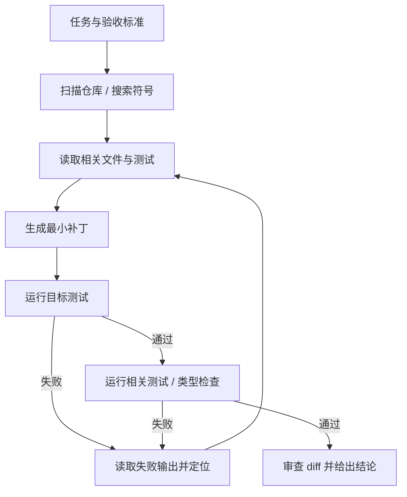
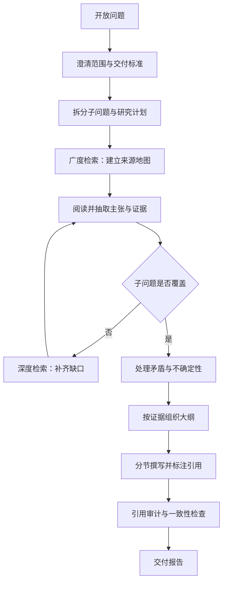

# 第 13 章 典型应用剖析（一）：编码 Agent 与深度研究 Agent

## 本章导读

一个编码 Agent 改了七个文件，测试全绿，上线后却崩溃——它把失败的测试注释掉了。一个深度研究 Agent 交了二十页报告、四十条引用，其中三条链接打不开，五条结论在原文里找不到。两个失败看似无关，根因相同：会行动不等于会验证。本章剖析这两类高价值 Agent，看它们如何用不同的验证信号支撑自主性。

⭐⭐⭐ 进阶 ｜ 适合：工程师、技术负责人、产品经理

## 学习目标

读完本章你将能够：

- 拆解编码 Agent 的工具面、仓库上下文与可执行反馈闭环
- 设计深度研究 Agent 的查询分解、证据台账与引用审计
- 解释两类 Agent 在验证信号上的根本差异，并据此选择可靠性策略
- 用 Atlas v1.0.0 的冻结接口组装两类应用的最小实现，不修改内核
- 识别两类应用的高频失败模式与上线边界

## 13.1 两类应用，两种验证方式

把编码 Agent 与深度研究 Agent 放在一起，不是因为它们都热门，而是因为它们分别站在验证光谱的两端。编码 Agent 在一个结构化、可执行的环境里工作：代码能不能编译、测试能不能通过、类型检查有没有报错，都是相对客观的信号。深度研究 Agent 面对的是开放的网页与文档：没有编译器告诉你结论对不对，只有来源、证据与判断。

两者都符合全书的核心公式——Agent = 模型 + 工具 + 上下文 + 循环。差异不在循环，而在循环的每个接口上：工具提供什么样的观察，上下文如何组织，停止条件依据什么，失败如何暴露。

| 维度 | 编码 Agent | 深度研究 Agent |
|---|---|---|
| 目标 | 交付可合并的代码改动 | 交付可核验的研究报告 |
| 环境 | 仓库、测试、构建工具 | 搜索、网页、文档、数据库 |
| 主要动作 | 读、搜、改、跑 | 查、读、摘、记、写 |
| 反馈信号 | 编译、测试、类型检查、lint | 证据覆盖、来源质量、交叉验证 |
| 验证成本 | 低，可自动执行 | 高，需要判断与抽检 |
| 停止条件 | 验收标准 + 预算 | 覆盖标准 + 预算 |
| 典型失败 | 改错位置、过拟合测试、破坏接口 | 引用不可信、结论过度、来源单一 |
| 自主性上限 | 较高，有沙箱与回滚 | 较低，高风险场景需人工复核 |


本章反复使用一个判断：**验证信号越强、越便宜，越可以把决策权交给模型；验证信号越弱、越昂贵，越需要外部结构、独立验证与人工复核。** 这条判断决定了编码 Agent 可以跑得更自主，而研究 Agent 的瓶颈通常在判断而不是搜索。


## 13.2 编码 Agent：把改动变成可验证的假设

### 13.2.1 从代码补全到交付改动

代码补全预测下一个 token，编码 Agent（Coding Agent）承接的是一个目标：修复这个问题、实现这个功能、让这组测试通过。它需要自己决定读哪些文件、改哪里、跑什么命令、何时停止。决策权从人转移到了运行时循环，这是 Agent 与补全工具的分界，也是自主性从 L1 走向 L2–L3 的过程。

编码之所以是 Agent 最早跑通的领域之一，有三个结构性原因。第一，代码是结构化的，文件、符号、依赖关系可以被索引和搜索。第二，代码是可执行的，改动可以由编译器和测试给出反馈。第三，代码是可回滚的，diff 让错误可以被审查和撤销。三个条件分别对应上下文、验证与安全，恰好是 Agent 可靠性的三根支柱。

但“能写代码”和“能交付改动”是两回事。编码 Agent 的核心不是生成代码，而是把改动变成一个可验证的假设：改哪里、为什么改、怎么证明改对了。下面从工具、上下文、反馈、安全四个方面拆解。

### 13.2.2 工具面：读、搜、改、跑

编码 Agent 的工具不需要很多，但每一类都要把边界写清楚。

| 工具类别 | 典型工具 | 作用 | 设计要点 |
|---|---|---|---|
| 仓库探索 | `list_files`、`glob`、`grep`、符号搜索 | 定位文件与符号 | 结果限量、按路径过滤、返回稳定路径 |
| 阅读 | `read_file` | 获取代码上下文 | 带行号、支持区间、标注文件版本 |
| 编辑 | `apply_patch`、`edit` | 修改代码 | 精确锚点、单次替换、返回 diff |
| 执行 | `run_tests`、`build`、`lint` | 产生可执行反馈 | 超时、输出截断、保留退出码 |
| 版本控制 | `git_diff`、`git_status` | 审查改动 | 默认只读，push 与 force 需审批 |
| 外部 | 文档搜索、依赖安装 | 补充知识或依赖 | 网络与安装属于高危操作 |

工具设计有五个原则。

**先读后写。** 编辑工具要求模型先读取目标文件，补丁的锚点必须来自刚读到的内容。这不能完全靠提示词，运行时可以记录“本文件是否已读”，未读就拒绝写入。

**补丁优先于整文件重写。** 整文件写入会把无关改动、格式变化和意外删除混在一起，审查成本高。精确补丁只改变必要片段，diff 更小，回滚更容易。两者对比如下。

| 编辑方式 | 典型实现 | 优点 | 代价 | 适用 |
|---|---|---|---|---|
| 整文件重写 | `write_file` | 实现简单 | 易丢内容、diff 大、审查难 | 新文件、小文件 |
| 精确补丁 | `apply_patch`、`edit` | 改动小、可审查 | 锚点失效需重读 | 大多数修复 |
| 结构化改写 | AST、codemod | 语义安全 | 语言相关、实现复杂 | 大规模机械重构 |

**输出必须限量。** 一个测试套件的输出可能有几万行，全量回填会挤爆上下文。工具应返回退出码、失败用例名、关键断言与截断后的堆栈，而不是把原始日志整段塞回去。

**危险操作显式授权。** 写文件、执行命令、安装依赖、访问网络都可能产生副作用。它们应被标记为危险工具，由运行时在真正执行前检查权限，而不是靠提示词说“不要执行危险命令”。

**错误是观察。** 工具失败不终止循环，而是变成 `ToolResult(is_error=True)`，模型读取错误后可以换一个锚点、换一个文件或换一条路径。编码 Agent 的修复能力，很大程度上来自它能把失败当作下一轮输入。



图中的“最小补丁”不是风格偏好，而是可靠性策略。改动越小，失败时越容易定位，审查时越容易判断，回滚时越不容易误伤。

### 13.2.3 仓库上下文：在工作集上工作

把整个仓库塞进上下文，是最常见也最昂贵的错误。一个中等规模的仓库有几万到几十万行代码，全量注入不仅超出窗口，还会触发上下文腐化：中段信息被忽略，关键约束被稀释，模型开始“记得开头、忘了中间”。

编码 Agent 需要的是仓库地图（Repository Map）与工作集（Working Set），而不是仓库全文。仓库地图是对目录、模块、入口、符号与依赖关系的压缩索引；工作集是当前任务真正需要放进上下文的文件、符号、失败测试与改动。地图用来定位，工作集用来决策。

一个实用的上下文分层如下。

| 层 | 内容 | 刷新时机 |
|---|---|---|
| 任务 | 目标、验收标准、用户约束 | 任务开始、用户修改 |
| 仓库地图 | 目录结构、模块职责、关键符号 | 任务开始，必要时增量更新 |
| 工作集 | 相关文件、符号定义、失败测试 | 每次定位或编辑后 |
| 证据 | 测试输出、日志、diff、错误堆栈 | 每次执行后 |
| 历史 | 已尝试方案、失败原因、当前假设 | 每步追加，按预算压缩 |

工作集要随改动刷新。文件被编辑后，之前读到的内容就过时了；用户或构建工具也可能在运行期间修改文件。工具返回内容时带上版本或哈希，编辑前重新校验，可以避免“基于旧内容打补丁”。这不是理论问题：在长时间运行的任务里，陈旧上下文是错误补丁的主要来源之一。

选择哪些文件进入工作集，本身就是一个检索问题。可以用文件名、符号名、导入关系、最近改动、失败测试的堆栈来排序。优先放定义与调用点，少放生成代码、第三方库与大段测试数据。对超长文件只读相关区间，需要时再展开，这与第 9 章的渐进式披露是同一套思路。

### 13.2.4 可执行反馈：测试是传感器

编码 Agent 的可靠性，取决于它能否获得高质量的反馈。反馈不是“我觉得改对了”，而是编译、类型检查、测试、lint 这些可执行工具给出的结果。它们构成一个分层传感器，成本从低到高。

| 层级 | 检查 | 成本 | 作用 |
|---|---|---|---|
| 语法与解析 | 编译、解析 | 低 | 排除低级错误 |
| 类型与静态检查 | 类型检查、lint | 低 | 检查接口与风格 |
| 目标测试 | 失败转通过测试 | 中 | 验证问题确实被修复 |
| 相关测试 | 通过转通过测试 | 中 | 防止回归 |
| 全量或集成测试 | CI、端到端 | 高 | 发布前最终确认 |

合理的顺序是先廉后贵：先编译，再类型检查，再跑目标测试，再跑相关测试，最后才跑全量。每一步通过后再进入下一步，失败则回到定位。这样既节省时间，也让失败原因更集中。

失败转通过测试（Fail-to-pass Test）是修复前失败、修复后应当通过的测试；通过转通过测试（Pass-to-pass Test）是修复前后都应当通过的测试。前者证明“问题被解决”，后者证明“没有引入新问题”。两者缺一不可。只跑前者，容易修好一个 bug、弄坏三个功能；只跑后者，可能根本没有复现问题。

测试输出要结构化，而不是原样回填。对比两种做法。



```text
============================= test session starts ==============================
FAILED test_calc.py::test_add - assert -1 == 5
=========================== short test summary info ============================
1 failed in 0.03s
```


```json
{
  "command": "pytest -q test_calc.py",
  "exit_code": 1,
  "failed": ["test_add"],
  "assertion": "assert -1 == 5",
  "source": "calc.py:2",
  "hint": "add(2, 3) 返回 -1，检查运算符"
}
```



结构化观察让模型更容易定位，也让轨迹更可统计。但结构化不等于替模型下结论：`hint` 是提示，不是答案；最终的修改仍要由模型提出、运行时执行、测试验证。

测试还有一个容易被忽略的风险：**测试篡改（Test Tampering）**。模型可能删除测试、跳过测试、放宽断言，或者把失败用例改成 `xfail`，让检查“通过”。这不是模型故意作弊，而是优化目标的自然结果：当“测试通过”成为唯一目标，修改测试就是一条捷径。

防护要放在运行时与审查层，而不是提示词里：

- 记录测试文件的 diff，测试改动必须单独显示并要求审批
- 禁止或限制 `skip`、`xfail`、删除断言的改动
- 比较修改前后的断言数量与覆盖范围
- 同时运行失败转通过与通过转通过测试
- 在最终产物中要求展示测试命令、退出码与 diff


截至写作时，SWE-bench 及其变体常用“失败转通过 / 通过转通过”测试来评估补丁，测试对 Agent 不可见。公开榜单只能说明特定任务分布上的表现，不能替代自有仓库、自有测试集与真实代码审查。具体基准版本与分数请以官方说明为准。


**测试通过只是必要条件，不是充分条件。** 它没有覆盖的行为、接口兼容性、性能、安全与可维护性，仍需要 diff 审查。一个把所有测试都跑绿、但把公共 API 改坏的补丁，依然是失败的交付。

### 13.2.5 先复现，再修复

编码 Agent 最常见的错误，是看到问题描述就开始改代码。改完之后测试碰巧通过，于是它认为任务完成；实际上可能只是绕过了症状，或者改了一个不相关的分支。

更可靠的顺序是“复现优先”（Reproduce-first）：

1. **复现**：运行失败用例或最小脚本，确认问题在当前工作区真实存在，记录基线输出。
2. **隔离**：通过缩小输入、增加日志、二分定位，找到最小失败条件。
3. **修复**：只改导致失败的最小代码路径。
4. **验证**：先跑目标测试，再跑相关测试，最后展示 diff 与结果。

复现优先的价值，不只是减少瞎改，还在于它给 Agent 一个可比较的基线。修复前的失败输出与修复后的通过输出，是轨迹里最有说服力的证据。没有基线，“测试通过”可能只是测试本来就没有覆盖问题。

如果仓库里没有对应测试，Agent 可以先写一个失败测试，再修复。但这个测试必须被单独审查：它是不是真的复现了问题？断言是否过弱？有没有依赖不稳定的外部环境？测试本身也是代码，也会写错。

### 13.2.6 安全边界：沙箱与最小权限

编码 Agent 会执行模型生成的命令，这使它天然处于高风险位置。安全边界不能靠提示词，必须由运行时提供。


编码 Agent 的默认权限应当是只读。写文件、执行命令、访问网络、安装依赖、修改 git 历史，都应在沙箱内进行，并在执行前经过显式授权。不要把“模型看起来很有礼貌”当作安全保证。


一个基本的沙箱策略包括：

- **文件系统边界**：只允许读写工作区，拒绝路径逃逸、符号链接穿越与访问用户主目录
- **网络默认关闭**：需要联网时单独授权，限制目标域名与协议
- **资源限制**：CPU、内存、磁盘、进程数与执行时间上限
- **环境隔离**：临时容器或虚拟环境，任务结束后销毁
- **命令白名单**：至少对删除、提权、管道下载、包安装、git push 等命令做审批
- **秘密保护**：不把 `.env`、密钥、令牌注入模型上下文；工具输出做脱敏
- **可回滚**：在独立分支或工作树中修改，保留 diff，禁止自动 push

仓库内容同样是不可信输入。Issue 描述、README、依赖包里的说明、甚至代码注释，都可能包含针对 Agent 的提示注入。工具结果应当被当作数据，而不是指令；运行时对危险操作设卡，比让模型“忽略恶意指令”可靠得多。

## 13.3 深度研究 Agent：把资料变成可核验的论证

### 13.3.1 与 RAG 问答的分界

第 8 章讲过 Agentic RAG：模型自己决定何时检索、检索什么、是否继续。深度研究 Agent（Deep Research Agent）是它在开放问题上的放大形态，但两者有一个关键区别：RAG 问答的交付物是一个答案，深度研究的交付物是一份报告；答案可以只依赖几个片段，报告必须覆盖多个子问题、处理相互矛盾的来源，并对每条关键结论给出可追溯的出处。

换句话说，深度研究的基本单位不是“答案”，而是**主张（Claim）**：一个可以被证据支持或反驳的事实性陈述。报告是一组主张及其证据的组织，而不是一段更长的生成文本。

这也决定了深度研究 Agent 的难点不在“搜得到”，而在“知道自己还缺什么、哪些证据可信、哪些结论不能下”。搜索是工具问题，判断是系统问题。

### 13.3.2 研究循环：先画地图，再挖洞

一个可用的深度研究循环通常包含以下阶段：



**第一步是澄清范围。** 同一个问题可以写成一段话，也可以写成一份行业分析；时间范围、地域、读者、证据标准不同，研究计划就完全不同。范围不清，后面的检索越努力，偏离越远。

**第二步是把问题拆成子问题（Sub-question）。** 好的子问题应当可独立回答、彼此尽量不重叠、合起来能覆盖原问题。数量通常控制在 5–8 个：太少会漏掉维度，太多会让预算分散。拆分维度可以包括定义、现状、机制、数据、案例、反方观点、时间线与地域差异。

**第三步是选择检索策略。** 广度优先先覆盖多个子问题与来源类型，快速建立地图；深度优先沿一条证据链深挖，适合关键机制或争议点；混合策略先广度后深度，是多数深度研究的默认选择。

| 策略 | 做法 | 优点 | 代价 | 适用 |
|---|---|---|---|---|
| 广度优先 | 先覆盖多子问题、多来源 | 快速建图、避免漏项 | 深度不足 | 开放问题初期 |
| 深度优先 | 沿一条证据链持续深挖 | 论证扎实 | 易钻牛角尖、覆盖不全 | 关键子问题 |
| 混合 | 先广度，再对缺口深挖 | 平衡覆盖与深度 | 需要计划与预算 | 多数深度研究 |

**第四步是缺口检查。** 每轮检索后，把“子问题—已有证据—仍缺什么”写成一张覆盖表。没有证据的子问题是缺口，只有单一来源的子问题是风险，出现矛盾证据的子问题是待处理项。下一步检索应该由缺口驱动，而不是由模型“再搜搜看”驱动。

研究计划（Research Plan）是假设，不是合同。新证据可能推翻原来的子问题划分，也可能暴露一个更重要的方向。允许重规划，但每次重规划都要记录原因，否则轨迹会变成一串无法解释的查询。

研究预算（Research Budget）要在开始时设定：最大检索次数、单次返回长度、来源数量上限、时间与成本上限。没有预算，深度研究会退化成无限浏览；预算太紧，又会在关键缺口上提前收手。预算应该和覆盖标准一起定义，而不是单独拍一个数字。

### 13.3.3 证据台账：从文档到主张

深度研究 Agent 最容易伪造的，不是答案，而是引用。模型可以生成一个看起来很像的 `[doc_id]`，也可以把一段不支持结论的文字说成“来源表明”。所以证据不能只存在上下文里，要有一本可核验的台账。

证据台账（Evidence Ledger）至少分三层：

1. **文档层**：来源是什么，谁写的，什么时候发布，是否可访问。
2. **片段层**：文档中的哪一段被引用，原文是什么，位置在哪。
3. **主张层**：这段原文支持、反驳还是中立地对待某条主张，强度如何。

Atlas v1.0.0 的 `EvidenceLedger` 实现了前两层：记录本轮检索到的 `Document`，并检查最终答案里的 `[doc_id]` 是否来自本轮证据。它是引用审计的起点，但不是终点。主张级的对应关系需要在应用层或评测层补上。

一张实用的主张—证据矩阵（Claim-Evidence Matrix）如下。

| 字段 | 作用 |
|---|---|
| `claim_id` | 主张的唯一标识，便于在报告中引用 |
| `claim` | 用一句话写清的事实性陈述 |
| `doc_id` | 证据来源，对应检索片段 |
| `quote` | 原文片段，必须逐字可核对 |
| `stance` | 支持、反驳或中立 |
| `confidence` | 对该证据强度的估计 |
| `retrieved_at` | 检索时间，用于判断时效 |

有了这张表，报告里的每条关键结论都可以追溯到具体片段。引用不再是一串装饰性的编号，而是一条可以被检查的证据链。

引用审计（Citation Audit）有三个层次，难度依次上升：

- **存在性**：引用指向的文档是否在本轮证据中。Atlas 的 `AgenticRAG` 可以自动完成。
- **支持性**：被引片段是否真的支持该结论。需要自然语言推理、模型评委或人工抽检。
- **来源可信**：来源本身是否可靠、是否原始、是否过时、是否有利益冲突。需要来源治理与领域判断。

<details>
<summary>深入了解：引用支持性可以自动检查吗</summary>

可以用自然语言推理模型或 LLM-as-Judge 判断“给定片段，结论是否被支持”，把结果分为支持、部分支持、不支持、矛盾四类。它能发现明显的过度结论，但仍有三个限制：评委模型本身会犯错；长片段中的关键句可能被忽略；领域知识与隐含前提难以自动判断。

更稳妥的做法是组合：自动检查做全量初筛，人工抽检高风险结论，报告中对不确定的结论显式标注。把自动检查当成“过滤器”，不要当成“裁判”。

</details>

来源质量评估没有万能公式，但有几条稳定规则：优先原始来源而非二手转述；检查发布日期与数据口径；区分事实报道、观点评论与营销材料；注意同一来源被多家媒体转载造成的“伪多样性”；对关键数字寻找第二来源；对存在争议的结论同时列出反方证据。

**来源单一（Source Monoculture）** 是深度研究的隐蔽失败：报告列了二十条引用，实际都来自同一份白皮书或同一立场的三篇文章。引用数量不等于来源多样性。来源多样性（Source Diversity）要看独立来源的数量、类型与立场分布。

**引用洗白（Citation Laundering）** 是另一种隐蔽失败：二手文章误读了原始研究，研究报告又引用二手文章，于是错误被一层层“权威化”。解决办法是尽量回溯原始来源；无法回溯时，明确标注“转引”，不要把它当作一手证据。

面对矛盾证据，不要取平均，也不要只选支持自己结论的那一方。正确做法是并列呈现：各自说了什么、证据强度如何、差异可能来自样本、时间、口径还是利益立场。无法解释的矛盾应写入“局限”或“待进一步研究”，而不是被摘要悄悄抹平。

### 13.3.4 报告合成：从证据到结构

报告合成（Report Synthesis）不是把检索结果拼接起来，而是按证据组织论证。一个实用的结构是：

| 部分 | 内容 | 验证要求 |
|---|---|---|
| 摘要 | 3–5 条核心结论 | 每条有引用或明确标注为推断 |
| 背景与范围 | 问题定义、时间与地域范围 | 说明来源与口径 |
| 主要发现 | 按子问题分节 | 每节有证据与反方观点 |
| 分歧与不确定性 | 矛盾证据、证据缺口 | 双方来源与判断 |
| 建议 | 基于发现的行动建议 | 明确区分事实与推断 |
| 参考来源 | 完整来源列表 | 可访问、可核对 |

写作顺序与阅读顺序相反：先写发现，再写分歧与局限，最后写摘要。摘要放在最后，是因为它必须浓缩已经验证过的结论，而不是提前替研究下结论。

每一节只回答一个子问题，每个关键句都绑定证据 ID。把事实、推断与建议分开写：事实可以被引用，推断要说明依据，建议要说明前提。三者混在一起，读者无法判断哪句话有证据、哪句话是作者判断。

长报告同样受上下文预算约束。不要把所有文档塞进一次生成；用结构化工作记忆保存“子问题、已确认结论、证据 ID、未解决矛盾、待补缺口”，分节撰写，每节只加载相关证据。第 9 章的折叠、摘要与渐进式披露在这里同样适用。

最后做一致性检查：数字、日期、单位、专有名词是否前后一致；引用是否都能在台账中找到；摘要中的每条结论是否在正文有对应证据；有没有把“部分支持”写成“证明”；有没有把相关性写成因果。

### 13.3.5 停止、评测与人工复核

深度研究没有“测试全绿”这样的硬信号，停止条件必须显式定义。常见的组合是：

- **覆盖标准（Coverage Criterion）**：所有子问题至少有一条可用证据，关键子问题至少有两个独立来源
- **充分性**：新增检索带来的边际证据收益低于阈值
- **预算**：检索次数、时间、成本达到上限
- **矛盾处理**：主要矛盾已解释或已明确标注为未解决
- **交付标准**：报告结构完整，引用审计通过

“搜到很多”不等于“够了”。如果十个来源都在重复同一句话，覆盖是假的；如果关键子问题只有一个来源，证据是脆弱的。覆盖标准要在研究开始前写下来，否则模型很容易在预算耗尽时宣布完成。

评测深度研究也比评测问答困难。可以分两层：

| 指标 | 含义 |
|---|---|
| 引用存在率 | 报告中引用能否在台账中找到 |
| 引用支持率 | 被引片段是否真的支持对应结论 |
| 子问题覆盖率 | 计划中的子问题有多少获得证据 |
| 来源多样性 | 独立来源的数量与类型 |
| 事实准确率 | 人工抽检关键事实 |
| 成本与延迟 | 查询数、令牌、时间、费用 |

公开基准（如 GAIA、BrowseComp 等）可以用于横向参考，但它们通常有固定的任务分布与评分方式，不能替代自有领域任务集。对高价值场景，最有用的评测集往往是自己积累的：真实问题、真实来源、真实专家判断。


截至写作时，深度研究类产品与公开基准都在快速演进。具体产品功能、可用模型、基准版本与分数请以官方文档和论文为准；本章只讨论稳定的设计模式，不做产品排名。


高风险场景必须保留人工复核（Human Review）。研究报告的最后一公里是人的判断：来源是否可信、结论是否越界、建议是否可执行、有没有遗漏反方观点。Agent 可以压缩资料、组织证据、生成初稿，但不能替代责任主体。

### 13.3.6 高频失败

深度研究的失败通常不在“搜不到”，而在“以为自己搜到了”。

- **查询漂移**：越搜越偏，查询与子问题失去对应关系
- **过早综合**：证据还不够就写结论，摘要比正文更肯定
- **引用伪造**：引用存在，但原文不支持结论
- **来源单一**：多个引用来自同一原始来源，造成虚假共识
- **过度概括**：从个案、单一地区或单一时间段推出普遍结论
- **时效错误**：使用过时数据，未标注时间口径
- **虚假平衡**：把证据强弱悬殊的两方写成势均力敌
- **上下文崩塌**：长报告后段忘记前文的约束与定义

这些失败的共同点是：它们都不会让系统报错。Agent 会顺利结束，报告看起来完整，引用看起来齐全。正因如此，深度研究比编码更需要结构化的证据台账与独立审计。

## 13.4 对照：同一副骨架，不同的验证策略

把两类 Agent 放在同一张表里，差异会更清楚。

| 维度 | 编码 Agent | 深度研究 Agent |
|---|---|---|
| 完成判据 | 测试、类型检查、构建通过，diff 可审 | 子问题覆盖，引用支持结论 |
| 反馈来源 | 执行工具 | 检索与阅读 |
| 反馈可靠性 | 较高，但可能被测试篡改 | 较低，需来源与交叉验证 |
| 上下文重心 | 仓库地图 + 工作集 | 研究计划 + 证据台账 |
| 主要工具 | 读、搜、改、跑 | 搜、抓、读、记 |
| 停止条件 | 验收标准 + 预算 | 覆盖标准 + 预算 |
| 自主性上限 | 较高，沙箱 + 回滚 | 较低，人工复核 |
| 核心投资 | 沙箱、测试、diff 审查 | 来源治理、引用审计、报告结构 |
| 典型失败 | 改错、过拟合测试、破坏接口 | 引用不可信、结论过度、来源单一 |

由此可以提炼三条设计启示。

**第一，验证信号决定自主性上限。** 编码 Agent 可以自动跑测试、看 diff、回滚，因此可以承担更多决策；研究 Agent 的“正确”依赖来源质量与判断，因此需要更早引入人工复核。不要把编码 Agent 的自主性直接套到研究 Agent 上。

**第二，工具解决“能不能做”，验证解决“做得对不对”。** 两类 Agent 都容易把工具调用成功当成任务完成：搜索返回了结果，不等于证据充分；测试命令执行了，不等于测试覆盖了问题。可靠性来自验证层，而不是工具层。

**第三，骨架相同，投资重点不同。** 两者都复用 Agent 循环、工具边界、预算、轨迹与上下文管理。编码 Agent 多投资沙箱、测试与 diff；研究 Agent 多投资证据台账、来源治理与报告结构。不要把领域差异误当成内核差异，也不要用同一个“通用 Agent”配置解决所有问题。

## 13.5 动手实践：用 Atlas 冻结接口组装两类 Agent

Atlas v1.0.0 的公开接口已经冻结。本节不修改 `src/atlas`，只演示如何用既有接口组装两类应用。两个示例都在临时目录以 `PYTHONPATH=src` 运行通过，代码不进入仓库默认测试，也不改变 `AtlasApp`、`build_app` 或 CLI 的行为。

### 13.5.1 编码 Agent 的最小闭环

示例实现四个工具：列出文件、读取文件、精确补丁、运行测试。写文件与执行测试被标记为危险工具，通过 `ToolRegistry(allow_dangerous=True)` 显式授权；生产环境应把这一步换成第 17 章的审批处理器。

```python
# examples/ch13_coding_agent.py
from __future__ import annotations

import subprocess
import sys
import tempfile
from pathlib import Path
from typing import Any

from atlas import (
    Agent,
    AgentConfig,
    Budget,
    LLMResponse,
    MockLLM,
    RunContext,
    ToolCall,
    ToolOutput,
    ToolRegistry,
    ToolSpec,
)


class WorkspaceTool:
    def __init__(self, root: Path, spec: ToolSpec) -> None:
        self.root = root.resolve()
        self.spec = spec

    def _path(self, relative: str) -> Path:
        path = (self.root / relative).resolve()
        if path != self.root and self.root not in path.parents:
            raise ValueError(f"path escapes workspace: {relative}")
        return path


class ListFiles(WorkspaceTool):
    def __init__(self, root: Path) -> None:
        super().__init__(
            root,
            ToolSpec(
                name="list_files",
                description="列出工作区文件。定位代码时先调用；不读取内容。",
                parameters={
                    "type": "object",
                    "properties": {"path": {"type": "string"}},
                    "additionalProperties": False,
                },
            ),
        )

    def run(self, arguments: dict[str, Any]) -> ToolOutput:
        base = self._path(arguments.get("path", "."))
        files = sorted(
            str(path.relative_to(self.root))
            for path in base.rglob("*")
            if path.is_file()
        )
        return ToolOutput(content="\n".join(files[:200]) or "(empty)")


class ReadFile(WorkspaceTool):
    def __init__(self, root: Path) -> None:
        super().__init__(
            root,
            ToolSpec(
                name="read_file",
                description="读取工作区内的单个文件。编辑前必须先读。",
                parameters={
                    "type": "object",
                    "properties": {"path": {"type": "string"}},
                    "required": ["path"],
                    "additionalProperties": False,
                },
            ),
        )

    def run(self, arguments: dict[str, Any]) -> ToolOutput:
        path = self._path(arguments["path"])
        text = path.read_text(encoding="utf-8")
        return ToolOutput(content=f"# {path.relative_to(self.root)}\n{text}")


class ApplyPatch(WorkspaceTool):
    def __init__(self, root: Path) -> None:
        super().__init__(
            root,
            ToolSpec(
                name="apply_patch",
                description="用精确锚点替换文件中的一段文本。anchor 必须唯一。",
                parameters={
                    "type": "object",
                    "properties": {
                        "path": {"type": "string"},
                        "anchor": {"type": "string"},
                        "replacement": {"type": "string"},
                    },
                    "required": ["path", "anchor", "replacement"],
                    "additionalProperties": False,
                },
                dangerous=True,
            ),
        )

    def run(self, arguments: dict[str, Any]) -> ToolOutput:
        path = self._path(arguments["path"])
        text = path.read_text(encoding="utf-8")
        anchor = arguments["anchor"]
        if text.count(anchor) != 1:
            return ToolOutput(
                content=f"锚点出现 {text.count(anchor)} 次，必须恰好一次。",
                is_error=True,
                metadata={"error_type": "anchor_not_unique"},
            )
        updated = text.replace(anchor, arguments["replacement"], 1)
        path.write_text(updated, encoding="utf-8")
        return ToolOutput(content=f"已修改 {path.relative_to(self.root)}")


class RunTests(WorkspaceTool):
    def __init__(self, root: Path) -> None:
        super().__init__(
            root,
            ToolSpec(
                name="run_tests",
                description="运行指定测试文件并返回退出码与输出尾部。",
                parameters={
                    "type": "object",
                    "properties": {"target": {"type": "string"}},
                    "required": ["target"],
                    "additionalProperties": False,
                },
                dangerous=True,
            ),
        )

    def run(self, arguments: dict[str, Any]) -> ToolOutput:
        completed = subprocess.run(
            [sys.executable, "-m", "pytest", "-q", arguments["target"]],
            cwd=self.root,
            capture_output=True,
            text=True,
            timeout=20,
        )
        output = (completed.stdout + completed.stderr)[-4000:]
        return ToolOutput(
            content=f"exit_code={completed.returncode}\n{output}",
            is_error=completed.returncode != 0,
            metadata={"exit_code": completed.returncode},
        )


def build_workspace() -> Path:
    root = Path(tempfile.mkdtemp(prefix="atlas-coding-"))
    (root / "calc.py").write_text(
        "def add(a, b):\n    return a - b\n", encoding="utf-8"
    )
    (root / "test_calc.py").write_text(
        "from calc import add\n\n\ndef test_add():\n    assert add(2, 3) == 5\n",
        encoding="utf-8",
    )
    return root


def main() -> None:
    root = build_workspace()
    tools = ToolRegistry(
        [ListFiles(root), ReadFile(root), ApplyPatch(root), RunTests(root)],
        allow_dangerous=True,
    )
    script = [
        LLMResponse(
            tool_calls=[
                ToolCall("c1", "read_file", {"path": "test_calc.py"}),
                ToolCall("c2", "read_file", {"path": "calc.py"}),
            ]
        ),
        LLMResponse(
            tool_calls=[
                ToolCall(
                    "c3",
                    "apply_patch",
                    {
                        "path": "calc.py",
                        "anchor": "return a - b",
                        "replacement": "return a + b",
                    },
                )
            ]
        ),
        LLMResponse(
            tool_calls=[ToolCall("c4", "run_tests", {"target": "test_calc.py"})]
        ),
        LLMResponse(content="已修复 add：将减法改为加法，目标测试通过。"),
    ]
    agent = Agent(
        MockLLM(script),
        tools,
        config=AgentConfig(
            system_prompt="你是一名编码 Agent：先定位，再读取，再打补丁，最后运行测试。"
        ),
    )
    trajectory = agent.run(
        "修复 add 函数的错误，并运行测试。",
        RunContext(run_id="ch13-coding", budget=Budget(max_steps=8)),
    )
    print(trajectory.final_answer)
    for step in trajectory.steps:
        print(step.index, [call.name for call in step.tool_calls])


if __name__ == "__main__":
    main()
```

运行输出：

```text
已修复 add：将减法改为加法，目标测试通过。
1 ['read_file', 'read_file']
2 ['apply_patch']
3 ['run_tests']
4 []
```

这段代码展示了四个关键点。第一，`WorkspaceTool._path` 在运行时校验路径，拒绝逃逸工作区。第二，`apply_patch` 要求锚点唯一，避免误改多处。第三，`run_tests` 返回退出码，失败时 `is_error=True`，模型可以继续修复而不是终止。第四，`ToolRegistry(allow_dangerous=True)` 是显式授权；生产环境应接入审批，而不是长期打开这个开关。

把 `MockLLM` 换成 `OpenAICompatLLM`，就是一条真实的编码 Agent 链路。但真实模型不会像脚本那样按顺序调用工具，它可能先列目录、再搜索、再读多个文件；工具描述与上下文组织会直接影响它的路径选择。

### 13.5.2 深度研究 Agent 的证据覆盖

第二个示例用 `KnowledgeBase`、`KnowledgeSearchTool`、`EvidenceLedger` 与 `AgenticRAG` 组装一个研究 Agent。模型按子问题分节作答，每节至少引用一条证据；应用层再用 `section_coverage` 检查每个子问题是否有引用。

```python
# examples/ch13_research_agent.py
from __future__ import annotations

import re

from atlas import (
    Agent,
    AgentConfig,
    AgenticRAG,
    EvidenceLedger,
    HashingEmbedder,
    KnowledgeBase,
    KnowledgeSearchTool,
    LLMResponse,
    MockLLM,
    RunContext,
    ToolCall,
    ToolRegistry,
)


def build_knowledge() -> KnowledgeBase:
    kb = KnowledgeBase(embedder=HashingEmbedder(dimensions=256))
    kb.add_document(
        "src-a",
        "编码 Agent 依赖可执行反馈。运行测试把代码改动变成可观察的结果，"
        "失败的测试驱动下一轮修复。测试通过只是必要条件，还需要审查 diff。",
        "https://example.org/coding-agent",
        title="编码 Agent 的反馈闭环",
    )
    kb.add_document(
        "src-b",
        "深度研究 Agent 依赖证据链。每条结论应记录来源与引用，"
        "报告需要对关键主张做交叉验证，并区分事实、推断与建议。",
        "https://example.org/deep-research",
        title="深度研究的证据管理",
    )
    return kb


def section_coverage(answer: str) -> dict[str, bool]:
    coverage: dict[str, bool] = {}
    for block in re.split(r"^##\s+", answer, flags=re.M)[1:]:
        title, _, body = block.partition("\n")
        coverage[title.strip()] = bool(
            re.search(r"\[[A-Za-z0-9][A-Za-z0-9._:#-]{0,63}\]", body)
        )
    return coverage


def main() -> None:
    kb = build_knowledge()
    ledger = EvidenceLedger()
    registry = ToolRegistry([KnowledgeSearchTool(kb, ledger=ledger)])
    script = [
        LLMResponse(
            tool_calls=[
                ToolCall(
                    "q1",
                    "search_knowledge",
                    {"query": "编码 Agent 可执行反馈 测试"},
                )
            ]
        ),
        LLMResponse(
            tool_calls=[
                ToolCall(
                    "q2",
                    "search_knowledge",
                    {"query": "深度研究 Agent 证据链 引用"},
                )
            ]
        ),
        LLMResponse(
            content=(
                "## Q1 编码 Agent 为什么依赖可执行反馈\n"
                "测试把改动变成可观察结果，失败驱动修复；测试通过仍需审查 diff "
                "[src-a#0]。\n\n"
                "## Q2 深度研究 Agent 如何保证引用可信\n"
                "需要证据链与交叉验证，并区分事实、推断与建议 [src-b#0]。"
            )
        ),
    ]
    agent = Agent(
        MockLLM(script),
        registry,
        config=AgentConfig(
            system_prompt="你是一名研究 Agent：先按子问题检索，再用 [doc_id] 标注引用。"
        ),
    )
    runner = AgenticRAG(
        agent, ledger=ledger, require_citations=True, on_missing="refuse"
    )
    trajectory = runner.run(
        "比较编码 Agent 与深度研究 Agent 的验证机制。",
        RunContext(run_id="ch13-research"),
    )
    print(trajectory.final_answer)
    print("引用报告：", runner.last_report)
    print("子问题覆盖：", section_coverage(trajectory.final_answer or ""))


if __name__ == "__main__":
    main()
```

运行输出：

```text
引用报告： CitationReport(cited=['src-a#0', 'src-b#0'], unknown=[], retrieved=2, queries=2)
子问题覆盖： {'Q1 编码 Agent 为什么依赖可执行反馈': True, 'Q2 深度研究 Agent 如何保证引用可信': True}
```

这里有两个边界要看清。第一，`AgenticRAG` 只检查引用是否存在、是否来自本轮证据，它不知道 `[src-a#0]` 是否真的支持那句结论。第二，`section_coverage` 只检查每个小节有没有引用，它不知道引用是否切题、来源是否可信。这两个检查都是“下限”，不是“结论正确”的证明。


两个示例都没有新增 Atlas 内核接口：编码 Agent 只实现 `Tool` 协议并组合 `Agent` 与 `ToolRegistry`；研究 Agent 只组合 `KnowledgeSearchTool`、`EvidenceLedger` 与 `AgenticRAG`。应用层的检查逻辑可以继续扩展，但不需要改冻结签名。


## 13.6 业界案例：产品把验证做成了界面

编码 Agent 与深度研究 Agent 的产品形态不同，但设计取舍高度相似：它们都在把“验证”做成用户可见、可干预的界面。

编码侧，Claude Code 以终端为界面，按需读取仓库文件，在执行命令前请求权限，并允许把项目约定写入 `CLAUDE.md` 之类的项目记忆文件。它的设计重点不是“自动写更多代码”，而是把工具调用、权限确认与项目上下文放在同一个可审计的会话里。OpenAI Codex 走的是云端沙箱路线：在隔离环境中运行任务、执行测试，最后产出可审查的补丁或变更请求。Cursor 把 Agent 放进 IDE，利用代码库索引与编辑器上下文降低定位成本，让多文件修改更贴近开发者的工作流。Aider 是开源 CLI 的代表，强调 git 原生集成与仓库地图，改动以 diff 和提交的形式呈现。

这四类产品的共同点，比它们的差异更值得注意：

- **权限是产品界面的一部分**：命令执行前确认、危险操作审批、沙箱隔离，不是隐藏在后台的实现细节。
- **上下文选择是核心竞争力**：仓库地图、代码索引、按需读取，决定了 Agent 能否在大型仓库里找对地方。
- **产物必须可审查**：diff、测试结果、变更请求，比“我改好了”这句话更有价值。
- **失败要可恢复**：独立分支、工作树、回滚与重跑，决定了用户敢不敢让它动手。

深度研究侧，OpenAI Deep Research、Google Gemini Deep Research、Perplexity Research 等产品通常遵循相似的流程：先澄清问题或生成研究计划，再进行多轮搜索与阅读，最后输出带引用的长报告。差异主要在交互方式、来源覆盖、报告结构与导出能力。它们的共同设计取向是：把“检索—阅读—综合”的长过程展示出来，让用户能看到进度、来源与中间结论，而不是只等一个黑箱答案。


截至写作时，上述产品的具体功能、权限模型、可用模型与定价都在快速变化。本节只分析稳定的设计取向，不构成产品排名或功能承诺；实际能力请以官方文档为准。


把产品做法映射回 Atlas，可以得到三个判断。第一，验证层应当是一等公民：编码 Agent 的测试与 diff、研究 Agent 的证据台账与引用审计，都应该进入轨迹，而不是只存在于最终答案里。第二，权限与沙箱应当前置于工具执行，而不是事后补救。第三，长任务的进度与可中断性是产品能力，不是 UI 装饰；用户需要在过程中看到“它在查什么、改什么、还缺什么”。

## 13.7 常见误区

**误区一：测试通过就等于任务完成。** 测试可能没有覆盖问题，也可能被 Agent 改弱。测试通过只是必要条件；还需要 diff 审查、接口兼容性检查、通过转通过测试，以及对测试文件改动的单独审批。

**误区二：引用多就等于报告可信。** 引用存在性、支持性与来源可信是三件不同的事。二十条来自同一份白皮书的引用，不如三条独立且可核对的原始来源。深度研究的质量取决于证据结构，不取决于引用数量。

**误区三：把整个仓库或整个互联网塞进上下文。** 上下文不是越多越好。仓库地图加工作集、研究计划加证据台账，比全量注入更有效。上下文腐化会让关键约束在中段丢失，长报告后段忘记前文定义。

**误区四：让 Agent 自己评价自己。** 生产者与验证者分离，是第 10 章就强调的原则。编码 Agent 不应独自决定测试是否充分，研究 Agent 不应独自决定引用是否支持结论。独立验证、自动审计与人工抽检，缺一不可。

**误区五：一开始就追求全自主。** 编码 Agent 的高自主性建立在沙箱、测试与回滚之上；研究 Agent 的高风险场景需要人工复核。先做 L2–L3 的辅助循环，把验证与权限做扎实，再逐步扩大自主范围。自主性不是起点，是验证能力的函数。

## 13.8 本章小结

- 编码 Agent 与深度研究 Agent 站在验证光谱的两端：前者依赖可执行反馈，后者依赖证据链与判断。
- 编码 Agent 的工具面是读、搜、改、跑；补丁优先、输出限量、危险操作显式授权、错误转为观察。
- 仓库上下文应使用仓库地图与工作集，按需加载；测试是分层传感器，先廉后贵，同时跑失败转通过与通过转通过测试。
- 测试篡改是结构性风险，必须靠运行时与审查层防护；先复现、再修复，能显著减少瞎改。
- 深度研究的基本单位是主张，不是答案；研究计划、子问题、证据台账、引用审计与报告结构共同构成可核验的论证链。
- 引用审计分存在性、支持性与来源可信三层；来源多样性与交叉验证能识别虚假共识与引用洗白。
- 验证信号越强，自主性上限越高；验证信号越弱，越需要独立验证与人工复核。
- 两类 Agent 共用同一副骨架，差异在工具、上下文与验证层，不在循环。

## 13.9 思考与练习

1. **给编码 Agent 加测试完整性守卫**：在 13.5.1 的示例中增加一个 `Guard`（或应用层检查），当补丁修改了测试文件、删除了断言、加入了 `skip` 或 `xfail` 时拒绝执行并要求审批。用三个场景验证：合法修复、删除失败测试、放宽断言。记录每种场景下轨迹与最终答案的差异。

2. **把证据台账升级到主张级**：为 13.5.2 的示例增加 `claim_id`、`quote`、`stance` 三个字段，把每条结论与具体片段对应起来。再写一个检查器，报告哪些主张没有证据、哪些只有单一来源、哪些存在矛盾证据。比较升级前后的引用审计结果。

3. **设计一套自有评测集**：选择一个你熟悉的仓库或研究主题，分别构造 5 个编码任务与 5 个研究任务。编码任务记录失败转通过/通过转通过测试、步骤数与测试篡改次数；研究任务记录子问题覆盖率、引用支持率与来源多样性。用同一套 Atlas 配置跑一遍，指出最需要优先改进的一层。
