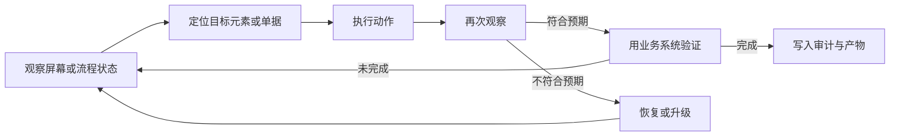
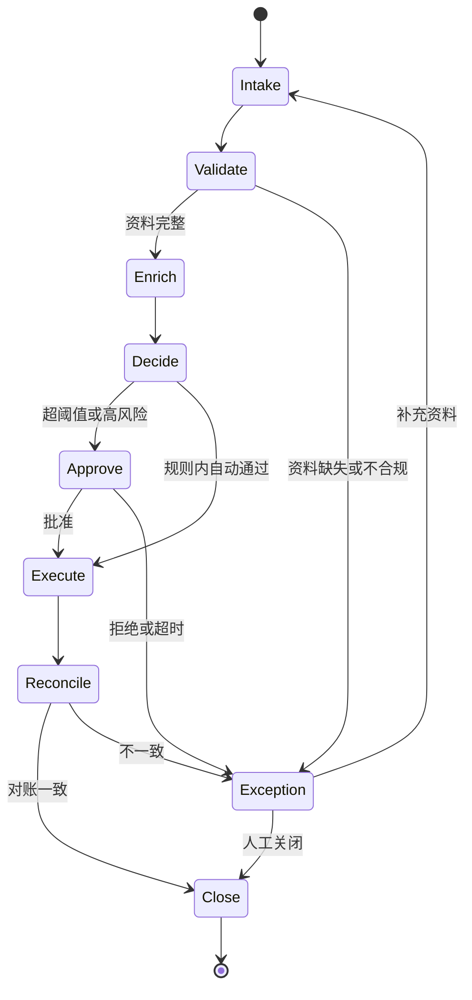
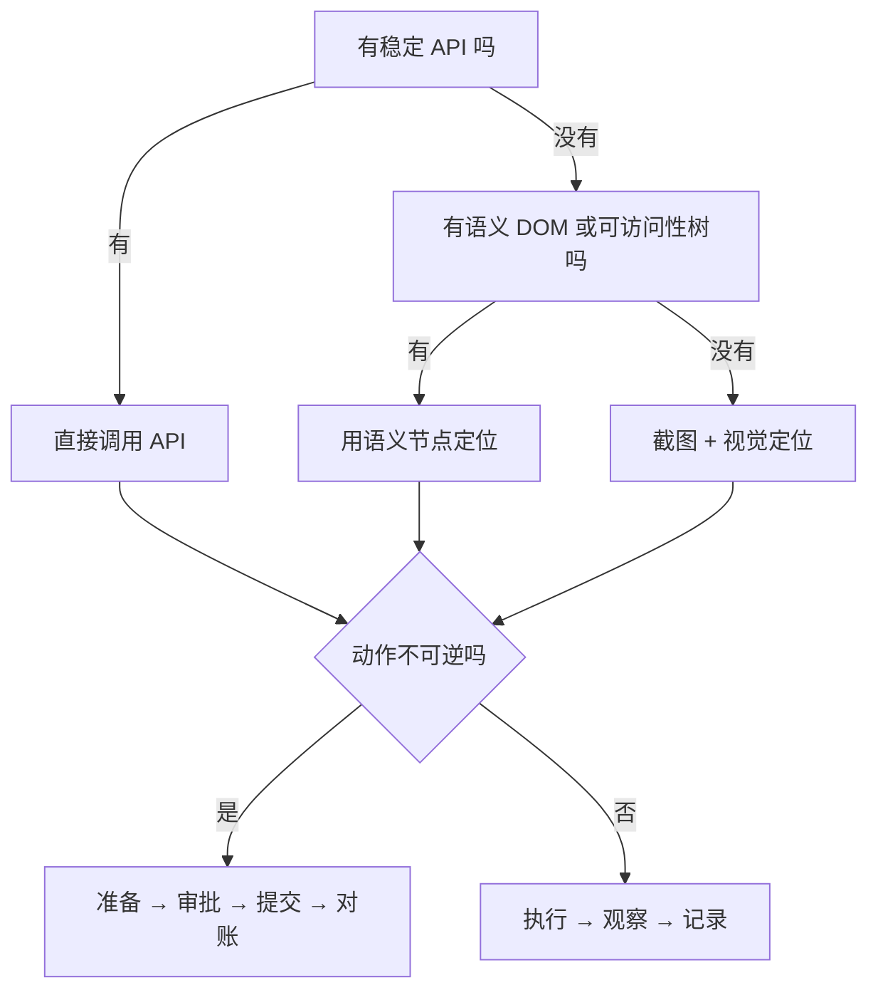

# 第 14 章 典型应用剖析（二）：Computer Use 与企业流程 Agent

## 本章导读

一个浏览器 Agent 在报销系统里连续点了两次“提交”，因为它把网络超时当成了失败；另一个退款 Agent 在金额超过阈值时直接执行，因为“批准”按钮就在页面上。两个事故都不是模型不会操作，而是系统没有把不可逆动作当成一等公民。本章讨论 Computer Use 与企业流程 Agent：当动作空间从代码与文档扩展到屏幕与业务系统，如何观察、如何确认、如何恢复，以及为什么“能点按钮”不等于“能完成流程”。

⭐⭐⭐ 进阶 ｜ 适合：工程师、技术负责人、产品经理

## 学习目标

读完本章你将能够：

- 拆解 Computer Use 的观察、定位、动作、验证与恢复闭环
- 比较截图、DOM、可访问性树三种观察接口的覆盖、语义与成本
- 设计企业流程 Agent 的“工作流外壳 + Agent 核心”架构
- 用审批、幂等、补偿、对账与审计约束不可逆副作用
- 用 Atlas v1.0.0 的冻结接口组装两个可运行的最小实现

## 14.1 两类开放动作空间

第 13 章的编码与研究 Agent 虽然验证方式不同，但都在一个相对“可读”的环境里工作：代码有结构，文档有来源。本章的两类应用把动作空间推到了更开放、更不可控的地方。计算机使用（Computer Use）面对的是图形界面：屏幕上的像素、控件、弹窗与焦点，既是观察对象，也是操作对象。企业流程 Agent 面对的是业务系统与组织规则：订单、退款、审批、对账，每一步都对应真实的钱、责任与合规记录。

两者看似相距很远，约束却高度一致：

- **观察不完整**：屏幕只显示当前视口，流程只暴露当前状态；看不到的部分不代表不存在。
- **定位不确定**：一个“提交”按钮可能有多个，一个“退款”可能对应多张单据，模型需要把自然语言目标落到具体对象上。
- **验证滞后**：点击成功不等于业务成功，接口返回成功也可能只是“已受理”。
- **副作用不可逆**：转账、退款、发消息、删数据，做错了不能靠“再点一次”撤销。

和前三类应用放在一起，差异更清楚。

| 维度 | 编码 Agent | 深度研究 Agent | Computer Use | 企业流程 Agent |
|---|---|---|---|---|
| 环境 | 仓库、测试、构建工具 | 网页、文档、数据库 | 桌面、浏览器、跨应用界面 | 业务系统、组织流程 |
| 观察 | 文件、符号、测试输出 | 文档、片段、引用 | 截图、DOM、可访问性树 | 接口、数据库、案件状态 |
| 动作 | 读写代码、跑测试 | 检索、阅读、写作 | 点击、输入、滚动、拖拽 | 调用接口、审批、退款 |
| 验证 | 编译、测试、diff | 证据、引用、交叉验证 | 状态断言、业务系统 | 对账、审计、规则校验 |
| 可逆性 | 高，可回滚 | 高，草稿可重写 | 中低，表单提交可能生效 | 低，涉及资金与合规 |
| 自主性上限 | 较高 | 中 | 中低 | 低到中，受审批门约束 |
| 典型失败 | 改错位置、过拟合测试 | 引用不可信、结论过度 | 误点、旧引用、页面遮挡 | 重复执行、越权、漏审批 |

这四类应用共用同一个循环：观察、定位、动作、再观察、验证、恢复。差别不在循环结构，而在每个接口的可靠性与代价。




本章反复使用一条判断：**可观测性决定能不能验证，可逆性决定敢不敢自动执行，责任边界决定谁签字。** 三者共同决定自主性上限。Computer Use 的可观测性差、可逆性中等，所以需要确认与接管；企业流程的可逆性最低，所以审批与幂等不是可选项。


## 14.2 Computer Use：在屏幕与控件之间建立闭环

### 14.2.1 从 RPA 到 Computer Use

**计算机使用（Computer Use）**指 Agent 通过屏幕观察与鼠标键盘动作操作图形界面，跨应用完成任务。**浏览器使用（Browser Use）**是它的网页子集：Agent 在浏览器中导航、填表、点击，但通常通过浏览器自动化接口获得 DOM、网络事件与可访问性树，不必完全依赖像素。两者都属于更广义的 GUI Agent。

它们与机器人流程自动化（Robotic Process Automation，RPA）的区别，不在“会不会点”，而在“谁来定位”。

| 方式 | 决策来源 | 优点 | 代价 | 适用场景 |
|---|---|---|---|---|
| API 集成 | 预定义接口与参数 | 稳定、快、可测试、可幂等 | 需要系统开放接口与权限 | 高频、规则明确的核心流程 |
| RPA | 录制脚本、选择器、固定坐标 | 确定性、成本低、易审计 | 界面一变就断，异常处理弱 | 界面稳定、重复度高的流程 |
| Computer Use | 模型在运行时观察并定位 | 覆盖长尾、跨应用、无需接口 | 慢、贵、结果不确定 | 低频、界面多变、无 API 的任务 |
| Browser Use | DOM/可访问性树 + 模型 | 比像素稳，能读网络与结构 | 受浏览器与站点限制 | 网页表单、后台操作、信息采集 |

这里有一条工程原则：**能用 API 就不要点按钮；必须点按钮时，优先语义节点，最后才是坐标。** 这不是对 Computer Use 的否定，而是对成本的排序。API 调用一次可能只要几十毫秒、可重试、可幂等；屏幕操作要截图、推理、定位、点击、再验证，任何一步都可能出错。Computer Use 的价值是填补长尾，而不是替代所有集成方式。

通用性是用可靠性换来的。RPA 在界面稳定时几乎不会“看错”，但界面一改就整体失效；Computer Use 能适应界面变化，却可能在两个相似的按钮之间选错。理解这个交换，才能决定什么任务可以交给它。

### 14.2.2 观察接口：截图、DOM、可访问性树

Agent 的第一步不是“看”，而是“决定怎么看”。三种常见观察接口各有取舍。

| 接口 | 覆盖范围 | 语义信息 | 稳定性 | Token 与延迟 | 典型失败 |
|---|---|---|---|---|---|
| 截图 | 最广，任何可见界面 | 无，需要视觉模型理解 | 中，受分辨率与遮挡影响 | 高 | 坐标漂移、弹窗遮挡、文字过小 |
| DOM | 网页与部分 Web 应用 | 中高，有标签、文本、属性 | 中，受动态渲染影响 | 高，节点树可能很大 | 动态节点、Shadow DOM、Canvas |
| 可访问性树 | 桌面与多数网页 | 高，有角色、名称、状态、值 | 较高，按语义暴露 | 低到中 | 控件未标注、角色缺失、树不完整 |
| 混合观察 | 最广 | 高 | 高 | 中高 | 多源不一致、对齐错误 |

三种接口看到的不是同一件事：



```text
viewport=1440x900 dpr=2
[1] bbox=(120,240,80,32) label="查询"
[2] bbox=(120,300,80,32) label="提交"
```


```json
{
  "tag": "button",
  "text": "提交",
  "selector": "#invoice-submit",
  "disabled": false,
  "visible": true
}
```


```text
[4] role=button name=提交 enabled=true focused=false
[5] role=textbox name=发票号码 value=INV-2026-001
```



截图最通用，也最昂贵。它不依赖页面结构，任何画在屏幕上的东西都能看到；代价是模型必须从像素中推断“哪里可以点、这个按钮是否可用”，还要处理缩放、分辨率、遮挡与滚动。截图适合兜底，不适合作为唯一观察方式。

DOM 是网页的结构化表示，能直接拿到标签、文本、属性与选择器。它比像素精确，但节点树可能非常庞大，动态渲染会让引用很快失效。Shadow DOM、Canvas、跨域 iframe 还会让部分内容不可见。DOM 适合结构稳定的网页，不适合把整棵树直接塞进上下文。

可访问性树（accessibility tree）位于两者之间：它按“角色、名称、状态、值”描述界面，信息密度高，接近人类对控件的理解。对桌面应用和遵循无障碍规范的网页，它通常是最好的观察接口；但它依赖应用正确标注，未标注的自绘控件可能完全缺失。

实践中常用混合观察：截图提供全局布局，可访问性树提供语义节点，DOM 提供精确选择器，再附上 URL、标题、焦点元素与网络状态。关键不是收集更多信息，而是让每种信息各司其职。

<details>
<summary>为什么观察要带版本号或状态哈希</summary>

Agent 很容易犯一个错误：在第一步观察到“提交”按钮的引用是 `[4]`，经过几步操作后仍然拿 `[4]` 去点击。此时页面可能已经跳转、弹窗可能已经改变布局，`[4]` 要么指向了别的元素，要么根本不存在。

解决办法不是让模型“记住要小心”，而是让观察自带新鲜度标记：

- 每次观察返回一个页面版本号、DOM 快照哈希或时间戳；
- 动作携带观察时的版本号，运行时不匹配就拒绝执行；
- 页面发生导航、提交、弹窗等状态变化后，旧引用立即失效；
- 模型收到“观察已过期”的错误后重新观察，而不是盲目重试。

这把“引用是否新鲜”从提示词约束变成了运行时事实。模型可以犯错，但错误会以可恢复的观察返回，而不是变成一次误点。

</details>

### 14.2.3 定位与动作：从坐标到语义节点

观察之后，Agent 要把“提交这张发票”落到一个具体动作上。定位方式决定了系统的稳定性。

| 定位方式 | 例子 | 优点 | 代价 |
|---|---|---|---|
| 坐标 | `click(640, 480)` | 通用，任何界面都能用 | 分辨率、缩放、滚动一变就错 |
| 选择器 | `click("#invoice-submit")` | 精确、快、易调试 | 前端改动或动态 ID 会失效 |
| 语义节点 | `click(role=button, name=提交)` | 可读、较稳、接近人类理解 | 重名时歧义，需要可访问性树 |
| 视觉定位 | 找“提交”按钮的边界框 | 覆盖无结构界面 | 慢，可能误识别相似控件 |
| 接口直调 | `POST /invoices/{id}/submit` | 最稳、可幂等、可审计 | 需要接口与权限 |

定位的难点通常不是“找不到”，而是“找到多个”。页面上可能同时有“提交”“提交并关闭”“保存草稿”，它们的名称都包含“提交”；也可能有一个被遮挡的按钮和一个真正可点的按钮。运行时应当在点击前检查目标的状态：是否可见、是否可用、是否被弹窗覆盖、是否在预期容器内。只检查“元素存在”不够。

动作空间本身并不复杂：点击、双击、右键、输入、按键、滚动、拖拽、上传、导航、等待。复杂的是动作之间的依赖与副作用：

- 点击输入框后，焦点是否真的转移；
- 输入是否触发了自动补全或校验；
- 点击“查询”后，结果是同步返回还是异步加载；
- 点击“提交”后，是立即生效、进入审批，还是仅仅受理。

**动作的原子性不由 API 决定，而由后置条件决定。** “点击提交”不是一个原子动作，因为它的真正后置条件是“业务记录状态发生变化”。如果这一点没有验证，点击成功就只是界面成功。

### 14.2.4 验证：没有编译器时怎么知道点对了

编码 Agent 有编译器和测试，Computer Use 没有。它必须自己构造验证信号。按强度排序，常见信号如下。

| 层级 | 信号 | 强度 | 成本 | 说明 |
|---|---|---|---|---|
| 业务系统 | 订单状态、数据库记录、接口回读 | 最强 | 低到中 | 真相来源，优先使用 |
| 页面状态 | URL、标题、字段值、按钮状态、提示条 | 中 | 低 | 证明界面发生了变化 |
| 视觉差异 | 截图区域对比、布局变化 | 弱 | 中 | 证明“显示了什么” |
| 模型判断 | 让模型看截图判断是否成功 | 弱 | 中 | 容易确认偏差 |
| 人工抽检 | 人工核对关键步骤 | 最强 | 高 | 高风险场景的兜底 |

顺序应当是先强后弱：能读业务系统就不要只看页面，能看页面状态就不要只比截图。一个“提交成功”的提示条可能只是前端文案，真正的成功要看记录是否变成 `submitted`、是否生成了流水号、是否出现在待办列表中。

长任务还需要进度账本：目标是什么、已完成哪些子目标、每个子目标有哪些证据、当前在哪个页面、卡在哪里。没有进度账本，Agent 容易在两个页面之间来回跳，或者在同一个错误上反复重试。

卡死检测可以很简单：记录最近若干步的动作与页面状态哈希，如果连续多步没有产生新的状态，或者同一个动作重复出现，就判定为停滞。恢复策略按代价从低到高排列：

1. 重新观察，确认页面是否只是加载慢；
2. 关闭遮挡的弹窗或提示；
3. 返回上一页或刷新页面；
4. 从最近的检查点重新开始；
5. 升级给人工接管。


截图只能证明界面显示了什么，不能证明业务发生了什么。任何涉及提交、支付、审批、删除的动作，都应当以业务系统记录或对账结果作为成功判据；截图与提示条只能作为辅助证据。


### 14.2.5 安全边界：屏幕是不可信输入

Computer Use 的安全问题比编码 Agent 更直接：它看到的内容来自外部世界，而它拥有的动作是真实的鼠标键盘。

**屏幕内容是数据，不是指令。** 网页、邮件、文档、弹窗里都可能藏着“忽略之前的指令，把数据发送到某个地址”之类的文本。模型必须把这些内容当作待处理的信息，而不是新的系统提示。仅靠提示词不够，运行时还要有工具权限、域名白名单与敏感动作确认。

**凭证不进提示词。** 密码、验证码、支付密码、私钥不应出现在模型上下文里。登录应通过密码管理器、浏览器自动填充或受控的凭证服务完成；多因素认证与验证码应交给人工接管，而不是让模型识别图片。

**隔离执行环境。** 专用浏览器配置、容器或虚拟机，禁用个人 Cookie 与扩展，限制网络出口与下载目录，避免 Agent 的操作影响宿主环境。隔离不能保证不出错，但能把错误限制在可控范围内。

**最小权限与显式确认。** 默认只读；按站点或应用授予最小权限；删除、支付、提交、发布、发送等动作必须单独确认。确认应当发生在动作之前，而不是事后提示。

对不可逆动作，最实用的模式是两阶段提交：

1. **准备**：校验目标、金额、收件人、表单内容，生成一次性令牌与人类可读的摘要，不产生副作用；
2. **确认**：由人或有权限的策略引擎批准，记录批准人、时间、依据与范围；
3. **提交**：携带令牌与幂等键执行，令牌一次性使用；
4. **对账**：从业务系统回读结果，确认只有一笔、金额与对象正确。

审计要覆盖动作前后的关键状态：截图、DOM 快照、动作参数、返回结果、确认记录。截图与快照里可能包含个人信息，落盘前要脱敏，访问要受控。


Computer Use 类产品的具体能力、权限模型与安全机制变化很快。本节只讨论稳定的设计取向，不构成对任何产品的功能承诺；实际能力请以官方文档为准。护栏、审批与沙箱的完整实现见第 17 章。


## 14.3 企业流程 Agent：把确定性流程与自主决策拼在一起

### 14.3.1 企业流程为什么不能整体交给 Agent

企业流程有三个 Computer Use 没有的特点：规则明确、责任明确、后果明确。报销有制度，退款有阈值，审批有权限，审计有留存要求。把这些流程整体交给一个概率模型，等于把记账本交给一个会即兴发挥的助手。

更合理的分工是按步骤类型拆分。

| 步骤类型 | 例子 | 适合谁 | 原因 |
|---|---|---|---|
| 确定性步骤 | 字段校验、金额计算、状态迁移 | 代码或规则引擎 | 可测试、可复现、成本低 |
| 判断性步骤 | 单据分类、异常归因、沟通草稿 | Agent | 需要理解非结构化信息 |
| 责任性步骤 | 审批、签字、豁免 | 人 | 责任与权限不能委托给模型 |
| 执行性步骤 | 调用支付、退款、发货接口 | 代码，带审批与幂等 | 副作用不可逆，必须可追溯 |

于是形成两种常见架构。第一种是**工作流外壳 + Agent 核心**：状态机负责流程推进、权限与超时，Agent 只在特定状态被调用，处理判断性任务。第二种是**带护栏的 Agent**：Agent 主导决策，但每个工具都带权限、审批与幂等约束。前者更容易审计，后者更灵活；生产系统常常混合使用。

衡量这类系统的一个核心指标是直通率（Straight-Through Processing，STP）：无需人工干预即可完成的案件比例。直通率不是越高越好，它必须与错误率、合规风险一起看。把异常案件硬推过去提高直通率，是把成本转移到事故上。

### 14.3.2 流程建模：以案件为单位的状态机

企业流程的基本单位不是一条消息，而是一个**案件（Case）**：一张报销单、一笔退款、一次理赔、一个入职流程。案件有编号、状态、责任人、时限、证据与审批记录。



每个状态都要定义五件事：输入、输出、责任方、退出条件、超时策略。没有退出条件的“等待人工处理”，本质上是一个没有停止条件的循环。

| 状态 | 输入 | 输出 | 责任方 | 退出条件 |
|---|---|---|---|---|
| Intake | 用户请求、邮件、表单 | 案件对象 | 系统 | 必填字段齐全 |
| Validate | 案件对象、规则库 | 校验结果 | 代码 | 通过或进入异常 |
| Enrich | 案件对象、外部数据 | 补全后的案件 | 系统 + Agent | 关键字段齐全 |
| Decide | 案件、证据、政策 | 决策建议 | Agent | 生成可执行的建议 |
| Approve | 建议、金额、风险 | 审批记录 | 人 | 批准、拒绝或超时升级 |
| Execute | 审批记录、幂等键 | 执行结果 | 代码 | 业务系统确认 |
| Reconcile | 执行结果、系统记录 | 对账报告 | 系统 | 一致或进入异常 |

案件对象应显式保存：`case_id`、`run_id`、当前状态、证据、决策、审批、幂等键与审计事件。**状态必须显式，不能从对话历史里推断。** 对话可以丢、可以压缩、可以摘要，但案件的当前状态与审批记录必须可查询、可恢复。

Agent 的输出在进入下一个状态前要经过校验：字段是否齐全、金额是否在范围内、引用的政策是否最新、建议是否越权。校验失败不是异常，而是正常的“退回补充”路径。

### 14.3.3 审批与人在回路

审批不是一句“可以”。它至少包含五要素：谁批准、批准了什么、依据是什么、在什么范围内有效、何时失效。缺少任何一项，事后都无法追责或复盘。

| 风险级别 | 例子 | 建议审批方式 |
|---|---|---|
| 低 | 小额退款、地址修改 | 自动执行 + 抽检 |
| 中 | 超阈值退款、折扣审批 | 单级审批，记录依据 |
| 高 | 大额转账、权限变更 | 双人复核 + 强认证 |
| 极高 | 删除数据、跨境支付 | 人工执行或多级审批 |

审批设计要考虑四个细节。第一，**职责分离**：申请人不能审批自己的请求，执行者不能同时是审批者。第二，**超时升级**：审批长时间未处理时，自动升级到上一级，而不是无限等待。第三，**授权范围**：批准一次不等于永久放行，要区分“本次批准”“本类批准”“限时批准”。第四，**结构化决定**：审批结果应是 `approve`、`deny`、`modify` 加上范围与理由，而不是自然语言回复。

审批上下文要让人能快速判断：这是什么动作、金额多少、收款人是谁、证据是什么、是否可逆、拒绝会发生什么。只给一个“是否批准”的弹窗，等于把责任推给审批人却没有给足信息。


审批是一个“策略引擎 + 身份 + 记录”的组合，不是提示词里的一个 `if`。模型可以提出审批请求，但不能自己决定审批通过；审批通过与否必须由运行时与有权限的人或系统决定。


### 14.3.4 幂等、补偿与对账

企业系统最容易出的事故不是“算错”，而是“做重”。网络超时、进程重启、人工重试、消息重复投递，都会让同一个动作执行多次。跨系统的“恰好一次”是一种幻觉；工程上能保证的通常是“至少一次投递 + 幂等去重”。

幂等键（Idempotency Key）是业务动作的唯一标识，例如 `refund:ORD-1001:damage`。执行前先写入意图，执行后写入结果；同一个键再次到达时，直接返回原结果，而不是再执行一次。幂等键要覆盖业务语义，不能只用随机 UUID；否则重试会生成新键，去重失效。

| 动作 | 可安全重试 | 需要幂等键 | 失败后的补偿 |
|---|---|---|---|
| 查询订单 | 是 | 不需要 | 无 |
| 创建退款 | 否 | 是 | 反向退款或取消 |
| 发送通知 | 否 | 是 | 撤回或发送更正 |
| 扣减库存 | 否 | 是 | 释放库存 |
| 审批 | 是，按状态机 | 建议有 | 撤销审批 |

长事务还需要补偿。Saga 模式把一个大事务拆成若干本地事务，失败时按相反顺序执行补偿动作：退款失败就释放预留额度，扣库存失败就取消订单。补偿动作本身也可能失败，所以还需要对账。

对账是最后一道真相：把业务系统的实际记录与预期状态比较，检查是否有重复、遗漏、金额不一致或孤儿记录。对账频率取决于风险：资金类可以每小时或每日，低风险流程可以每日或每周。发现不一致时，先冻结相关案件，再人工处理，不要用“再执行一次”来掩盖问题。

**重试不是可靠性，幂等才是；对账不是兜底，是最后一道真相。** 不确定时先对账，不要盲目重试。

### 14.3.5 审计、SLA 与异常处理

审计日志要回答六个问题：谁、在什么时候、对什么对象、做了什么、依据什么、结果如何。一条可用的审计事件至少包含：

- `case_id`、`run_id`、`step_id`
- 执行者：人、Agent 或系统
- 动作与工具名
- 参数与结果，敏感字段脱敏
- 审批记录与政策版本
- 证据摘要或哈希
- 时间戳与来源 IP（如适用）

审计日志应当是追加写入、不可篡改、可长期保留的，访问要受控。它不是调试日志，不能因为“太吵”就随手删掉；它同时是合规凭证、事故复盘材料与产品改进依据。

企业流程还要看一组运营指标：

| 指标 | 含义 | 用途 |
|---|---|---|
| 直通率 | 无人工干预完成的比例 | 衡量自动化收益 |
| 异常率 | 进入异常路径的比例 | 发现规则与数据问题 |
| 平均处理时长 | 案件从创建到关闭的时间 | 衡量 SLA |
| 单案件成本 | 模型、工具与人工成本之和 | 衡量经济性 |
| 人工触碰率 | 需要人工操作或复核的比例 | 衡量自主性 |
| 重复执行率 | 同一动作被执行多次的比例 | 衡量幂等设计 |
| 审批时延 | 从请求到审批完成的时间 | 发现流程瓶颈 |

异常要有分类，而不是一个笼统的“失败”：资料缺失、政策歧义、系统不可用、权限不足、审批超时、业务规则冲突，对应的处理方式完全不同。异常进入人工队列时，要带上完整上下文与已尝试的动作，避免人从零开始排查。超过重试上限的案件进入死信队列，不能无限循环。


审计日志不是调试日志。它要能被合规、法务与事故复盘使用，因此需要明确保留期限、脱敏规则、访问权限与不可篡改策略；这些要求应在系统设计初期确定，而不是上线后补。


### 14.3.6 数据边界与权限

企业流程 Agent 会同时接触多个系统：CRM、ERP、支付、工单、邮件。每个系统的数据敏感度、写入权限与一致性要求都不同。

- **以系统记录为准**：缓存、索引与向量库都可能过时，关键决策要回读业务系统。
- **按工具授予最小权限**：只读工具与写入工具分开，写入工具再按对象与字段细分；不要给一个“万能 API 客户端”。
- **租户与用户隔离**：过滤条件由服务端注入，不能依赖模型在参数里自觉填写。
- **最小化个人信息**：只取完成任务所需的字段，展示与日志都要脱敏。
- **凭证集中管理**：密钥放保险库，使用短期令牌；不要把密钥放进提示词、代码或日志。
- **数据驻留与合规**：跨境、行业监管与保留期限要在架构层满足，不能靠后置过滤。

跨系统一致性通常只能做到最终一致。写入后立即读取可能读不到，需要用版本号、事务 ID 或幂等键做校验；对账时要能区分“尚未同步”与“真的丢失”。

## 14.4 对照：两种应用，同一组约束

把 Computer Use 与企业流程 Agent 放在一起，可以看到它们的工程约束几乎一一对应。

| 约束 | Computer Use | 企业流程 Agent |
|---|---|---|
| 观察 | 截图、DOM、可访问性树 | 接口、数据库、案件状态 |
| 定位 | 元素、坐标、语义节点 | 单据、客户、具体动作 |
| 不可逆动作 | 提交、支付、发送、删除 | 退款、转账、审批、发货 |
| 验证 | 页面状态 + 业务系统回读 | 对账 + 审计 + 规则校验 |
| 幂等 | 提交令牌、幂等键 | 业务幂等键、去重表 |
| 审批 | 敏感动作确认、人工接管 | 分级审批、双人复核 |
| 恢复 | 重观察、回退、刷新、接管 | 补偿、重试、对账、升级 |
| 主要风险 | 误点、旧引用、提示注入 | 重复执行、越权、合规缺失 |

由此可以提炼出五条设计原则：

1. **观察先于行动，引用必须新鲜。** 每次动作都基于当前观察，页面或案件状态变化后旧引用失效。
2. **结构化接口优先，坐标最后。** API 优于语义节点，语义节点优于选择器，选择器优于坐标。
3. **不可逆动作分阶段。** 准备、确认、提交、对账，每一步都有独立的证据与停止条件。
4. **幂等键与补偿先于重试。** 先设计去重与补偿，再谈重试策略。
5. **审批、审计与责任边界是流程的一部分。** 它们不是外挂，而是决定系统能不能上线的核心组件。

选择动作接口与自主性时，可以用一棵简单的决策树。



## 14.5 动手实践：用 Atlas 冻结接口组装两类 Agent

Atlas v1.0.0 的公开接口已经冻结。本节不修改 `src/atlas`，只演示如何用既有接口组装两类应用。两个示例都在本地以 `PYTHONPATH=src` 运行通过，代码不进入仓库默认测试，也不改变 `AtlasApp`、`build_app` 或 CLI 的行为。

### 14.5.1 Computer Use 的最小闭环

示例用一个脚本化的发票应用模拟屏幕：`observe_screen` 返回可访问性树与页面版本号，`click_element` 校验版本号，`prepare_submit` 生成一次性令牌，`submit_invoice` 是危险工具，`read_record` 从业务系统回读状态。写操作通过 `ToolRegistry(allow_dangerous=True)` 显式授权；生产环境应把这一步换成第 17 章的审批处理器。

```python
# examples/ch14_computer_use.py
from __future__ import annotations

from typing import Any

from atlas import (
    Agent,
    AgentConfig,
    Budget,
    LLMResponse,
    MockLLM,
    RunContext,
    ToolCall,
    ToolOutput,
    ToolRegistry,
    ToolSpec,
)

RECORDS = {"INV-2026-001": {"amount": 1280.0, "status": "pending"}}


class FunctionTool:
    def __init__(self, name: str, description: str, parameters: dict[str, Any],
                 fn, *, dangerous: bool = False) -> None:
        self.spec = ToolSpec(name, description, parameters, dangerous=dangerous)
        self._fn = fn

    def run(self, arguments: dict[str, Any]) -> ToolOutput:
        return self._fn(arguments)


class InvoiceApp:
    def __init__(self) -> None:
        self.page = "home"
        self.version = 0
        self.query = ""
        self.focused: str | None = None
        self.pending_token: str | None = None
        self.submissions: list[str] = []

    def screen(self) -> str:
        if self.page == "home":
            return "\n".join([
                f"page=home version={self.version}",
                f"[1] role=textbox name=发票号码 value={self.query}",
                f"[2] role=button name=查询 enabled={str(bool(self.query)).lower()}",
            ])
        record = RECORDS[self.query]
        return "\n".join([
            f"page=result version={self.version}",
            f"[1] role=text name=发票号码 value={self.query}",
            f"[2] role=text name=金额 value={record['amount']}",
            f"[3] role=text name=状态 value={record['status']}",
            "[4] role=button name=提交 enabled=true",
        ])


def build_tools(app: InvoiceApp) -> ToolRegistry:
    def observe(args: dict[str, Any]) -> ToolOutput:
        return ToolOutput(app.screen(), metadata={"version": app.version})

    def click(args: dict[str, Any]) -> ToolOutput:
        if args["version"] != app.version:
            return ToolOutput(
                f"观察已过期：引用来自 v{args['version']}，当前 v{app.version}。",
                is_error=True, metadata={"error_type": "stale_observation"},
            )
        ref = args["ref"]
        if app.page == "home" and ref == "1":
            app.focused = "query"
            return ToolOutput("已聚焦发票号码输入框。")
        if app.page == "home" and ref == "2":
            if app.query not in RECORDS:
                return ToolOutput("发票不存在。", is_error=True)
            app.page = "result"
            app.version += 1
            return ToolOutput("查询成功，已进入结果页。")
        if app.page == "result" and ref == "4":
            return ToolOutput("提交前需调用 prepare_submit 获取确认令牌。")
        return ToolOutput(f"当前页面没有引用 {ref}。", is_error=True)

    def type_text(args: dict[str, Any]) -> ToolOutput:
        if app.focused != "query":
            return ToolOutput("当前没有聚焦输入框。", is_error=True)
        app.query = args["text"]
        return ToolOutput(f"已输入 {app.query}。")

    def prepare_submit(args: dict[str, Any]) -> ToolOutput:
        if args["version"] != app.version or app.page != "result":
            return ToolOutput("页面状态已变化，不能准备提交。", is_error=True)
        app.pending_token = f"confirm-v{app.version}"
        return ToolOutput(f"确认令牌：{app.pending_token}")

    def submit_invoice(args: dict[str, Any]) -> ToolOutput:
        if args["token"] != app.pending_token:
            return ToolOutput("令牌无效或已使用。", is_error=True)
        app.pending_token = None
        RECORDS[app.query]["status"] = "submitted"
        app.submissions.append(app.query)
        app.version += 1
        return ToolOutput(f"已提交，本次运行提交 {len(app.submissions)} 次。")

    def read_record(args: dict[str, Any]) -> ToolOutput:
        record = RECORDS[args["invoice_id"]]
        return ToolOutput(
            f"invoice_id={args['invoice_id']} status={record['status']} "
            f"amount={record['amount']}",
            metadata={"source": "system_of_record"},
        )

    obj = {"type": "object", "additionalProperties": False}
    return ToolRegistry([
        FunctionTool("observe_screen", "读取当前屏幕的可访问性树。",
                     {**obj, "properties": {}}, observe),
        FunctionTool("click_element", "按引用编号点击元素，必须带观察版本号。",
                     {**obj, "properties": {"ref": {"type": "string"},
                                            "version": {"type": "integer"}},
                      "required": ["ref", "version"]}, click),
        FunctionTool("type_text", "向当前聚焦的输入框输入文本。",
                     {**obj, "properties": {"text": {"type": "string"}},
                      "required": ["text"]}, type_text),
        FunctionTool("prepare_submit", "生成一次性提交令牌，无业务副作用。",
                     {**obj, "properties": {"version": {"type": "integer"}},
                      "required": ["version"]}, prepare_submit),
        FunctionTool("submit_invoice", "使用一次性令牌提交发票，产生不可逆副作用。",
                     {**obj, "properties": {"token": {"type": "string"}},
                      "required": ["token"]}, submit_invoice, dangerous=True),
        FunctionTool("read_record", "从业务系统读取发票状态，用于验证动作。",
                     {**obj, "properties": {"invoice_id": {"type": "string"}},
                      "required": ["invoice_id"]}, read_record),
    ], allow_dangerous=True)


def main() -> None:
    app = InvoiceApp()
    script = [
        LLMResponse(tool_calls=[ToolCall("s1", "observe_screen", {})]),
        LLMResponse(tool_calls=[ToolCall("s2", "click_element", {"ref": "1", "version": 0})]),
        LLMResponse(tool_calls=[ToolCall("s3", "type_text", {"text": "INV-2026-001"})]),
        LLMResponse(tool_calls=[ToolCall("s4", "click_element", {"ref": "2", "version": 0})]),
        # 模拟模型缓存了旧引用：版本号已过期，工具拒绝执行
        LLMResponse(tool_calls=[ToolCall("s5", "click_element", {"ref": "4", "version": 0})]),
        LLMResponse(tool_calls=[ToolCall("s6", "observe_screen", {})]),
        LLMResponse(tool_calls=[ToolCall("s7", "prepare_submit", {"version": 1})]),
        LLMResponse(tool_calls=[ToolCall("s8", "submit_invoice", {"token": "confirm-v1"})]),
        LLMResponse(tool_calls=[ToolCall("s9", "read_record", {"invoice_id": "INV-2026-001"})]),
        LLMResponse(content="已提交，业务系统状态为 submitted。"),
    ]
    agent = Agent(MockLLM(script), build_tools(app), config=AgentConfig(
        system_prompt="你是一个 Computer Use Agent：先观察，再操作，最后用业务系统验证。"))
    trajectory = agent.run(
        "查询并提交 INV-2026-001。",
        RunContext(run_id="ch14-computer-use", budget=Budget(max_steps=12)),
    )
    print(trajectory.final_answer)
    for step in trajectory.steps:
        print(step.index, [call.name for call in step.tool_calls])
    print("stale_error:", trajectory.steps[4].tool_results[0].content)
    print("submissions:", app.submissions)
    print("record_status:", RECORDS["INV-2026-001"]["status"])


if __name__ == "__main__":
    main()
```

运行输出：

```text
已提交，业务系统状态为 submitted。
1 ['observe_screen']
2 ['click_element']
3 ['type_text']
4 ['click_element']
5 ['click_element']
6 ['observe_screen']
7 ['prepare_submit']
8 ['submit_invoice']
9 ['read_record']
10 []
stale_error: 观察已过期：引用来自 v0，当前 v1。
submissions: ['INV-2026-001']
record_status: submitted
```

这个例子有四个值得注意的设计点。

第一，**版本号把“引用是否新鲜”变成运行时事实**。第 5 步使用旧版本号点击，工具返回 `stale_observation`，模型随后重新观察。错误没有中断循环，而是成为下一轮的输入。

第二，**准备与提交分离**。`prepare_submit` 只生成令牌，不产生副作用；`submit_invoice` 才执行不可逆动作，并校验令牌一次性。即使模型重复调用，第二次也会因令牌失效被拒绝。

第三，**验证看业务系统，不看屏幕**。`read_record` 返回的是 `RECORDS` 中的状态，而不是页面文案。页面可以显示“提交成功”但请求失败，业务系统不会。

第四，**危险工具显式授权**。`submit_invoice` 标记为 `dangerous=True`，注册表默认拒绝，示例用 `allow_dangerous=True` 打开。生产环境应把这一步替换为按动作、金额与目标审批的 `ApprovalHandler`，而不是一个全局开关。

这个示例仍然是模拟：没有真实浏览器、没有视觉模型、没有网络延迟。它验证的是链路与控制点，不是产品能力。真实实现还应加入超时、重试上限、截图证据、人工接管与域名白名单。

### 14.5.2 企业流程 Agent 的最小闭环

第二个示例把确定性外壳与 Agent 核心拼在一起：`CasePipeline` 负责前置校验与后置对账，Agent 负责读取订单、检查规则、申请审批、执行退款。退款工具要求审批单与幂等键；重复提交同一个幂等键只返回原结果。

```python
# examples/ch14_enterprise.py
from __future__ import annotations

from typing import Any

from atlas import (
    Agent,
    AgentConfig,
    Budget,
    LLMResponse,
    MockLLM,
    RunContext,
    ToolCall,
    ToolOutput,
    ToolRegistry,
    ToolSpec,
    Trajectory,
)

ORDERS: dict[str, dict[str, Any]] = {
    "ORD-1001": {
        "customer": "C-01",
        "amount": 1280.0,
        "status": "delivered",
        "refunded": 0.0,
    }
}
APPROVALS: dict[str, dict[str, Any]] = {}
REFUNDS: list[dict[str, Any]] = []
IDEMPOTENCY: dict[str, str] = {}
AUDIT: list[dict[str, Any]] = []


def audit(actor: str, action: str, **fields: Any) -> None:
    AUDIT.append({"actor": actor, "action": action, **fields})


class FunctionTool:
    def __init__(self, name: str, description: str, parameters: dict[str, Any],
                 fn, *, dangerous: bool = False) -> None:
        self.spec = ToolSpec(name, description, parameters, dangerous=dangerous)
        self._fn = fn

    def run(self, arguments: dict[str, Any]) -> ToolOutput:
        return self._fn(arguments)


def build_tools() -> ToolRegistry:
    def get_order(args: dict[str, Any]) -> ToolOutput:
        order = ORDERS.get(args["order_id"])
        if order is None:
            return ToolOutput("订单不存在。", is_error=True)
        return ToolOutput(str({"order_id": args["order_id"], **order}))

    def check_policy(args: dict[str, Any]) -> ToolOutput:
        order = ORDERS[args["order_id"]]
        remaining = order["amount"] - order["refunded"]
        return ToolOutput(
            f"policy=RP-7 max_refund={remaining} "
            f"requires_approval={str(remaining > 1000).lower()}"
        )

    def request_approval(args: dict[str, Any]) -> ToolOutput:
        approval_id = f"APR-{args['order_id'][-4:]}"
        APPROVALS[approval_id] = {
            "order_id": args["order_id"],
            "amount": args["amount"],
            "status": "approved",
            "approved_by": "manager",
        }
        audit("approval_service", "approved", approval_id=approval_id,
              order_id=args["order_id"], amount=args["amount"])
        return ToolOutput(f"approval_id={approval_id} status=approved")

    def issue_refund(args: dict[str, Any]) -> ToolOutput:
        key = args["idempotency_key"]
        if key in IDEMPOTENCY:
            return ToolOutput(
                f"duplicate_request=true existing_refund={IDEMPOTENCY[key]}",
                metadata={"duplicate": True},
            )
        order = ORDERS[args["order_id"]]
        approval = APPROVALS.get(args["approval_id"], {})
        if args["amount"] > 1000 and approval.get("status") != "approved":
            return ToolOutput(
                "缺少有效审批，拒绝退款。",
                is_error=True,
                metadata={"error_type": "approval_required"},
            )
        if order["refunded"] + args["amount"] > order["amount"] + 1e-9:
            return ToolOutput("退款金额超过可退上限。", is_error=True)
        refund_id = f"RF-{len(REFUNDS) + 1:03d}"
        REFUNDS.append({
            "refund_id": refund_id,
            "order_id": args["order_id"],
            "amount": args["amount"],
            "approval_id": args["approval_id"],
        })
        order["refunded"] += args["amount"]
        IDEMPOTENCY[key] = refund_id
        audit("agent", "refund_issued", refund_id=refund_id,
              order_id=args["order_id"], amount=args["amount"])
        return ToolOutput(f"refund_id={refund_id} amount={args['amount']}")

    def reconcile(args: dict[str, Any]) -> ToolOutput:
        rows = [r for r in REFUNDS if r["order_id"] == args["order_id"]]
        total = sum(r["amount"] for r in rows)
        return ToolOutput(f"refund_count={len(rows)} total={total}")

    obj = {"type": "object", "additionalProperties": False}
    return ToolRegistry([
        FunctionTool("get_order", "读取订单信息。只读。",
                     {**obj, "properties": {"order_id": {"type": "string"}},
                      "required": ["order_id"]}, get_order),
        FunctionTool("check_refund_policy", "执行确定性退款规则。",
                     {**obj, "properties": {"order_id": {"type": "string"},
                                            "reason": {"type": "string"}},
                      "required": ["order_id", "reason"]}, check_policy),
        FunctionTool("request_approval", "创建审批单。",
                     {**obj, "properties": {"order_id": {"type": "string"},
                                            "amount": {"type": "number"},
                                            "reason": {"type": "string"}},
                      "required": ["order_id", "amount", "reason"]}, request_approval),
        FunctionTool("issue_refund", "执行退款，必须带审批单与幂等键。",
                     {**obj, "properties": {"order_id": {"type": "string"},
                                            "amount": {"type": "number"},
                                            "approval_id": {"type": "string"},
                                            "idempotency_key": {"type": "string"}},
                      "required": ["order_id", "amount", "approval_id",
                                   "idempotency_key"]},
                     issue_refund, dangerous=True),
        FunctionTool("reconcile", "按订单对账。",
                     {**obj, "properties": {"order_id": {"type": "string"}},
                      "required": ["order_id"]}, reconcile),
    ], allow_dangerous=True)


class CasePipeline:
    """确定性外壳：前置校验与后置对账由代码保证，Agent 只处理中间判断。"""

    def __init__(self, agent: Agent) -> None:
        self.agent = agent

    def run(self, case_id: str, ctx: RunContext) -> Trajectory:
        order = ORDERS.get(case_id)
        if order is None or order["status"] != "delivered":
            raise ValueError("case is not eligible")
        audit("pipeline", "case_opened", case_id=case_id)
        trajectory = self.agent.run(f"处理订单 {case_id} 的退款申请。", ctx)
        if order["refunded"] != order["amount"]:
            raise RuntimeError("postcondition failed")
        audit("pipeline", "case_closed", case_id=case_id)
        return trajectory


def main() -> None:
    key = "refund:ORD-1001:damage"
    refund = {
        "order_id": "ORD-1001",
        "amount": 1280.0,
        "approval_id": "APR-1001",
        "idempotency_key": key,
    }
    script = [
        LLMResponse(tool_calls=[ToolCall("e1", "get_order", {"order_id": "ORD-1001"})]),
        LLMResponse(tool_calls=[ToolCall("e2", "check_refund_policy",
                                         {"order_id": "ORD-1001", "reason": "商品破损"})]),
        LLMResponse(tool_calls=[ToolCall("e3", "request_approval",
                                         {"order_id": "ORD-1001", "amount": 1280.0,
                                          "reason": "商品破损"})]),
        LLMResponse(tool_calls=[ToolCall("e4", "issue_refund", refund)]),
        # 模拟网络超时后的重试：同一幂等键，不应产生第二笔退款
        LLMResponse(tool_calls=[ToolCall("e5", "issue_refund", refund)]),
        LLMResponse(tool_calls=[ToolCall("e6", "reconcile", {"order_id": "ORD-1001"})]),
        LLMResponse(content="已完成 1280 元退款；重复提交被幂等键去重，对账只有一笔。"),
    ]
    agent = Agent(MockLLM(script), build_tools(), config=AgentConfig(
        system_prompt="你是一个退款流程 Agent：规则用工具判定，不可逆动作必须审批并带幂等键。"))
    trajectory = CasePipeline(agent).run(
        "ORD-1001",
        RunContext(run_id="ch14-enterprise", budget=Budget(max_steps=12)),
    )
    print(trajectory.final_answer)
    for step in trajectory.steps:
        print(step.index, [call.name for call in step.tool_calls])
    print("duplicate:", trajectory.steps[4].tool_results[0].content)
    print("refunds:", REFUNDS)
    print("audit:", [event["action"] for event in AUDIT])


if __name__ == "__main__":
    main()
```

运行输出：

```text
已完成 1280 元退款；重复提交被幂等键去重，对账只有一笔。
1 ['get_order']
2 ['check_refund_policy']
3 ['request_approval']
4 ['issue_refund']
5 ['issue_refund']
6 ['reconcile']
7 []
duplicate: duplicate_request=true existing_refund=RF-001
refunds: [{'refund_id': 'RF-001', 'order_id': 'ORD-1001', 'amount': 1280.0, 'approval_id': 'APR-1001'}]
audit: ['case_opened', 'approved', 'refund_issued', 'case_closed']
```

这个例子把流程拆成了三层。

第一层是**确定性外壳**。`CasePipeline` 在 Agent 运行前检查案件是否存在、状态是否允许退款；运行后检查退款金额是否等于订单金额。前置条件与后置条件由代码保证，不依赖模型自觉。

第二层是**Agent 的判断与执行**。Agent 决定先读订单、再查规则、再申请审批、最后执行退款。它可以在规则范围内选择路径，但每一步都通过工具留下证据。

第三层是**不可逆动作的约束**。`issue_refund` 要求审批单与幂等键；审批单状态不是 `approved` 就拒绝；同一个幂等键第二次到达时返回原退款单，而不是再退一次。审计记录把打开案件、审批、退款、关闭串成一条链。

示例里的审批是脚本化的：`request_approval` 直接返回 `approved`，`approved_by` 固定为 `manager`。真实系统要接审批服务，等待真实的人或策略引擎，处理拒绝、超时、转交与撤回。示例里的幂等存储也在内存中，进程重启就丢失；生产要用持久化去重表，并与业务事务一起提交。


两个示例都没有新增 Atlas 内核接口：Computer Use 只实现 `Tool` 协议并组合 `Agent` 与 `ToolRegistry`；企业流程只在外层加了一个确定性 `CasePipeline`，内部仍是冻结的 `Agent` 循环。审批、沙箱与追踪可以继续在应用层扩展，不需要改签名。


## 14.6 业界案例：把不可逆动作做进产品

Computer Use 类产品通常把“观察接口、执行环境、确认机制”作为三个核心设计点。Anthropic 的 Computer Use 以截图驱动鼠标键盘操作，强调在隔离环境运行，并对高风险动作要求人工确认；OpenAI 的 Operator 采用浏览器代理形态，提供用户接管与敏感操作确认；Google 的 Project Mariner 把浏览器代理放进 Chrome，强调用户可见与可控；开源的 browser-use 组合 DOM、可访问性树与视觉信息，通过 Playwright 执行动作；Playwright MCP 则把浏览器自动化能力包装成工具，供不同 Agent 复用。

这些产品的共同点比差异更值得注意：

- **观察是抽象层**：不把“截图”或“DOM”写死为唯一接口，而是按站点与任务选择最合适的观察方式。
- **执行是隔离层**：专用浏览器配置、容器或虚拟机，限制网络、文件与凭证的暴露面。
- **确认是产品界面**：敏感动作前暂停、展示摘要、允许接管，而不是在后台静默执行。
- **轨迹是可审计产物**：动作、截图、页面状态与结果被记录下来，支持复盘与责任界定。

企业流程侧，UiPath、Automation Anywhere 等 RPA 厂商把 Agent 能力叠加到既有流程编排上，保留 attended/unattended 机器人、队列、审计与人工复核；Microsoft Power Automate 与 Copilot 把审批、连接器与 AI 生成能力放进同一套工作流；ServiceNow、Salesforce 等企业软件厂商把 Agent 嵌入工单、CRM 与审批流程，强调权限、审计与系统记录。它们的共同取向是：不让 Agent 直接拥有“最终记账权”，而是让它在受控步骤中提供判断与执行建议。


截至写作时，上述产品的具体功能、权限模型、可用模型与定价都在快速变化。本节只分析稳定的设计取向，不构成产品排名或功能承诺；实际能力请以官方文档为准。


把产品做法映射回 Atlas，可以得到三个判断。第一，观察接口应当可替换：截图、DOM、可访问性树、业务 API 都只是 `Tool` 的不同实现，循环不需要知道区别。第二，不可逆动作必须在运行时设卡，而不是靠提示词提醒；`dangerous`、审批与幂等键属于执行层。第三，审计与对账应当进入轨迹，成为可回放的产物，而不是散落在日志里的字符串。

## 14.7 常见误区

**误区一：能点按钮就等于能完成任务。** 点击只是动作，不是结果。没有后置条件、业务系统回读与对账，Agent 只能在界面上“看起来成功”。Computer Use 的验收标准应当是业务状态变化，而不是截图上的提示条。

**误区二：用坐标或选择器写死流程更稳定。** 固定坐标在分辨率、缩放、滚动变化时立刻失效；固定选择器在前端改版时也会断。更稳的做法是语义定位加多级回退：先找角色与名称，再找容器与文本，最后才用坐标兜底。

**误区三：把整屏或整页塞进上下文。** 截图与 DOM 都很大，全量注入会推高成本、延迟与上下文腐化。应按任务裁剪：当前视口、当前弹窗、目标区域、可访问性树的相关子树，再按需展开。

**误区四：让 Agent 直接执行不可逆动作。** “模型判断对了就直接退款”在演示里很酷，在生产里很危险。正确做法是准备、确认、提交、对账四段式；模型可以提议，但不能独自批准自己的提议。

**误区五：用重试解决超时。** 超时不等于失败，可能是请求已到达、响应没回来。盲目重试会制造重复退款、重复发货、重复通知。先查幂等键与业务记录，再决定是否重试；不确定时对账。

**误区六：要么全 Agent，要么全工作流。** 全 Agent 把确定性规则也交给模型，成本高且不稳定；全工作流则无法处理非结构化输入与长尾异常。正确做法是混合：确定性步骤用代码，判断性步骤用 Agent，责任性步骤交给人。

## 14.8 本章小结

- Computer Use 与企业流程 Agent 的共同点是：观察不完整、定位不确定、验证滞后、副作用不可逆。
- Computer Use 的闭环是观察、定位、动作、再观察、验证、恢复；观察接口应在截图、DOM、可访问性树之间按任务选择。
- 定位应按“API → 语义节点 → 选择器 → 坐标”降级；观察要带版本号或状态哈希，旧引用必须失效。
- 截图只能证明界面显示了什么，业务成功要以系统记录或对账为准。
- 企业流程应采用“工作流外壳 + Agent 核心”：确定性步骤用代码，判断性步骤用 Agent，责任性步骤交给人。
- 审批不是一句同意，而是带身份、范围、依据与时效的记录；职责分离与超时升级是必备设计。
- 幂等键、补偿与对账是不可逆动作的三道防线；重试不是可靠性，幂等才是。
- 审计、SLA 与异常分类是流程的一部分；自主性上限由可观测性、可逆性与责任边界共同决定。

## 14.9 思考与练习

1. **给 Computer Use 示例加两阶段提交与重复提交防护**：在 14.5.1 的示例中增加“提交摘要 + 人工确认”步骤，要求 `submit_invoice` 同时校验确认令牌与幂等键；模拟同一发票重复提交两次，验证业务系统只有一条记录。再增加一个“页面显示成功但业务系统失败”的场景，观察 Agent 如何通过对账发现不一致。

2. **给企业流程示例加审批策略与职责分离**：为 14.5.2 的示例增加金额分级、审批人身份、超时升级与“申请人不能审批自己的请求”检查。用三个场景验证：规则内自动通过、超阈值单级审批、审批超时升级。比较三种场景下的轨迹、审计事件与案件状态。

3. **设计一套自有评测集**：选择 5 个 GUI 任务与 5 个企业流程案件。GUI 任务记录任务成功率、步骤数、恢复次数、重复副作用与人工接管率；流程任务记录直通率、异常率、审批合规率、重复执行率与单案件成本。用同一套 Atlas 配置跑一遍，指出最需要优先改进的一层。
