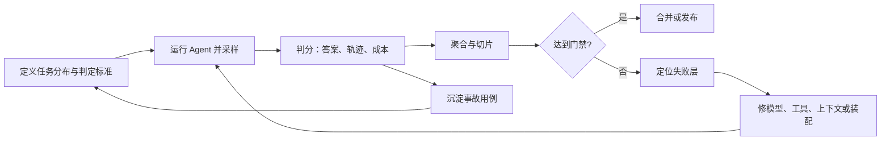
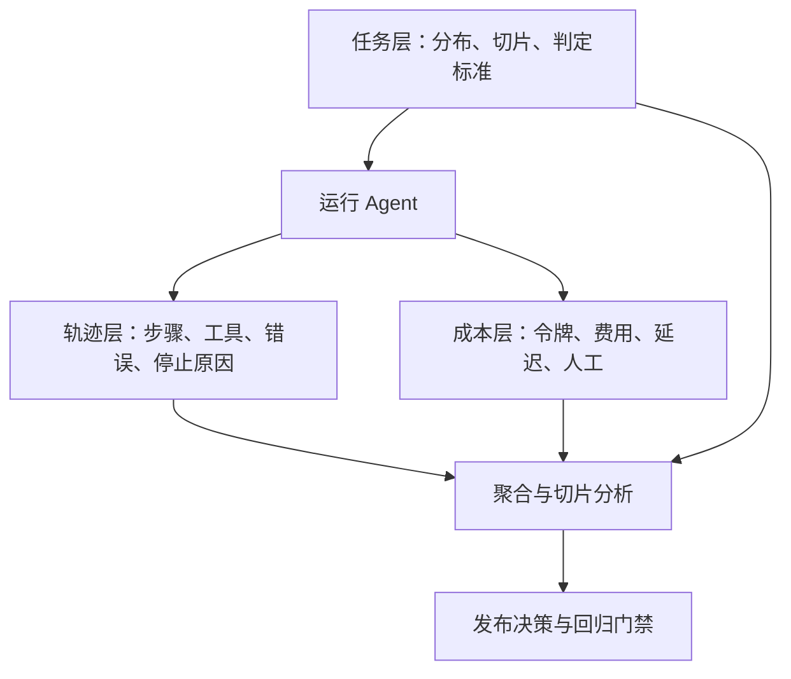
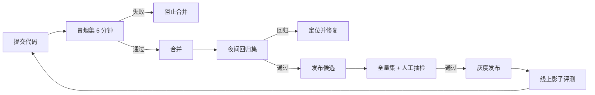
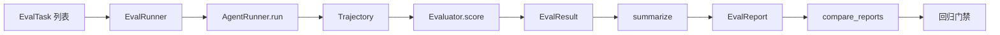

# 第 15 章 Agent 评测：任务、轨迹与成本

## 本章导读

一个团队把模型从 A 换到 B，演示集上的答案全对，上线后任务成功率却下降了 18%。复盘发现：演示集只有十道顺利路径，没人统计工具错误、预算耗尽与重复调用；新模型更爱多步探索，成本翻倍，超时被记成了“失败”。评测不是跑一遍看答案，而是用可复现的任务、可审计的轨迹和可比较的成本，回答“这次改动到底让系统变好还是变坏”。

⭐⭐⭐ 进阶 ｜ 适合：工程师、技术负责人、产品经理

## 学习目标

读完本章你将能够：

- 解释为什么只看最终答案会误判 Agent 的质量
- 设计任务、轨迹、成本三层评测指标，并正确聚合
- 说明 SWE-bench、GAIA、τ-bench、WebArena、OSWorld 各自衡量什么、盲区在哪
- 搭建自建评测集、回归门禁与可校准的 LLM-as-Judge
- 用 Atlas v1.1.0 的评测层运行一组可复现的评测

## 15.1 为什么 Agent 评测难

体检和量一次体温的区别，在于前者用一组可比较的指标回答“身体处于什么状态”，后者只回答“此刻烧不烧”。Agent 评测更像体检：单看一次最终答案，既不知道系统是否稳定，也不知道它为什么成功、代价多大、下次会不会失败。

Agent 把评测的难度推高了三次。

第一，**从答案变成过程**。传统问答可以只看输出对不对；Agent 的输出只是一条轨迹的终点。同一个正确答案，可能来自一次工具调用，也可能来自十二次重试、两次越权尝试和一次重复退款。只看终点，会把危险的过程当成成功。

第二，**从单次变成分布**。模型有随机性，工具会抖动，网页会改版。一次运行的结果不能代表系统能力，评测必须在一组任务上重复采样，并报告分布而不是孤立分数。

第三，**从正确变成代价**。Agent 的成功有价格：令牌、延迟、工具调用、人工复核。一个 95% 成功率但每次要十分钟、花十块钱的方案，未必比 90% 成功率、十秒完成的方案更适合产品。


评测（Evaluation）是用可复现的任务、可比较的指标和可追溯的证据，判断系统在目标分布上的表现，并据此做决策的过程。评测的目的不是产生一个分数，而是回答具体问题：能不能上线、该换哪个模型、该先修哪一层。


最常见的四种“假评测”：

- **只看最终答案**：答案对了，但轨迹里有重复副作用、越权调用或不可复现的偶然成功。
- **用演示集当评测集**：演示用例被反复调优，分数上涨只说明系统记住了题，不说明泛化。
- **忽略环境差异**：模型、提示词、工具版本、网页快照、价格表任意一项变化，分数就不可比。
- **不算成本**：成功率提高两个点，成本翻了三倍，却被当成“全面升级”。

一个可用的评测系统要同时具备四个性质：**可复现**（同样输入能得到可解释的差异）、**有效**（指标真的衡量目标能力）、**敏感**（能区分好改动和坏改动）、**可负担**（跑得起、看得懂）。缺任何一项，评测就会退化成发布前的仪式。



评测还是一项长期资产。每一次线上事故、每一个用户投诉、每一次模型升级引入的回归，都应该变成一条新的评测任务。任务集会随着系统一起长大；没有任务集的团队，只能靠记忆和运气防止旧问题复发。

## 15.2 三层评测对象：任务、轨迹、成本

Agent 的评测对象不止一个。把它拆成三层，能让“成功”这件事变得可解释。

### 15.2.1 任务层：分布决定结论

任务层回答“在哪些问题上测”。评测集的分布决定了结论能推广到哪里。只测简单问答，就不能声称系统能处理多跳研究；只测英文，就不能声称支持中文；只测只读工具，就不能声称能安全执行写操作。

一条评测任务（Eval Task）至少应包含：

| 字段 | 作用 | 例子 |
|---|---|---|
| `id` | 稳定标识，用于回归对比 | `refund-dup-001` |
| `question` | 交给 Agent 的原始任务 | “处理订单 ORD-1001 的退款” |
| `reference` | 参考答案或目标产物 | “只产生一笔 1280 元退款” |
| `rubric` | 无法用参考答案时的评分标准 | “必须引用政策条款并说明金额依据” |
| `metadata` | 切片、环境、期望停止原因、必需工具等 | `{"slice": "refund", "expected_stop": "final_answer"}` |

判定方式要和任务性质匹配：

| 判定方式 | 适用任务 | 成本 | 主要风险 |
|---|---|---|---|
| 精确匹配 | 有唯一短答案 | 低 | 对同义表达过于苛刻 |
| 包含匹配 | 答案需包含关键事实 | 低 | 可能被关键词堆砌欺骗 |
| 执行式判定 | 代码、SQL、API、GUI 有可执行检查 | 中 | 环境搭建与测试覆盖 |
| 规则/约束判定 | 工具调用、权限、预算、停止原因 | 低到中 | 规则写得不全 |
| 评分标准判定 | 报告、摘要、语气、有帮助程度 | 中到高 | 评委偏差与漂移 |
| 人工复核 | 高风险、主观、争议样本 | 高 | 慢、贵、难以规模化 |

任务层最容易犯的错误，是把“平均分”当成“覆盖度”。十个简单任务全对，平均分一百分，但系统可能完全不会处理长任务、异常输入或多工具协作。评测集要按**切片（Slice）**组织：任务类型、难度、语言、工具集、风险级别、租户、停止原因。切片让“总体没退步”这种说法失去掩护——总体可能没退步，但关键切片已经崩了。

### 15.2.2 轨迹层：过程也是结果

轨迹（Trajectory）是 Agent 一次运行的完整记录：每一步的思考摘要、工具调用、工具结果、用量与终止原因。轨迹层回答“它是怎么做到的”，以及“这个过程能不能接受”。

把答案和过程放在一起，会得到四种情况：

| 答案 | 过程 | 含义 | 处理 |
|---|---|---|---|
| 对 | 干净 | 真正成功 | 保留，作为正样本 |
| 对 | 脏 | 偶然成功或有隐患 | 修过程，不能只看绿 |
| 错 | 干净 | 能力或信息不足 | 补能力、补证据 |
| 错 | 脏 | 系统性问题 | 优先定位，通常是装配或工具问题 |

轨迹层常用指标：

- **有效完成率（Valid Completion Rate）**：以 `final_answer` 结束的运行占比。预算是安全护栏，不是成功。
- **工具错误率**：失败工具调用数除以总调用数；按 `error_type` 分组，区分校验、权限、超时、上游错误。
- **重复动作率**：相同工具与相同参数的重复调用占比。重试是必要的，重复副作用是事故。
- **恢复成功率**：工具失败后，后续步骤是否换了一条路径并最终完成。
- **步骤效率**：完成同一类任务所需的步数与工具调用数；用于发现“能做完但绕远路”。
- **计划完成度**：计划步骤中 `done` 的比例，以及重规划次数。
- **上下文与记忆指标**：每步输入令牌、压缩比、折叠后展开次数、引用命中率。
- **协作指标**：多 Agent 场景下按角色统计成功率、交接损耗与成本归因。

还要检查轨迹的结构不变式。最基础的一条是：assistant 发出的每个工具调用，必须有且只有一条对应的 tool 结果消息。压缩、截断、回放都不能把这一对拆开。评测器可以直接检查轨迹中调用与结果的配对；这类错误在答案正确时也可能存在。


`final_answer` 只表示模型给出了答案，不表示答案正确。有效完成率必须与任务成功率一起看；把预算耗尽、超时、模型错误都算作“失败”，才能得到真实的系统表现。


### 15.2.3 成本层：成功也要算账

成本层回答“这次成功值多少钱”。Agent 的成本不是单次模型调用的价格，而是完成任务全过程的资源消耗：

| 指标 | 定义 | 用途 | 常见误用 |
|---|---|---|---|
| 输入/输出令牌 | 一次运行累计的 prompt 与 completion token | 估算模型费用与上下文压力 | 只看输出，忽略历史与工具结果 |
| 费用 | 令牌费用、工具费用、检索费用、人工费用之和 | 预算与定价 | 使用过期价格表 |
| 延迟 | 从开始到结束的耗时，至少看 p50 与 p95 | 交互体验与超时设计 | 只看平均值，忽略长尾 |
| 工具调用数 | 一次运行的工具调用总量 | 发现低效路径与限流风险 | 把并行调用算成一次 |
| 每次成功成本 | 总费用除以成功任务数 | 比较方案经济性 | 用失败成本为 0 的假账 |
| 人工介入率 | 需要人工审批、接管或复核的运行占比 | 评估自主性与运营负担 | 只统计显式审批，漏掉隐式复核 |

**每次成功成本（Cost per Success）**比“平均每次运行成本”更有决策价值，因为它把失败也计入分母。一个便宜但经常失败的方案，每次成功成本可能更高。

延迟要看分布。对交互式产品，p95 延迟决定用户是否觉得“卡”；对后台任务，长尾决定队列是否堆积。提示缓存（Prompt Caching）会显著改变成本结构，但不会改变模型能力；比较方案时要在同一价格表、同一缓存命中假设下计算。



## 15.3 指标体系与聚合

指标不是越多越好。选指标的原则是：每个指标都要对应一个决策或一种失败模式；没有行动含义的指标，只会增加仪表盘的面积。

### 15.3.1 成功率、pass@k 与 pass^k

**任务成功率（Task Success Rate）**是最基础的指标：

$$
\text{success rate} = \frac{\text{通过的尝试数}}{\text{总尝试数}}
$$

它对随机系统不够。同一个任务跑三次，可能一次成功、两次失败，也可能三次都成功。于是有两个互补指标：

- **pass@k**：同一任务采样 k 次，至少一次成功的比例。它衡量“能力上限”——给足重试机会，系统能不能做对。
- **pass^k**：同一任务采样 k 次，全部成功的比例。它衡量“可靠性”——不给重试，系统能否稳定交付。

两者一起看，才能区分“偶尔灵光”和“稳定可用”。一个系统 pass@5 很高、pass^5 很低，说明它有潜力但不适合无人值守；产品要么增加验证与重试，要么把这类任务降级到人工复核。

<details>
<summary>pass@k 的估计公式</summary>

若一个任务采样 n 次，其中 c 次成功，则至少一次成功的无偏估计为：

$$
\text{pass@k} = 1 - \frac{\binom{n-c}{k}}{\binom{n}{k}}
$$

当 n 很大时，它接近 $1-(1-\hat p)^k$。实践中最容易犯的错是比较不同 k 的 pass@k：k 越大，分数天然越高。报告时必须写明 k、采样次数与温度。

</details>

成功率是比例，样本少时波动很大。粗略地说，95% 置信区间在 p=0.5 附近约为 $\pm 1/\sqrt{n}$：100 条任务约 ±10 个百分点，400 条约 ±5 个百分点，1600 条约 ±2.5 个百分点。用 20 条任务得出“提升了 8 个点”，大概率是在读噪声。

### 15.3.2 过程指标

过程指标（Process Metric）衡量轨迹质量，结果指标（Outcome Metric）衡量任务结果。二者不能互相替代。过程指标建议控制在 3–5 个，并和已知失败模式绑定：

| 指标 | 计算方式 | 对应失败模式 |
|---|---|---|
| 工具错误率 | 失败调用 / 总调用 | 工具描述、参数 schema、上游不稳定 |
| 重复动作率 | 重复调用 / 总调用 | 循环、重试设计、幂等缺失 |
| 有效完成率 | `final_answer` 次数 / 总运行 | 预算过紧、停止条件错误 |
| 恢复成功率 | 失败后完成的任务 / 有失败的任务 | 错误回填与改道能力 |
| 约束违反率 | 越权、越界、危险调用次数 / 总运行 | 护栏与权限设计 |
| 每次成功工具数 | 工具调用总数 / 成功任务数 | 路径低效、检索冗余 |

过程指标要能落到具体步骤。比如“工具错误率高”不是结论，应该继续按 `error_type` 与工具名分组，定位是参数校验失败、权限拒绝还是上游超时。没有归因的指标，只会让团队互相猜。

### 15.3.3 成本与效率指标

成本指标至少同时报告三个量：**每次成功成本**、**每次成功令牌数**、**p95 延迟**。只报告总费用，会被任务量和重试次数污染；只报告单次调用价格，会漏掉多步循环的真实开销。

比较两个方案时，建议固定同一任务集、同一模型价格表、同一工具成本、同一并发假设，然后同时看：

- 成功率与 pass^k 是否提高；
- 每次成功成本是否可接受；
- p95 延迟是否满足产品约束；
- 人工介入率是否下降；
- 关键切片的约束违反率是否为零。

如果一项提升以另一项的大幅恶化为代价，它不是“全面升级”，而是一次需要产品决策的交换。

### 15.3.4 聚合与切片

聚合最容易制造假象。辛普森悖论（Simpson's Paradox）在 Agent 评测里很常见：总体成功率上升，但每个关键切片都在下降，只是因为任务构成变了。避免方法：

- **先切片，再聚合**：至少按任务类型、难度、风险级别、语言、工具集、租户分组。
- **不要平均平均分**：先算每个切片的样本量与成功率，再按样本量加权。
- **把严重错误单独计数**：越权、重复副作用、数据泄漏不能用“平均分”抵消。
- **报告样本量与置信区间**：没有不确定性的分数，不可用于决策。
- **固定任务集版本**：任务增删会让总分不可比，回归对比必须使用同一版本。

## 15.4 主流基准：它们各自衡量什么

**基准（Benchmark）**是标准化的任务集、运行环境与判定方法的组合。它的价值是提供跨团队的可比性；它的局限是，它衡量的是基准作者定义的能力，不是你的产品需求。

### 15.4.1 编码与终端

**SWE-bench** 用真实开源仓库的 issue 构造任务：给定 issue 描述与仓库快照，Agent 需要产出一个补丁，由测试判断是否解决。它通常区分 `FAIL_TO_PASS`（修复前失败、修复后应通过）与 `PASS_TO_PASS`（修复前后都应通过）测试。SWE-bench Verified 是经过人工筛选的子集，用于降低问题描述不清或测试不可靠的噪声。

它衡量的是“在真实仓库里定位、修改并通过测试”的能力。盲区也很明显：仓库与依赖被固定在某个快照，测试覆盖不到的行为不会被发现；不同脚手架（scaffold）对分数影响很大；通过测试不等于补丁可维护。

### 15.4.2 通用助手与工具使用

**GAIA** 用需要浏览网页、调用工具、做多步推理的现实问题，答案通常是短文本，按难度分级。它衡量“通用助手能否把工具与推理组合起来解决开放问题”。盲区是静态题目、答案匹配严格、可能被污染，而且不衡量成本与轨迹安全。

**τ-bench** 把 Agent 放进带模拟用户和领域工具的环境（例如零售、航空客服），要求在多轮对话中遵守业务规则并完成任务。它的一个重要贡献是强调 **pass^k**：同一个任务重复 k 次是否都成功，用来衡量可靠性而不是偶尔的正确。盲区是模拟用户与有限领域，和真实用户的复杂性仍有差距。

**BFCL** 一类函数调用基准主要衡量工具选择与参数生成的正确性。它是能力探针，不是端到端任务评测；工具调用语法正确，不代表多步任务能完成。

### 15.4.3 网页与桌面

**WebArena** 提供自托管的真实网站环境（电商、论坛、CMS 等），用功能检查判断任务是否完成。它比静态问答更接近真实网页操作，但环境版本、站点覆盖与判定脚本会显著影响结果。

**OSWorld** 在真实操作系统与应用上执行任务，通常结合截图、可访问性信息与执行脚本判定。它覆盖桌面软件的开放动作空间，代价是环境重、运行慢、判定脚本维护成本高，视觉定位与系统版本差异也会带来噪声。

### 15.4.4 基准对照

| 基准 | 领域 | 任务单位 | 判定方式 | 主要衡量 | 盲区 |
|---|---|---|---|---|---|
| SWE-bench | 软件工程 | issue → 补丁 | 仓库测试 | 定位、修改、回归 | 快照固定、脚手架敏感 |
| GAIA | 通用助手 | 开放问题 | 短答案匹配 | 工具+多步推理 | 静态、污染、无成本 |
| τ-bench | 客服/工具 | 多轮对话任务 | 环境状态与规则 | 工具使用、规则遵守、pass^k | 模拟用户、领域窄 |
| WebArena | 网页 | 网站任务 | 功能检查 | 导航、表单、跨站操作 | 环境与站点覆盖 |
| OSWorld | 桌面 | 应用任务 | 执行脚本/状态 | 真实 GUI 操作 | 环境重、视觉噪声 |
| BFCL | 工具调用 | 单次/多轮调用 | 结构匹配 | 函数选择与参数 | 非端到端 |

### 15.4.5 使用基准的五个陷阱

1. **污染与过拟合**：题目、答案或测试可能进入训练数据；反复针对榜单调提示词，也会把基准变成训练集。
2. **脚手架差异**：同一个模型，不同的工具集、重试策略、上下文管理，分数可能差很多。比较模型时要固定脚手架，比较系统时要说明脚手架。
3. **指标口径不同**：pass@1 与 pass@k、严格匹配与人工判定、是否允许重试，都会改变结论。
4. **忽略成本与延迟**：榜单通常不报告每次成功成本与 p95 延迟，而这两项往往决定产品可用性。
5. **环境不可复现**：网页改版、依赖升级、模型版本变化，会让旧分数失去意义。评测报告必须记录环境快照。


截至写作时，上述基准的任务规模、判定脚本、排行榜分数与模型表现都在快速变化。本节只讨论它们衡量什么、盲区在哪，不引用具体分数，也不构成对任何模型或产品的排名。使用前请以官方文档与论文为准。


## 15.5 搭建自己的评测集与回归测试

公开基准回答“这个模型大概有多强”，自建评测集回答“我们的系统在我们的任务上能不能用”。后者才是上线决策的依据。

### 15.5.1 任务从哪里来

高质量任务通常来自五个地方：

- **线上轨迹**：真实用户任务与真实失败，最有价值，但要去标识、脱敏并取得使用授权。
- **事故与工单**：每一次重复退款、越权、引用伪造、超时，都应该变成一条回归用例。
- **专家编写**：领域专家设计边界条件、对抗输入与高风险场景。
- **合成变体**：对已有任务做改写、换语言、换工具、换数据，扩大覆盖，但不能替代真实样本。
- **公开基准的子集**：用于能力对比，不作为唯一验收标准。

任务集要分层，而不是一锅粥。一个实用的划分是：20% 核心顺利路径、50% 常见变体与边界、20% 已知事故回归、10% 对抗与高风险。比例可以调整，但必须显式。

### 15.5.2 评测任务的设计

一条好任务要满足四个条件：**可复现**、**可判定**、**有区分度**、**有代表性**。

| 设计项 | 要求 | 反面例子 |
|---|---|---|
| 问题描述 | 与真实用户输入一致，包含必要上下文 | 只写“修一下这个 bug” |
| 参考答案 | 唯一答案用 reference，多解用 rubric | 把一篇文章当唯一答案 |
| 环境 | 固定仓库、数据、工具版本与网络快照 | 依赖当天网页内容 |
| 判定 | 优先执行式检查，其次规则，最后评委 | 让模型“看着差不多”判分 |
| 停止条件 | 标明期望的 `stop_reason` 与预算 | 只看答案，不看是否超时 |
| 切片 | 标注任务类型、难度、风险、语言 | 所有任务混在一起算总分 |
| 版本 | 任务、环境、判定器都有版本号 | 改完题直接覆盖旧文件 |

**金标准集（Golden Set）**用于日常回归，应该稳定、可重复、经过人工确认。**挑战集（Challenge Set）**用于发现能力边界，可以更难、更脏、更对抗，但不适合作为唯一门禁。两者要分开管理，避免团队只针对金标准调优。

### 15.5.3 套件分层与运行策略

评测不能只在发布前跑一次。按反馈速度分层：

| 层级 | 规模 | 运行时机 | 目标 |
|---|---|---|---|
| 冒烟集 | 20–50 条 | 每次提交 | 5 分钟内发现明显断裂 |
| 回归集 | 100–300 条 | 每日或合并前 | 防止已知问题复发 |
| 全量集 | 500 条以上 | 每周或发布前 | 评估整体能力与切片 |
| 线上影子 | 真实流量采样 | 持续 | 发现分布漂移与新失败 |

冒烟集要快，回归集要稳，全量集要全。不要把全部任务塞进每次提交，否则团队会开始忽略失败。对已知不稳定的任务，应该隔离并标注，而不是删除；删除会让问题永远消失，隔离能让它继续被看见。



### 15.5.4 回归门禁与版本化

**回归测试（Regression Testing）**不是“再跑一遍”，而是与基线比较，判断候选是否变差。门禁规则要具体、可解释：

| 规则 | 示例 | 作用 |
|---|---|---|
| 关键切片零回归 | 支付、退款、删除类任务不得出现新的失败 | 防止高风险功能退化 |
| 总体成功率 | 下降不超过 1 个百分点 | 允许噪声，阻止明显退化 |
| 每次成功成本 | 上升不超过 10% | 防止用成本换分数 |
| p95 延迟 | 上升不超过 15% | 保护交互体验 |
| 约束违反 | 必须为零 | 安全指标不接受平均 |
| 样本量 | 每个切片至少 30 条 | 避免小样本噪声 |

门禁要用同一版本的任务集、环境、模型、提示词、工具与价格表。任何一项变化，都要记录在评测报告里。**评测报告不是一张截图，而是一份可复现的实验记录**：任务集版本、代码提交、模型名与温度、工具版本、运行时间、失败样本与原始轨迹。

## 15.6 LLM-as-Judge：把主观判断变成可校准的测量

有些任务没有唯一答案：一份研究报告是否有据、一段客服回复是否有帮助、一个摘要是否遗漏关键信息。这时可以用 **LLM-as-Judge（模型评委）**：让一个模型按评分标准给另一个模型的输出打分。

### 15.6.1 适用边界

| 场景 | 推荐判定 | 原因 |
|---|---|---|
| 有唯一短答案 | 精确/包含匹配 | 便宜、稳定、可解释 |
| 有测试或可执行检查 | 执行式判定 | 最接近真实成功 |
| 开放报告、摘要、语气 | 评分标准 + 模型评委 | 无法穷举答案 |
| 高风险审批、合规 | 人工复核 | 责任不能交给模型 |
| 两个方案接近 | 成对比较 + 人工抽检 | 单点评分区分度不足 |

模型评委是测量工具，不是真理。它的分数只有在经过校准后才有意义：用一批人工标注样本，比较评委与人的一致率；一致率低，就先修评分标准或换评委模型，而不是直接拿分数做决策。

### 15.6.2 评分设计

好的评分标准要可拆解、可观察、可判定。不要写“回答得好不好”，而要写：

- 是否回答了用户问题；
- 是否覆盖了指定的三个子问题；
- 每个事实性结论是否有引用支持；
- 是否区分了事实、推断与建议；
- 是否违反安全或格式约束。

评分流程通常是：先逐条判断二元标准，再合成总分。二元判断比 1–10 分更稳定，也更容易校准。要求评委引用轨迹中的步骤或答案中的原句作为证据；没有证据的判断要降权。



给一个候选答案和评分标准，输出 0–1 分与逐条理由。适合批量回归，成本低。


给两个候选答案，判断哪一个更好或是否平局。适合模型/提示词 A/B 对比，区分度更高，但需要交换顺序以抵消位置偏差。



### 15.6.3 偏差与校准

模型评委有稳定的偏差，必须设计对冲：

| 偏差 | 表现 | 缓解 |
|---|---|---|
| 位置偏差 | 总是偏好前一个或后一个答案 | 随机交换顺序，取两次结果 |
| 冗长偏差 | 更长、更详细的答案得分更高 | 明确惩罚无关内容，控制长度 |
| 自我偏好 | 偏好同族模型的输出 | 使用不同模型家族做评委 |
| 顺从偏差 | 倾向给“看起来合理”的答案高分 | 要求证据，先判事实再判表达 |
| 宽松偏差 | 分数集中在高分段 | 用二元标准与固定分布校准 |
| 格式偏差 | 偏好结构化、带标题的答案 | 统一格式或显式忽略格式 |

校准方法：准备 50–200 条人工标注样本，计算评委与人的一致率（如 Cohen's kappa）；按切片检查偏差；定期用新样本复校；对高分与低分边界做抽检。评委模型升级也要重新校准，因为分数分布会变。


不要用评委分数直接替代人工验收，也不要用评委给评委打分。评委是一种近似测量；在安全、合规、资金相关场景，最终判断必须由可执行检查或有权限的人完成。


## 15.7 动手实践：Atlas v1.1.0 评测层

Atlas v1.1.0 在冻结内核之外新增 `atlas.eval`：它接收任何 `AgentRunner`，运行任务，产出 `EvalResult` 与 `EvalReport`。`Agent`、`AgentRunner`、`Trajectory`、`Tool` 的签名不变。



### 15.7.1 类型与评分器

先定义冻结的评测类型。`EvalTask` 描述任务，`EvalResult` 保留轨迹与判分明细，`Evaluator` 是一个最小协议。

```python
# src/atlas/eval/base.py
from __future__ import annotations

from dataclasses import dataclass, field
from typing import Any, Protocol

from atlas.types import Trajectory


@dataclass
class EvalTask:
    id: str
    question: str
    reference: str | None = None
    rubric: str | None = None
    metadata: dict[str, Any] = field(default_factory=dict)


@dataclass
class EvalResult:
    task_id: str
    trajectory: Trajectory
    score: float
    passed: bool
    detail: dict[str, Any] = field(default_factory=dict)


class Evaluator(Protocol):
    def score(self, task: EvalTask, trajectory: Trajectory) -> EvalResult:
        ...
```

评分器可以组合。`ExactMatchEvaluator` 适合唯一答案，`ContainsEvaluator` 适合关键事实，`TrajectoryEvaluator` 检查过程约束，`WeightedEvaluator` 把答案与过程合成一个分数。

```python
# src/atlas/eval/scorers.py（核心节选）
def _normalize(text: str, *, case_sensitive: bool) -> str:
    collapsed = " ".join(text.strip().split())
    return collapsed if case_sensitive else collapsed.lower()


class ExactMatchEvaluator:
    def __init__(self, *, case_sensitive: bool = False) -> None:
        self.case_sensitive = case_sensitive

    def score(self, task: EvalTask, trajectory: Trajectory) -> EvalResult:
        answer = trajectory.final_answer or ""
        if task.reference is None:
            return EvalResult(task.id, trajectory, 0.0, False,
                              {"error": "task has no reference"})
        expected = task.reference
        ok = _normalize(answer, case_sensitive=self.case_sensitive) == _normalize(
            expected, case_sensitive=self.case_sensitive
        )
        return EvalResult(task.id, trajectory, 1.0 if ok else 0.0, ok,
                          {"expected": expected, "answer": answer})


class TrajectoryEvaluator:
    def __init__(
        self,
        *,
        require_final_answer: bool = True,
        max_steps: int | None = None,
        max_tool_calls: int | None = None,
        required_tools: Sequence[str] = (),
        forbidden_tools: Sequence[str] = (),
        allow_tool_errors: bool = True,
    ) -> None:
        self.require_final_answer = require_final_answer
        self.max_steps = max_steps
        self.max_tool_calls = max_tool_calls
        self.required_tools = set(required_tools)
        self.forbidden_tools = set(forbidden_tools)
        self.allow_tool_errors = allow_tool_errors

    def score(self, task: EvalTask, trajectory: Trajectory) -> EvalResult:
        metrics = collect_metrics(trajectory)
        used_tools = set(metrics.tool_names)
        checks: dict[str, bool] = {}
        if self.require_final_answer:
            checks["final_answer"] = trajectory.stop_reason == "final_answer"
            checks["non_empty_answer"] = bool((trajectory.final_answer or "").strip())
        if self.max_steps is not None:
            checks["max_steps"] = metrics.steps <= self.max_steps
        if self.max_tool_calls is not None:
            checks["max_tool_calls"] = metrics.tool_calls <= self.max_tool_calls
        if self.required_tools:
            checks["required_tools"] = self.required_tools <= used_tools
        if self.forbidden_tools:
            checks["forbidden_tools"] = not (self.forbidden_tools & used_tools)
        if not self.allow_tool_errors:
            checks["no_tool_errors"] = metrics.failed_tool_calls == 0
        passed = all(checks.values())
        score = sum(checks.values()) / len(checks) if checks else 1.0
        return EvalResult(task.id, trajectory, score, passed,
                          {"checks": checks, "metrics": metrics.as_dict()})
```

`WeightedEvaluator` 接受一组 `(evaluator, weight)`，用加权平均得到总分。权重不是真理，而是产品判断：对退款流程，安全约束的权重应该高于答案流畅度；对研究报告，引用支持性的权重应该高于篇幅。


评分器要尽量“可解释”。一个 0.73 分如果拆不出是哪几条标准没过，就无法指导修复。Atlas 的 `detail` 字段保留每个子评分器的结果，就是为了让失败可归因。


### 15.7.2 轨迹与成本指标

`collect_metrics` 把一条轨迹压缩成可聚合的指标。它不调用模型，纯规则计算，因此便宜、稳定、可复现。

```python
# src/atlas/eval/metrics.py（节选）
@dataclass
class TrajectoryMetrics:
    steps: int = 0
    tool_calls: int = 0
    failed_tool_calls: int = 0
    duplicate_tool_calls: int = 0
    max_parallel_calls: int = 0
    unique_tools: int = 0
    prompt_tokens: int = 0
    completion_tokens: int = 0
    total_tokens: int = 0
    cost_usd: float = 0.0
    duration_seconds: float = 0.0
    stop_reason: str = "final_answer"
    tool_errors: dict[str, int] = field(default_factory=dict)
    tool_names: list[str] = field(default_factory=list)


def collect_metrics(trajectory: Trajectory) -> TrajectoryMetrics:
    names: list[str] = []
    seen: set[tuple[str, str]] = set()
    duplicate_calls = 0
    failed_calls = 0
    max_parallel = 0
    errors: Counter[str] = Counter()

    for step in trajectory.steps:
        max_parallel = max(max_parallel, len(step.tool_calls))
        for call in step.tool_calls:
            names.append(call.name)
            key = (call.name, json.dumps(call.arguments, sort_keys=True,
                                         ensure_ascii=False, default=str))
            if key in seen:
                duplicate_calls += 1
            else:
                seen.add(key)
        for result in step.tool_results:
            if result.is_error:
                failed_calls += 1
                errors[str(result.metadata.get("error_type", "unknown"))] += 1

    duration = 0.0
    if trajectory.ended_at is not None:
        duration = max(0.0, (trajectory.ended_at - trajectory.started_at).total_seconds())

    usage = trajectory.usage
    return TrajectoryMetrics(
        steps=len(trajectory.steps),
        tool_calls=len(names),
        failed_tool_calls=failed_calls,
        duplicate_tool_calls=duplicate_calls,
        max_parallel_calls=max_parallel,
        unique_tools=len(set(names)),
        prompt_tokens=usage.prompt_tokens,
        completion_tokens=usage.completion_tokens,
        total_tokens=usage.total_tokens,
        cost_usd=usage.cost_usd,
        duration_seconds=duration,
        stop_reason=trajectory.stop_reason,
        tool_errors=dict(errors),
        tool_names=names,
    )
```

聚合报告同时保留“按尝试”和“按任务”两种视角。`pass@k` 与 `pass^k` 在这里由重复运行计算；`cost_per_success` 用总费用除以通过尝试数。

```python
# src/atlas/eval/metrics.py（聚合节选）
@dataclass
class EvalSummary:
    task_count: int
    attempt_count: int
    passed_attempts: int
    pass_rate: float
    pass_at_k: float
    pass_pow_k: float
    mean_score: float
    total_tokens: int
    mean_tokens: float
    total_cost_usd: float
    cost_per_success: float | None
    mean_latency_seconds: float
    p95_latency_seconds: float
    stop_reasons: dict[str, int]
    failed_task_ids: list[str]
    k: int = 1


def summarize(results: Iterable[EvalResult], *, k: int | None = None) -> EvalSummary:
    rows = list(results)
    if not rows:
        raise ValueError("cannot summarize an empty result set")

    by_task: dict[str, list[EvalResult]] = defaultdict(list)
    for row in rows:
        by_task[row.task_id].append(row)

    k = k or max(len(group) for group in by_task.values())
    passed_attempts = sum(1 for row in rows if row.passed)
    any_pass = sum(1 for group in by_task.values() if any(r.passed for r in group))
    all_pass = sum(1 for group in by_task.values() if all(r.passed for r in group))
    task_count = len(by_task)
    attempt_count = len(rows)

    total_tokens = sum(collect_metrics(row.trajectory).total_tokens for row in rows)
    total_cost = sum(collect_metrics(row.trajectory).cost_usd for row in rows)
    latencies = [collect_metrics(row.trajectory).duration_seconds for row in rows]

    return EvalSummary(
        task_count=task_count,
        attempt_count=attempt_count,
        passed_attempts=passed_attempts,
        pass_rate=passed_attempts / attempt_count,
        pass_at_k=any_pass / task_count,
        pass_pow_k=all_pass / task_count,
        mean_score=sum(row.score for row in rows) / attempt_count,
        total_tokens=total_tokens,
        mean_tokens=total_tokens / attempt_count,
        total_cost_usd=total_cost,
        cost_per_success=(total_cost / passed_attempts) if passed_attempts else None,
        mean_latency_seconds=sum(latencies) / attempt_count,
        p95_latency_seconds=_percentile(latencies, 0.95),
        stop_reasons=dict(Counter(row.trajectory.stop_reason for row in rows)),
        failed_task_ids=sorted(
            task_id for task_id, group in by_task.items()
            if not any(r.passed for r in group)
        ),
        k=k,
    )
```


这里的 `cost_usd` 来自 `Usage.cost_usd`。如果适配层没有回填真实成本，评测只能比较令牌数，不能比较钱。生产环境应使用统一价格表，并在报告里记录价格版本与缓存假设。


### 15.7.3 评测运行器、聚合与回归

`EvalRunner` 负责三件事：给每个任务创建独立的 `RunContext`、捕获单个任务的异常、把结果聚合成报告。单个任务崩溃不应该让整批评测丢失。

```python
# src/atlas/eval/runner.py（节选）
class EvalRunner:
    def __init__(
        self,
        runner: AgentRunner,
        evaluator: Evaluator,
        *,
        name: str = "eval",
        budget: Budget | None = None,
        repeat: int = 1,
    ) -> None:
        if repeat < 1:
            raise ValueError("repeat must be at least 1")
        self.runner = runner
        self.evaluator = evaluator
        self.name = name
        self.budget = budget or Budget()
        self.repeat = repeat

    def run(self, tasks, *, budget=None, repeat=None, metadata=None) -> EvalReport:
        task_list = list(tasks)
        if not task_list:
            raise ValueError("at least one eval task is required")
        attempts = repeat or self.repeat
        base_budget = budget or self.budget
        results: list[EvalResult] = []

        for task in task_list:
            for attempt in range(1, attempts + 1):
                ctx = RunContext(
                    run_id=f"{self.name}:{task.id}:{attempt}",
                    budget=replace(base_budget),
                    metadata={"eval_task_id": task.id, "attempt": attempt},
                )
                try:
                    trajectory = self.runner.run(task.question, ctx)
                except Exception as exc:
                    trajectory = Trajectory(
                        task=task.question, run_id=ctx.run_id,
                        stop_reason="error", ended_at=utcnow(),
                    )
                    results.append(EvalResult(
                        task_id=task.id, trajectory=trajectory,
                        score=0.0, passed=False,
                        detail={"error": f"{type(exc).__name__}: {exc}"},
                    ))
                    continue

                result = self.evaluator.score(task, trajectory)
                result.detail.setdefault("attempt", attempt)
                results.append(result)

        summary = summarize(results, k=attempts)
        return EvalReport(
            name=self.name, results=results, summary=summary,
            metadata={"repeat": attempts, **(metadata or {})},
        )
```

`compare_reports` 按任务聚合多次尝试的平均分与通过率，再与基线比较。它不把“总分变化”当作唯一结论，而是列出具体回归任务与缺失任务。

```python
# src/atlas/eval/runner.py（回归节选）
def compare_reports(
    baseline: EvalReport,
    candidate: EvalReport,
    *,
    tolerance: float = 0.0,
) -> RegressionReport:
    baseline_stats = _task_stats(baseline)
    candidate_stats = _task_stats(candidate)
    common = sorted(set(baseline_stats) & set(candidate_stats))
    missing = sorted(set(baseline_stats) - set(candidate_stats))

    regressions, improvements = [], []
    unchanged = 0
    for task_id in common:
        base_score, base_pass = baseline_stats[task_id]
        cand_score, cand_pass = candidate_stats[task_id]
        delta = cand_score - base_score
        item = TaskDelta(
            task_id=task_id,
            baseline_score=base_score, candidate_score=cand_score,
            baseline_pass_rate=base_pass, candidate_pass_rate=cand_pass,
            delta=delta,
        )
        if delta < -tolerance:
            regressions.append(item)
        elif delta > tolerance:
            improvements.append(item)
        else:
            unchanged += 1

    return RegressionReport(
        baseline_name=baseline.name, candidate_name=candidate.name,
        regressions=regressions, improvements=improvements,
        unchanged=unchanged, missing_task_ids=missing,
        pass_rate_delta=candidate.summary.pass_rate - baseline.summary.pass_rate,
        mean_score_delta=candidate.summary.mean_score - baseline.summary.mean_score,
        cost_per_success_delta=_cost_delta(baseline, candidate),
    )
```

回归门禁可以直接用 `RegressionReport.ok()`：默认不允许任何任务回归，也不允许任务缺失。真实团队通常会按风险分级，给低风险切片留一点容忍度，但安全与资金相关切片应当零容忍。

### 15.7.4 LLM 评委

`LLMJudgeEvaluator` 把任务、参考答案、评分标准、候选答案与轨迹摘要交给一个独立模型，要求它输出结构化分数与逐条依据。解析失败时按不通过处理，并保留错误原因。

```python
# src/atlas/eval/judge.py（节选）
class LLMJudgeEvaluator:
    def __init__(
        self,
        llm: LLM,
        *,
        threshold: float = 0.7,
        temperature: float = 0.0,
        max_trajectory_chars: int = 4000,
    ) -> None:
        self.llm = llm
        self.threshold = threshold
        self.temperature = temperature
        self.max_trajectory_chars = max_trajectory_chars

    def score(self, task: EvalTask, trajectory: Trajectory) -> EvalResult:
        prompt = self.build_prompt(task, trajectory)
        try:
            response = self.llm.complete(
                [
                    Message(role="system", content=JUDGE_SYSTEM_PROMPT),
                    Message(role="user", content=prompt),
                ],
                temperature=self.temperature,
            )
            score, reason, criteria = parse_judge_response(response.content or "")
        except Exception as exc:
            return EvalResult(
                task_id=task.id, trajectory=trajectory, score=0.0, passed=False,
                detail={
                    "judge_error": f"{type(exc).__name__}: {exc}",
                    "judge_model": getattr(self.llm, "model", "unknown"),
                },
            )

        return EvalResult(
            task_id=task.id, trajectory=trajectory,
            score=score, passed=score >= self.threshold,
            detail={
                "reason": reason, "criteria": criteria,
                "threshold": self.threshold,
                "judge_model": getattr(self.llm, "model", "unknown"),
            },
        )
```

评委提示词要求“先逐条核对标准，再给总分”，并明确“没有证据支持的结论要扣分；不要因为文字更长而给更高分”。这两句话分别对冲无据结论与冗长偏差。评委模型最好与被执行模型不同族，并固定温度与提示词版本。

### 15.7.5 端到端示例

下面的示例用脚本模型模拟一个计算器 Agent：基线全部正确，候选版本在乘法任务上答错。评测器把答案匹配（权重 0.7）与轨迹约束（权重 0.3）合成总分，再用 `compare_reports` 判断是否阻止合并。

```python
# examples/ch15_eval.py
from __future__ import annotations

import ast
import operator
from typing import Any

from atlas import (
    Agent, AgentConfig, Budget, ContainsEvaluator, EvalRunner, EvalTask,
    LLMResponse, MockLLM, ToolCall, ToolOutput, ToolRegistry, ToolSpec,
    Trajectory, TrajectoryEvaluator, Usage, WeightedEvaluator,
    collect_metrics, compare_reports,
)

TASKS = [
    EvalTask(id="add-mul", question="计算 (12+8)*3。", reference="60"),
    EvalTask(id="multiply", question="计算 7*8。", reference="56"),
    EvalTask(id="div-zero", question="计算 9/0。", reference="无法计算"),
    EvalTask(id="add", question="计算 2+2。", reference="4"),
]

EXPRESSIONS = {
    "计算 (12+8)*3。": "(12 + 8) * 3",
    "计算 7*8。": "7 * 8",
    "计算 9/0。": "9 / 0",
    "计算 2+2。": "2 + 2",
}

_OPS = {
    ast.Add: operator.add,
    ast.Sub: operator.sub,
    ast.Mult: operator.mul,
    ast.Div: operator.truediv,
}


def _evaluate(node: ast.AST) -> float:
    if isinstance(node, ast.Expression):
        return _evaluate(node.body)
    if isinstance(node, ast.Constant) and isinstance(node.value, (int, float)):
        return node.value
    if isinstance(node, ast.BinOp) and type(node.op) in _OPS:
        return _OPS[type(node.op)](_evaluate(node.left), _evaluate(node.right))
    if isinstance(node, ast.UnaryOp) and isinstance(node.op, (ast.UAdd, ast.USub)):
        value = _evaluate(node.operand)
        return value if isinstance(node.op, ast.UAdd) else -value
    raise ValueError("unsupported expression")


class CalculatorTool:
    spec = ToolSpec(
        "calculator",
        "计算只含数字、括号与四则运算符的表达式。",
        {
            "type": "object",
            "properties": {"expression": {"type": "string"}},
            "required": ["expression"],
            "additionalProperties": False,
        },
    )

    def run(self, arguments: dict[str, Any]) -> ToolOutput:
        try:
            tree = ast.parse(str(arguments["expression"]), mode="eval")
            return ToolOutput(str(_evaluate(tree)))
        except Exception as exc:
            return ToolOutput(
                f"计算失败：{exc}",
                is_error=True,
                metadata={"error_type": "exception"},
            )


def script_for(expression: str, answer: str) -> list[LLMResponse]:
    return [
        LLMResponse(
            tool_calls=[ToolCall("c1", "calculator", {"expression": expression})],
            usage=Usage(prompt_tokens=520, completion_tokens=24, cost_usd=0.00052),
        ),
        LLMResponse(
            content=answer,
            usage=Usage(prompt_tokens=180, completion_tokens=12, cost_usd=0.00018),
        ),
    ]


def build_evaluator() -> WeightedEvaluator:
    return WeightedEvaluator(
        [
            (ContainsEvaluator(), 0.7),
            (TrajectoryEvaluator(max_steps=4, max_tool_calls=2), 0.3),
        ],
        pass_threshold=0.8,
    )


class ScriptedCalculatorRunner:
    def __init__(self, answers: dict[str, str]) -> None:
        self.answers = answers

    def run(self, task: str, ctx=None) -> Trajectory:
        agent = Agent(
            MockLLM(script_for(EXPRESSIONS[task], self.answers[task])),
            ToolRegistry([CalculatorTool()]),
            config=AgentConfig(system_prompt="先计算，再给出简洁答案。"),
        )
        return agent.run(task, ctx)


def main() -> None:
    baseline_answers = {
        "计算 (12+8)*3。": "60",
        "计算 7*8。": "56",
        "计算 9/0。": "无法计算：除数不能为 0。",
        "计算 2+2。": "4",
    }
    candidate_answers = dict(baseline_answers)
    candidate_answers["计算 7*8。"] = "57"  # 模拟一次模型升级引入的回归

    budget = Budget(max_steps=4, max_tool_calls=2)
    baseline = EvalRunner(
        ScriptedCalculatorRunner(baseline_answers), build_evaluator(),
        name="calculator-baseline", budget=budget,
    ).run(TASKS)
    candidate = EvalRunner(
        ScriptedCalculatorRunner(candidate_answers), build_evaluator(),
        name="calculator-candidate", budget=budget,
    ).run(TASKS)

    for report in (baseline, candidate):
        summary = report.summary
        print(
            f"{report.name}: pass_rate={summary.pass_rate:.2f} "
            f"mean_score={summary.mean_score:.3f} "
            f"tokens={summary.total_tokens} cost=${summary.total_cost_usd:.5f}"
        )

    diff = compare_reports(baseline, candidate)
    print(f"regressions={len(diff.regressions)} "
          f"pass_rate_delta={diff.pass_rate_delta:+.2f}")
    for item in diff.regressions:
        print(f"- {item.task_id}: {item.baseline_score:.2f} -> "
              f"{item.candidate_score:.2f}")
    print("gate:", "pass" if diff.ok() else "block")

    failed = [result for result in candidate.results if not result.passed]
    if failed:
        metrics = collect_metrics(failed[0].trajectory)
        print(f"failed={failed[0].task_id} steps={metrics.steps} "
              f"tool_calls={metrics.tool_calls} errors={metrics.tool_errors}")
```

运行输出：

```text
calculator-baseline: pass_rate=1.00 mean_score=1.000 tokens=2944 cost=$0.00280
calculator-candidate: pass_rate=0.75 mean_score=0.825 tokens=2944 cost=$0.00280
regressions=1 pass_rate_delta=-0.25
- multiply: 1.00 -> 0.30
gate: block
failed=multiply steps=2 tool_calls=1 errors={}
```

这个例子说明了三件事。第一，**回归不一定是总体崩溃**：四条任务只坏了一条，总体通过率从 1.00 降到 0.75，门禁仍然应该阻止合并。第二，**分数要能拆**：`multiply` 的 0.30 来自答案匹配 0 分、轨迹约束 1 分加权，团队能立刻知道是答案错了，而不是系统整体退化。第三，**成本要一起看**：两个版本的令牌与费用相同，说明这次退化不是“模型更努力但答错”，而是输出质量本身出了问题。

示例用的是脚本模型，只验证评测链路，不证明真实模型能力。换成真实模型时，必须重复采样、记录温度、固定工具版本，并保留失败轨迹。Atlas 的完整实现位于 `src/atlas/eval/`，测试与示例可用 `PYTHONPATH=src python3 -m pytest -q` 与 `PYTHONPATH=src python3 examples/ch15_eval.py` 复现；v1.1.0 的测试基线为 117 passed。

## 15.8 业界案例：SWE-bench 评测器做对了什么

SWE-bench 不只是一个数据集，也是一套可运行的评测器。它把每个任务封装成“仓库快照 + issue + 测试补丁”，在隔离环境中应用模型生成的补丁，再运行指定测试。它的流程有几个值得借鉴的设计。

**第一，环境快照。** 每个任务固定仓库、基础提交与依赖，避免“今天能跑、明天不能跑”。Agent 评测最怕环境漂移；SWE-bench 用容器与固定提交把环境变成任务的一部分。

**第二，可执行判定。** 它不依赖模型自评，而是用测试结果判断补丁是否解决问题。`FAIL_TO_PASS` 检查问题是否真的被修复，`PASS_TO_PASS` 检查是否破坏原有行为。这比“看起来对了”可靠得多。

**第三，失败现场可追溯。** 补丁、测试输出、退出码与日志都被保留，方便定位是定位错、改错还是测试环境问题。评测报告不仅给分数，还给证据。

**第四，任务集版本化。** 数据集、测试补丁与运行脚本一起版本化，分数才有可比性。

τ-bench 则提供了另一个重要视角：它不仅看平均成功率，还看同一任务重复多次是否都成功。对客服、退款、订单这类“不能偶尔出错”的场景，pass^k 比 pass@k 更接近产品要求。

把这些做法映射回 Atlas：评测层要固定任务、环境、模型与价格表；判定优先用执行式检查；失败时保留完整轨迹与指标；回归对比使用同一任务版本。评测器的工程质量，决定了评测结论的可信度。


截至写作时，SWE-bench、τ-bench 等基准的任务集、运行脚本与排行榜规则可能已经更新。本节只讨论其评测设计，不引用具体分数；实际使用时请以官方仓库与论文为准。


## 15.9 常见误区

**误区一：只测最终答案。** 答案正确可能来自偶然，也可能伴随重复副作用、越权调用或超时重试。必须同时看 `stop_reason`、工具错误、重复动作、成本与约束违反。

**误区二：把演示集当评测集，评测一次就结束。** 演示用例通常经过反复调优，分数上涨不代表泛化；而模型、提示词、工具与环境都会随时变化，没有版本化与回归门禁的评测，只能证明“当时那一次跑通了”。评测集要独立管理，定期加入线上失败与对抗样本，保留挑战集，并让每次发布都跑同一套回归。

**误区三：只看总体平均分。** 总体提升可能掩盖关键切片退化。先切片再聚合，对安全、资金、合规切片设置零回归门禁。

**误区四：忽略成本与延迟。** 成功率提高两个点、成本翻三倍，不一定是升级。把每次成功成本与 p95 延迟放进同一张决策表。

**误区五：让评委模型自评且不校准。** 模型评委有位置、冗长、自我偏好等偏差。用不同族模型、交换顺序、二元标准与人工标注校准；评委升级后要重新校准。

## 15.10 本章小结

- 评测是决策工具，不是发布仪式；它要可复现、有效、敏感、可负担。
- Agent 评测有三层对象：任务分布、轨迹质量、成本效率；只看最终答案会漏掉过程风险与真实代价。
- 任务集要按切片组织，判定方式要与任务性质匹配；金标准集与挑战集分开管理。
- 成功率之外，要报告 pass@k（能力上限）与 pass^k（可靠性），并给出样本量与置信区间。
- 轨迹指标包括有效完成率、工具错误率、重复动作率、恢复成功率、约束违反率等；指标要能归因到具体步骤。
- 成本要按每次成功计算，同时看令牌、费用、p95 延迟与人工介入率。
- SWE-bench、GAIA、τ-bench、WebArena、OSWorld 衡量不同能力，也各有环境、判定与成本盲区；不要用榜单替代产品验收。
- 自建评测集要来自真实任务与事故，固定环境与版本，分冒烟、回归、全量与线上影子四层。
- LLM-as-Judge 适合开放任务，但必须拆解评分标准、使用证据、对冲偏差并做人工校准。
- Atlas v1.1.0 在不改冻结接口的前提下新增 `EvalTask`、`EvalResult`、`Evaluator`、`EvalRunner` 与回归对比，把任务、轨迹与成本统一进一条可执行流水线。

## 15.11 思考与练习

1. **为一个已有 Agent 设计三层指标**：选择第 14 章的 Computer Use 或企业流程示例，列出 5 条任务、每条任务的判定方式、3 个轨迹指标与 2 个成本指标。说明哪些切片必须零回归，为什么。

2. **实现一个回归门禁**：在 15.7 的示例中增加两个规则：关键切片（例如 `div-zero`）不允许回归；每次成功成本上升超过 20% 时阻止合并。构造一个“总体成功率不变但成本翻倍”的候选版本，验证门禁会阻止它，并输出具体原因。

3. **校准一个 LLM 评委**：准备 30 条开放任务（报告摘要或客服回复），人工标注通过/不通过，再用两个不同模型家族的评委打分。计算一致率，交换答案顺序检查位置偏差，并根据结果修改评分标准。说明你会把哪些样本加入金标准集，哪些放入挑战集。
