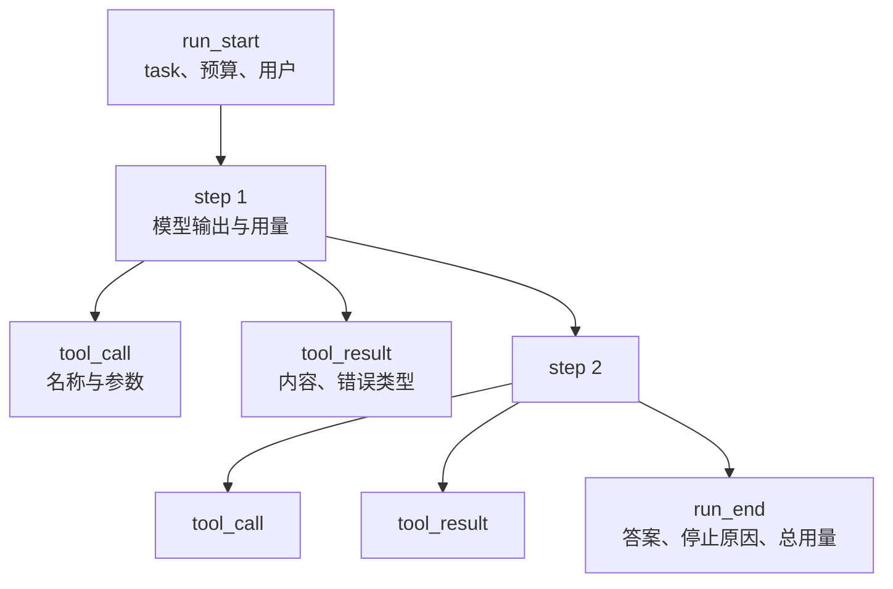
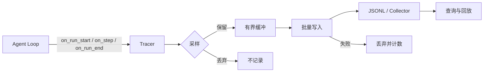
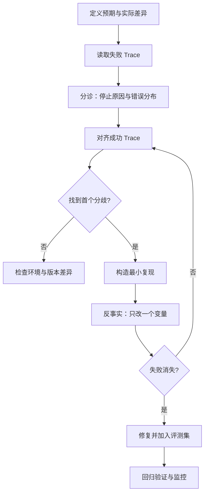
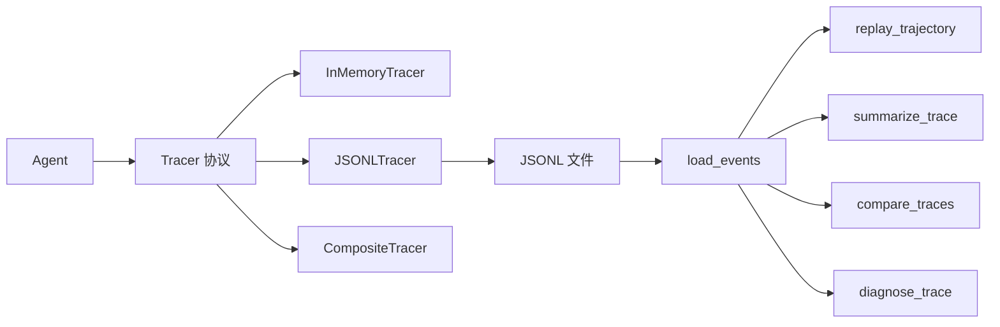

# 第 16 章 可观测性与调试：从 Trace 到根因

## 本章导读

线上退款 Agent 连续出现重复退款，日志里只有一句“已为您退款”。没人知道它调了几次支付接口、第一次是否超时、模型看到的是哪条工具结果。团队花了两天复现，最后发现是一次超时重试没有幂等键。可观测性不是“多打日志”，而是让一次运行的关键决策、证据与副作用可回放、可比较、可归因。

⭐⭐⭐ 进阶 ｜ 适合：工程师、SRE、技术负责人

## 学习目标

读完本章你将能够：

- 区分日志、指标与 Trace，说明 Agent 为什么需要结构化事件
- 设计事件模型，并决定记录粒度、采样、脱敏与保留策略
- 对常见失败模式做分诊，用首个分歧点定位根因
- 设计可回放的调试流程，把线上失败转成固定评测用例
- 使用 Atlas v1.2.0 的 `Tracer`、JSONL 记录、回放与诊断工具

## 16.1 为什么日志不够

日志回答“程序执行到了哪里”，指标回答“系统整体是否健康”，Trace 回答“这一次请求经历了什么”。三者不能互相替代。

Agent 的失败往往不是某一行为空或某一异常抛出，而是**一串看似合理的决策叠加**：模型先查了政策，工具超时；它换了个关键词，查到旧版政策；它据此给出答案，用户照做后发现规则已经变了。日志里每一行都正常，异常也被捕获成了工具错误，但整条链路是错的。

调试 Agent 要回答三个问题：

1. **发生了什么**：模型在第几步看到了什么、调了什么、拿到了什么、为什么停下。
2. **为什么发生**：哪一步是首个分歧点，是模型判断错、工具返回错、上下文缺了信息，还是编排把任务交给了错误的角色。
3. **能否复现**：给我同样的输入、模型版本、工具版本与环境，我能不能重放这条轨迹，并验证修复是否有效。

普通日志通常只覆盖第一问的一部分。它缺少稳定的运行标识、父子关系、结构化字段与因果顺序；你也无法把“第 3 步的工具超时”和“第 5 步的重复退款”自动关联起来。Trace 的价值，是把一次运行变成**可查询的事件序列**，让这三问都有证据。


可观测性（Observability）指仅凭外部输出就能推断系统内部状态的能力。对 Agent 而言，最重要的外部输出不是一条最终答案，而是一条带时间、因果关系与用量的事件流。


## 16.2 Trace 的数据模型：Run、Step 与 Event

Atlas 在接口清单里早就预留了 `Tracer`，但直到 v1.2.0 才真正接入。协议只有三个方法：

```python
class Tracer(Protocol):
    def on_run_start(self, task: str, ctx: RunContext) -> None: ...
    def on_step(self, step: Step, ctx: RunContext) -> None: ...
    def on_run_end(self, trajectory: Trajectory, ctx: RunContext) -> None: ...
```

这个协议故意保持最小：它不规定存储格式，也不绑定任何供应商。`JSONLTracer`、`InMemoryTracer`、未来的 OpenTelemetry 导出器都实现同一组方法。Agent 只在三个时点调用它，内核不感知追踪后端。

一次运行（Run）由若干步骤（Step）组成，每个步骤又可能包含多次工具调用与结果。事件是这条层级结构的最小记录单位：



事件本身采用统一信封，避免每种事件各写一套字段：

```python
# src/atlas/trace/events.py（节选）
@dataclass
class TraceEvent:
    run_id: str
    type: EventType
    payload: dict[str, Any] = field(default_factory=dict)
    event_id: str = field(default_factory=lambda: uuid4().hex)
    parent_id: str | None = None
    timestamp: datetime = field(default_factory=utcnow)
    schema_version: int = SCHEMA_VERSION
```

几个字段值得单独解释：

| 字段 | 作用 | 设计取舍 |
|---|---|---|
| `event_id` | 事件唯一标识 | 运行时生成，不依赖业务字段 |
| `run_id` | 串起一次运行的全部事件 | 直接复用 `RunContext.run_id`，与评测、日志共用 |
| `parent_id` | 表达“工具调用属于哪个步骤” | 只做一层父子，足够定位；更深的因果关系用时间与 payload 还原 |
| `type` | 事件类型 | 稳定字符串，便于过滤与聚合 |
| `timestamp` | UTC 时间 | 统一时区，避免跨部署比较错误 |
| `schema_version` | 事件格式版本 | 消费端可以拒绝或迁移不兼容格式 |

事件是**只追加**的。修正一条错误记录应该写新事件，而不是改旧事件；否则审计链断裂，回放也会得到不同结果。Atlas 的 `JSONLTracer` 每行写一个 JSON 对象，天然满足追加写与按行恢复。

### 16.2.1 事件类型与载荷

Atlas v1.2.0 定义六类事件：

| 事件 | 何时产生 | 关键载荷 |
|---|---|---|
| `run_start` | 运行开始 | 任务、用户、预算、运行元数据 |
| `step` | 每次模型调用后 | 步骤号、思考摘要、令牌用量、本步调用与结果的完整快照 |
| `tool_call` | 每次工具调用 | 调用 ID、工具名、参数 |
| `tool_result` | 每次工具返回 | 调用 ID、内容或内容哈希、是否错误、错误类型 |
| `run_end` | 运行结束 | 最终答案、停止原因、总用量、耗时、步数 |
| `note` | 人工或代码补充 | 说明性消息，用于标注实验、事故或回放上下文 |

`step` 事件保留本步完整快照，`tool_call` 与 `tool_result` 再拆成独立事件。这看起来有冗余，但解决的是两个不同问题：回放需要按步骤还原轨迹，查询需要按工具名、错误类型或参数快速过滤。用一点存储换掉“从大对象里反复解析”的成本，通常是值得的。

### 16.2.2 Trace、Span 与指标的关系

如果你熟悉分布式追踪，可以把一次 Run 看成一个根 Span，每个 Step 与工具调用是子 Span。Trace 是这棵树，指标是从事件流聚合出来的数值。Atlas 的 `TraceSummary` 就是这种聚合：

- 步数、工具调用数、工具错误数从事件计数得到；
- 错误类型分布从 `tool_result.metadata.error_type` 得到；
- 令牌与费用从 `run_end.usage` 得到；
- 首个错误事件 ID 从事件顺序得到。

这样，第 15 章的成本与轨迹指标不再需要单独埋点，直接从 Trace 计算即可。评测报告与线上追踪因此共享同一份事实来源。

## 16.3 记录什么、不记录什么

可观测性最常见的错误不是“记得太少”，而是“记得太多且没有结构”。全量记录会带来成本、隐私与噪声；记录不足又无法定位。判断标准是：**这条字段能否支持一个具体的调试或审计问题**。

### 16.3.1 必须记录的决策与证据

| 类别 | 建议记录 | 用途 |
|---|---|---|
| 模型调用 | 模型名、温度、提示词哈希、响应摘要、用量、延迟 | 区分模型/提示词/采样导致的差异 |
| 工具调用 | 工具名、参数（脱敏后）、调用 ID、耗时 | 复现参数错误、权限拒绝、超时 |
| 工具结果 | 内容或哈希、`is_error`、`error_type`、截断标记 | 判断是工具失败还是模型误读 |
| 上下文 | 令牌数、压缩/折叠/摘要计数、证据 ID | 定位“信息没进上下文”或“压缩丢了关键句” |
| 规划与反思 | 计划版本、步骤状态、重规划原因 | 定位计划错误与无效重试 |
| 检索 | 查询、召回文档 ID、分数、过滤条件 | 定位召回缺失与权限过滤 |
| 记忆 | 写入/检索/淘汰的条目 ID 与原因 | 定位过时记忆与跨用户泄漏 |
| 安全与审批 | guard 决策、审批人、范围、结果 | 审计越权与人工介入 |
| 运行结果 | 停止原因、最终答案、总成本、总耗时 | 分诊与回归比较 |

注意“内容或哈希”这个选项。对高风险数据（合同、病历、个人信息），可以只记录 SHA-256 与字符数，把原文留在受控存储中；调试时用哈希去受控存储换取原文。这样 Trace 本身可以更低成本地流转与保留。

### 16.3.2 不应记录的内容

- **供应商隐藏的推理链**：`Step.thought` 只应记录模型显式输出的推理摘要。隐藏推理既不可审计，也可能包含敏感信息。
- **明文密钥与凭据**：API Key、Bearer Token、密码、会话 Cookie 不应进入 Trace。
- **未脱敏的个人信息**：邮箱、手机号、身份证号、地址应按组织策略脱敏或哈希。
- **无上限的原始文档**：整篇网页、整份合同会让单条事件膨胀，拖慢写入与查询。记录文档 ID、片段 ID 与摘要即可。
- **可推导的重复数据**：同一段内容在 `step`、`tool_result`、`run_end` 重复三份，既浪费也容易不一致。Atlas 在 `step` 里保留快照，独立事件只保留定位所需字段。

脱敏的顺序很重要：**先脱敏，再截断**。如果先截断，密钥可能被截成半截，正则再也识别不出来。Atlas 的 `redact_text` 明确按这个顺序执行，并记录截断了多少字符。

```python
# src/atlas/trace/events.py（节选）
def redact_text(text: str, *, max_chars: int = 4000) -> str:
    value = text
    for pattern, replacement in _SECRET_PATTERNS:
        value = pattern.sub(replacement, value)
    if max_chars >= 0 and len(value) > max_chars:
        omitted = len(value) - max_chars
        value = value[:max_chars] + f"...[truncated {omitted} chars]"
    return value
```

这段实现只覆盖常见模式，不是完整的 DLP 方案。生产环境还应接入组织级敏感信息识别、字段级加密与访问控制；Trace 的保留期也要按数据分级设置。

### 16.3.3 采样：别让追踪拖垮系统

全量追踪在低流量阶段很舒服，在高流量阶段会变成成本与故障源。常见策略：

| 策略 | 做法 | 适用 |
|---|---|---|
| 全量 | 每个 run 都记录 | 调试期、低流量、高风险流程 |
| 头部采样 | 按 `run_id` 哈希决定是否记录 | 稳定流量下的无偏抽样 |
| 尾部采样 | 先缓冲，失败/超时/高成本运行必留 | 生产环境的性价比之选 |
| 分层采样 | 按任务类型、租户、风险级别设不同比例 | 关键切片全量，长尾抽样 |

Atlas v1.2.0 实现了确定性的头部采样：对 `run_id` 做 SHA-256，再按比例落桶。同一个 `run_id` 在多次判断中得到相同结果，避免“开始记录了、步骤却丢了”的半截 Trace。

```python
# src/atlas/trace/recorder.py（节选）
def _should_record(self, run_id: str) -> bool:
    cached = self._decisions.get(run_id)
    if cached is not None:
        return cached
    digest = hashlib.sha256(run_id.encode("utf-8")).hexdigest()
    bucket = int(digest[:8], 16) % 10_000
    decision = bucket < int(self.sample_rate * 10_000)
    self._decisions[run_id] = decision
    return decision
```

采样会改变分母。只对 10% 流量采样后，你看到的错误数不能直接和全量时期比较；报告里必须同时给出采样率、采样方法和估算总量，否则会得出“错误下降了 90%”的假结论。

## 16.4 采集架构与故障隔离

Trace 是旁路，不是主流程。追踪系统挂了，Agent 仍然要能完成任务；追踪写入变慢，也不能把模型调用拖死。



Atlas 在 `Agent._emit` 里做了最小但关键的隔离：

```python
# src/atlas/agent/loop.py（节选）
def _emit(self, method: str, *args: Any) -> None:
    if self.tracer is None:
        return
    try:
        getattr(self.tracer, method)(*args)
    except Exception:
        return
```

这段代码有两个取舍。第一，它吞掉了追踪异常，保证 Agent 的结果不受影响；第二，它也吞掉了错误信息，可能让追踪故障变得隐蔽。生产实现应该把失败计数、最后一条错误与丢弃数量暴露为指标，而不是完全静默。

采集层通常还要考虑：

- **有界队列**：队列满时选择丢弃新事件或丢弃低优先级事件，不能无限占用内存。
- **批量与重试**：批量写入降低开销，但重试必须幂等，避免重复事件。
- **背压**：当后端持续不可用时，主动降级为采样或只保留错误事件。
- **访问控制**：Trace 可能包含用户输入与工具结果，读取权限应与原始数据一致。
- **保留期**：按数据分级设置保留时长，失败样本可以单独延长。

### 16.4.1 与日志、指标打通

Trace 不是孤岛。日志里应带上 `run_id` 与步骤编号，指标里应能从异常峰值下钻到具体样本。常见做法是：结构化日志统一输出 `run_id`、`step_index`、`event_id`；指标侧提供失败率、P95 延迟与每步成本，同时保留少量 exemplar（示例样本 ID）；告警触发时，直接把 `run_id` 带进 Trace 查询。这样从“整体失败率上升”到“某一次运行第 3 步工具超时”只需要两次跳转，而不是人工 `grep` 几个小时。

三个系统的分工也要说清楚：指标负责发现“有异常”，Trace 负责解释“异常发生在哪”，日志负责补充“当时打印了什么”。如果只有指标，你知道系统变差却不知道原因；如果只有 Trace，你很难在百万级运行中发现异常；如果只有日志，你无法自动关联。三者共享同一个运行标识，才构成完整的可观测性。

本地开发用 JSONL 足够：一行一个事件，`grep`、`jq`、脚本都能处理，不依赖任何服务。生产环境更适合 OpenTelemetry Collector 一类的管道，再由后端做索引与保留。

## 16.5 失败模式分类：先分诊，再定位

调试最怕“从头读一遍 Trace”。更高效的做法是先分诊：根据停止原因、错误分布与首个异常事件，把失败归入少数类别，再针对该类去看对应字段。

| 失败类别 | 典型症状 | Trace 证据 | 常见根因 |
|---|---|---|---|
| 模型决策 | 答非所问、格式错误、选错工具 | 步骤中的调用与最终答案 | 提示词、模型能力、温度、示例缺失 |
| 工具失败 | 错误结果、重试、绕过 | `tool_result.is_error`、`error_type` | 参数校验、权限、超时、上游故障 |
| 上下文问题 | 忽略约束、重复提问、引用缺失 | 令牌数、压缩计数、召回 ID | 预算过紧、压缩丢句、检索未命中 |
| 规划问题 | 步骤顺序错、反复重规划 | 计划版本、步骤状态、反思内容 | 计划粒度过粗、缺少验收标准 |
| 编排问题 | 角色空转、交接丢失 | 子运行 ID、角色顺序、黑板版本 | 角色边界不清、产物截断、监督者误判 |
| 安全策略 | 拒绝、审批失败、越权尝试 | guard 决策、审批记录、`stop_reason=denied` | 权限配置、规则过严、审批超时 |
| 环境问题 | 同一输入时好时坏 | 时间戳、工具版本、网络错误 | 网页改版、依赖升级、服务抖动 |
| 运行资源 | 超时、预算耗尽 | `stop_reason`、用量、耗时 | 预算过紧、循环、成本失控 |

分诊不是诊断。它只回答“先看哪一层”。真正的根因要靠**首个分歧点**：把失败运行与最近一次成功运行对齐，找到第一条不同的工具调用、工具结果或模型决策。

Atlas 的 `compare_traces` 就是做这件事：按步骤比较工具名、参数、结果内容哈希与错误状态，返回第一个分歧的步骤号与原因。它不比较思考文本，因为思考措辞变化很常见，真正的分歧通常先出现在动作或观察上。

需要提醒的是，规则式分诊有明确边界。`diagnose_trace` 这样的函数擅长识别结构性信号——没有 `run_end`、工具报错、预算耗尽、重复调用——但它无法判断语义正确性：答案是否真的回答了用户、引用的政策是否已经过期、两个角色是否在互相推诿。这些需要第 15 章的判分器、领域专家或人工复核。把规则诊断与语义评测分开，各自负责能负责的部分，比让一个“万能诊断器”给出似是而非的结论更可靠。


“首个分歧点”不等于“根因”。它只是因果链上最早可观察的差异。你还需要做反事实验证：只改这一个变量，失败是否消失。否则容易把相关当因果。


## 16.6 回放与根因分析

回放有三个层次，成本和保真度依次上升：

| 层次 | 做法 | 能回答的问题 | 代价 |
|---|---|---|---|
| 事件回放 | 读取 Trace，重建时间线与轨迹 | 当时发生了什么 | 低，但无法重新执行 |
| 确定性回放 | 录制模型响应与工具结果，按原顺序重放 | 改代码/提示词后行为是否变化 | 中，需要录制与匹配 |
| 环境回放 | 恢复仓库、数据、网页与依赖快照 | 真实环境下的行为 | 高，需要容器与快照 |

大多数线上问题用前两层就能定位。只有当失败依赖真实环境（网页改版、依赖版本、文件状态）时，才需要环境回放。

### 16.6.1 录制什么才能确定性回放

确定性回放的关键不是“把整个请求存下来”，而是**让下一次执行命中同样的决策与观察**。至少需要：

- 模型标识、温度、提示词哈希与响应内容；
- 工具名、参数、结果与错误状态；
- 工具 schema 版本与实现版本；
- 关键环境快照（仓库提交、知识库版本、网页时间戳）；
- 随机种子与并发顺序（如果实现依赖它们）。

回放时，模型调用与工具调用都应先查录制，再决定是否真实执行。命中录制就返回原响应；未命中则明确报错，而不是悄悄调用真实服务。否则一次“回放”可能产生真实副作用，尤其是退款、发邮件、删数据这类动作。

### 16.6.2 根因分析流程



这个流程有两个容易被跳过的步骤。第一，**先定义预期**。如果团队对“正确”没有共识，Trace 再完整也无法判断哪一步错了。第二，**把修复变成评测任务**。只修一次代码，问题会在下次模型或工具变化时复发；把失败样本加入第 15 章的金标准集，才算真正闭环。

### 16.6.3 一个典型误判

看一个常见场景：候选版本的最终答案与基线完全一致，但轨迹里有一次工具调用失败。只看答案，它是“成功”；只看错误率，它是“退化”。两者都不完整。

正确的解读是：

- 答案一致，说明模型用其他信息补上了缺口，或者只是猜对了；
- 工具失败说明这次成功不可靠，换个输入就可能失败；
- 如果失败原因是参数拼写错误，修复成本很低；如果是权限配置，影响面可能更大。

Atlas 的 `diagnose_trace` 会把这种情况标为 `recovered_tool_error`，同时保留 `first_error_event_id`。它不替你判断“能不能接受”，但把证据摆在了同一个地方。

### 16.6.4 回放不是时光机

确定性回放常被高估。现实中至少有四类非确定性无法完全消除：并发工具的执行顺序、墙钟时间与超时、外部服务内容变化、模型供应商的静默升级。因此回放的正确目标是“控制已知变量下的可重复性”，而不是追求逐字节一致。

工程上通常这样做：录制时记录模型版本与响应 ID；回放时优先命中录制，未命中就明确失败而不是联网；对并发步骤按 `step` 编号排序，而不是按完成时间；每次回放输出一份差异清单，标明哪些字段来自录制、哪些是重新计算。这样即使环境有漂移，你也能说清楚结论的置信边界，而不是把“回放通过”误当成“线上一定正确”。

## 16.7 动手实践：Atlas v1.2.0 的追踪层

Atlas v1.2.0 在不改冻结接口的前提下新增 `atlas.trace`：



### 16.7.1 事件与记录器

`TraceEvent` 是统一信封，`JSONLTracer` 负责追加写入，`InMemoryTracer` 用于测试与一次性分析，`CompositeTracer` 把事件扇出给多个后端。三者都实现同一个 `Tracer` 协议。

```python
# src/atlas/trace/recorder.py（节选）
class InMemoryTracer:
    def __init__(self, *, max_chars=4000, redact=True, include_content=True):
        self.events: list[TraceEvent] = []
        self.max_chars = max_chars
        self.redact = redact
        self.include_content = include_content

    def on_run_start(self, task, ctx):
        self.events.append(
            build_run_start(task, ctx, max_chars=self.max_chars, redact=self.redact)
        )

    def on_step(self, step, ctx):
        self.events.extend(
            build_step_events(
                step, ctx, max_chars=self.max_chars,
                redact=self.redact, include_content=self.include_content,
            )
        )

    def on_run_end(self, trajectory, ctx):
        self.events.append(
            build_run_end(
                trajectory, max_chars=self.max_chars,
                redact=self.redact, include_content=self.include_content,
            )
        )
```

`JSONLTracer` 在此之上增加文件写入、线程锁、确定性采样与内容哈希选项。写入失败不会冒泡到 Agent，因为 `Agent._emit` 已经做了隔离。

### 16.7.2 Agent 的接入点

接入点只有三处，且都发生在状态已经稳定之后：

```python
# src/atlas/agent/loop.py（节选）
self._emit("on_run_start", task, ctx)

# 每次追加 Step 之后
self._emit("on_step", trajectory.steps[-1], ctx)

# finally 中，ended_at 已设置
self._emit("on_run_end", trajectory, ctx)
```

`on_run_end` 放在 `finally` 里，保证预算耗尽、模型异常、工具异常等所有路径都会留下结束事件。没有 `run_end` 的 Trace 会被 `summarize_trace` 标记为 `missing_run_end`，这正是分诊的第一条线索。

### 16.7.3 聚合、比较与诊断

从事件流出发，可以做三件事：

```python
# 聚合：一次运行的指标与信号
summary = summarize_trace(events)
print(summary.stop_reason, summary.tool_errors, summary.signals)

# 比较：两次运行的首个分歧
diff = compare_traces(baseline_events, candidate_events)
print(diff.index, diff.reason, diff.diverged)

# 诊断：按规则给出失败类别
diagnosis = diagnose_trace(candidate_events)
print(diagnosis.category, diagnosis.evidence)
```

`summarize_trace` 输出 `TraceSummary`，包含步数、工具调用、错误类型、令牌、费用、耗时、信号与首个错误事件 ID。`compare_traces` 输出 `TraceDivergence`，只比较动作与观察，不比较思考措辞。`diagnose_trace` 输出 `FailureDiagnosis`，类别包括 `recovered_tool_error`、`tool_error`、`budget_stop`、`timeout`、`policy_denied`、`runtime_error`、`incomplete_trace`、`empty_answer`、`loop_suspected`、`healthy` 与 `unknown`。

### 16.7.4 端到端示例

示例构造两个只有一处差异的运行：基线查询 `refund`，候选把主题拼成 `refnd`，工具报错，但模型仍然给出了相同答案。

```python
# examples/ch16_trace.py（核心片段）
def script(topic: str, answer: str) -> list[LLMResponse]:
    return [
        LLMResponse(
            tool_calls=[ToolCall("c1", "lookup_policy", {"topic": topic})],
            finish_reason="tool_calls",
            usage=Usage(prompt_tokens=120, completion_tokens=18, cost_usd=0.0002),
        ),
        LLMResponse(
            content=answer,
            usage=Usage(prompt_tokens=80, completion_tokens=20, cost_usd=0.0001),
        ),
    ]


baseline_tracer = JSONLTracer(path)
candidate_tracer = InMemoryTracer()
baseline = run_agent("refund", answer, baseline_tracer, "policy-baseline")
candidate = run_agent("refnd", answer, candidate_tracer, "policy-candidate")

events = load_events(path)
baseline_events = [e for e in events if e.run_id == "policy-baseline"]
candidate_events = candidate_tracer.events
```

运行输出：

```text
baseline: stop=final_answer steps=2 tool_calls=1 errors=0 signals=[]
candidate: stop=final_answer steps=2 tool_calls=1 errors=1 signals=['tool_error']
first divergence: index=0 reason=tool_call diverged=True
diagnosis: recovered_tool_error evidence=["1 tool errors: {'unknown_topic': 1}", 'run recovered and produced a final answer']
replay: answer='退款政策：签收后 7 天内可无理由退款。' tool_error=True error_type=unknown_topic
eval note: answer matches | trace still unsafe because the tool call failed
redacted: api_key=<redacted>
jsonl events: 6 (file removed with temp dir)
```

这个例子说明三件事。第一，**答案相同不代表过程相同**：候选的工具调用参数错了，只是答案碰巧一致。第二，**首个分歧点在动作层**：`compare_traces` 在第 0 步就抓到参数差异，不需要读完整条链路。第三，**诊断是分诊不是判决**：`recovered_tool_error` 只说明“出过错但最终有答案”，是否可接受仍要结合业务风险判断。

回放时还要注意内容哈希。若使用 `include_content=False`，`replay_trajectory` 能还原步骤结构与错误状态，但拿不到原文；这是隐私与可调试性之间的显式取舍。

## 16.8 业界案例：OpenTelemetry GenAI 语义约定

分布式追踪的通用标准是 OpenTelemetry（OTel）。它把一次请求表示为 Trace，把其中的工作单元表示为 Span，并通过属性（attributes）记录结构化字段。社区为生成式 AI 定义了 GenAI 语义约定，把模型调用、令牌用量、工具执行等映射为标准 Span 与属性。

这类约定值得借鉴的地方不在具体字段名，而在三个设计原则：

**第一，层次化。** 对话、模型调用、工具执行是不同层级的 Span，父 Span 负责串联一次任务，子 Span 记录每次外部调用。这样既能看全局耗时，也能下钻到某一次工具调用。

**第二，属性化。** 模型名、请求温度、输入输出令牌、工具名、错误类型都是属性，而不是拼进一段自由文本。属性化让过滤、聚合与告警成为可能。

**第三，可插拔后端。** 应用只负责产生标准事件，采集与存储由 Collector 和后端决定。你可以在本地用文件，在生产用托管服务，而不改业务代码。


OpenTelemetry 的 GenAI 语义约定仍在演进，属性名、Span 名称与稳定级别可能变化。截至写作时，部分约定属于实验性内容；接入前请以 OpenTelemetry 官方文档与所用后端的最新说明为准，不要硬编码未经确认的字段。


对 Agent 团队来说，一个务实的做法是：**内部事件模型保持稳定，导出层做映射**。Atlas 的 `TraceEvent` 是内部模型，`JSONLTracer` 是导出实现；未来增加 OTel 导出器时，只需把事件映射成 Span 与属性，Agent 与评测代码不变。这与第 11 章“适配层隔离外部框架”的思路一致。

## 16.9 常见误区

**误区一：把日志当日志用。** 只在关键函数里打印字符串，没有运行 ID、父子关系与结构化字段，无法自动关联，也无法回放。

**误区二：要么全量记录，要么只记失败。** 全量记录原始文档、完整提示词与隐藏推理，会带来成本、隐私与查询噪声，正确做法是先问“这条字段支持哪个调试问题”再决定是否记录；反过来只保留失败 Trace 也不行，没有成功轨迹作为对照，你无法判断哪一步是“首个分歧”。成功样本与失败样本要使用同一套事件模型。

**误区三：让追踪影响主流程。** 同步写远端、无界队列、写入失败抛异常，都会让可观测性变成新的故障源。追踪必须旁路、有界、可降级。

**误区四：回放时执行真实副作用。** 回放工具调用时误连生产支付或邮件服务，会把调试变成第二次事故。回放默认应只读或使用 mock，真实执行必须显式开关。

**误区五：采样后直接比较绝对数。** 采样率变化会让错误数、成本与延迟的分母变化。报告必须同时记录采样策略与采样率。

## 16.10 本章小结

- 日志回答“执行到哪里”，指标回答“整体是否健康”，Trace 回答“这一次请求经历了什么”。
- Trace 由 Run、Step 与 Event 组成；统一信封包含运行 ID、父子关系、类型、时间与 schema 版本。
- 事件只追加；`step` 保留快照，`tool_call`/`tool_result` 支持细粒度查询。
- 记录决策与证据，不记录隐藏推理、明文密钥与无上限原文；先脱敏再截断。
- 采样要确定性、可解释，并记录采样率；生产优先保留失败、超时与高成本运行。
- 追踪是旁路：有界缓冲、批量写入、失败隔离，不能改变 Agent 的返回结果。
- 失败分诊按模型、工具、上下文、规划、编排、安全、环境与资源分类；首个分歧点是定位起点，不是根因本身。
- 回放分为事件回放、确定性回放与环境回放；确定性回放要锁定模型、工具与环境版本。
- 根因分析要经过“定义预期 → 分诊 → 对齐成功轨迹 → 最小复现 → 反事实验证 → 加入评测集”的闭环。
- Atlas v1.2.0 新增 `TraceEvent`、`JSONLTracer`、`InMemoryTracer`、`CompositeTracer`、`load_events`、`replay_trajectory`、`summarize_trace`、`compare_traces` 与 `diagnose_trace`，在不改冻结接口的前提下接入 Agent 与编排器。

## 16.11 思考与练习

1. **设计一个事件字段表**：选择第 14 章的企业流程 Agent，列出至少 10 个必须记录的事件字段，并说明每个字段支持哪个调试或审计问题。哪些字段应该只存哈希？哪些应该设置更短保留期？

2. **实现尾部采样**：在 `JSONLTracer` 外再包一层缓冲器，先记录事件但不落盘；运行结束后，只要满足“失败、超时、成本超过阈值”之一就写文件，否则丢弃。说明缓冲上限、丢弃策略与并发安全如何处理。

3. **做一次根因复盘**：用 `examples/ch16_trace.py` 构造一个新的候选版本，让它在第 2 步改用错误工具，但最终答案仍正确。用 `compare_traces` 找首个分歧，用 `diagnose_trace` 看分类，再把这条失败样本改写成第 15 章的 `EvalTask`，并设计一个回归门禁规则。
