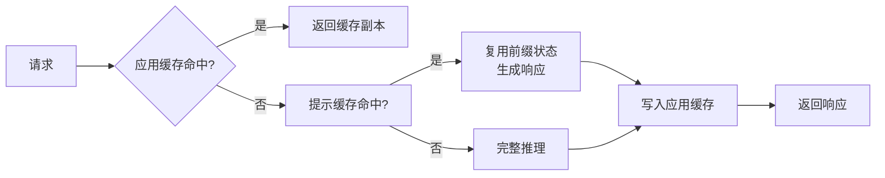
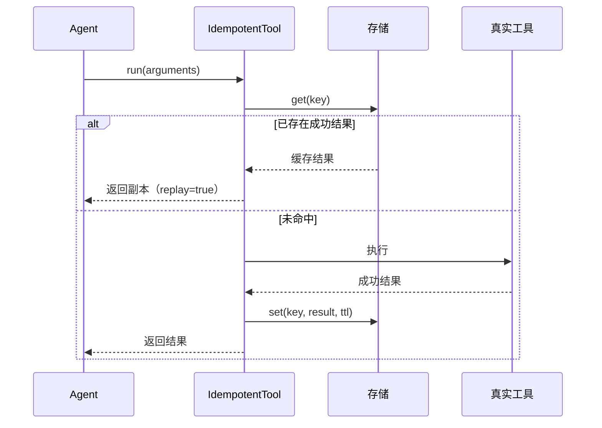
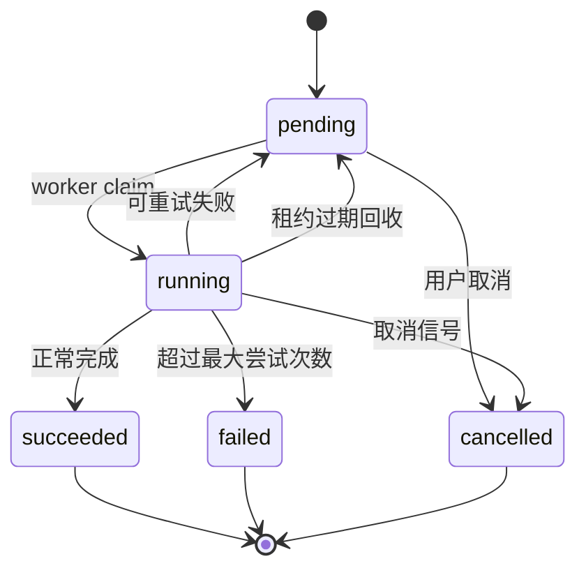
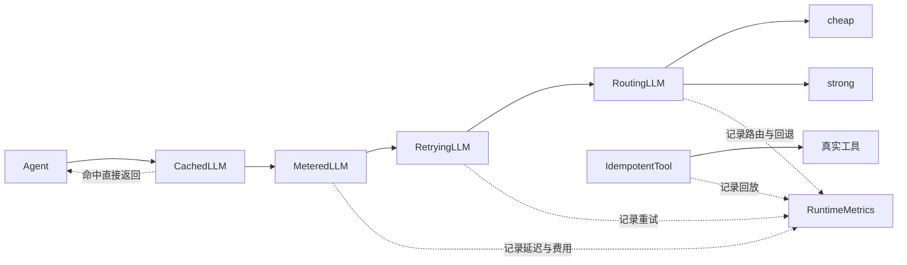

# 第 18 章 生产化部署：成本、延迟与可靠性

## 本章导读

周五上线，周一账单是预算的八倍；P95 延迟从 8 秒涨到 47 秒；一次上游 503 引发三层重试，请求量放大九倍；更糟的是，客服系统里出现了三张内容完全相同的退款工单。Demo 阶段只关心“能不能答对”，生产阶段还要回答三个问题：每次**成功任务**花多少钱、尾延迟有多长、失败和重试会不会制造重复副作用。本章讨论如何把这三件事一起管住。

⭐⭐⭐ 进阶 ｜ 适合：工程师、平台工程师、技术负责人

## 学习目标

读完本章你将能够：

- 用“每次成功任务的成本”、P95/P99 延迟与成功率描述生产目标，而不是只看单次调用
- 区分提示缓存（Prompt Caching）与应用层响应缓存，设计正确的缓存键与隔离边界
- 用模型路由、预算与并发控制优化成本，同时不牺牲高风险任务的质量
- 设计只重试可重试错误、带指数退避与抖动的重试策略，并用幂等避免重复副作用
- 用限流、熔断、降级与异步任务队列处理过载和长任务
- 使用 Atlas v1.4.0 的 `CachedLLM`、`RoutingLLM`、`RetryingLLM`、`IdempotentTool`、`TokenBucket` 与 `JobRunner`

## 18.1 从 Demo 到生产：三个指标必须一起管

Demo 的典型写法是：把问题丢给模型，能跑通就上线。生产环境立刻会暴露三组相互牵制的指标：

- **成本**：不是“一次调用多少钱”，而是“完成一个用户任务平均花多少钱”。一个任务可能包含 8 次模型调用、5 次工具调用和 2 次重试，只统计第一次调用会严重低估。
- **延迟**：用户感知的是端到端时间，包括排队、检索、模型推理、工具执行和多次循环。平均值会骗人，真正影响体验的是 P95 与 P99。
- **可靠性**：包括任务成功率、超时率、重复副作用次数和安全事件数。一个“最终答对但重试三次、重复发了两封邮件”的运行不能算可靠。

三者经常冲突：加缓存降成本，可能返回过期答案；加大重试提成功率，可能放大延迟和费用；换小模型降成本，可能拉低质量。生产化的核心不是把某一项做到极致，而是**为每条业务路径明确优先级和预算**。

一个有用的成本公式是：

```text
每次成功任务成本 =
  (每次任务模型调用数 × 平均 token 数 × 单价 × (1 + 重试率)
   + 工具与基础设施成本)
  ÷ 任务成功率
```

分母最容易被忽略。成功率从 90% 降到 60%，即使单次成本不变，每次成功任务成本也会上升 50%。所以优化成本之前，先确认失败率没有在偷偷放大分母。

容量规划可以用利特尔法则（Little's Law）估算：**并发数 ≈ 到达率 × 平均处理时间**。如果每分钟有 60 个任务、每个任务平均 20 秒，那么平均需要 20 个并发槽位；但为了吸收突发流量，不能只按平均值配置，还要按峰值到达率和 P95 处理时间留余量。

| 优化手段 | 主要影响 | 代价与风险 |
|---|---|---|
| 提示缓存 | 降低输入 token 成本、缩短首 token 延迟 | 要求稳定前缀；缓存有 TTL；跨租户隔离需自己保证 |
| 响应缓存 | 相同请求直接复用 | 命中率依赖重复度；过期数据；可能放大错误 |
| 模型路由 | 简单任务用便宜模型 | 路由误判会伤质量；需要评测集校准 |
| 减少循环步数 | 同时降成本与延迟 | 可能降低复杂任务成功率 |
| 并行工具调用 | 降延迟 | 增加瞬时并发与副作用协调难度 |
| 重试 | 提升瞬时故障下的成功率 | 放大延迟、成本与重复副作用 |
| 异步任务 | 避免请求超时，支持长任务 | 增加队列、状态机与运维复杂度 |


生产目标应该写成可验证的 SLO，例如“95% 的任务在 60 秒内成功完成，且每次成功任务成本低于 0.08 美元”。只写“要快、要便宜”无法驱动工程决策，也无法判断一次发布是变好还是变坏。


## 18.2 成本：缓存、路由与预算

### 18.2.1 提示缓存与应用层响应缓存

“缓存”在 Agent 系统里至少指两种完全不同的东西。

**提示缓存（Prompt Caching）** 由模型服务商提供：把一段稳定的前缀（系统提示、工具定义、长文档）缓存起来，后续请求命中时复用已计算的键值状态。它不改变模型输出，只减少重复计算，因此通常表现为输入 token 折扣和首 token 延迟下降。代价是前缀必须稳定：只要在开头改一个字，后面的缓存就可能全部失效。所以系统提示应把“稳定内容”放前面，“每次变化的内容”放后面。

**应用层响应缓存** 是应用自己做的：把“完整请求 → 完整响应”存起来，下次相同请求直接返回，模型根本不会被调用。它省得更多，但风险也更大：缓存键设计错误会串租户，TTL 过长会返回过期事实，缓存了工具调用提议则可能把一次副作用放大成多次。

| 维度 | 提示缓存 | 应用层响应缓存 |
|---|---|---|
| 缓存对象 | 模型内部的提示前缀状态 | 完整响应（文本或工具调用） |
| 命中条件 | 前缀完全一致（通常有最小长度） | 请求键完全一致 |
| 主要收益 | 输入 token 折扣、降低首 token 延迟 | 省掉整次模型调用 |
| 一致性风险 | 低，输出仍由模型生成 | 高，可能返回过期或越权内容 |
| 工具调用 | 不影响 | 默认不应缓存，避免副作用放大 |
| 隔离责任 | 服务商负责缓存实现，应用负责前缀不泄密 | 应用必须把租户、权限、模型版本放进键 |
| 适用场景 | 长系统提示、固定工具集、长文档问答 | 高频重复问答、离线批处理、幂等查询 |

Atlas 的 `CachedLLM` 实现的是应用层响应缓存。它的键由 `response_cache_key` 生成，包含命名空间、消息、工具定义、温度和 `max_tokens`，并用 SHA-256 规范化。三个设计点值得注意：

1. **默认不缓存带工具调用的响应**。复用一段“建议调用 `send_email`”的文本，并不等于复用发信结果；如果上层真的执行了它，就会重复产生副作用。需要时应显式打开 `cache_tool_calls=True`，并确保工具本身幂等。
2. **命名空间必须包含租户与权限范围**。`namespace="tenant-a"` 与 `namespace="tenant-b"` 的缓存互不可见；生产环境还应把模型版本、提示版本放进键空间，避免发布后读到旧模型的响应。
3. **返回深拷贝**。缓存对象被调用方修改后不能污染下一次命中，否则会出现难以复现的“缓存漂移”。




语义缓存（Semantic Cache）用向量相似度判断“问题差不多”，命中率更高，但在事实查询、金额、日期、权限相关场景可能返回错误答案。它不是“更聪明的精确缓存”，而是一种用正确性换成本的权衡；高风险路径应禁用，或至少把相似度阈值调到极高并保留人工复核。


### 18.2.2 模型路由：把便宜模型用在它够用的地方

模型路由（Model Routing）根据任务特征选择不同模型。最简单的策略是长度路由：短提示走便宜模型，长上下文或带 `[deep]` 标记的请求走强模型。更复杂的做法包括按任务类型分类、按历史成功率选择、以及级联（Cascade）：先让小模型尝试，置信度不足再升级。

路由的价值来自模型价格的巨大差异；风险来自误判。把一份需要精细法律推理的合同交给小模型，省下的钱可能远低于一次错误决策的代价。因此路由策略必须用评测集校准，而不是凭感觉设阈值。

| 路由方式 | 判断依据 | 优点 | 风险 |
|---|---|---|---|
| 静态规则 | 任务类型、租户套餐、显式标记 | 可预测、易调试 | 覆盖不了长尾 |
| 长度/结构启发式 | 提示长度、工具数量、是否多跳 | 实现简单、无额外调用 | 长度不等于难度 |
| 分类器 | 轻量模型判断任务难度 | 比启发式准 | 多一次调用与维护成本 |
| 级联 | 小模型先答，置信度不足再升级 | 平均成本低 | 需要可靠的置信度信号 |
| 学习型路由 | 历史成功率与成本 | 可持续优化 | 需要数据管道与防反馈偏差 |

Atlas 的 `RoutingLLM` 采用“路由表 + 回退顺序”的结构。它只捕获 `LLMError`，不会把代码缺陷（例如 `KeyError`）误当成上游故障而静默切换模型；这一点很重要：路由应该处理“模型服务不可用”，不应掩盖程序 bug。

```python
# src/atlas/runtime/routing.py（节选）
for index, name in enumerate(order):
    try:
        response = self.routes[name].complete(...)
    except LLMError as exc:
        last_error = exc
        continue
    self.last_route = name
    self.counts[name] = self.counts.get(name, 0) + 1
    return response
raise LLMError(f"all routes failed: {last_error}")
```

还要注意路由与安全策略的交互：高风险工具不应因为“走了便宜模型”就绕过审批或护栏。路由只决定用哪个模型，不改变权限边界。

### 18.2.3 预算与计量：把成本变成可执行约束

只在月底看账单已经太晚。生产系统需要把预算变成运行时约束：单次运行最多多少步、多少 token、多少钱、多少秒。Atlas 的 `BudgetStopPolicy` 在每一步检查 `max_steps`、`max_tokens`、`max_cost_usd`、`max_seconds` 与 `max_tool_calls`，任一超限就停止并给出对应的 `stop_reason`；其中 `max_tool_calls` 因 `StopReason` 没有独立取值，当前归入 `max_steps`。

`MeteredLLM` 负责把“调用”变成可聚合的数字：记录延迟、token 与费用，并可按 `ModelPrice` 覆盖服务商返回的 `cost_usd`。价格表区分普通输入、缓存命中输入与输出，未提供缓存价格时按普通输入价计算——宁可高估，也不要漏算。

```python
# src/atlas/runtime/metrics.py（节选）
@dataclass(frozen=True)
class ModelPrice:
    prompt_per_1k: float
    completion_per_1k: float
    cached_prompt_per_1k: float | None = None

    def cost(self, usage: Usage) -> float:
        cached = min(max(usage.cached_tokens, 0), max(usage.prompt_tokens, 0))
        uncached = max(usage.prompt_tokens - cached, 0)
        ...
```

成本指标要按维度拆分：租户、任务类型、模型、路由、提示版本。只有这样，才能回答“哪个客户的哪类任务在吞预算”，而不是只看到一个总数。

## 18.3 延迟：优化尾延迟，而不是平均值

一次 Agent 请求的延迟可以拆成：排队时间、上下文构建、模型首 token 延迟、解码时间、工具执行、以及多轮循环的叠加。平均值低不代表体验好——如果 5% 的请求要 60 秒，用户会记住那 5%。

尾延迟还会被扇出放大。假设并行调用 20 个下游，每个下游有 1% 的概率超过 1 秒，那么至少一个慢请求的概率是 `1 - 0.99^20 ≈ 18%`。Agent 的工具并行调用、检索分片、多智能体协作都会制造这种放大。

| 优化手段 | 降低哪部分延迟 | 说明 |
|---|---|---|
| 减少循环步数 | 整体 | 合并工具、提前停止、避免无效反思 |
| 并行工具调用 | 工具阶段 | 只对无依赖且无副作用的调用并行 |
| 提示缓存 | 首 token | 稳定前缀越长收益越明显 |
| 流式输出 | 感知延迟 | 首 token 更早出现，但总时长未必变短 |
| 模型路由 | 解码 | 简单任务用更快的模型 |
| 上下文裁剪 | 首 token 与解码 | 少放无关内容，降低 prefill 与注意力开销 |
| 区域化部署 | 网络 | 缩短客户端到服务端的往返 |
| 异步任务 | 请求等待 | 长任务改为提交后轮询或回调 |

超时（Timeout）要分层设置，并明确“超时之后发生了什么”：

- **单次模型请求超时**：防止一个挂起的连接占住工作线程。
- **单步超时**：覆盖一次模型调用加其触发的工具。
- **整次运行截止时间**：对应 `RunContext.deadline_at` 或预算中的 `max_seconds`。
- **队列等待超时**：任务在队列里待太久，应在开始前就失败，而不是执行到一半被取消。

超时不等于取消。很多 SDK 在客户端超时后，服务端可能仍在生成；如果没有把取消信号传到下游，成本仍会发生。生产实现应尽量使用支持取消的客户端，并在工具层传递截止时间。

## 18.4 可靠性：重试、限流、熔断与降级

### 18.4.1 重试：只重试可重试的错误

重试不是“失败就再来一次”。首先要区分：

- **可重试**：超时、连接重置、429、502/503/504、临时不可用。
- **不可重试**：400 参数错误、401/403 鉴权失败、内容审核拒绝、业务规则冲突。
- **不确定**：请求已发出但没收到响应。这类最危险，必须靠幂等解决，而不是靠重试次数。

其次要控制**重试放大**。如果客户端重试 3 次、网关重试 3 次、模型 SDK 再重试 3 次，一次失败会变成 27 次请求。正确做法是只在一层做重试，其他层关闭自动重试，或用“重试预算”（Retry Budget）限制重试请求占总请求的比例。

指数退避加抖动（Exponential Backoff with Jitter）是标准做法：第 `n` 次重试等待 `base × 2^(n-1)`，再乘以一个随机因子，避免大量客户端在同一时刻再次打满上游。

```python
# src/atlas/runtime/retry.py（节选）
def delay(self, attempt: int, random_fn=random.random) -> float:
    raw = min(self.max_delay, self.base_delay * (2 ** (attempt - 1)))
    return raw * random_fn() if self.jitter else raw
```

Atlas 的 `RetryingLLM` 把重试封装在 `LLM` 协议内，对上层 Agent 完全透明。`RetryingTool` 则要求显式传入 `idempotent=True` 才允许多次尝试——因为重试一个非幂等的发信、扣款或建单工具，可能把一次失败变成多次副作用。这个约束应该由构造函数强制，而不是写在文档里指望调用方记得。

### 18.4.2 限流与并发：主动拒绝比雪崩好

限流（Rate Limiting）控制单位时间内的请求量，常用令牌桶（Token Bucket）：桶以固定速率补充令牌，请求消耗令牌，没有令牌就等待或拒绝。它允许短时突发，同时约束长期平均速率。

并发限制（Concurrency Limit）控制同时进行的请求数，常用信号量。两者解决不同问题：限流防上游被打爆，并发限制防本进程资源耗尽。容量规划时可以用利特尔法则把二者关联起来。

Atlas 的 `TokenBucket` 是进程内实现，`RateLimitedLLM` 在获取令牌后记录等待时间。必须明确它的边界：多实例部署时，每个实例各有自己的桶，总速率是实例数乘以单实例速率。需要全局限流时，应使用 Redis 令牌桶、API 网关配额或服务商提供的配额管理。

过载时，**快速拒绝**通常比无限排队更好：排队会让延迟不断上升，最终所有请求都超时，还占满内存。返回 429 并带上 `Retry-After`，让客户端有序退避，是更可控的失败方式。

### 18.4.3 熔断与降级：把故障限制在局部

熔断器（Circuit Breaker）在连续失败后打开，后续请求直接失败，不再打向已经不健康的上游；经过冷却期后进入半开状态，放少量请求试探，成功则关闭，失败则继续打开。

降级（Degradation）是熔断后的产品决策，必须按路径预先定义：

- 非关键摘要任务：返回缓存结果、模板答案，或提示“稍后重试”。
- 搜索结果不足：减少检索轮次，明确告知答案可能不完整。
- 高风险动作（转账、发信、发布）：**失败关闭**，绝不降级为“静默执行”。
- 长任务：转入异步队列，完成后通知用户。

安全路径与可用性路径的降级策略可能相反。第 17 章强调失败关闭；本章强调可用性。两者不矛盾：**安全决策失败时关闭，非安全功能失败时降级**，这个边界要在设计时写清楚。

### 18.4.4 幂等：重试与异步的前提

分布式系统里，端到端的“恰好一次”（Exactly Once）很难实现。更现实的模型是：**至少一次交付 + 幂等消费 = 有效一次**。所谓有效一次，是指重复请求不会产生重复副作用。

实现幂等的常见方式：

- 调用方生成幂等键（Idempotency Key），通常由业务实体、操作类型和规范化参数哈希得到。
- 服务端用唯一约束或原子 `SETNX` 占位，记录“处理中/已完成”。
- 已完成的请求直接返回首次结果；处理中则返回冲突或让调用方轮询。
- 结果设置合理 TTL，避免存储无限增长。

Atlas 的 `IdempotentTool` 按“命名空间 + 工具名 + 规范化参数”生成键，只缓存成功结果；失败不缓存，避免把一次瞬时故障固化成永久失败。回放时会在 `metadata` 中标记 `idempotent_replay=True`，便于追踪区分真实执行与复用。它也有明确的局限：进程内存储、没有原子占位，并发相同调用仍可能同时穿透；生产环境应换成 Redis 或数据库唯一约束。




不要对“结果不确定”的调用直接重试。例如扣款请求超时，可能已经扣款成功；此时再发一次就是重复扣款。正确顺序是：先用幂等键查询结果，确认未执行后再重试。


## 18.5 长任务：异步、队列与可恢复执行

一个深度研究任务可能运行十几分钟，远超 HTTP 请求的合理等待时间。把它硬塞进同步接口，会遇到网关超时、连接中断、用户刷新页面后任务丢失等问题。生产系统通常采用异步任务模式：

1. 客户端提交任务，服务端立即返回 `job_id`。
2. 任务进入队列，由 worker 领取执行。
3. 客户端轮询状态，或由服务端通过 Webhook 通知。
4. 结果持久化，支持查询、取消与重试。



队列实现有几个容易踩的坑：

- **可见性超时/租约**：worker 领取任务后，任务对其他 worker 隐藏；如果 worker 崩溃，租约到期后任务应重新可见。没有这个机制，进程崩溃会让任务永远停在 `running`。
- **心跳**：长任务要定期续租，否则会被误判为死亡并重复领取。
- **幂等**：任务可能被至少一次执行，所有副作用必须可去重。
- **检查点**：把已完成的步骤、上下文快照和预算持久化，恢复时从检查点继续，而不是从头重跑。

Atlas 的 `JobRunner` 是一个最小实现：`JobStore` 负责保存与领取，`InMemoryJobStore` 用锁保证同一任务不会被两个线程同时领取。`JobRunner.run_once` 为任务生成稳定的 `run_id`，并把 `job_id` 与当前 `attempt` 写入运行元数据；失败且未超过 `max_attempts` 时把状态改回 `pending`。

一个 Agent 特有的细节是：`Agent.run` 会把模型异常转成 `stop_reason="error"`，而不是让异常冒泡。因此 `JobRunner` 除了捕获异常，还要把 `stop_reason="error"` 当作可重试失败：

```python
# src/atlas/runtime/jobs.py（节选）
trajectory = self.runner.run(job.task, ctx)
if trajectory.stop_reason in self.retry_stop_reasons:
    raise RuntimeError(f"agent stopped with {trajectory.stop_reason}")
job.status = "succeeded"
```

| 执行方式 | 适用时长 | 优点 | 代价 |
|---|---|---|---|
| 同步请求 | 秒级到十几秒 | 实现简单、交互直接 | 受网关超时限制，过载时容易雪崩 |
| 异步队列 | 分钟级 | 削峰、可重试、可查询 | 需要状态机、幂等与运维 |
| 持久化执行 | 分钟到天 | 崩溃后可恢复、支持长时间等待 | 框架与状态存储复杂度高 |

“持久化执行”（Durable Execution）把每个步骤的结果记录下来，进程重启后从最后完成的位置继续。Temporal 一类系统是典型代表。它不是银弹：步骤边界必须幂等，外部副作用要与工作流状态协调，否则恢复时仍可能重复执行。



```python
def run_task(task: str) -> str:
    trajectory = agent.run(task)
    return trajectory.final_answer or ""
```
实现最简单，但请求会一直占用连接；任务超过网关超时时间就会被客户端判定失败，而上游可能仍在执行。



```python
def submit(task: str) -> str:
    job = jobs.submit(task)
    return job.id

# 另一个进程或线程
while True:
    job = jobs.run_once()
    if job is None:
        break
```
提交与执行解耦，客户端轮询或等待通知。代价是需要任务状态、幂等、租约与结果存储。



```text
workflow = start(task)
  step 1: 检索资料      -> 记录结果
  step 2: 调用模型      -> 记录结果
  step 3: 等待人工审批  -> 可跨小时挂起
  step 4: 发布报告      -> 幂等键写入
进程崩溃后，从最后完成的 step 继续。
```
适合长时间等待与严格恢复语义，但引入额外基础设施，且每个步骤仍需幂等。



## 18.6 发布与持续迭代：别让优化悄悄变成回归

生产环境不是“部署完就结束”。模型会升级、提示会修改、工具会变化，任何一项都可能让昨天的成功案例今天失败。

发布策略上，常见做法包括：

| 策略 | 做法 | 适用场景 | 风险 |
|---|---|---|---|
| 蓝绿部署 | 两套环境切换流量 | 需要快速回滚 | 资源翻倍，状态迁移复杂 |
| 金丝雀发布 | 1%→5%→25%→100% 逐步放量 | 大多数在线服务 | 需要可靠的指标对比 |
| 影子流量 | 复制真实请求给新版本，不返回给用户 | 验证模型/提示变更 | 成本翻倍，隐私与权限要隔离 |
| 功能开关 | 按租户/用户/任务类型开启 | 灰度与紧急关闭 | 开关组合爆炸，需定期清理 |

发布门禁应该复用第 15 章的评测集、第 16 章的 Trace 和第 17 章的安全切片。至少观察四类指标：

- **质量**：任务成功率、关键字段准确率、人工复核通过率。
- **延迟**：P50、P95、P99，以及首 token 时间。
- **成本**：每次成功任务成本、缓存命中率、重试率。
- **安全**：未授权副作用次数、审批拒绝率、注入告警数。

模型版本必须固定并登记。服务商可能弃用旧模型或静默调整行为，依赖“latest”别名会让线上行为不可复现。升级模型应像升级数据库一样对待：先在评测集上跑，再影子流量，再金丝雀，最后全量，并保留回滚开关。


一个实用的发布原则是“提示、模型、工具定义、路由阈值”都纳入版本管理，并记录每次运行的版本组合。否则当指标变差时，你无法回答“到底是模型变了、提示变了，还是流量变了”。


## 18.7 动手实践：Atlas v1.4.0 的运行时层

Atlas 没有修改 `Agent` 的冻结接口。第 18 章新增的能力全部通过实现现有协议接入：

- 所有 LLM 包装器都实现 `complete(messages, tools=None, *, temperature, max_tokens)`。
- 所有工具包装器都暴露 `spec` 与 `run(arguments)`。
- 因此 `Agent`、`ToolRegistry`、评测器与追踪器都不需要改动。



### 18.7.1 组合顺序

包装器的顺序会改变语义。Atlas 示例采用“缓存最外、重试其次、计量再次、路由最内”：

```python
# examples/ch18_runtime.py（节选）
cached = CachedLLM(
    RetryingLLM(
        MeteredLLM(
            RoutingLLM(
                {"cheap": cheap, "strong": strong},
                LengthRouter(threshold_chars=60),
                fallback_order=("strong",),
                metrics=metrics,
            ),
            price=ModelPrice(1.0, 2.0, 0.5),
            route="router",
            metrics=metrics,
        ),
        RetryPolicy(max_attempts=2, base_delay=0.0, jitter=False),
        metrics=metrics,
    ),
    cache=InMemoryResponseCache(),
    namespace="tenant-a:atlas-demo",
    metrics=metrics,
)
```

- 缓存放最外层：命中时不会产生任何模型费用，也不会污染延迟统计。
- 重试放在计量外：每次真实尝试都会经过计量层，失败尝试记录为 `llm_errors`，成功尝试记录延迟与费用；退避等待不计入单次调用延迟。
- 路由放在最内层：路由自身可以回退到备用模型；如果整条链路仍失败，外层重试再发起新一轮。

顺序不是固定的。如果你希望“重试时也走缓存”，可以把缓存放到重试内层；如果你只想统计最终成功的逻辑调用，可以把计量放到重试外层；如果你希望看到每次尝试的延迟与错误，就把计量放在重试内层（本节示例）。关键是明确指标口径，并保持全局一致。

### 18.7.2 缓存、路由与计量

`CachedLLM` 默认不缓存工具调用提议，`LengthRouter` 用长度阈值选择路由，`MeteredLLM` 用可注入时钟测量延迟。示例中第二次短请求命中缓存，`cheap` 模型只被调用一次：

```text
== 路由与缓存 ==
short -> cheap: 短回答 | hit = False
short -> cheap: 短回答 | hit = True
long  -> strong: 深度回答 | hit = False
calls: cheap=1 strong=1
```

注意这里缓存的是“模型响应”，不是“最终任务结果”。如果上游还有检索或工具调用，应用层缓存只能省掉模型这一段，不能替代对整个任务的缓存编排。

### 18.7.3 重试与幂等

重试示例让前两次调用返回 503，第三次成功。注入的 `sleep` 记录退避序列 `[0.1, 0.2]`，因此不需要真实等待：

```text
== 重试 ==
result = flaky: 恢复成功
attempts=3 delays=[0.1, 0.2]
```

幂等示例中，同一用户重复提交相同的建单参数，真实工具只执行一次；第二次返回缓存结果并标记回放。换一个命名空间则视为另一个用户，重新执行：

```text
== 幂等工具 ==
user-1 first=ticket-001 replay=True
user-2 isolated -> real_calls=2
```

### 18.7.4 限流与指标

`TokenBucket(rate=1.0, capacity=1.0)` 在第二次请求时等待 1 秒。`RateLimitedLLM` 只记录大于零的等待，因此指标里的等待次数与真实阻塞次数一致：

```text
== 限流 ==
waits=1 wait_seconds=1.0
```

`RuntimeSnapshot` 提供缓存命中率、平均模型延迟、平均工具延迟、总费用，以及按 `MeteredLLM.route` 统计的调用数。这些指标是旁路累计，不参与控制流；记录失败不应改变调用结果。

### 18.7.5 长任务

`JobRunner` 把一次 Agent 运行包装成任务。示例中 worker 第一次抛错，任务回到 `pending`，第二次成功：

```text
== 任务队列 ==
status=succeeded attempts=2 answer=报告已生成
```

最终指标快照同时展示模型调用数、缓存命中率、重试次数、总费用与路由分布：

```text
== 指标快照 ==
llm_calls=3 cache_hit_rate=0.33 retries=2 cost=$2.22
routes={'router': 2, 'strong': 1}
```

<details>
<summary>深入了解：为什么缓存命中率不能单独作为优化目标</summary>

缓存命中率可以通过“把键设计得很粗”来刷高，例如忽略模型版本、租户或工具定义。这种命中率越高，越可能返回越权或过期的内容。真正应该看的是“命中且答案仍正确”的比例，以及命中带来的成本节省是否被错误率抵消。缓存指标必须与质量指标、隔离测试一起看。

</details>

### 18.7.6 当前实现的边界

| 能力 | Atlas v1.4.0 | 生产建议 |
|---|---|---|
| 响应缓存 | 进程内、TTL + LRU | Redis/Memcached，跨实例共享，键含租户与版本 |
| 幂等存储 | 进程内、非原子占位 | 数据库唯一约束或 Redis `SETNX`，处理并发穿透 |
| 限流 | 单进程令牌桶 | 全局限流器或网关配额，按租户公平分配 |
| 重试 | 异常名与文本匹配 | 对接服务商错误类型，设置重试预算 |
| 任务队列 | 进程内、锁保护领取 | 带可见性超时、心跳与死信队列的持久化队列 |
| 熔断 | 未实现 | 按依赖配置熔断器，定义降级路径 |
| 检查点 | 未实现 | 持久化轨迹、预算与工具结果，支持恢复 |

本章的运行时聚焦模型调用与工具调用链路。第 5 章的 MCP 连接池、第 7–8 章的持久化记忆与增量索引、第 10 章的多 Agent 并行调度，属于同一主题的不同切面；Atlas v1.4.0 没有逐一实现，而是通过协议包装与可替换存储留出接入位置。生产落地时应把这些能力与上表的替换点一起规划，而不是假设某一章会自动补齐。

## 18.8 业界案例：缓存、路由与持久化执行

**提示缓存。** Anthropic 的 Prompt Caching 和 OpenAI 的自动提示缓存都把“稳定前缀复用”做进了模型服务：长系统提示、工具定义或文档前缀命中后，输入侧计费与首 token 延迟都会下降。两家都要求前缀保持稳定，且缓存有生命周期；具体的最小长度、写入倍率、读取折扣与 TTL 会随产品和模型变化，落地时应以官方文档为准。工程上的共同结论是：**把稳定内容前置，把变化内容后置**，并监控前缀命中率，而不是假设“开了缓存就一定省钱”。

**模型路由与回退。** 开源网关 LiteLLM 的 Router 提供重试、回退与多种路由策略，常被用在同一套应用接口后接多家模型供应商的场景。它的价值不只是省钱，还包括供应商故障时的可用性。代价是配置复杂度与可观测性要求上升：如果不知道每次请求走了哪个模型，就无法解释质量波动。

**持久化执行。** Temporal 一类持久化执行系统把工作流步骤的状态写入事件历史，进程崩溃后可以从最后完成的位置恢复。它适合长时间等待人工审批、跨小时运行的研究任务和需要严格重试语义的业务流程。对 Agent 而言，关键设计是：模型调用和工具调用都要有幂等键，检查点要保存“已产生哪些副作用”，而不只是“执行到第几步”。


本章提到的产品能力和计费方式会变化。上线前应以服务商官方文档为准，并通过自己的小流量实验验证缓存命中率、路由质量与故障回退行为。


## 18.9 常见误区

1. **只统计单次调用成本。** 一个任务可能包含多次模型调用、重试和工具调用。正确口径是“每次成功任务成本”，并把失败率放进分母。
2. **多层重试叠加。** 客户端、网关、SDK 各配三次重试，失败时请求量放大 27 倍。只保留一层重试，其他层显式关闭。
3. **对非幂等工具重试。** 发信、扣款、建单被重试会制造重复副作用。重试必须与幂等键、唯一约束或结果查询配合。
4. **缓存键不含租户或版本。** 命中率看似很高，实际在跨权限复用内容。命名空间必须包含租户、权限范围、模型与提示版本。
5. **把超时当取消。** 客户端超时后上游可能仍在生成和计费。要传递取消信号，并监控“超时后仍产生费用”的比例。
6. **只优化平均延迟。** 平均值下降但 P99 恶化，用户体验仍然糟糕。尾延迟还会被并行扇出放大。
7. **降级策略一刀切。** 高风险动作降级为静默执行是安全事故；正确做法是安全路径失败关闭，非安全路径才降级。
8. **异步队列没有租约和幂等。** worker 崩溃后任务卡在 `running`，或者被重复领取执行两次。

## 18.10 本章小结

- 生产化要同时管理成本、尾延迟与可靠性，核心口径是“每次成功任务成本”和 P95/P99。
- 提示缓存优化输入侧，应用层响应缓存省掉整次调用；后者必须处理租户隔离、TTL、工具调用与版本失效。
- 模型路由用便宜模型处理简单任务，但必须用评测集校准，且不改变安全边界。
- 重试只针对可重试错误，配合指数退避、抖动、重试预算与幂等；非幂等工具不得盲目重试。
- 限流与并发控制保护上游和本进程；过载时快速拒绝优于无限排队。
- 熔断把故障限制在局部；降级策略要按路径预先定义，安全路径失败关闭。
- 长任务应异步化，队列需要租约、心跳、幂等与检查点；持久化执行能恢复，但不能替代幂等设计。
- 发布要用评测、Trace 与安全指标做门禁，固定模型与提示版本，支持金丝雀与回滚。
- Atlas v1.4.0 用协议兼容的包装器实现缓存、路由、重试、幂等、限流、计量与任务队列，未改动冻结接口。

## 18.11 思考与练习

1. **成本计算。** 某任务平均调用模型 6 次，每次输入 3,000 token、输出 500 token；输入单价 1 美元/百万 token，输出 4 美元/百万 token；重试率 15%，成功率 80%。估算每次成功任务成本。如果缓存命中一半输入，成本会降到多少？
2. **幂等设计。** 为“提交退款申请”工具设计幂等方案：键由哪些字段组成？如何处理“处理中”的并发请求？TTL 应该设多长？失败结果要不要缓存？
3. **动手练习。** 在 `examples/ch18_runtime.py` 基础上，为 `RoutingLLM` 增加一个“按任务类型路由”的路由器，并用至少 5 条测试用例验证：简单问答走便宜模型、合同分析走强模型、未知类型回退到默认模型。再为 `JobRunner` 增加一个“租约过期后任务重新变为 pending”的模拟测试。
