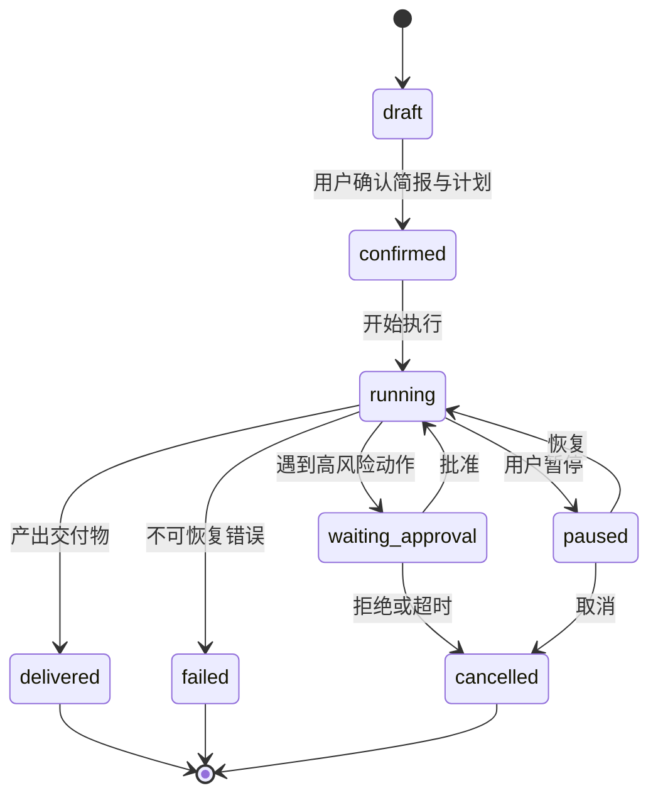
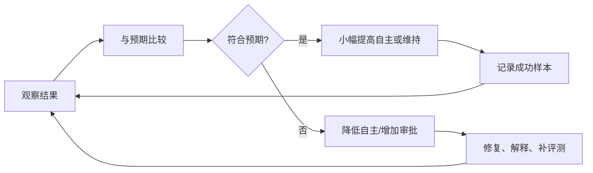
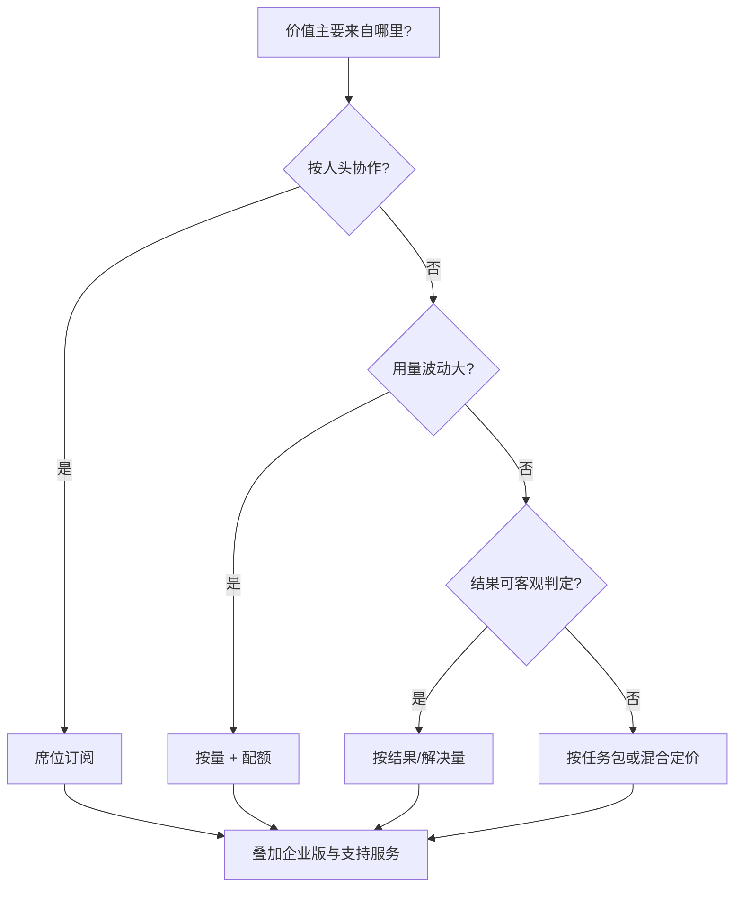

# 第 19 章 Agent 产品设计：交互、信任与商业模式

## 本章导读

一个团队做出了能自动完成竞品调研的 Agent，用户却只把它当搜索框用；另一个团队让 Agent 自动发周报，一次发错收件人之后，所有人关掉了自动模式。能力已经具备，产品却没有被真正使用。Agent 产品设计的核心，不是把自主性调到最高，而是决定**哪些决策交给模型、哪些留给用户**，并让这种分配随着信任逐步扩大。

⭐⭐ 进阶 ｜ 适合：产品经理、设计师、工程师、创业者

## 学习目标

读完本章你将能够：

- 用失败成本、可验证性与可逆性判断一个任务适合的自主级别
- 区分对话式、委派式、后台运行式与嵌入式交互，并为任务选择合适形态
- 设计任务简报、计划确认、进度展示、中断与接管流程
- 用可验证信号校准用户信任，设计渐进式自主与信任修复
- 比较订阅、按量、按结果与混合定价，并把 Atlas 的轨迹、Trace、评测、审批与任务队列映射到产品界面

## 19.1 产品设计的起点：用户愿意把什么交给 Agent

技术文档回答“Agent 能做什么”，产品文档必须回答“用户愿意让它做什么”。这两者之间隔着三个现实约束：

- **失败成本（Cost of Failure）**：答错一句话，和发错一封邮件、改错一行生产代码，后果完全不同。
- **可验证性**：用户能否在几分钟内判断结果对不对。能验证的任务可以大胆放权，不能验证的任务必须保留人工门。
- **可逆性（Reversibility）**：错误能否撤销。可撤销的动作可以先执行再通知，不可撤销的动作要先审批。

先看一个判断表：

| 任务 | 失败成本 | 可验证性 | 可逆性 | 建议自主级别 | 交互形态 |
|---|---|---|---|---|---|
| 资料查询、摘要 | 低 | 高 | 高 | L2–L3 | 对话式、嵌入式 |
| 文档草稿、竞品分析 | 中 | 中 | 高 | L3 | 委派式 |
| 代码修改、测试修复 | 中 | 高（diff/测试） | 高 | L3 | 委派式、嵌入式 |
| 客服退款、账户变更 | 高 | 中 | 低 | L2–L3 + 审批 | 委派式 + 审批 |
| 生产运维变更 | 极高 | 低 | 极低 | L1–L2 + 双人审批 | 后台 + 人工门 |
| 长周期研究、监控 | 中 | 中（引用） | 高 | L3–L4 | 后台运行式 |

建议从“高频、可验证、可逆、失败成本可控”的场景切入。这类任务能快速积累成功样本，让用户建立信任；反过来，从低频、不可逆、难以验证的场景起步，产品会在第一次错误后失去用户。


模型能力决定“理论上能不能做”，产品设计决定“现在该不该放手”。不要因为演示里能全自动完成，就默认用户愿意在第一次使用时交出全部决策权。


## 19.2 四种交互范式

### 19.2.1 对话式：适合探索，不适合长任务

对话式（Conversational）交互以多轮消息为中心。优点是低门槛、易纠偏、适合需求本身还不清楚的任务；缺点是用户要自己组织提示、维护上下文，长任务容易在对话里“淹掉”，产物也不稳定。

对话式产品要解决三个问题：

- **空白框问题**：用户不知道能问什么。用示例任务、快捷指令与能力边界说明降低启动成本。
- **上下文丢失**：长对话需要摘要、置顶目标与“当前任务”状态，而不是让用户反复复述。
- **结果不可复用**：重要产物应可保存为文档、看板或任务，而不是留在聊天记录里。

### 19.2.2 委派式：把任务当项目来管

委派式（Delegated）交互让用户提交一个目标，Agent 先给计划，再执行，最后交付可审查的产物。它适合多步骤、需要工具、需要产物的知识工作。

委派式的设计重点是四个界面：

1. **任务简报**：目标、范围、来源、约束、交付格式、预算与权限。
2. **计划预览（Plan Preview）**：准备做哪几步、用哪些工具、可能产生什么副作用、预计多久花多少钱。
3. **执行视图**：当前步骤、已完成步骤、证据与异常。
4. **审查与交付**：diff、引用、报告、可编辑结果，以及“接受/修改/重做”。

委派式不是“把聊天框改名叫任务”。如果用户提交后只看到一个转圈，它仍然是一个体验更差的聊天框。

### 19.2.3 后台运行式：用户只在异常时出现

后台运行式（Background / Ambient）让 Agent 持续监听事件或按计划执行，例如监控竞品更新、每天整理工单、CI 失败后自动修复。用户不再逐步操作，而是在收到通知或查看摘要时介入。

后台产品必须先回答“出了事谁负责”：

- **升级路径**：什么情况通知人、通知谁、多久没响应就暂停。
- **预算与频率**：每天最多跑几次、最多花多少钱、失败重试几次。
- **审计与回滚**：每一次自动动作都能查到原因与结果，关键动作可撤销。
- **急停开关**：一键暂停全部自动任务，而不是逐个关闭。

没有这些机制，后台 Agent 会把“自动化”变成“无人看守的风险”。

### 19.2.4 嵌入式：在用户已有的工作流里出现

嵌入式（Embedded / Copilot）把 Agent 放进 IDE、CRM、邮件或客服工作台，以建议、补全、侧边栏或一键操作的形式出现。它的优势是低摩擦：用户不需要切换工具，也不需要重新描述上下文。

风险是**自动化偏差（Automation Bias）**：用户容易接受看起来合理的建议，尤其是在高频、重复的任务里。设计上要保留“为什么这样建议”的证据、明显的撤销入口，以及不确定时的降级提示。

| 形态 | 用户注意力 | 任务时长 | 结构程度 | 关键界面 | 主要风险 |
|---|---|---|---|---|---|
| 对话式 | 持续在场 | 秒到分钟 | 低 | 消息、示例、产物卡片 | 提示负担、上下文丢失 |
| 委派式 | 提交与审查时在场 | 分钟到小时 | 中高 | 简报、计划、进度、审查 | 计划偏离、等待焦虑 |
| 后台式 | 例外时在场 | 小时到天 | 高 | 通知、摘要、审计、急停 | 无人监督、错误累积 |
| 嵌入式 | 任务进行中 | 秒到分钟 | 高 | 内联建议、diff、撤销 | 自动化偏差、上下文误判 |

### 19.2.5 组合使用，而不是四选一

真实产品很少只用一种形态。委派任务执行到一半需要澄清时，应能无缝转为对话；后台任务发现异常时，应升级为一次对话或审批；嵌入式建议可以一键升级为委派任务。关键不是形态本身，而是**上下文与状态能否在形态之间携带**。如果用户从“后台通知”点进去，还要重新描述任务，自动化就失去了意义。




用户：帮我看看这份竞品报告还缺什么。
Agent：我先按“市场、产品、定价、渠道”四块检查，缺定价对比和两个来源，要我补吗？



任务简报：对比 A/B/C 三家竞品，输出 8 页报告，必须引用公开来源，预算 20 分钟、2 美元。
Agent：计划 5 步：收集资料 → 提取定价 → 对比功能 → 生成图表 → 成稿。第 2 步需要访问付费数据库，是否授权？



订阅：每周一 9:00 检查三家竞品更新。
Agent 通知：本周检测到 2 处定价变化，已生成 1 页摘要；来源链接 6 条。未发现需要立即处理的风险。



## 19.3 任务简报、计划确认与首次成功

### 19.3.1 任务简报：把“随便做”变成可执行契约

对话式输入往往缺少约束，委派式产品需要用**任务简报（Task Brief）**把隐含要求显式化。不是每个字段都要用户填写，而是系统提供合理默认值，只对“会改变结果”的信息提问。

| 字段 | 作用 | 默认策略 |
|---|---|---|
| 目标 | 要完成什么、给谁看 | 从用户输入提取，复述确认 |
| 范围 | 包含什么、不包含什么 | 给出建议边界，允许编辑 |
| 来源 | 允许使用哪些数据与网站 | 默认只用授权来源 |
| 约束 | 格式、语气、合规、截止时间 | 从模板继承 |
| 交付物 | 文档、表格、代码、消息 | 默认最易审查的形态 |
| 预算 | 时间、费用、步数上限 | 按任务类型给预设档位 |
| 权限 | 可读、可写、可对外发送 | 默认最小权限 |
| 成功标准 | 怎样算完成 | 可验证的检查项，而非“写好一点” |

提问要克制。第一次使用就问十个问题，用户会直接放弃；更好的做法是先给一个可执行的默认方案，再问一两个真正影响方向的问题。例如：“我会默认使用公开来源并输出 Markdown；如果你需要引用内部数据，请现在告诉我。”

### 19.3.2 计划确认：展示“要做什么”，不是展示“怎么想”

计划确认的目的，是让用户在付出等待成本之前发现方向错误。计划应该包含：

- 步骤与顺序，以及每一步的产出。
- 会用到的工具、数据源与外部副作用。
- 预计时间范围与费用范围。
- 明确不做什么，避免范围蔓延。
- 哪些步骤需要审批或人工输入。

计划不是思维链。用户不需要看到模型内部的推理细节，需要看到的是**可审查的承诺**：打算做什么、依据什么、可能影响什么。

### 19.3.3 首次成功：缩短到第一份有价值产物的时间

新用户第一次使用的目标不是“理解所有功能”，而是“在几分钟内拿到一个有用的结果”。可用手段包括：

- 预置 3–5 个真实任务模板，而不是功能清单。
- 首次运行只要求最小授权，用到再申请更多权限。
- 先跑一个只读的试运行（Dry Run），展示计划与样例输出。
- 交付物默认可编辑、可导出，避免“结果只在聊天里”。
- 失败时给出下一步，而不是只报错。

首次成功的指标是**首次有价值产物的时间（Time to First Useful Artifact）**，不是注册数、消息数或功能点击率。

## 19.4 进度、等待、中断与接管

### 19.4.1 等待也是产品的一部分

长任务的等待体验，取决于用户是否知道“现在在做什么、还要多久、会不会出错”。好的进度展示通常包含：

- **阶段**：检索、分析、撰写、校验，而不是一个没有信息的转圈。
- **当前动作**：正在读哪份资料、调用哪个工具、卡在哪一步。
- **已完成证据**：已收集的来源、已生成的中间产物。
- **时间与费用范围**：用区间而不是假精确的百分比。
- **异常与改道**：某个来源不可用时，说明替代方案。

不要用“47%”这种没有依据的精确数字。用户一旦发现进度条和实际不符，就会失去对整个系统的信任。

### 19.4.2 中断的四种语义

中断语义（Interruption Semantics）要回答的不是“有没有取消按钮”，而是一组不同的用户意图：

| 操作 | 语义 | 系统要求 |
|---|---|---|
| 暂停 | 不再发起新动作，保留当前状态 | 停止调度、保存检查点、可恢复 |
| 修改 | 改变目标、范围或计划后继续 | 重新确认计划、重算预算 |
| 接管 | 人接手后续步骤，Agent 转为辅助 | 移交上下文、显示当前状态 |
| 取消 | 终止任务，尽量撤销未完成副作用 | 取消信号传播、幂等、清理资源 |

很多产品的“取消”只是停止前端动画，后端仍在调用模型和工具，费用继续产生。第 18 章的分层超时与取消传播在这里直接决定产品成本与用户信任。取消还必须考虑已经发生的副作用：能回滚的回滚，不能回滚的明确告知。

### 19.4.3 通知与升级

后台任务的通知应该**可操作、可合并、有优先级**：

- 只在需要人决策、出现异常或产出完成时通知。
- 同类事件合并成摘要，避免每个小步骤都推送。
- 明确“需要你做什么”，而不是只发一条“任务已完成”。
- 设置升级路径：超时未处理时提醒上级或自动暂停。



## 19.5 信任校准：让信任与可靠性匹配

信任校准（Trust Calibration）指用户的信任程度与系统实际可靠性相匹配。信任过低，用户不愿使用；信任过高，用户在不该放手时放手，错误后果更大。

- **过度信任**（Overtrust）：用户不看引用就采纳结论，不审查 diff 就合并代码。
- **信任不足**（Undertrust）：系统明明可靠，用户仍逐条核对，产品没有省下时间。

信任不是一次性的品牌印象，而是**针对具体任务、逐步累积的判断**。同一个用户可能放心让 Agent 整理资料，却不放心让它发邮件。

### 19.5.1 信任的三个层次

用户对 Agent 的信任至少有三个层次，不能用一句“可信 AI”笼统概括：

- **能力信任（Competence Trust）**：它能不能把任务做对。信号包括评测结果、成功案例、来源引用与可验证的产物。
- **意图信任（Intent Trust）**：它会不会按我的利益行事。信号包括权限边界、审批门、可撤销操作，以及明确说明“不做什么”。
- **数据信任（Data Trust）**：它会不会泄露、滥用或错误使用我的数据。信号包括权限说明、保留策略、脱敏与审计记录。

三者不能互相替代。能力再强，如果意图不可信，用户也不会授权写操作；数据信任一旦破裂，能力信任也救不回来。产品设计要分别回答这三个问题：**做得对、为我做、数据安全**，并针对最薄弱的一环补齐证据。

### 19.5.2 可验证信号

| 信号 | 建立什么信任 | 代价 | 风险 |
|---|---|---|---|
| 来源引用 | 结论可追溯 | 检索与展示成本 | 引用存在不等于支持结论 |
| 计划预览 | 方向可控 | 多一次确认 | 计划可能与执行不一致 |
| 试运行/预览 | 结果可预判 | 额外一次执行 | 预览环境与真实环境不同 |
| 可逆操作与撤销 | 错误可恢复 | 需要版本与回滚机制 | 并非所有副作用都可逆 |
| 审计记录 | 行为可追责 | 存储与隐私成本 | 记录不等于用户能理解 |
| 不确定性表达 | 知道何时该复核 | 可能降低“聪明感” | 模型自评置信度未必可靠 |
| 一致的行为 | 形成稳定预期 | 需要评测与版本管理 | 模型升级可能破坏一致性 |

### 19.5.3 渐进式自主

渐进式自主（Progressive Autonomy）主张把自主性像权限一样逐步授予，而不是一次性开关：

1. **建议**：Agent 只给方案，人执行。
2. **逐步审批**：每个高风险动作前确认，低风险动作自动执行。
3. **执行后通知**：在策略范围内自动执行，完成后告知，可撤销。
4. **策略内自治**：在明确边界内自主运行，只在异常时升级。

这与第 1 章的 L1–L4 对应，也与第 17 章的审批、第 18 章的预算和审计衔接。升级的条件应该是可验证的：连续 N 次成功、人工修改率低于阈值、无安全事件，而不是“用户看起来很满意”。

### 19.5.4 信任修复

错误发生后，信任修复的顺序通常是：

1. **承认与界定**：发生了什么、影响了谁、范围多大，不淡化也不夸大。
2. **解释到合适的层次**：给出可核验的原因，不展示冗长的内部推理。
3. **修复与补偿**：撤销错误、恢复数据、给出替代方案。
4. **防止复发**：修改默认值、增加审批、补充评测用例。
5. **重新建立**：从小范围任务重新开始，而不是要求用户立刻恢复全自动。

最伤信任的不是犯错，而是犯错后假装没发生，或者用“模型就是这样”把责任推回给用户。



<details>
<summary>深入了解：可解释性不等于展示思维链</summary>

用户需要的是“我凭什么相信这个结果”，而不是模型完整的内部推理。有效的解释包括：用了哪些来源、做了哪些假设、执行了哪些动作、哪些地方不确定、哪些事情没有做。隐藏推理既不可验证，也可能包含敏感信息；把它直接展示给用户，既不能建立真正的信任，也可能泄露系统提示与数据。

</details>

## 19.6 商业模式与定价

### 19.6.1 先选价值度量，再选计费单位

定价的第一步不是选“按月还是按量”，而是确定**价值度量（Value Metric）**：客户认为自己在为什么付费。常见选择包括席位、任务数、解决量、节省的时间、产生的收入。

好的价值度量通常满足三个条件：

- 与客户感知的价值同向增长。
- 与你的边际成本有可解释的关系。
- 难以被简单绕过或恶意套利。

### 19.6.2 常见定价模型

| 模型 | 计费单位 | 优点 | 风险 | 适用场景 |
|---|---|---|---|---|
| 席位订阅 | 每用户/月 | 收入可预测、销售简单 | 与使用量脱节，重度用户可能亏 | 协作型、使用频率稳定的工具 |
| 按量计费 | 调用、token、任务数 | 与成本对齐、低门槛 | 账单不可预测、用户焦虑 | 使用波动大、开发者工具 |
| 按结果计费 | 成功任务、解决工单 | 与价值强对齐、易说服 | 成功定义与归因争议、收入延迟 | 客服、销售线索、明确交付物 |
| 混合定价 | 平台费 + 用量/结果 | 兼顾可预测与公平 | 结构复杂、销售解释成本高 | 企业级 Agent 平台 |
| 企业授权 | 年费/合同 | 大客户稳定、可定制 | 实施成本高、扩展慢 | 合规要求高的大型组织 |

按结果计费（Outcome-based Pricing）在 Agent 产品里很有吸引力，因为客户只为“真正完成的事”付费。但它要求：结果可客观判定、归因清晰、防欺诈机制、退款与争议流程。否则团队会陷入“这算不算解决”的长期扯皮。


不要默认把 token 成本直接转嫁给客户。token 是生产成本，不是客户价值。面向业务用户时，按任务、按解决量或按席位定价通常更容易理解；面向开发者时，按量计费可以接受，但必须提供预算、配额与用量告警。


### 19.6.3 单位经济模型

无论选哪种定价，都要先算清楚单位经济（Unit Economics）：

```text
单客户毛利 = 客单价 - 每次成功任务成本 × 成功任务数 - 支持与基础设施成本
```

Agent 的成本具有三个特征：**变动大、尾部重、失败也收费**。一次复杂任务可能调用几十次模型；重试和长上下文会让成本突然上升；失败任务同样消耗 token。因此定价必须包含：

- 用量上限或公平使用条款，避免少数客户拖垮毛利。
- 成本监控与告警，按租户、任务类型拆分。
- 失败与重试的成本归属规则。
- 企业客户的价格保护与超额计费机制。



### 19.6.4 定价页与试用

定价页要把“单位”讲清楚：一次任务是什么、什么算成功、超额怎么算、失败是否收费。试用应让客户完成一个真实任务并看到价值，而不是只给固定天数。对高变动成本的产品，“无限量”套餐要么设置公平使用上限，要么只作为企业合同中的受控条款。

## 19.7 指标、实验与 Atlas 的映射

### 19.7.1 产品指标

Agent 产品的核心指标应围绕“任务是否被完成、用户是否愿意继续委托”：

| 指标 | 回答的问题 | 常见误用 |
|---|---|---|
| 首次成功时间 | 新用户多久拿到第一个有用结果 | 只看注册转化 |
| 任务成功率 | 端到端完成的比率 | 把“模型返回了文本”当成功 |
| 人工修改率 | 产物需要改多少 | 只看采纳率，不看修改幅度 |
| 审批通过率 | 高风险动作是否合理 | 通过率越高越好是错觉 |
| 升级/转人工率 | 何时需要人接手 | 只压转人工率，忽视体验 |
| 每周活跃任务数 | 用户是否持续委托 | 用消息数冒充任务数 |
| 每次成功任务成本 | 单位经济是否成立 | 只算模型单价 |
| 安全事件数 | 是否发生越权或外泄 | 只统计已造成损失的事件 |

审批通过率需要谨慎解读：过高可能意味着审批流于形式，过低可能意味着 Agent 判断或沟通有问题。它应该和误拒率、人工修改率一起看。

### 19.7.2 Atlas 产物如何变成产品界面

第 19 章不新增代码，但前面各章的产物正好对应产品界面：

| Atlas 产物 | 产品界面 | 作用 |
|---|---|---|
| `Trajectory.steps` | 任务时间线 | 展示每一步做了什么、结果如何 |
| `TraceEvent` | 证据与审计面板 | 回答“为什么这样做”、支持回放 |
| `EvalReport` | 质量说明与发布门禁 | 支撑“这个版本更可靠”的对外声明 |
| `RuntimeSnapshot` | 费用与延迟仪表 | 让用户看到预算消耗与预计剩余 |
| `ApprovalHandler` | 审批收件箱 | 高风险动作的确认与拒绝 |
| `JobRunner` / `Job` | 后台任务列表 | 提交、轮询、重试与查看结果 |
| `Guard` / `AuditLog` | 安全中心 | 展示拦截、拒绝与审计记录 |

这张表也是全书的一个收束：产品界面不是另起炉灶，而是把运行时的可观测性、安全性与成本控制翻译成用户能理解的语言。同时要看到当前实现的边界：`ApprovalHandler` 只返回布尔决策，没有内建超时与升级；`JobRunner` 支持提交、领取、重试与状态查询，但没有暂停、取消与接管 API。本章描述的暂停、接管与超时审批是产品需求，需要在队列、工具执行与审批实现中补齐协作式取消、检查点和外部工作流，不能假设现有接口已经支持。

### 19.7.3 实验与发布

产品实验同样需要护栏：

- A/B 实验不能只优化点击率，要看任务成功率、人工修改率与安全事件。
- 新交互先在小流量或内部用户中验证，再逐步放量。
- 提示、模型、路由与界面文案都可能影响信任，变更要记录版本。
- 定性研究不可省略：用户为什么不敢点“自动执行”，往往只能从访谈里得到。

## 19.8 业界案例：三种交互与三种收费

**编码 Agent。** 以 Claude Code、Codex CLI 为代表的编码 Agent 普遍采用“委派 + 审查”的交互：用户给出任务，Agent 读代码、改文件、跑测试，用户审查 diff 后再接受。权限模式、计划确认与可中断执行是这类产品的核心设计，因为代码修改可验证、可回滚，但影响面大。它们把自主性放在“可审查的产物”上，而不是要求用户盲信任。

**深度研究 Agent。** OpenAI Deep Research、Gemini Deep Research 一类产品把长任务放到后台：先澄清问题、给出研究计划，再持续检索与撰写，最后交付带引用的报告。用户不需要盯着每一步，但需要看到计划、来源与进度。这类产品的信任主要来自**引用与可编辑的计划**，而不是“模型说得很自信”。

**客服 Agent。** Intercom Fin 等客服产品采用按解决量计费，把收费与“真正解决了客户问题”绑定，并把复杂问题升级给人工。这种模式与价值对齐，但需要清晰定义“解决”、处理争议与防止刷量。具体功能、计费单位与价格会变化，落地时应以官方文档为准。


本章提到的产品、功能与定价仅用于说明设计取向，截至写作时可能已经变化。不要把它们当作稳定的功能清单或价格承诺。


## 19.9 常见误区

1. **把能力当产品，第一次就要求全自动。** “能自动完成”不是价值主张；用户关心的是省下多少时间、减少多少错误、是否可控。信任尚未建立时，默认全自动会让一次错误直接终止使用；应先建议、再审批、再自治。
2. **进度条造假，取消按钮不停止执行。** 没有依据的百分比会破坏信任；只停前端动画、后端继续烧钱，是最容易失去用户信任的细节。用阶段、证据与时间区间，并让取消真正传播到模型与工具。
3. **把思维链当解释。** 用户需要来源、假设、动作与不确定性，而不是冗长的内部推理。
4. **按 token 向业务用户收费，或卖“无限量”可变成本套餐。** 成本单位不等于价值单位；业务用户难以预测账单，也无法判断是否划算。少数重度用户还可能吞噬毛利，至少要有公平使用条款与成本告警。
5. **只看活跃度，不看任务完成。** 消息数和会话数可以很高，但用户可能只是在反复纠正同一个失败任务。

## 19.10 本章小结

- Agent 产品设计的核心是分配决策权：按失败成本、可验证性与可逆性决定自主级别。
- 对话式适合探索，委派式适合多步任务，后台式适合持续运行，嵌入式适合现有工作流；四者可以组合。
- 任务简报把隐含要求变成可执行契约；计划预览展示承诺，不展示内部推理。
- 等待体验取决于阶段、证据与时间区间；中断要区分暂停、修改、接管与取消，并真正停止成本。
- 信任校准让信任与可靠性匹配；用引用、预览、可逆性、审计与不确定性表达建立信任，用渐进式自主扩大授权。
- 信任修复的顺序是承认、解释、修复、防复发、重新建立，而不是回避或甩锅。
- 定价先选价值度量，再选计费单位；席位、按量、按结果与混合各有适用场景，必须覆盖变动成本与失败成本。
- 产品指标要围绕任务成功率、人工修改率、信任与单位经济，而不是消息数等虚荣指标。
- Atlas 的轨迹、Trace、评测、运行时指标、审批与任务队列，可以直接映射为进度、证据、质量说明、费用仪表与审批界面。

## 19.11 思考与练习

1. **交互选型。** 为一个“自动整理每周客户反馈并生成产品周报”的 Agent 选择交互形态与自主级别。说明失败成本、可验证性、可逆性分别如何影响你的选择，并画出任务从提交到交付的状态机。
2. **信任修复。** 假设 Agent 在未经确认的情况下把内部报告发给了外部合作伙伴。设计一次信任修复流程：第一时间告知什么、如何界定影响、如何补偿、如何修改默认权限，以及多久后可以重新开放自动发送。
3. **定价设计。** 一个研究 Agent 每次成功任务平均成本 0.6 美元，失败任务平均成本 0.2 美元，成功率为 80%。请计算每次成功任务成本，并比较“每席位 30 美元/月”“每任务 2 美元”“每份报告 5 美元”三种定价的毛利与风险。哪种最适合早期产品？为什么？
