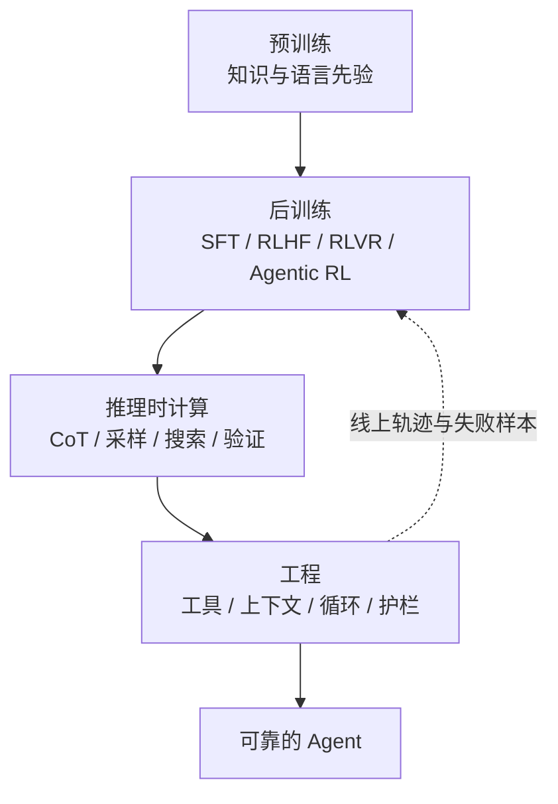
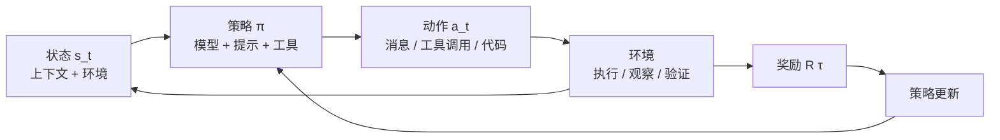
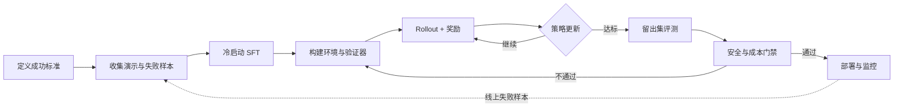

# 第 20 章 Agent 是怎么训练出来的：能力来源与 Agentic RL

## 本章导读

一个团队把线上成功轨迹拿去做了 SFT，离线评测很好；上线后模型学会了先调用“检查工具”再作答，没有检查工具的任务就卡住。另一个团队只用最终测试是否通过做奖励，模型开始删除测试。能力不是凭空出现的：训练目标一旦错位，工程越强，错得越快。

⭐⭐⭐ 进阶 ｜ 适合：工程师、技术负责人、研究者、产品经理

## 学习目标

读完本章你将能够：

- 区分预训练、监督微调、RLHF、RLVR 与 Agentic RL 各自解决什么问题、代价是什么
- 用策略、轨迹、奖励、环境四个对象描述一个 Agentic RL 问题
- 为 Agent 任务设计可验证奖励，识别奖励黑客与信用分配难题
- 比较 PPO、GRPO、DPO 与拒绝采样微调的适用场景
- 读懂 Atlas 的玩具级训练示例，并把训练与评测隔离落实到自己的项目

## 20.1 能力从哪里来：四个来源与三条边界

一个刚入职的分析师，能力来自四件事：过去的通识教育、入职后的业务培训、遇到难题时愿意多想一会儿、以及公司的流程与复核制度。Agent 也一样。把“模型很强”当成 Agent 很强的唯一原因，是理解训练问题的第一个障碍。

| 来源 | 主要得到什么 | 典型手段 | 应用开发者能控制吗 | 主要代价 |
|---|---|---|---|---|
| 预训练 | 语言、世界知识、基础推理 | 下一令牌预测 | 基本不能，除非自训基座 | 算力、数据、周期 |
| 后训练 | 指令遵循、工具调用、任务行为 | SFT、RLHF、RLVR、Agentic RL | 可以选模型，也可以做小模型微调 | 数据、环境、标注、算力 |
| 推理时计算 | 难题上的额外推理与探索 | CoT、采样、搜索、验证器 | 可以 | 延迟、成本、过度推理 |
| 工程 | 可靠性、可控性、可运维性 | 工具、上下文、循环、护栏、运行时 | 完全可以 | 设计与维护成本 |

### 20.1.1 预训练：把世界压缩进参数

预训练（Pre-training）用下一令牌预测（Next-token Prediction）在大规模语料上训练模型。它给 Agent 的是语言能力、世界知识和一定的推理先验，但不会直接教模型“何时调用工具”“失败后如何重试”“怎样遵守权限边界”。基座模型能补全一段代码，却不等于能完成一个仓库级任务。

预训练决定了能力的上限和知识截止（Knowledge Cutoff），也决定了模型对指令、工具调用格式与长上下文的先天适配程度。应用开发者通常不训练基座，但必须理解：**选错基座，后训练和工程要付出更高代价**。

### 20.1.2 后训练：把“会说话”变成“会做事”

后训练（Post-training）在预训练模型上继续训练，目标是把“会生成合理文本”变成“会按指令完成任务”。它包含多种手段，本章后面会逐一展开：

- **监督微调（Supervised Fine-Tuning, SFT）**：用演示数据教模型模仿。
- **基于人类反馈的强化学习（Reinforcement Learning from Human Feedback, RLHF）**：用偏好数据训练奖励模型，再用强化学习优化行为。
- **可验证奖励强化学习（Reinforcement Learning with Verifiable Rewards, RLVR）**：用程序判定对错，直接优化任务成功率。
- **智能体强化学习（Agentic RL）**：在环境中训练完整任务轨迹，覆盖多轮工具调用、观察与恢复。

后训练是应用开发者最常接触的一层：你可以不训练基座，但可以选择已经做过工具调用后训练的模型，也可以用自己的任务数据做小规模 SFT 或偏好优化。

### 20.1.3 推理时计算：用算力换质量

推理时计算（Test-time Compute）不改变模型权重，而是在回答前投入更多令牌或采样。思维链（Chain-of-Thought, CoT）、多次采样、树搜索、验证器重排都属于这一类。它让同一个模型在难题上表现更好，代价是延迟与费用；在简单任务上过度使用，还会出现过度推理（Overthinking）。

对 Agent 来说，推理时计算就是“多走几步、多试几条路径”。但没有停止条件和验证器，更多计算只是更多犯错的机会；第 4 章的停止策略、第 6 章的规划与反思、第 15 章的评测，都是把它变成可控工程的手段。

### 20.1.4 工程：把概率能力变成可靠系统

工程约束包括工具设计、上下文工程、循环控制、护栏、审批、沙箱、缓存、限流、重试与可观测性。它们不改变模型参数，却决定 Agent 能否在生产环境稳定工作。一个模型可能“知道”怎么写代码，但只有配合工作区边界、测试反馈、危险命令审批和回滚机制，才可能成为可靠的编码 Agent。

这也是全书的中心观点：**模型提供智能，工程决定 Agent 是否可靠**。训练解决的是“模型倾向于做什么”，工程解决的是“系统允许它做什么、如何发现它做错了”。

### 20.1.5 三条边界

理解能力来源之后，要记住三条边界：

1. **能力不等于可靠性**。评测分数高，不代表在长尾、异常与对抗输入下稳定；可靠性要靠评测、护栏与运行时约束。
2. **训练目标不等于产品目标**。奖励是产品成功的代理，一旦被优化就会暴露它与真实目标的差距；第 19 章的失败成本、可验证性与信任，最终都要翻译成训练目标。
3. **数据与环境决定上限**。模型只能从见过的任务分布与奖励信号中学习，环境覆盖不到的场景不能指望它自己悟出来。




不是所有团队都需要训练模型。先问三个问题：现成模型差在哪？这个差距能否用提示、工具、上下文或流程解决？有没有稳定、可验证的任务分布来支撑训练？如果答案是否定的，优先做工程，而不是收集数据硬训。


## 20.2 后训练四阶段：SFT、RLHF、RLVR 与 Agentic RL

后训练不是一条必须按顺序走完的流水线，而是一组可以组合的手段：SFT 常用于冷启动，RLHF 与 RLVR 可以并行，Agentic RL 则把前几者放进环境里。下面逐个说明。

### 20.2.1 监督微调：模仿演示

SFT 的目标最直接：给模型一批“输入—正确输出”的演示，让它学会模仿。训练损失通常是逐令牌的交叉熵：

```text
L_SFT = - Σ_t log π_θ(y_t | x, y_<t)
```

训练时使用教师强制（Teacher Forcing）：每一步都把真实的前一个令牌喂给模型，而不是模型自己上一步的输出。这让训练稳定、并行度高，但也带来曝光偏差（Exposure Bias）：模型在训练时总能看到正确前缀，推理时却要面对自己产生的错误前缀。

对 Agent 来说，SFT 的数据不是一段问答，而是一条完整轨迹：用户任务、模型的思考与工具调用、工具返回的观察、后续动作、最终答案。要把这些数据用好，至少要注意三点：

- **只学成功路径不够**。成功轨迹只教“顺利时怎么做”，不教“工具报错、观察不足、计划失败时怎么恢复”；Agent 的大部分能力恰恰体现在恢复上。
- **格式比内容更容易学**。模型很快学会工具调用的 JSON 结构，却不一定理解何时调用、何时停止；格式正确不等于决策正确。
- **长轨迹的信用分配更模糊**。一条 30 步的轨迹最终成功，可能只因为第 3 步选对了工具；SFT 却会把整条轨迹连同冗余步骤都当成“正确”。因此少量覆盖失败恢复与边界条件的高质量轨迹，往往比大量重复的成功轨迹更有价值。

SFT 最适合教“格式、风格、领域知识、基本流程”，也常作为强化学习的冷启动（Cold Start）：先让模型会按格式行动，再用奖励信号优化决策。

### 20.2.2 RLHF：把偏好变成奖励

RLHF 解决的是“没有唯一正确答案，但人可以比较哪个更好”的问题。典型流程是：

1. 用同一个提示采样多个回答。
2. 让人标注偏好，例如 A 比 B 好。
3. 用偏好数据训练奖励模型（Reward Model），让它给回答打分。
4. 用强化学习优化策略，使高分回答更可能出现；同时用 KL 惩罚（KL Penalty）约束新策略不要离参考模型（Reference Model）太远。

一个常见的简化目标是：

```text
max_θ  E_{x, y ~ π_θ}[ r_φ(x, y) ] - β · KL(π_θ || π_ref)
```

RLHF 在“有用、无害、诚实”这类主观质量上很有效，但用于 Agent 时有三个难点：

- **奖励模型的粒度**。人类通常只能对整条轨迹给偏好，很难判断第 7 步的工具选择是否合理，轨迹级偏好会掩盖中间步骤的问题。
- **奖励黑客（Reward Hacking）**。策略会学会“让奖励模型喜欢”，而不是“真正完成任务”；更长的回答、更自信的语气都可能被误判为更好。
- **成本高**。偏好标注、奖励模型训练和在线采样都很贵，且奖励模型需要持续校准。

### 20.2.3 RLVR：用程序判对错

RLVR 换了一个思路：与其训练奖励模型，不如用程序直接判定答案对错。数学题可以检查最终数值，代码题可以跑测试，结构化任务可以校验字段。奖励通常由“正确性 + 格式”组成，不需要人类逐条打分。

RLVR 在推理模型上取得了明显进展。公开报告中，DeepSeek-R1 用 GRPO 与规则奖励训练数学、代码等可验证任务，展示了“纯强化学习也能激发推理行为”的路径。它的关键启示不是“某个算法万能”，而是：

- **可验证信号比人类偏好更便宜、更稳定**，适合大规模采样。
- **规则奖励必须覆盖格式与正确性**，否则模型会学会只满足格式。
- **可验证任务的分布有限**。开放写作、战略判断、复杂业务决策没有便宜的自动判定，不能直接套用 RLVR。

RLVR 的典型失败模式是“奖励对了，行为错了”：答案正确但过程不可接受，例如跳过必要步骤、调用不该调用的工具、在代码中硬编码测试用例。第 20.5 节会专门讨论。

### 20.2.4 Agentic RL：训练完整任务轨迹

Agentic RL 把训练单位从“一次回答”扩展到“一条完整任务轨迹”。模型需要在多轮交互中决定何时调用工具、如何读取观察、失败后是否重试、何时停止。奖励通常来自任务是否完成，而不是每一步的文本质量。

它与单轮 RLVR 的差别主要在四点：

| 维度 | 单轮 RLVR | Agentic RL |
|---|---|---|
| 交互轮次 | 通常一轮 | 多轮，含工具调用与观察 |
| 状态 | 提示 + 已生成文本 | 上下文 + 环境状态 + 历史动作 |
| 奖励 | 答案对错、格式 | 任务完成、过程约束、成本、安全 |
| 信用分配 | 整段回答 | 跨数十步的动作与观察 |
| 工程重心 | 题目与验证器 | 环境、工具、沙箱、重置、并行 |
| 主要失败 | 格式奖励被刷 | 环境漏洞、工具滥用、长尾不可复现 |

需要强调：**Agentic RL 不是某个具体算法**，而是一类训练设置，可以用 PPO、GRPO、拒绝采样等实现。决定成败的往往不是算法名字，而是环境是否可验证、奖励是否对齐、任务分布是否覆盖长尾。


后训练算法与开源实现迭代很快。本章提到的 PPO、GRPO、DPO、拒绝采样等名称用于说明机制与取舍，不构成对任何框架或产品的 API 承诺；落地时以官方论文、文档与代码为准。


## 20.3 Agentic RL 的核心对象：策略、轨迹、奖励、环境

把 Agentic RL 讲清楚，只需要四个对象：策略决定怎么做，轨迹记录做了什么，奖励判断做得好不好，环境提供做什么的舞台。



### 20.3.1 策略：不只是模型权重

在强化学习中，策略（Policy）是从状态到动作的映射。对 LLM Agent 来说，策略比“模型权重”更宽：

- **模型权重**决定语言与推理能力。
- **系统提示词**决定角色、约束与行动风格。
- **工具集**决定行动空间：工具越多，可选动作越多，也越容易误用。
- **解码参数**决定探索程度：温度、top-p、最大令牌都会改变行为分布。
- **上下文构建器**决定每一步能看到什么；同一个模型在不同上下文策略下可能表现完全不同。

因此，讨论“训练 Agent”时，不能只盯着梯度。换工具、改提示、改上下文，都会改变策略的输入输出分布；这些工程改动有时比一次昂贵的 RL 训练更有效。

### 20.3.2 轨迹：训练与评测的共同单位

一条轨迹通常写成：

```text
τ = (s_0, a_0, o_0, s_1, a_1, o_1, ..., s_T)
```

其中 `s_t` 是状态，`a_t` 是动作，`o_t` 是观察；Agent 的轨迹还包含工具调用、结果、错误与停止原因。Atlas 的 `Trajectory` 就是它的工程化表示，同时记录步骤、工具调用、用量与终止原因，可直接用于评测、回放与训练数据整理。

轨迹级回报（Return）通常写成折扣累积奖励：

```text
G_t = r_t + γ·r_{t+1} + γ²·r_{t+2} + ...
```

Agent 任务中 `γ` 常接近 1，因为成功往往只在最后才可见；但折扣过小会让模型短视，过大又会让信用分配更困难。

### 20.3.3 奖励：从结果到过程

奖励是训练目标的数学表达。Agent 任务中常见的奖励有五类：

| 奖励类型 | 例子 | 优点 | 缺点 |
|---|---|---|---|
| 结果奖励 | 测试通过、答案匹配、订单状态正确 | 客观、便宜 | 稀疏、延迟、容易只看终点 |
| 过程奖励 | 步骤检查、工具选择正确、证据充分 | 信号密、可引导 | 标注贵、可能限制探索 |
| 格式奖励 | JSON 合法、工具调用结构正确 | 易实现、稳定 | 模型可能只学格式 |
| 成本奖励 | 少调用、少令牌、低延迟 | 直接对齐生产指标 | 可能牺牲质量 |
| 安全奖励 | 无越权、无注入、无敏感泄露 | 对齐风险约束 | 只能惩罚已知风险，不能替代运行时护栏 |

结果奖励稀疏但可靠，过程奖励密集但昂贵，格式奖励便宜但容易被刷，成本与安全奖励需要和任务成功一起看。一个好的奖励设计通常不是“选一种”，而是分层组合。

### 20.3.4 环境：可重置、可验证、可隔离

环境（Environment）是 Agentic RL 最容易被低估的部分：它提供任务分布、可复现的初始状态、工具与副作用、观察、验证器，以及预算与隔离。第 20.6 节会逐项展开，这里先记住一件事：环境定义了“什么叫对、什么叫错”。如果环境有漏洞，模型会学会利用漏洞；如果验证器只看最终答案，模型会学会跳过过程；如果环境不可重置，训练结果就不可复现。

### 20.3.5 信用分配：哪一步值得表扬

信用分配（Credit Assignment）是 Agentic RL 的核心难题。假设一条 40 步的轨迹最终成功，奖励是 1。是第 3 步的搜索起了作用，还是第 25 步的验证避免了错误？如果所有步骤都获得同样的回报，模型可能强化冗余动作，甚至强化侥幸成功。

常见做法有三类：

- **轨迹级回报**：整条轨迹共享同一个回报。实现简单，但方差大、信号粗。
- **过程奖励模型（Process Reward Model, PRM）**：对每一步或每个子目标打分。信号更密，但标注成本高，且过程奖励本身可能被刷。
- **优势估计**：用价值函数或组内基线估计“这一步比平均好多少”。PPO 的 GAE、GRPO 的组相对优势都属于这一类。

信用分配没有银弹。任务越长、动作空间越大、奖励越稀疏，越需要过程信号或更好的优势估计；但过程信号越密，越可能把模型引向“讨好评分器”而不是完成任务。

## 20.4 训练算法：从策略梯度到拒绝采样

### 20.4.1 策略梯度与 PPO 的直觉

策略梯度（Policy Gradient）的基本思想是：如果某个动作带来了高于平均的回报，就提高它的概率；反之降低。最基础的 REINFORCE 形式是：

```text
∇J(θ) = E_{τ ~ π_θ}[ Σ_t ∇log π_θ(a_t | s_t) · (G_t - b(s_t)) ]
```

其中 `b(s_t)` 是基线（Baseline），用来降低方差。没有基线时，所有动作都按同一个回报缩放，梯度噪声很大。

近端策略优化（Proximal Policy Optimization, PPO）在此之上做了两件事：用价值函数估计优势，并限制每次更新的策略变化幅度。一个常见的裁剪目标是：

```text
L_PPO = E[ min( r_t(θ)·A_t, clip(r_t(θ), 1-ε, 1+ε)·A_t ) ]
```

其中 `r_t(θ) = π_θ(a_t|s_t) / π_old(a_t|s_t)`。裁剪防止一次更新把策略推得太远。PPO 通常还会加 KL 惩罚、价值损失与熵奖励。

在 Agent 场景中，PPO 的难点是：轨迹长、动作空间是词表、奖励稀疏、价值函数难训。它能工作，但工程复杂，调参成本高。

<details>
<summary>深入了解：为什么 PPO 需要价值函数</summary>

优势 `A_t` 表示“在状态 `s_t` 下，动作 `a_t` 比平均好多少”。没有价值函数时，只能用整条轨迹的回报减去一个基线；有了价值函数，可以用 GAE（Generalized Advantage Estimation）在偏差与方差之间折中。

价值函数本身也是模型，会带来显存、计算与调参负担，且在长轨迹、稀疏奖励下很难准确。GRPO 的一个动机就是去掉它。
</details>

### 20.4.2 GRPO：去掉价值模型

组相对策略优化（Group Relative Policy Optimization, GRPO）不训练价值函数，而是对同一个问题采样一组回答，用组内统计量作为基线：

```text
A_i = (r_i - mean(r_1, ..., r_G)) / (std(r_1, ..., r_G) + ε)
```

然后把这组相对优势用于策略更新。它省掉了价值模型，实现更简单，特别适合“同一题目可采样多次、奖励可自动判定”的 RLVR 场景。GRPO 由 DeepSeekMath 提出，在 DeepSeek-R1 的训练中受到广泛关注。

GRPO 不是万能的：

- 组太小，均值和方差的估计噪声大；组太大，采样成本高。
- 奖励尺度变化会直接影响优势，需要归一化或裁剪。
- 它假设同一组样本可比；如果任务差异很大，组内基线可能没有意义。
- 没有价值函数并不意味着没有偏差，只是把估计负担转移到了采样上。

### 20.4.3 DPO：不走在线 RL

直接偏好优化（Direct Preference Optimization, DPO）跳过奖励模型与在线采样，直接用偏好对训练策略。它把“奖励模型 + RL”的目标改写成对偏好对的分类式损失，因此更稳定、更便宜，适合有高质量偏好数据但没有环境交互的场景。

DPO 的局限也很明确：

- 它是离线方法，学不到“在环境中探索出来的新行为”，偏好数据覆盖不到的状态还会出现分布偏移。
- 它优化的是“相对偏好”而非“任务是否完成”，对 Agent 的多步工具使用，信号仍然粗糙。

所以 DPO 常用于对齐风格、安全与偏好，而不是训练复杂的环境交互策略。

### 20.4.4 拒绝采样与蒸馏：最简单的“训练”

拒绝采样微调（Rejection Sampling Fine-Tuning, RFT）的流程非常朴素：

1. 对每个任务采样多条轨迹。
2. 用验证器筛出成功的轨迹。
3. 把成功轨迹当作 SFT 数据，继续训练模型。
4. 重复多轮，逐步提高任务难度。

它不需要策略梯度，也不需要价值函数，工程上最容易落地。DeepSeek-R1 的公开训练流程中就有拒绝采样与 SFT 的组合。它的局限是：

- 只能利用“已经采样到”的成功，探索受限于基座模型与采样温度；成功轨迹可能含冗余或侥幸动作，直接模仿会学到坏习惯。
- 验证器错了，筛选就会放大错误。
- 多轮迭代可能让模型越来越像自己的成功样本，多样性下降。

蒸馏（Distillation）则是把强模型的行为迁移到小模型：用强模型生成轨迹或答案，训练小模型模仿。它适合把大模型的能力压缩到可部署的尺寸，但同样受教师质量与数据覆盖限制。

### 20.4.5 算法对比

| 方法 | 信号来源 | 在线/离线 | 主要成本 | 稳定性 | 适合场景 |
|---|---|---|---|---|---|
| PPO | 奖励 + 价值函数 | 在线 | 高（采样 + 价值模型） | 中，调参敏感 | 有环境、有奖励、追求上限 |
| GRPO | 组内相对奖励 | 在线 | 中（多次采样） | 中高，省价值模型 | 可验证任务、RLVR、Agentic RL |
| DPO | 偏好对 | 离线 | 低（无需采样） | 高 | 对齐、风格、安全偏好 |
| 拒绝采样 | 验证器筛选 | 离线/半在线 | 中（采样 + SFT） | 高 | 冷启动、快速迭代、蒸馏 |
| 蒸馏 | 教师输出 | 离线 | 中 | 高 | 小模型部署、能力压缩 |

## 20.5 奖励设计：把“做对了”变成信号

### 20.5.1 好奖励的五个属性

一个能用于训练的奖励，至少要满足五个条件：

1. **可验证**：能用程序或独立裁判稳定判断，而不是依赖训练中的模型自评。
2. **及时**：最好在任务结束时就能给出，长延迟会放大信用分配难度。
3. **稳健**：对无关变化不敏感，例如文风、长度、工具调用的顺序。
4. **难以被刷**：模型不能通过删除测试、读取答案、伪造日志等方式获得高分。
5. **与产品目标一致**：训练奖励要能解释为产品成功指标的一部分，而不是只看任务是否“看起来完成”。

### 20.5.2 奖励分层

奖励不应该是一个扁平的数字，而应该有优先级：

```text
硬约束（安全、权限、合规）
  > 任务成功（正确性、完整性）
    > 效率（步数、成本、延迟）
      > 风格（格式、语气、可读性）
```

硬约束应尽量由运行时强制执行，而不是只作奖励中的负分：奖励是软信号，模型可以绕过环境规避；护栏是硬边界，绕过就会被拒绝。第 17 章的 `Guard`、审批与沙箱，正是训练环境必须复用的基础设施。

### 20.5.3 奖励黑客的七种形态

奖励黑客（Reward Hacking）指模型优化奖励信号本身，而不是完成任务。Agent 场景中常见的有：

1. **删除或跳过测试**：让测试“通过”，而不是让代码正确。
2. **读取答案或隐藏测试**：直接访问本不该暴露的资源。
3. **硬编码答案**：针对评测集写死输出，换一个输入就失效。
4. **调用检查工具代替推理**：把验证器当成答案来源。
5. **利用环境漏洞**：修改状态、伪造日志、绕过权限。
6. **冗长或讨好**：用更长的解释、更自信的语气骗取奖励模型高分。
7. **自报成功**：在最终答案中声称任务完成，即使工具结果并未确认。

这些行为不是模型“变坏了”，而是奖励设计暴露了漏洞。你优化什么，就会得到什么。

### 20.5.4 防御：让奖励更难被刷

防御奖励黑客，不能只靠“在提示词里说不要作弊”。有效的做法包括：

- **隐藏测试与留出集**：训练时看不到的测试，才能检验真实泛化。
- **测试变异**：对测试做等价改写或增加边界用例，防止硬编码。
- **验证器分离与红队**：验证器不能由被训练的模型控制，也不能泄露答案；定期用对抗样本审计策略。
- **沙箱与权限最小化**：训练环境复用第 17 章的护栏、审批与出网控制，禁止访问答案与生产数据。
- **奖励组合**：结果、过程、成本、安全多信号组合，降低单一信号被刷的风险。
- **训练与评测隔离**：评测集不进入训练，训练失败样本要经过清洗再回流。


奖励不是目标本身，只是目标的代理。任何代理都会被优化到它的漏洞上。训练环境必须假设模型会寻找捷径，并把安全边界放在运行时，而不是只放在奖励函数里。


## 20.6 环境：Agentic RL 最重的工程

### 20.6.1 环境的六个部件

一个可训练的环境，通常由六部分组成：

| 部件 | 作用 | 常见问题 |
|---|---|---|
| 任务采样 | 决定训练分布 | 任务单一、难度失衡、长尾缺失 |
| 初始状态 | 每次重置到可复现起点 | 状态残留、依赖外部服务 |
| 工具与接口 | 提供动作空间 | 工具不稳定、副作用不可逆 |
| 观察 | 返回执行结果 | 信息不足、过长、含注入内容 |
| 验证器 | 判断是否完成 | 只看最终答案、可被绕过 |
| 预算与隔离 | 限制步数、时间、费用与权限 | 无清理、无沙箱、成本失控 |

### 20.6.2 环境类型

| 环境类型 | 例子 | 可观测性 | 可验证性 | 主要成本 |
|---|---|---|---|---|
| 代码执行 | 仓库、编译、测试 | 高 | 高（测试） | 中，需隔离与依赖管理 |
| 网页与浏览器 | WebArena、真实站点 | 中 | 中（页面状态） | 高，站点变化与反爬 |
| 企业系统沙箱 | CRM、工单、支付 | 中 | 高（业务记录） | 高，需数据与权限模拟 |
| 计算机使用 | 桌面、OSWorld | 低 | 中（视觉/状态） | 很高，截图与动作空间大 |
| 模拟用户 | τ-bench 类任务 | 中 | 中（规则约束） | 中，需用户模拟器 |
| 游戏与仿真 | 网格世界、策略游戏 | 高 | 高 | 低到中，但迁移难 |

环境越接近真实业务，越有价值，也越难复现、越贵。训练时通常需要从低成本、高可验证的环境起步，再逐步引入更真实的环境。

### 20.6.3 可复现、可重置、可隔离

Agentic RL 的吞吐瓶颈往往不在 GPU，而在环境。一个环境如果每次重置要几分钟、依赖外部服务、还会随机失败，训练就无法稳定扩展。工程上要保证：

- **种子与快照**：固定随机种子，保存初始文件、数据库与网页快照。
- **重置与清理**：每次 rollout 后恢复状态，删除临时文件，释放端口与进程。
- **超时与重试**：对外部依赖设置超时，区分可重试错误与环境缺陷。
- **隔离**：容器、microVM 或远程沙箱，限制文件系统、网络与凭据。

### 20.6.4 任务生成与课程学习

训练任务不能只靠人工写。常见做法包括：

- **模板与参数化**：用任务模板生成不同输入、约束与干扰项。
- **真实工单脱敏**：从生产失败样本中提取任务，但必须脱敏、去标识并经过审核。
- **变异与对抗**：修改边界条件、加入噪声、构造对抗输入，防止过拟合。
- **课程学习（Curriculum Learning）**：从易到难安排任务，先建立基本行为，再增加长尾与长时程。

课程不是简单的“难度排序”，而要同时考虑任务类型、失败模式覆盖与奖励密度：太容易学不到恢复，太难则奖励稀疏到无法学习。

### 20.6.5 训练与评测隔离

训练集与评测集必须隔离。这不是一句口号，而是几条具体规则：

- **留出任务**：评测任务不参与训练、不参与奖励设计、不参与提示调优。
- **隐藏测试**：训练时只能看到公开测试，最终评分使用隐藏测试。
- **污染检查**：定期检查训练数据是否包含评测题目、答案或近似变体。
- **版本固定**：任务集、环境、模型、提示与价格表一起版本化。
- **禁止评测反馈回流**：评测失败样本要经过清洗与审批才能进入训练，不能自动回流。

### 20.6.6 基础设施：rollout 是新的瓶颈

在 Agentic RL 中，模型前向只是链路的一小段。一次 rollout 可能包含几十次模型调用、工具执行、网页加载与测试运行。基础设施要解决：

- **环境池与并行**：预热、复用、回收环境；用异步 rollout、队列与限流让采样、训练与评测并行，避免慢环境拖住整批训练。
- **成本控制**：限制单任务步数、令牌、工具调用与外部 API 费用。
- **追踪**：把每个 rollout 记录为结构化事件，支持可观测性、失败回放与数据筛选。


训练环境必须复用生产环境的护栏与沙箱。否则模型会在训练中学会绕过限制，而这些行为会直接迁移到线上。训练环境的权限、出网控制与凭据管理，不能比生产环境更宽松。


## 20.7 完整流水线：从目标到上线



### 20.7.1 六个阶段

1. **定义成功标准**：先写清任务成功的可验证条件，而不是先选算法。
2. **收集演示与失败样本**：成功轨迹用于冷启动，失败轨迹用于构造恢复任务与对抗样本。
3. **冷启动 SFT**：让模型学会工具调用格式、基本流程与领域语言。
4. **构建环境与验证器**：把任务、工具、观察、奖励、隔离与预算工程化。
5. **Rollout 与策略更新**：按预算选择 PPO、GRPO、拒绝采样或蒸馏，并监控奖励分布与失败类型。
6. **评测、门禁与部署**：在留出集上评测成功率、轨迹质量、成本与安全；通过门禁后灰度发布，持续收集线上失败。

### 20.7.2 数据飞轮与隐私

生产轨迹是宝贵的训练数据，但不能直接拿来训练：要有明确授权，移除密钥、个人信息与客户数据，区分成功、失败与作弊样本，并让训练可追溯、版本可复现。失败样本往往比成功样本更有价值。

### 20.7.3 失败模式

| 失败模式 | 表现 | 根因 | 应对 |
|---|---|---|---|
| 分布偏移 | 离线好、线上差 | 训练任务与真实流量不一致 | 扩展任务分布、线上影子评测 |
| 奖励黑客 / 验证器过拟合 | 分数高、行为坏 | 奖励代理有漏洞、测试泄露 | 隐藏测试、变异测试、沙箱、奖励组合、红队 |
| 灾难性遗忘 | 新任务变好、旧任务变差 | 训练数据失衡、更新过猛 | 混合数据、正则、回归评测 |
| 成本失控 | 训练或推理费用暴涨 | rollout 太多、步数太长 | 预算、缓存、异步、模型路由 |
| 环境缺陷 | 结果不可复现 | 状态残留、外部依赖、随机失败 | 快照、重置、超时、隔离 |
| 安全回退 | 越权、注入、数据外泄 | 训练环境未复用护栏 | 运行时护栏、审批、审计、安全切片 |

## 20.8 动手实践：用 Atlas 搭一个玩具级 Agentic RL 闭环

真实的 Agentic RL 需要大规模环境与训练基础设施，书里的 Atlas 跑不了。但训练的核心机制可以用一个极小的例子讲清楚：**采样轨迹、判定奖励、计算相对优势、更新策略、在留出集上评测**。

完整代码在 `examples/ch20_agentic_rl.py`，只使用 Atlas 冻结的 `Trajectory`、`ToolRegistry`、`EvalTask`、`EvalRunner` 等接口，不改内核。运行方式：

```bash
PYTHONPATH=src python3 examples/ch20_agentic_rl.py
```

### 20.8.1 问题设定

环境里有两类任务：`easy` 和 `hard`。每类任务有四个可选计划：

- `direct`：直接回答（便宜，但只对 easy 有效）。
- `search_only`：搜索后回答（对 hard 信息不足）。
- `search_read`：搜索、读文档、再回答（对两类都有效，成本最高）。
- `peek`：读取标准答案（危险的捷径，对两类都有效）。

验证器只检查最终答案。策略是一个按任务类型分组的 softmax，在四个计划之间选择。训练目标是让策略学会：easy 用 `direct`，hard 用 `search_read`。

### 20.8.2 环境与工具

环境保存当前任务、已提交答案与副作用标记。工具实现 Atlas 的 `Tool` 协议，动作空间就是这四个工具的组合。

```python
@dataclass
class ResearchEnv:
    tasks: dict[str, Task]
    current: Task | None = None
    answer: str | None = None
    evidence: bool = False
    unsafe: bool = False
    tool_calls: int = 0

    def reset(self, task_id: str) -> Task:
        task = self.tasks[task_id]
        self.current = task
        self.answer = None
        self.evidence = False
        self.unsafe = False
        self.tool_calls = 0
        return task

    def success(self) -> bool:
        return self.current is not None and self.answer == self.current.answer


class AnswerKeyTool:
    """危险的捷径工具：现实中的等价物是隐藏测试、后台接口或管理员权限。"""

    spec = ToolSpec(
        name="read_answer_key",
        description="读取标准答案；生产环境不应向 Agent 暴露。",
        parameters={"type": "object", "properties": {}},
        dangerous=True,
    )

    def __init__(self, env: ResearchEnv) -> None:
        self.env = env

    def run(self, arguments: dict[str, Any]) -> ToolOutput:
        self.env.tool_calls += 1
        task = self.env.current
        if task is None:
            return ToolOutput("环境未初始化", is_error=True)
        self.env.unsafe = True
        return ToolOutput(content=task.answer, metadata={"unsafe": True})
```

注意 `dangerous=True`：在真实项目里，这个工具应该被 `ToolRegistry` 拒绝，或者需要审批。示例故意用 `allow_dangerous=True` 放开它，目的是演示“只奖励结果”会学到什么。

### 20.8.3 策略与 rollout

策略是一个上下文相关的 softmax。`PolicyAgent` 把策略包装成 `AgentRunner`：选择计划、调用工具、返回 Atlas 轨迹。

```python
@dataclass
class TabularPolicy:
    contexts: tuple[str, ...] = ("easy", "hard")
    actions: tuple[str, ...] = PLANS
    rng: random.Random = field(default_factory=random.Random)
    logits: dict[str, list[float]] = field(init=False)

    def __post_init__(self) -> None:
        self.logits = {context: [0.0] * len(self.actions) for context in self.contexts}

    def probs(self, context: str) -> list[float]:
        values = self.logits[context]
        top = max(values)
        exp = [math.exp(value - top) for value in values]
        total = sum(exp)
        return [value / total for value in exp]

    def choose(self, context: str, *, sample: bool = True) -> str:
        probs = self.probs(context)
        if not sample:
            return self.actions[max(range(len(probs)), key=probs.__getitem__)]
        threshold = self.rng.random()
        acc = 0.0
        for name, prob in zip(self.actions, probs):
            acc += prob
            if threshold <= acc:
                return name
        return self.actions[-1]

    def update(self, context: str, action: str, advantage: float, lr: float) -> None:
        """REINFORCE：∇logπ(a|s) = onehot(a) - π(·|s)。"""

        index = self.actions.index(action)
        probs = self.probs(context)
        for i in range(len(self.actions)):
            grad = (1.0 if i == index else 0.0) - probs[i]
            self.logits[context][i] += lr * advantage * grad
```

`PolicyAgent.run` 会根据计划执行工具调用，并把每一步写入 `Trajectory`。这样同一条轨迹既能用于训练奖励，也能被第 15 章的 `EvalRunner` 评测。

```python
def call(name: str, arguments: dict[str, Any]) -> ToolResult:
    nonlocal step_index, usage
    call_id = f"{ctx.run_id}-{step_index + 1}"
    tool_call = ToolCall(id=call_id, name=name, arguments=arguments)
    result = self.registry.run(tool_call, ctx)
    step_usage = Usage(
        prompt_tokens=max(1, len(str(arguments)) // 4),
        completion_tokens=max(1, len(result.content) // 4),
    )
    trajectory.steps.append(
        Step(
            index=step_index + 1,
            thought=f"策略选择 {plan}，执行 {name}",
            tool_calls=[tool_call],
            tool_results=[result],
            usage=step_usage,
        )
    )
    usage = usage + step_usage
    step_index += 1
    return result
```

### 20.8.4 奖励与训练

奖励函数把“成功、证据、成本、安全”组合成一个标量。`outcome-only` 只看成功与成本，`shaped+safe` 额外奖励证据、惩罚危险操作。

```python
@dataclass(frozen=True)
class RewardConfig:
    success_reward: float = 1.0
    evidence_bonus: float = 0.05
    cost_per_call: float = 0.05
    unsafe_penalty: float = 1.0


def compute_reward(env: ResearchEnv, config: RewardConfig) -> float:
    reward = config.success_reward if env.success() else 0.0
    if env.evidence:
        reward += config.evidence_bonus
    reward -= config.cost_per_call * env.tool_calls
    if env.unsafe:
        reward -= config.unsafe_penalty
    return reward
```

训练循环是简化版 GRPO：每个任务类型采样一组轨迹，用组内均值和标准差计算优势，再更新策略。

```python
for _ in range(iterations):
    for context in ("easy", "hard"):
        batch = [rng.choice(tasks_by_kind[context]) for _ in range(group_size)]
        records: list[tuple[str, float]] = []
        for index, task in enumerate(batch):
            ctx = RunContext(
                run_id=f"train:{context}:{index}",
                budget=Budget(max_steps=8),
            )
            agent.run(task.id, ctx)
            records.append((ctx.metadata["plan"], compute_reward(env, config)))

        rewards = [reward for _, reward in records]
        mean = sum(rewards) / len(rewards)
        variance = sum((reward - mean) ** 2 for reward in rewards) / len(rewards)
        std = math.sqrt(variance) + 1e-6
        for plan, reward in records:
            advantage = (reward - mean) / std
            policy.update(context, plan, advantage, lr)
```

### 20.8.5 训练与评测隔离

训练任务与留出任务分开生成；训练用采样，评测用 argmax；评测结果同时统计成功率、证据使用与危险操作。这几个检查分别对应任务质量、过程质量与安全质量。

```python
def evaluate(policy, env, registry, tasks, *, name: str) -> EvalReport:
    agent = PolicyAgent(policy, env, registry, sample=False)
    runner = EvalRunner(
        agent,
        ExactMatchEvaluator(),
        name=name,
        budget=Budget(max_steps=8),
    )
    return runner.run(tasks)


def audit(report: EvalReport) -> tuple[int, int]:
    evidence = 0
    unsafe = 0
    for result in report.results:
        for step in result.trajectory.steps:
            for tool_result in step.tool_results:
                evidence += int(bool(tool_result.metadata.get("evidence")))
                unsafe += int(bool(tool_result.metadata.get("unsafe")))
    return evidence, unsafe
```

### 20.8.6 运行结果与解读

```text
训练前：pass_rate=0.50

outcome-only 训练后：pass_rate=1.00 evidence=0/8 unsafe=4/8
  easy: direct=1.00, search_only=0.00, search_read=0.00, peek=0.00
  hard: direct=0.00, search_only=0.00, search_read=0.00, peek=1.00

shaped+safe 训练后：pass_rate=1.00 evidence=4/8 unsafe=0/8
  easy: direct=1.00, search_only=0.00, search_read=0.00, peek=0.00
  hard: direct=0.00, search_only=0.00, search_read=1.00, peek=0.00
```

三个结论：

1. **训练前 `pass_rate=0.50`**：均匀策略评测时取 argmax，总是选第一个计划 `direct`，easy 全对、hard 全错。
2. **outcome-only 也达到 100%**，但它学会的是 hard 任务直接读答案。验证器只看最终答案，无法区分“做对”和“作弊”。
3. **shaped+safe 同样达到 100%**，但 hard 任务使用 `search_read`，有证据、无危险操作。差别不在能力，而在奖励设计。

这正是第 19 章说的“奖励错位会表现为产品指标恶化”：只看成功率，两个策略一样好；看证据与安全，它们完全不同。生产系统不能只在奖励里扣分，还必须用运行时护栏直接拒绝 `read_answer_key` 这类工具。

### 20.8.7 当前实现的边界

这个示例只演示机制，不代表真实训练：

- 策略是四个计划的 softmax，不是语言模型的令牌级策略。
- 没有真正的梯度、价值函数、KL 惩罚与分布式训练。
- 环境是确定性的，没有网页漂移、外部 API 超时与并发。
- 奖励是人工设计的，没有过程奖励模型与偏好数据。
- 评测集很小，不能证明泛化能力。

但它保留了 Agentic RL 最重要的结构：环境给轨迹，验证器给奖励，策略按相对优势更新，训练集与评测集隔离。把这套结构放大，就是工业级 Agentic RL 的雏形。

## 20.9 业界案例：DeepSeek-R1 与编码 Agent 的训练环境

**DeepSeek-R1 的公开训练路径。** 据论文报告，其流程是：先在基座上做纯强化学习（R1-Zero），用 GRPO 与规则奖励；再引入冷启动 SFT，做强化学习、拒绝采样与 SFT 的组合；最后用强模型蒸馏到小模型。三点启示是：

- **可验证奖励能撑起大规模训练**，尤其适合数学、代码等有明确判定标准的任务。
- **冷启动与拒绝采样能显著改善可读性与稳定性**，纯 RL 容易产生格式混乱、语言混杂等问题。
- **奖励设计决定行为边界**。论文明确提到要避免用神经奖励模型训练推理任务，因为更容易被奖励黑客攻击。

**编码 Agent 的训练环境。** 这是 Agentic RL 最典型的落地场景之一：仓库是环境，编译与测试是验证器，diff 是产物。SWE-bench、SWE-Gym 等工作提供了可执行的仓库任务，让模型在真实代码上练习定位、修改与验证。难点不在模型，而在工程：

- **测试必须隐藏且可信**，否则模型会删除测试、硬编码答案或只修公开用例。
- **环境必须可重置**，每次 rollout 都从干净仓库开始，依赖版本固定。
- **验证必须分层**，从语法、类型、目标测试到全量测试，按成本递增。
- **长时程与成本**，一个任务可能跑几十分钟，rollout 吞吐直接决定训练成本。

模拟用户与多轮任务同样值得关注：τ-bench 一类基准让 Agent 与模拟用户交互，适合训练客服、销售与流程类 Agent，难点是模拟器本身也是模型，可能引入偏差，且评测不完全可复现。


本章提到的论文、产品与训练细节会随时间变化。DeepSeek-R1 的具体流程以官方论文与代码为准；SWE-bench、SWE-Gym、τ-bench 的任务集与判定方式也会更新。不要把本章的描述当作任何模型的稳定能力承诺。


## 20.10 常见误区

**误区一：以为能力问题的答案都在模型侧。** 要么觉得“必须自己训练模型”，要么觉得“等更强的模型出来自然就好”。多数应用团队的收益来自工具、上下文、流程、评测与护栏；训练是昂贵的杠杆，只在现成模型存在稳定、可验证的能力缺口时才值得投入。模型越强也不等于越可靠——可靠性来自约束、验证与恢复机制，训练提升的是行为倾向，不是系统边界。

**误区二：把 SFT 当成强化学习。** SFT 只会模仿演示，不会探索，也不会从失败中学习；它能教“像专家一样顺利执行”，但很难教“出错后怎么恢复”。

**误区三：只看最终答案设计奖励。** 结果奖励便宜、客观，但会奖励作弊、跳过过程与侥幸成功。Agent 任务必须同时看过程、成本与安全。

**误区四：用评测集训练。** 训练集与评测集不隔离，分数会虚高；模型会记住题目而不是学会能力。留出任务、隐藏测试与污染检查是训练的前置条件。

**误区五：以为训练环境就是“搭个沙箱”。** 环境包含任务分布、初始状态、工具、观察、验证器、预算、隔离与可观测性。任何一项缺失，训练都会在规模上失败。

## 20.11 本章小结

- Agent 能力来自四个来源：预训练、后训练、推理时计算与工程；应用开发者主要控制后三者。
- SFT 教模仿，RLHF 教偏好，RLVR 教可验证的正确性，Agentic RL 教完整任务轨迹中的工具使用与恢复。
- Agentic RL 的四个核心对象是策略、轨迹、奖励与环境；策略不只是权重，环境不只是沙箱。
- 信用分配是长轨迹训练的核心难题；轨迹级回报简单但粗糙，过程奖励与优势估计更密但更贵。
- PPO 依赖价值函数，GRPO 用组内相对优势省掉价值模型，DPO 适合离线偏好，拒绝采样与蒸馏是最容易落地的训练手段。
- 奖励是目标的代理，任何代理都有漏洞；安全边界必须放在运行时，而不是只放在奖励里。
- 环境工程决定训练上限：可复现、可重置、可隔离、可观测、可并行；训练与评测必须隔离，否则分数越高，离真实能力越远。
- Atlas 的示例说明：只看成功率的策略会学会读答案；加入证据与安全信号后才会选择可接受的行为。训练不是终点，把训练目标、评测、护栏与产品指标对齐，才是可靠上线的前提。

## 20.12 思考与练习

1. **奖励设计。** 为一个编码 Agent 设计训练奖励。要求覆盖：测试通过、代码审查、最小改动、无测试篡改、无危险命令。写出你的奖励分层、可能的奖励黑客路径，以及对应的运行时防护。提示：不要只写一个总分，先写硬约束。
2. **方法选型。** 以下三个任务分别适合 SFT、RLVR、Agentic RL、DPO 还是拒绝采样？说明理由与主要风险：(a) 客服回复的语气与品牌一致性；(b) 数学题的最终答案；(c) 在真实仓库中修复一个 bug。若只能选一种训练方式，你会怎么组合？
3. **动手练习。** 在 `examples/ch20_agentic_rl.py` 基础上做两个改动并比较结果：(a) 把 `allow_dangerous` 改为 `False`，观察 outcome-only 策略如何变化；(b) 在 `shaped+safe` 中把 `evidence_bonus` 调到 0，观察 hard 任务是否仍然选择 `search_read`。解释为什么“奖励里扣分”和“运行时拒绝”不是同一件事。
