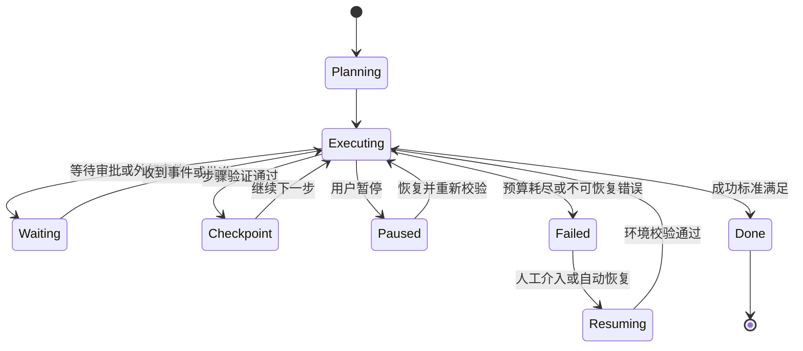
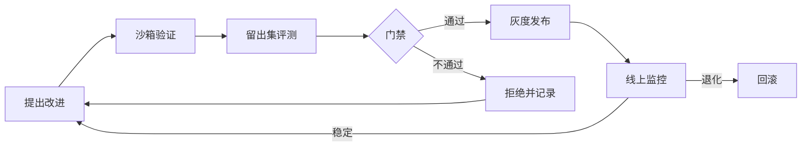

# 第 21 章 Agent 的未来：长时程、自我改进与 Agent 经济

## 本章导读

一个研究 Agent 被委派了为期三天的竞品调研。第一天它收集资料，第二天它等待用户确认采购数据源，进程在这期间重启了两次。恢复后它忘了已经下过单，又重复提交了一次；第三天它读到自己早期写下的过时假设，继续沿着错误方向写完了报告。任务“完成”了，但责任链断在了中间。

长时程、持续学习、自我改进、Agent 经济，这些词描述的不是四个孤立的功能，而是同一条趋势：**Agent 承担的责任链正在变长**。责任链越长，状态、验证、权限与成本的问题就越突出。

⭐⭐⭐ 进阶 ｜ 适合：工程师、技术负责人、产品经理、研究者

## 学习目标

读完本章你将能够：

- 用状态模型描述长时程任务，并设计检查点、恢复协议与预算边界
- 判断哪些经验应该进入记忆、工具与提示，哪些才值得进入模型权重
- 设计带门禁的自我改进闭环，识别能力回退、奖励黑客与权限累积风险
- 区分多 Agent 协作与 Agent 经济，判断什么场景不该使用它们
- 形成一套面向未来的判断框架，而不是追逐新名词

## 21.1 长时程任务：从一次运行到持续执行

今天大多数 Agent 任务以分钟计：查资料、改一个函数、处理一张工单。长时程任务（Long-horizon Task）把时间尺度拉长到数小时、数天甚至数周，期间会经历多次会话、多次人工交接、外部系统变化与进程重启。

公开研究已经开始测量这种能力。METR 一类工作用“50% 成功率下 Agent 能独立完成多长任务”作为指标，并观察到这一时间跨度随模型代际快速上升。


截至写作时，公开报告给出的时间跨度增长估计约为每 7 个月翻倍。该数字来自特定评测设置，不是物理定律，也不代表你的业务任务会以同样速度进步。引用时请以原始论文与最新评测为准。


### 21.1.1 长时程带来的四个新问题

长时程不是“把最大步数调大”。它改变了问题的结构：

1. **状态不再只存在于上下文里。** 上下文会满、会被压缩、会因进程重启而丢失。目标、计划、已确认的事实、对外承诺与预算必须落到外部存储。
2. **目标会漂移。** 任务越长，中间观察越多，模型越容易把“当前最有进展的子任务”当成“最终目标”。没有显式的成功标准，漂移几乎必然发生。
3. **中断成为常态。** 等待审批、等待外部事件、用户下班、服务重启，都会打断执行。系统必须能暂停、持久化、恢复，而不是从头再来。
4. **成本与不可逆性会累积。** 一次错误的搜索很便宜，一次错误的付款、发信或删库不便宜。长时程会放大每一次副作用。

### 21.1.2 用状态模型描述长时程任务

把长时程 Agent 当成一个有状态的系统，而不是一串提示词。至少要显式管理七类状态：

| 状态类型 | 例子 | 建议存储 | 丢失后的后果 |
|---|---|---|---|
| 目标与成功标准 | 交付物、验收条件、截止时间 | 结构化任务记录 | 目标漂移，做完才发现方向错 |
| 计划与里程碑 | 阶段、依赖、完成标记 | 计划对象 + 版本 | 重复劳动或漏做关键步骤 |
| 工作状态 | 已确认事实、假设、决策、开放问题 | 结构化工作区 | 重复调研、沿用错误假设 |
| 产物与版本 | 文档、代码、表格、引用 | 对象存储 + 版本号 | 覆盖正确版本，无法回滚 |
| 对外承诺 | 已发出的邮件、已下的单、已答应的期限 | 承诺台账 | 重复副作用、违约 |
| 预算与权限 | 剩余步数、费用、可用工具、审批范围 | 运行时状态 | 成本失控、越权 |
| 审计轨迹 | 谁在何时做了什么、依据是什么 | 追加式事件日志 | 无法复盘、无法追责 |

这张表的重点不是“存起来”，而是**每类状态都要有明确的写入者、读取者与失效条件**。例如“已下的单”只能由支付工具的回执写入，不能由模型自述“我已经下单了”；“假设”必须带来源与复核时间，过期后自动标为待验证。

### 21.1.3 检查点、恢复与幂等

长时程系统的可靠性，取决于三个工程动作：检查点（Checkpoint）、恢复协议（Resume Protocol）与幂等（Idempotency）。

- **检查点要落在可验证的步骤边界。** 一个步骤完成、验证通过、副作用确认之后，才值得保存。把检查点放在模型“觉得自己快做完了”的位置，恢复后往往得到半成品。
- **快照与事件日志配合使用。** 快照恢复快，事件日志可审计、可重放。生产系统通常保存“最近快照 + 之后的事件”，恢复时先加载快照，再重放增量。
- **副作用必须幂等。** 每次外部写操作带一个幂等键，通常由 `run_id + step + 动作摘要` 组成；重试时先查回执，再决定是否执行。没有幂等键的重试，本质上是在赌博。
- **恢复不是重放。** 恢复时必须重新校验环境：文件是否还在、权限是否变化、外部状态是否已被别人修改、预算是否足够。把旧轨迹原样再跑一遍，可能制造第二次副作用。

图中的 `Resuming` 不是简单地回到 `Executing`，而是一个独立的校验状态。长时程系统最容易犯的错误，是把“恢复”实现成“重新开始”。

### 21.1.4 长时程的典型失败模式

| 失败模式 | 表现 | 早期信号 | 应对 |
|---|---|---|---|
| 目标漂移 | 越做越偏，交付物与原始目标不一致 | 子任务数量增加但里程碑不推进 | 固定成功标准，定期回读目标 |
| 上下文腐化 | 早期结论被压缩后失真 | 模型引用过时假设 | 关键事实外置，压缩时保留来源 |
| 陈旧假设 | 外部世界已变，计划未变 | 工具结果与计划冲突却被忽略 | 假设带时间戳，恢复时重验 |
| 重复副作用 | 重试导致重复下单、重复发信 | 同一动作出现多个回执 | 幂等键、承诺台账、去重检查 |
| 预算失控 | 步数、令牌或费用缓慢超支 | 单步成本上升、重试增多 | 分层预算、熔断、降级 |
| 权限蠕变 | 为完成任务不断申请更多权限 | 审批范围逐次扩大 | 短期凭据、最小权限、定期复核 |
| 静默降级 | 主路径失败后悄悄走低质量路径 | 成功率不变但质量指标下降 | 显式降级标记、质量切片评测 |

编码 Agent 是观察这些问题的好场景：一个跨天重构任务需要保存仓库状态、测试结果、已修改文件与未完成计划；恢复时必须重新跑测试，而不是相信上次的“应该没问题”。深度研究 Agent 则更容易出现目标漂移与陈旧假设，因为外部网页每天都在变。

**案例：跨天编码任务。** 公开的编码 Agent 产品普遍采用几项共同做法：把计划写成仓库里的文件，而不是只留在对话里；用版本控制提交作为天然检查点；每次修改后跑测试，把验证结果作为继续的条件；对危险命令要求人工确认。产品细节会变化，但结构是一致的——把长时程状态放到模型之外，并让每一步都有可验证的落点。

## 21.2 持续学习：经验放在哪里

“持续学习”（Continual Learning）在 Agent 语境里经常被混用。它至少包含三种不同的载体：模型权重、外部记忆、以及工具与提示等可版本化产物。三者解决的问题不同，代价也完全不同。

### 21.2.1 三种学习载体

| 载体 | 改变速度 | 泛化方式 | 主要成本 | 主要风险 | 适合放什么 |
|---|---|---|---|---|---|
| 模型权重 | 慢，需训练与发布 | 跨任务泛化 | 数据、算力、评测 | 灾难性遗忘、能力回退 | 稳定的行为倾向、领域能力 |
| 外部记忆 | 快，运行时写入 | 实例级复用 | 存储、检索、治理 | 污染、过时、隐私 | 用户偏好、事实、历史决策 |
| 工具与提示 | 中，版本化发布 | 流程级复用 | 维护、兼容性 | 版本漂移、提示腐化 | 标准操作流程、技能、格式约束 |

一个常见的错误，是把所有经验都往权重里塞。用户今天说“报告要按项目分组”，这是偏好，应该进记忆；团队确认“所有对外邮件必须先走审批”，这是流程，应该进工具或护栏；只有“模型普遍不擅长某类代码重构”这种跨用户、可验证、稳定的缺口，才值得考虑训练。

### 21.2.2 经验回流的四条路径

1. **写入记忆。** 保存事实、偏好、历史决策与来源。重点是写入闸门：重要性、稳定性、敏感性、冲突处理。
2. **沉淀技能。** 把反复成功的工具序列固化成技能或工作流，带输入输出契约与失败处理。
3. **更新提示与策略。** 把团队规则、格式要求、判断标准写进系统提示或策略配置，并做版本管理。
4. **微调或强化学习。** 用筛选后的轨迹改变模型的行为分布。成本最高，必须配训练-评测隔离与回滚。

路径越往下，复用范围越大，爆炸半径也越大。一个实用顺序是：**先记忆，后工具，最后权重**。先用最低成本验证经验是否真的稳定，再决定是否把它固化成更大的资产。

### 21.2.3 该不该进入权重

| 判断维度 | 偏向记忆或工具 | 偏向权重 |
|---|---|---|
| 复用频率 | 低频、单用户 | 高频、跨用户 |
| 稳定性 | 经常变化 | 长期稳定 |
| 可验证性 | 难以自动判定 | 有稳定验证器 |
| 隐私与合规 | 含个人信息或客户数据 | 已脱敏、可授权 |
| 变更成本 | 需要快速回滚 | 可以接受发布周期 |

这张表不是决策公式，而是一组反问。只要有一项强烈偏向“记忆或工具”，就不应该急着训练。训练是重资产，不是默认选项。

### 21.2.4 遗忘、过期与能力回收

持续学习不只是“记住”，还包括“忘掉”和“收回”。

- **记忆过期**：事实带生存时间（Time To Live, TTL）与来源，偏好变化时用新值覆盖旧值，冲突时保留双方并标记待确认。
- **技能退役**：工具升级、接口废弃后，旧技能必须下架；否则模型会调用一个已经不存在的流程。
- **模型回滚**：新版本在留出集或线上指标上退化时，必须能快速回滚到旧版本。
- **灾难性遗忘**：持续训练新任务可能损害旧能力。常见缓解是混合旧数据、正则约束与回归评测，而不是只盯新任务分数。
- **合规删除**：用户要求删除数据时，记忆、日志、训练样本与派生模型都要有对应的处理路径；“删了数据库”不等于“删了模型里学到的内容”。

## 21.3 自我改进：闭环、边界与风险

自我改进（Self-improvement）最容易被浪漫化。严格地说，它指系统利用自身产生的输出、反馈或评测结果，改进提示、工具、技能或权重，并且这种改进经过某种门禁后被保留下来。运行时的一次反思不算自我改进；只有改变了下一次运行的系统状态，才算。

### 21.3.1 四个层次

| 层次 | 改什么 | 持久化 | 典型手段 | 爆炸半径 |
|---|---|---|---|---|
| L0 运行时反思 | 当前尝试 | 否 | 自我批评、重试、重规划 | 低 |
| L1 自生成数据 | 训练或评测数据 | 是 | 合成任务、失败样本挖掘 | 中 |
| L2 自修改产物 | 提示、工具、技能、配置 | 是 | 自动改写、技能沉淀 | 中高 |
| L3 自训练权重 | 模型参数 | 是 | 拒绝采样、蒸馏、强化学习 | 高 |

层次越高，收益与风险同时放大。多数产品团队应该先做好 L0 与 L1，把 L2 限制在低风险产物上，L3 只在有训练基础设施与严格评测时考虑。

### 21.3.2 一个可控的自我改进闭环

闭环里有四个不能省的角色：**提出者、评估者、门禁、回滚**。提出者可以是模型，评估者不能完全由同一个模型兼任，门禁要有明确的量化标准，回滚必须经过演练。缺任何一项，“自我改进”都会退化成“自我感觉良好”。

### 21.3.3 主要风险

| 风险 | 机制 | 早期信号 | 控制 |
|---|---|---|---|
| 奖励黑客 | 优化评测代理而非真实目标 | 分数上升、人工抽检变差 | 隐藏测试、红队、奖励分层 |
| 能力回退 | 新能力挤占旧能力 | 旧任务回归测试失败 | 混合数据、回归门禁 |
| 评测过拟合 | 改进针对公开评测 | 留出集与线上不一致 | 留出集、污染检查、影子评测 |
| 自我指涉退化 | 只用自己生成的数据训练 | 输出多样性下降、错误同质化 | 引入外部数据与人工样本 |
| 权限累积 | 为完成任务不断扩权 | 审批范围持续扩大 | 短期凭据、最小权限、复核 |
| 供应链风险 | 自动引入不可信依赖 | 新依赖来源不明 | 依赖白名单、沙箱、签名校验 |

其中“自我指涉退化”值得单独说明：如果模型只用自己的成功样本继续训练，错误会不断被复制，输出会越来越单一。公开研究常称之为模型崩溃（Model Collapse）的一类现象。缓解办法不是完全拒绝自生成数据，而是保留外部数据、人工样本与多样性指标。

### 21.3.4 治理：把改进当成发布

自我改进的治理，本质上和软件发布一样：版本、评测、灰度、监控、回滚、审计。区别在于，被发布的可能是模型自己写的提示或工具，因此还要额外做三件事：

- **提出与批准分离。** 高风险改动不能由提出者自己批准。
- **证据可复核。** 每次改进都要留下基线、评测集版本、指标变化与失败样本。
- **能力可回收。** 发现退化时，能撤销的不只是代码，还包括新获得的权限、技能与数据。

公开报道中的 AlphaEvolve 是一个值得参考的受控案例：它用自动评估器在沙箱里搜索程序改进，把“提出”交给搜索，把“判断”交给可执行评测。这类系统之所以能做自我改进，不是因为模型更自信，而是因为**评估器足够硬、试错足够便宜、失败足够可回滚**。


AlphaEvolve 等系统的具体能力、适用领域与评测结果会随论文和产品更新。本章只用它说明“可验证评估 + 沙箱 + 回滚”这一结构，不构成对其能力边界的承诺。


## 21.4 多 Agent 协作与 Agent 经济

多 Agent 协作是工程选择，Agent 经济（Agent Economy）是市场与制度设计。两者相关，但不能混为一谈：前者解决“怎么分工”，后者解决“谁为谁负责、怎么计价、出了事找谁”。

### 21.4.1 三种协作形态

| 形态 | 控制方式 | 优点 | 主要成本 | 适合场景 |
|---|---|---|---|---|
| 单 Agent + 工具 | 一个策略统一决策 | 简单、可追踪、成本低 | 单点能力上限 | 大多数任务 |
| 编排式多 Agent | 中心编排者分配角色 | 可并行、职责清晰 | 协调、上下文传递、一致性 | 可分解的复杂任务 |
| 联邦式 Agent 网络 | 协议发现与委派 | 跨组织复用能力 | 信任、身份、结算、责任 | 跨企业流程、开放市场 |

编排式多 Agent 的关键不是“多”，而是“边界”：每个角色有明确的输入输出契约、工具集与预算。没有边界的多 Agent，只是把一次混乱拆成了多次混乱。联邦式网络则把问题从工程推向了制度：你如何确认对方是谁、能做什么、做错了谁负责？

### 21.4.2 Agent 经济的四个基础设施

| 基础设施 | 回答的问题 | 当前状态 | 缺失后的后果 |
|---|---|---|---|
| 身份与授权 | 这个 Agent 代表谁、能做什么 | 早期，企业内多为静态凭据 | 无法追责，权限被冒用 |
| 支付与计量 | 按什么单位收费、如何结算 | 按量计费较成熟，按结果计费早期 | 价值难归因，争议难处理 |
| 合约与服务等级 | 承诺了什么、违约怎么办 | 以人工合同与服务等级协议（Service Level Agreement, SLA）为主 | 期望不一致，纠纷无依据 |
| 声誉与争议处理 | 谁可信、出错如何裁决 | 平台评分与人工仲裁为主 | 劣币驱逐良币，信任无法积累 |

A2A（Agent2Agent）一类协议尝试标准化 Agent 之间的发现、委派与结果交换。截至写作时，这类协议仍在早期，互操作性与安全模型都在演进。


A2A、Agent 支付与身份标准发展很快，具体协议版本、支持范围与合规要求请以官方规范为准。本章讨论的是制度需求，不是对某个协议的功能承诺。


### 21.4.3 多 Agent 与 Agent 经济的失败模式

- **责任扩散**：多个 Agent 接力完成一个动作，出错后没人能说清是哪一环的责任。
- **验证不对称**：委托方难以验证受托方是否真的完成了工作，只能相信对方的自述。
- **合谋与串价**：在开放市场中，多个 Agent 可能学会协同抬价或瓜分任务。
- **成本放大**：委派链条过长，每一次转手都增加调用、延迟与费用。
- **数据泄漏**：为了协作共享上下文，敏感信息被扩散到不该访问的 Agent。
- **能力造假**：通过刷评测、伪造案例或包装指标，让能力看起来比实际更强。

这些问题的共同点是：**协作越开放，验证越难，制度越重要**。在一个组织内部，可以用统一身份、审计日志与审批链解决；跨组织时，需要合同、第三方评测、保险与争议仲裁。

### 21.4.4 什么时候不该用多 Agent

先做单 Agent 基线，再决定是否拆分。以下情况通常不该拆：

- 任务无法清晰分解，或子任务之间高度耦合。
- 验证成本高于执行成本，拆开后反而更难确认结果。
- 延迟与费用预算很紧，多一次转手就不可接受。
- 信任边界不允许共享上下文。
- 你只是希望“看起来更先进”。

一个实用的判断是：**如果两个角色之间需要频繁共享隐含上下文，它们大概率应该是一个 Agent。** 只有当接口可以写成明确的输入输出契约时，拆分才真正带来收益。

## 21.5 对软件工程、组织与个人的影响

### 21.5.1 软件形态：从人点界面到 Agent 调接口

当越来越多的操作由 Agent 发起，软件需要同时服务两类用户：人和 Agent。这会带来一些具体变化：

- **接口要机器可读。** 稳定的结构化输出、明确的错误码、可发现的工具描述，比漂亮的页面更重要。
- **操作要幂等。** Agent 会重试，API 必须能区分“重复请求”和“新请求”。
- **权限要可细分。** 不能只给“管理员 / 普通用户”两档，要能表达“只能读这个项目”“只能发这类邮件”。
- **环境要可沙箱。** 让 Agent 在隔离环境里试错，比在生产环境里“小心一点”可靠。
- **文档要面向 Agent。** 除了给人看的教程，还需要给 Agent 看的工具契约、限制条件与示例。

这不是说 UX 不重要，而是产品多了一个维度：Agent Experience（AX）。一个只有人类界面、没有稳定 API 与权限模型的产品，很难被可靠地编排进自动化流程。

### 21.5.2 工程角色：从写代码到写约束

Agent 不会让工程消失，而是改变工作的重心：

- **规格与验收**：把模糊需求翻译成可验证的成功标准。
- **环境与评测**：搭建可复现的任务环境、测试与回归集。
- **护栏与响应**：设计审批、沙箱、回滚与事故响应。
- **轨迹审查**：从“看代码 diff”扩展到“看决策轨迹与证据”。

“Agent 操作员”可能成为一个正式角色：他不一定写模型，但要负责 Agent 的任务配置、权限、评测与线上表现。这个角色的核心能力不是提示词技巧，而是**把不确定性关进可验证的流程**。

### 21.5.3 组织：审查瓶颈从生产转向验证

当执行成本下降，瓶颈会转移到审查与责任。团队需要回答：

- 哪些动作可以自动执行，哪些必须审批？
- 谁对 Agent 的行为负责，出事后如何追溯？
- 如何衡量 Agent 的产出质量，而不只是数量？
- 当 Agent 之间互相调用时，预算与责任如何分摊？

| 指标 | 回答的问题 | 常见误用 |
|---|---|---|
| 任务成功率 | 做对了多少 | 忽略任务难度与长尾 |
| 每次成功任务成本 | 单位经济是否成立 | 只看模型费用，漏算人工复核 |
| 人工介入率 | 多少任务需要人兜底 | 把介入等同于失败 |
| 事故率与恢复时间 | 出错频率与止损能力 | 只看平均值，忽略尾部事故 |
| 轨迹质量 | 过程是否可接受 | 只看最终答案 |

### 21.5.4 个人：判断力比操作速度更稀缺

Agent 降低了“动手”的门槛，却提高了“判断”的价值。值得投入的能力包括：

- **写清楚目标与验收标准**：这是与 Agent 协作的通用语言。
- **验证与取证**：知道去哪里找证据，如何设计对照，如何识别“看起来对”。
- **领域知识**：越懂业务，越能发现 Agent 的合理错误。
- **风险意识**：知道哪些动作不可逆，哪些权限不能给。

把“会用某个工具”当成长期壁垒，通常会被下一版工具抹平；把“能判断什么值得做、什么结果可信”当成壁垒，才更持久。

## 21.6 开放问题与判断框架

### 21.6.1 六个尚未解决的问题

1. **长时程可靠性。** 错误会随步骤累积，如何让系统在数十小时的执行中保持可验证？进展信号是更成熟的检查点、幂等与恢复协议。
2. **持续学习不遗忘。** 如何在不损害旧能力的前提下吸收新经验？进展信号是稳定的持续学习评测与回滚机制。
3. **开放任务的评测。** 写作、战略、研究没有唯一答案，如何判断“更好”？进展信号是更可靠的过程评测与人类校准。
4. **自我修改下的对齐。** 当系统能改自己的提示、工具甚至权重，如何保证目标不被改写？进展信号是独立的评估者与不可绕过的门禁。
5. **多 Agent 的激励设计。** 如何防止合谋、责任扩散与能力造假？进展信号是可验证的身份、合约与声誉机制。
6. **责任与合规。** Agent 代表用户行动时，法律责任、数据边界与审计如何分配？进展信号是行业标准与监管实践，而不是某个模型的能力。

### 21.6.2 一个四问判断框架

面对任何“Agent 未来”叙事，先问四个问题：

| 问题 | 如果答案是“否” | 判断 |
|---|---|---|
| 结果可验证吗？ | 很难知道做对没有 | 先补评测与验证器，再谈自主 |
| 错误可逆吗？ | 一次失败可能造成不可恢复损失 | 必须审批、沙箱、限额 |
| 失败成本可承受吗？ | 尾部风险高 | 缩小授权，做人工兜底 |
| 时间跨度可控吗？ | 状态与外部变化难以管理 | 先做短任务，补检查点与恢复 |

四个问题都过关，才值得扩大自主；有一个不过关，就应该先补工程，而不是换更强的模型。

### 21.6.3 时间尺度与观察信号

不做具体日期的预测，但可以观察三类信号：

- **近期（约 1–2 年）**：长任务的成功时间跨度继续上升；检查点、恢复与幂等成为 Agent 框架的标配；更多产品提供面向 Agent 的稳定 API 与权限模型。
- **中期（约 3–5 年）**：持续学习以“记忆 + 技能 + 小模型微调”的混合形态进入产品；跨组织的 Agent 身份与结算在少数垂直行业试点。
- **长期（5 年以上）**：自我改进的对齐、开放任务评测与责任分配，仍是未解问题；技术能力可能进步很快，制度与验证的进步通常更慢。


以上时间尺度是分析框架，不是预测。Agent 领域的产品、协议与基准变化很快，任何具体判断都应结合最新事实重新评估。


## 21.7 全书回顾：Atlas 的演进路线

Atlas 从一个最小循环长成了一个可评测、可观测、可治理的 Agent 系统。回看这条路线，可以看到本书的结构：

| 阶段 | 章节 | 新增能力 | 核心问题 |
|---|---|---|---|
| v0.4.0 | 第 4 章 | 类型、模型、工具、循环、停止策略 | 怎么让 Agent 跑起来 |
| v0.5.0 | 第 5 章 | 参数校验、并行工具、MCP、危险工具授权 | 怎么安全地行动 |
| v0.6.0 | 第 6 章 | 计划、执行器、反思与重规划 | 怎么组织多步任务 |
| v0.7.0 | 第 7 章 | 记忆写入、检索、遗忘 | 怎么跨步骤记住 |
| v0.8.0 | 第 8 章 | 检索、Agentic RAG | 怎么引入外部知识 |
| v0.9.0 | 第 9 章 | 上下文预算、压缩、渐进式披露 | 怎么管理稀缺上下文 |
| v0.10.0 | 第 10 章 | 编排、共享板、角色 | 怎么协作 |
| v1.0.0 | 第 12 章 | 配置、应用、CLI | 怎么组装成产品 |
| v1.1.0 | 第 15 章 | 评测任务、运行器、报告 | 怎么知道做得好不好 |
| v1.2.0 | 第 16 章 | 追踪、回放 | 怎么定位失败 |
| v1.3.0 | 第 17 章 | 护栏、审批、沙箱、审计 | 怎么控制风险 |
| v1.4.0 | 第 18 章 | 缓存、路由、重试、限流、任务队列 | 怎么稳定上线 |
| 无内核变更 | 第 19–20 章 | 产品映射、训练示例 | 怎么产生价值、能力从哪来 |
| 无代码变更 | 第 21 章 | 未来判断框架 | 往哪里走 |

三件事始终没变：

1. **核心公式没变。** Agent = 模型 + 工具 + 上下文 + 循环。新能力都是在这四个位置上加深，而不是换掉它们。
2. **轨迹是共同单位。** 评测、调试、训练、审计都围绕同一条轨迹展开。谁掌握了可复现的轨迹，谁就掌握了改进的入口。
3. **接口稳定比功能多更重要。** Atlas 的冻结接口让每一章都能增量扩展，而不需要推翻前文。这也是生产系统的通则：能力可以快速变化，契约必须缓慢变化。

## 21.8 常见误区

1. **把长时程等同于更长上下文、更多步数。** 真正的问题在状态外置、检查点、幂等与恢复协议。上下文再长，也扛不住进程重启与外部世界变化。
2. **把自我改进等同于“模型自己改自己”。** 大多数可落地的改进发生在提示、工具、技能与数据层，而且必须有独立评估与回滚。没有门禁的自我修改，只是把风险自动化。
3. **把多 Agent 等同于更强。** 多 Agent 增加的是协调成本与验证难度。先做单 Agent 基线，只有当接口能写成明确契约时才拆分。
4. **把 Agent 经济等同于支付或发币。** 真正的门槛是身份、合约、证据、声誉与责任分配。没有这些，支付只是把纠纷提前。
5. **以为人可以从责任链中退出。** Agent 越自主，越需要人定义目标、校准信任、处理例外与承担后果。消失的是重复操作，不是判断与责任。

## 21.9 本章小结

- 长时程任务的本质是责任链变长，不是步数变多；状态、检查点、恢复协议与幂等是基础设施。
- 状态要外置：目标、计划、事实、产物、承诺、预算、审计各有写入者与失效条件。
- 恢复不是重放；恢复时必须重新校验环境、权限、预算与外部状态。
- 持续学习有三种载体：权重、记忆、工具与提示；大多数产品应先做记忆与工具，再考虑训练。
- 经验回流的顺序是“先记忆，后工具，最后权重”；训练是重资产，不是默认选项。
- 自我改进要按发布治理：提出、评估、门禁、灰度、监控、回滚，一个都不能少。
- 多 Agent 是工程选择，Agent 经济是制度设计；开放程度越高，身份、合约与验证越重要。
- 判断未来叙事的四问：可验证吗、可逆吗、失败成本可承受吗、时间跨度可控吗。
- 全书的不变量：模型提供智能，工程决定可靠性，产品设计决定价值，而责任始终需要有人承担。

## 21.10 思考与练习

1. **长时程状态设计。** 为一个“跨三天、需要用户两次审批、会调用支付接口”的采购 Agent 设计状态模型。列出至少七类状态、各自的写入者与失效条件，并说明检查点放在哪里、幂等键如何构造。
2. **经验载体选择。** 以下三条经验分别应该进入记忆、工具/提示，还是模型权重？说明理由与风险：(a) 某客户偏好报告按季度分组；(b) 团队规定所有对外邮件必须先审批；(c) 模型在特定代码库的重构任务上经常遗漏测试更新。
3. **自我改进红队。** 为一个会自动改写系统提示的客服 Agent 设计自我改进闭环。要求包含：评估集、门禁指标、灰度策略、回滚条件，以及至少三种可能的奖励黑客路径与对应防护。
